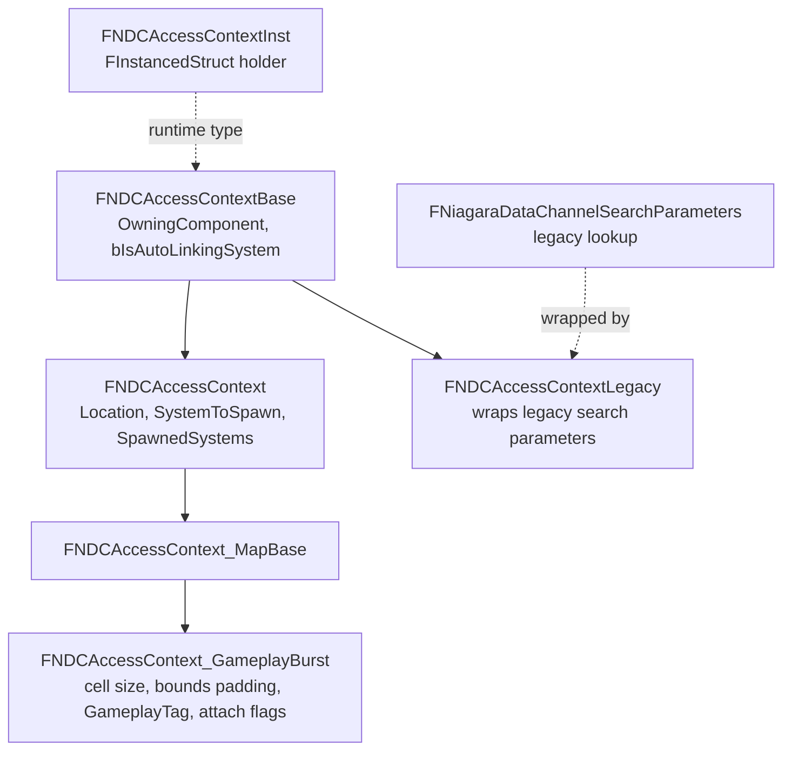

# 06 — Access Context

The access context is the key that `FindData` uses to resolve a channel to a data object (`NiagaraDataChannelHandler.h:53`). Every channel type declares which context struct it expects through `GetAccessContextType()` (`NiagaraDataChannel.h:70`, default `FNDCAccessContextLegacy`), and the channel keeps a transient instance for that type (`GetTransientAccessContext()` `:73`, implementation `:146-151` with `check(IsInGameThread())`).

## Hierarchy

| Type | Anchor | Fields |
|---|---|---|
| `FNiagaraDataChannelSearchParameters` | `NiagaraDataChannelAccessContext.h:15-56` | legacy lookup key (owner, channel) |
| `FNDCAccessContextBase` | `:71-95` | `OwningComponent` `:87`, `bIsAutoLinkingSystem` `:94` |
| `FNDCSpawnedSystemRef` | `:99-110` | weak reference to a spawned system |
| `FNDCAccessContext` | `:117-176` | `Location` `:147`, `bOverrideLocation` `:151`, `bOverrideSystemToSpawn` `:155`, `bReturnExistingSystems` `:159`, `SystemToSpawn` `:162`, `SpawnedSystems` `:169`, `ForEachSpawnedSystem` `:172`, `GetSpawnedSystems` `:175` |
| `FNDCAccessContextLegacy` | `:180-213` | the only context that falls through to the legacy `FindData` path (`NiagaraDataChannelHandler.cpp:251-257`) |
| `TNDCAccessContextType` | `:217-233` | `check(AccessContextStruct)` `:223` |
| `FNDCAccessContextInst` | `:242-277` | `Init` `:252`, `Reset` `:260`, `GetChecked<T>` `:268`, `Get<T>` `:271`, `GetScriptStruct` `:273`, `FInstancedStruct` `:276` |

`ForEachSpawnedSystem` and `GetSpawnedSystems` skip dead weak references (`NiagaraDataChannelAccessContextImpl.h:8-17,20-29`). Input/output markers `NDCAccessContextInput` and `NDCAccessContextOutput` distinguish caller-supplied fields from results (`NiagaraDataChannelAccessContext.h`).

## Reference and type repair

`FNiagaraDataChannelReference` (`NiagaraDataChannelReference.h:12-37`) pairs an asset reference with a context: `GetDataChannel` `:16`, `GetAccessContext` `:18`, `GetUsableAccessContext` `:20`, `SetDataChannel` `:21`, `OnValueChanged` `:22`, `bCustomAccessContext` `:32`, `InitAccessContext` `:36`.

`GetUsableAccessContext` (`NiagaraDataChannelReference.cpp:15-32`) copies the reference's context into the channel's transient context when `bCustomAccessContext && AccessContext.IsValid()` (`:23-27`) and returns the transient one; otherwise it returns a static `Dummy` (`:30-31`). `InitAccessContext(bool bTransferExisting)` (`:34-81`) re-types the instanced struct when the channel type changed — the comment at `:36-37` states this is needed because a user can change the NDC type — copying matching properties by name and type from the old struct (`:48-68`), and `AccessContext.Reset()` on failure to avoid memory bloat (`:80`). `SetDataChannel` `:83-90`, `OnValueChanged` `:92-102`.

Data interfaces follow the same rule: the read DI skips context creation for the legacy type (`NiagaraDataInterfaceDataChannelRead.cpp:684-687`), re-inits on struct mismatch (`:688-691`) and resets when auto-linking (`:693-696`); the write DI resets the context for the legacy type (`NiagaraDataInterfaceDataChannelWrite.cpp:1245-1248`). The read DI's `AccessContext` property is `meta = (ShowOnlyInnerProperties, EditCondition="!bAutoLinkToSpawningNDC")` (`NiagaraDataInterfaceDataChannelRead.h:85`) because auto-linking resolves the context from the spawning system instead (`bAutoLinkToSpawningNDC = true` default `:89-90`; `Tick` copies the context and sets `OwningComponent`/`bIsAutoLinkingSystem` at `NiagaraDataInterfaceDataChannelRead.cpp:498-510`). The write DI sets `BaseContext.OwningComponent = Instance->GetAttachComponent()` (`NiagaraDataInterfaceDataChannelWrite.cpp:320`).

Blueprint nodes refuse mismatched context pins: `IsConnectionDisallowed` rejects `FNDCAccessContextInst` pins whose struct differs from the channel's `GetAccessContextType()` with reason "Invalid Type For Access Context Pin." (`K2Node_DataChannelBase.cpp:103-137`, `:124`), and the comment at `:105-111` notes the reason is rarely surfaced because context menus show unrelated entries.

## Blueprint access to contexts

`UNiagaraDataChannelLibrary` exposes context helpers as `UFUNCTION`s (`NiagaraDataChannelFunctionLibrary.h:226-268`): `GetUsableAccessContextFromNDC` `:227-228` (impl `:389`), `GetUsableAccessContextFromNDCRef` `:231-232` (impl `:399`), `PrepareAccessContextFromNDCRef` `:239-240`, `MakeNDCAccessContextInstance` CustomThunk `:243-244` (impl `:130-148`), `Get/SetMembersInNDCAccessContextInstance` `:249-256` (impl `:106-117`), `Get/SetSinglePropertyInNDCAccessContextInstance` CustomThunk `:261-268` (impl `:150-192`, `:194-256`), plus `DECLARE_FUNCTION(exec...)` `:271-273`.

The thunks exist because an instanced struct has no static type in Blueprint: `execMakeNDCAccessContextInstance` throws `EBlueprintExceptionType::AbortExecution` when the supplied struct is not a child of `FNDCAccessContextBase` (`:135-147`); `execGetSinglePropertyInNDCAccessContextInstance` reads a wildcard property through `Stack.StepCompiledIn<FProperty>` (`:157-159`) and `CopyCompleteValue` (`:174`), aborting on a missing property (`:178-181`) and reporting a non-fatal error for a non-child struct (`:187-190`); `execSetSinglePropertyInNDCAccessContextInstance` special-cases bit-field `FBoolProperty` (`:219-234`), aborts on type mismatch (`:229-232`) and on a missing destination property (`:242-245`).

Node classes for these: `UK2Node_DataChannelAccessContextOperation : UK2Node_CallFunction` (`K2Node_DataChannel_WithContext.h:98-138`) with `ShowPinForProperties` (`:125`), `ContextStruct` with `meta=(BaseStruct="/Script/Niagara.NDCAccessContextBase")` (`:127-128`) and `ExpandNodeOptionalPins(..., FName PerPropertyFuncName)` (`:135`); subclasses `UK2Node_DataChannelAccessContext_Make` `:141-160`, `_GetMembers` `:164-182`, `_SetMembers` `:186-205`, `_Prepare` `:209-228`.

## Auto-linking

Map channels resolve an auto-linking context through `CurrentlyInitializingEntry` (`NiagaraDataChannel_Map.h:263-264`, used `NiagaraDataChannel_Map.cpp:192-198`) or the reverse map `SpawnedComponentsToActiveEntry` (`:276-277`, used `:204-208`) — a spawned system asking for its own data gets the entry that spawned it, and `FindData` resets `SpawnedSystems` on each call (`:184`). Islands use the legacy path with `Island.IsHandlerSystem(owner)` (`NiagaraDataChannel_Islands.cpp:210-220`).

## What a tech artist must know

- A context is a lookup key, not a parameter bag: the wrong context type produces a warning (`NiagaraDataChannelHandler.cpp:215-229`) and a null data pointer (`:239-259`).
- Changing the channel type re-types existing contexts by copying matching properties by name (`NiagaraDataChannelReference.cpp:48-68`); properties that do not exist on the new type are silently lost.
- `GetUsableAccessContext` mutates the channel's transient context (`NiagaraDataChannelReference.cpp:23-27`) — two references sharing one channel can overwrite each other's context.
