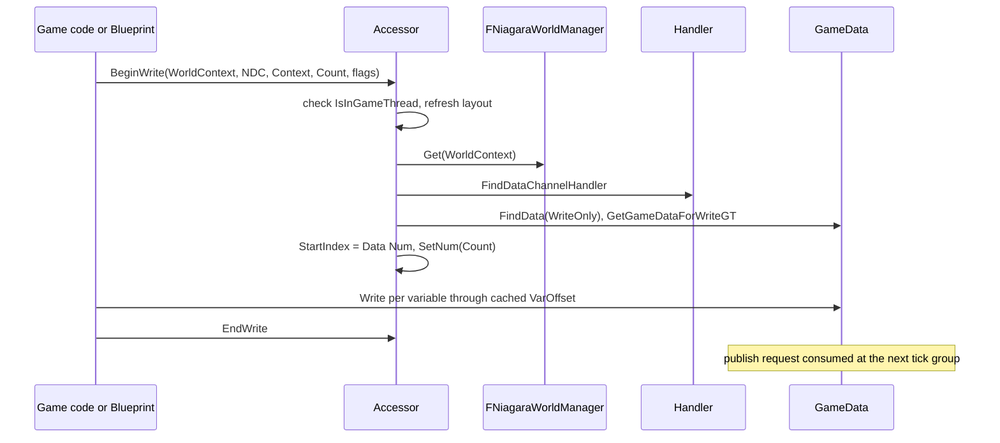

# 07 — Programmer Query API (deep dive)

Three surfaces reach a data channel from game code: the **C++ accessor structs** (`FNDCWriterBase`/`FNDCReaderBase` plus per-variable accessors), the **Blueprint function library** (`UNiagaraDataChannelLibrary`), and the **Blueprint nodes** (`UK2Node_DataChannelBase` subclasses). All three resolve to the same handler call: `FindData(AccessContext, AccessType)` (`NiagaraDataChannelHandler.h:53`).

## C++ accessors

`FNDCAccessorBase` (`NiagaraDataChannelAccessor.h:258-279`) holds `CachedLayout` (`:264`), `VariableAccessors` (`:267`), `StartIndex` (`:270`), `IsInitialized()` (`:274-275`) and `Init(DataChannel)` (`:278`). `FNDCVarAccessorBase` (`:288-330`) caches `Variable` (`:292`), `VarOffset:31` and `bIsRequired:1` (`:294-295`), `IsValid()` is `VarOffset != INDEX_NONE` (`:301`), and `WriteInternal`/`ReadInternal` (`:311-319`, `:321-329`) delegate to `Data->Write<T>` / `Data->Read<T>` — so a variable that is not in the layout returns `false`, it does not throw.

`FNDCWriterBase` (`:333-363`): `Data` (`:337`), `StartIndex` (`:340`, non-zero when writing into the middle of an existing buffer), `Count` (`:343`), `BeginWrite_Internal<TContext>` (`:345-346`), two public overloads — context (`:353`) and legacy search parameters (`:355-356`, commented as not supporting newer NDC types), `EndWrite()` (`:359`), `DebugSource` (`:362`). `FNDCReaderBase` (`:378-400`): `Data` (`:381`), `bPreviousFrame` (`:382`), `BeginRead_Internal` (`:384-385`), context and legacy `BeginRead` (`:390,393`), `EndRead()` (`:396`), `Num()` (`:398`). RAII wrappers `FNDCScopedWriter` (`:366-375`, `EndWrite` in the destructor) and `FNDCScopedReader` (`:403-412`).

Per-variable accessors are generated by macros (`:451-472`): `NDCVarWriter` (required), `NDCVarWriterOptional` (`:457`), `NDCVarReader` (required), `NDCVarReaderOptional` (`:469`). Each macro creates a `FNDCVarWriter<T>`/`FNDCVarReader<T>` member (`:416-432`, `:435-447`) plus a named `Write<VarName>(Index, Value)` / `Read<VarName>(Index, Out)` function bound to `Data`, `StartIndex`, `Count` and `bPreviousFrame`. Required variables warn when missing from the channel; optional ones are skipped with minimal overhead (doc comment `:182-183`). `FNDCPackedData` (`:474-529`) packs several small values into one `uint32` with `static_assert`s at `:484-489`, exposed through `NDCVarPackedValue` (`:531-533`).

The pattern the header documents (`:176-250`):

```cpp
struct FNDCExampleWriter : public FNDCWriterBase
{
    FNDCVarWriter(FNiagaraPosition, Position);
    FNDCVarWriter(FVector, Velocity);
    FNDCVarWriter(bool, bSomeValue);
};

FNDCScopedWriter ScopedWriter(ExampleWriter);
if (ScopedWriter->BeginWrite(MyWorld, DataChannel, SearchParameters, NumItems,
        bVisibleToGame, bVisibleToCPU, bVisibleToGPU))
{
    for (int32 i = 0; i < NumItems; ++i)
    {
        ScopedWriter->WritePosition(YourData[i].Position);
        ScopedWriter->WriteVelocity(YourData[i].Velocity);
        ScopedWriter->WritebSomeValue(YourData[i].bBoolValue);
    }
}   // EndWrite runs on scope exit
```

Two documented cautions: provide positions as `FNiagaraPosition`, not `Vector`, so Niagara interprets them as LWC positions (`:184`); enum types may target integer types in the channel (`:185`).

### What BeginWrite actually does

`BeginWrite_Internal` (`NiagaraDataChannelAccessorImpl.h:15-59`): `ensure` that `Data` is null before starting (`:18`), re-init the layout if the channel changed (`:22-26`), `ValidateLayout()` (`:28-33`), `check(IsInGameThread())` (`:35`), `GetWorldFromContextObject` (`:36`), `FNiagaraWorldManager::Get` (`:39`), `FindDataChannelHandler` (`:41`), `FindData(AccessContext, WriteOnly)` (`:43`), `GetGameDataForWriteGT` (`:46`), then `StartIndex = Data->Num()` (`:49`), `Count` (`:50`) and `SetNum` (`:51`). `BeginRead_Internal` (`:61-99`) is the same shape with `FindData(ReadOnly)` (`:89`) and `Data = NDCData->GetGameData()->AsShared()` (`:91`).

Consequences: accessors are game-thread only (`:35,81`); a write allocates `Count` rows starting at the current end of the buffer, so a writer that does not call `EndWrite` leaves a half-filled buffer; `Count` is capped by what the staging slot can hold (`NiagaraDataChannelData.cpp:449-463`).

Missing-variable behaviour is configurable: `fx.Niagara.DataChannels.MissingNDCAccessorMode` — 0 silent, 1 log warning, 2 ensure once, 3 ensure always (`NiagaraDataChannelAccessor.cpp:20-32`), forced to 0 when `DEBUG_NDC_ACCESS` is off (`:30`, macro at `NiagaraDataChannelAccessor.h:174`). `FNDCAccessorBase::Init` (`:345-394`) collects missing required variables and logs them listing the channel's variables (`:369-383`), then `ensureMsgf`/`ensureAlwaysMsgf` (`:385-392`). `FNDCVarAccessorBase::Init` (`:314-340`) resolves `VarOffset` from `GameDataLayout.VariableIndices` with the enum→`int` fallback (`:330-338`).

## Blueprint function library

`UNiagaraDataChannelLibrary` (`NiagaraDataChannelFunctionLibrary.h:24-274`) with result enum `ENiagartaDataChannelReadResult` (`:14-18`, spelled as in source). Legacy block (`:32-133`): `WriteToNiagaraDataChannel` `:49-50`, `ReadFromNiagaraDataChannel` `:64-65`, `GetDataChannelElementCount` `:79-80`, `SubscribeToNiagaraDataChannel` `:92-93`, `UnsubscribeFromNiagaraDataChannel` `:102-103`, `ReadFromNiagaraDataChannelSingle` `:118-119`, `WriteToNiagaraDataChannelSingle` `:132-133`. Context block (`:137-216`): `ReadFromNiagaraDataChannel_WithContext` `:147-148`, `WriteToNiagaraDataChannel_WithContext` `:162-163`, `GetDataChannelElementCount_WithContext` `:175-176`, `SubscribeToNiagaraDataChannel_WithContext` `:187-188`, `ReadFromNiagaraDataChannelSingle_WithContext` `:202-203`, `WriteToNiagaraDataChannelSingle_WithContext` `:215-216`. Non-`UFUNCTION` C++ helpers `:218-223`; context helpers `:226-268` (see [06](06_Access_Context.md)).

Implementations (`NiagaraDataChannelFunctionLibrary.cpp`): `GetNiagaraDataChannel` `:24`, legacy write/read/count `:29-51`, single-element variants `:51-63`, context variants `:64-98`, `MakeNDCAccessContextInstance` `:99`, member get/set `:106-117`, single property get/set `:118-129`, `SubscribeToNiagaraDataChannel` `:260-266` and `_WithContext` `:268`, `Unsubscribe` `:276`, `FindDataChannelHandler` `:284`, `CreateDataChannelWriter` `:297`, `CreateDataChannelReader` `:320`, `_WithContext` `:343`/`:366`, `GetUsableAccessContextFromNDC` `:389`, `FromNDCRef` `:399`.

The single-element functions carry the latency warning in their doc text: the element is not immediately visible, the earliest point it can be read is the next tick group (`NiagaraDataChannelFunctionLibrary.h:123`).

## Blueprint nodes

`UK2Node_DataChannelBase` (`K2Node_DataChannelBase.h:12-63`, `MinimalAPI, Abstract, NotBlueprintable`) holds `DataChannel` as a `TObjectPtr<UNiagaraDataChannelAsset>` (`:62`), `IgnoredVariables` (`:40`), `DataChannelVersion` under `WITH_EDITORONLY_DATA` (`:47-50`), `SupportsDynamicDataChannel()` default false (`:53`), `AddNDCDerivedPins`/`RemoveNDCDerivedPins` (`:55-56`), `NDCDerivedGeneratedPins` (`:57`).

`AllocateDefaultPins` marks the `Channel` pin `bNotConnectable = true` when the node does not support dynamic channels (`K2Node_DataChannelBase.cpp:50-70`, `:53-59`), preloads the asset (`:61`) and adds derived pins in the editor (`:63-69`). `ExpandNode` errors "Node does not have a valid data channel" (`:85-89`) or the out-of-sync message on version mismatch (`:93-97`), then `ExpandSplitPins` (`:100`).

Read nodes create one **output** pin per channel variable with `PersistentGuid = InVar.Version` (`K2Node_ReadDataChannel.cpp:27-48`, `:44`), skipping `IgnoredVariables` (`:35-38`); the external function is `ReadFromNiagaraDataChannelSingle` (`:22-25`) and `GetReadFunctionForType` maps types (`:185`). Write nodes create one **input** pin per variable (`K2Node_WriteDataChannel.cpp:23-44`, `:40`) and `ExpandNode` spawns an intermediate `UK2Node_CallFunction` to initialise the writer object before the write call (`:46-151`, `:56-62`), with `GetWriteFunctionForType` at `:153`.

`_WithContext` variants (`K2Node_DataChannel_WithContext.h`) override the function names: `UK2Node_WriteDataChannelSingle_WithContext` → `WriteToNiagaraDataChannel_WithContext` (`:67-74`, `:73`), `UK2Node_ReadDataChannelSingle_WithContext` → `ReadFromNiagaraDataChannel_WithContext` (`:82-89`, `:88`), plus `UK2Node_WriteDataChannel_WithContext` `:25-32`, `UK2Node_ReadDataChannel_WithContext` `:38-45`, `UK2Node_DataChannelGetNum_WithContext` `:52-60`; all report `SupportsDynamicDataChannel() = true` (`:31,44,59`).



## Query semantics

- Access types are `ReadOnly` and `WriteOnly` (`NiagaraDataChannelHandler.h:47,53`); the accessor uses `WriteOnly` in `BeginWrite` (`NiagaraDataChannelAccessorImpl.h:43`) and `ReadOnly` in `BeginRead` (`:89`).
- `Num()` on a reader reports the game data count (`NiagaraDataChannelAccessor.h:49,398`); the read data interface reports `GetNumInstances()` (`NiagaraDataInterfaceDataChannelRead.cpp:1389-1392`).
- Reading the previous frame is explicit: `bReadingPreviousFrame` on the Blueprint reader object (`NiagaraDataChannelAccessor.h:26`), `bPreviousFrame` on the C++ reader base (`:382`), `bPreviousFrame` argument to `GetCPUData` (`NiagaraDataChannelData.h:114`).
- `DebugSource` (`NiagaraDataChannelAccessor.h:362`) is what the debug log prints per write (`NiagaraDataChannelDebugUtilities.cpp:88,138`).

## What a programmer must know

- Accessors cache `VarOffset` per variable and re-init when the channel layout changes (`NiagaraDataChannelAccessor.h:264,285`); in non-shipping builds `ValidateLayout()` asserts the cached layout is still current (`:303-309`).
- Required vs optional is a compile-time choice with different failure modes: required warns (`:369-392`), optional returns false silently (`:314-318`).
- Everything in the accessor path is game-thread (`NiagaraDataChannelAccessorImpl.h:35,81`); the render thread only sees the proxy (`NiagaraDataChannelData.h:25-90`).
