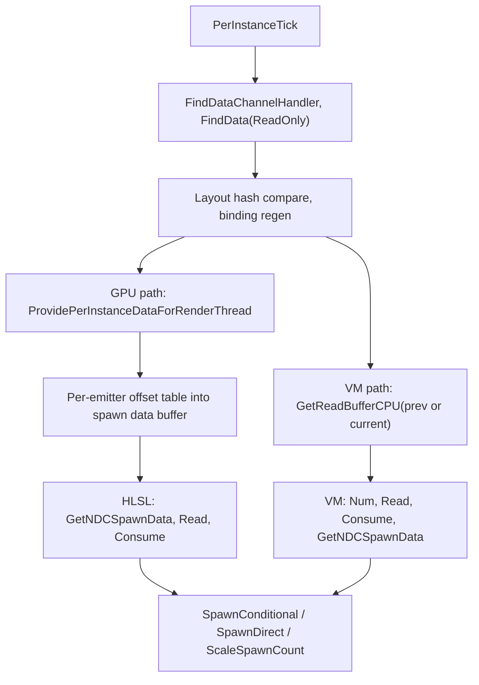

# 08 — Data Interfaces: Read and Write

Two data interfaces expose a channel to Niagara scripts: `UNiagaraDataInterfaceDataChannelRead` (`NiagaraDataInterfaceDataChannelRead.h:64-225`) and `UNiagaraDataInterfaceDataChannelWrite` (`NiagaraDataInterfaceDataChannelWrite.h:4-17`). Both are registered in the type registry only when NDC is enabled (`NiagaraModule.cpp:179-181`), and the read DI registers with `AllowNotUserVariable | AllowParameter` flags (`NiagaraDataInterfaceDataChannelRead.cpp:622-631`).

## Read data interface

Header doc (`NiagaraDataInterfaceDataChannelRead.h:4-19`): per-instance buffer selection, variadic accessor functions, and a local-read TODO at `:17-18` — `GetEmitterDependencies` is entirely commented out (`NiagaraDataInterfaceDataChannelRead.cpp:996-1026`) and the local-read branch in `GetReadBufferCPU` is commented out (`:340-347`).

| Setting | Default | Anchor |
|---|---|---|
| `Channel` | asset reference | `:81-82` |
| `AccessContext` | `EditCondition="!bAutoLinkToSpawningNDC"` | `:85-86` |
| `bAutoLinkToSpawningNDC` | `true` | `:89-90` |
| `bReadCurrentFrame` | `false` | `:103-104`, tradeoff comment `:92-102` |
| `bUpdateSourceDataEveryTick` | `true` | `:113-114` |
| `bOverrideSpawnGroupToDataChannelIndex` | `false` | `:126-127`, GPU emitters handle 8 spawns per frame `:123` |
| `bOnlySpawnOnceOnSubticks` | `true` | `:135-136` |

VM functions: `Num` `:197`, `Read` `:198`, `Consume` `:199`, `GetNDCSpawnData` `:201`, `SpawnConditional` `:204`, `SpawnDirect<T>` `:207`, `ScaleSpawnCount<T>` `:210`. Spawn modes `ENDIDataChannelSpawnMode` `:32-44` (`Override`, `Accumulate`, `None`); scale modes `:48-57` (`Override`, `Scale` — the comment at `:53-54` notes two 0.5 scales compound to 0.25).

Script hooks: `HasPreSimulateTick` `:175`, `HasPostSimulateTick` `:176`, `HasPostStageTick` `:177`, `PostSimulateCanOverlapFrames()` false `:188`, `PostStageCanOverlapTickGroups()` false `:189`, `RequiresCurrentFrameNDC()` `:191`, `GetGpuCountBufferEstimate()` 1 `:193`.

Per-instance data (`:274-330`): weak handler (`:284`), `DataChannelData` (`:287`), `ChachedDataSetLayoutHash` (`:290`), `bUpdateFunctionBindingRTData` (`:293`), `FuncToDataSetBindingInfo` with `TInlineAllocator<8>` (`:298`). `FNDIDataChannelRead_EmitterSpawnData` holds `NDCSpawnDataBuckets[16]` (`:227-237`, `:230`); `FNDIDataChannelRead_EmitterSpawnInfo::Get()` is `Count * Scale` clamped to `MAX_int32` (`:246-250`).

Runtime path (`NiagaraDataInterfaceDataChannelRead.cpp`): `Tick` `:392-607` returns early when unused (`:403-407`), resolves the handler through `WorldMan->GetDataChannelManager().FindDataChannelHandler` (`:477-489`), copies the access context and sets `OwningComponent`/`bIsAutoLinkingSystem` (`:498-510`), falls back to the legacy path (`:512-517`), warns on tick-order violation (`:520-534`), compares layout hashes and regenerates bindings through `FNDIDataChannelLayoutManager` (`:536-562`), warns on missing parameters (`:566-581`), validates bindings (`:593-604`). `PostTick` `:609-614`. `PerInstanceTick` `:736-758` (`STAT_NDIDataChannelRead_Tick` `:738`, returns true when NDC is disabled `:741-744`), `PerInstanceTickPostSimulate` `:760-782` (`:762`).

`PostStageTick` `:784-905`: `check(Usage == EmitterUpdateScript || SystemUpdateScript)` (`:789`), `NDCElementCountAtSpawn` (`:791-808`), per-NDC spawn counts (`:810-815`), stateful emitter handling (`:820`), per-entry `SpawnInfo` with `SpawnGroup = i` when overriding (`:822-836`) or a single combined `SpawnInfo` otherwise (`:837-846`), then the power-of-two indirection table: 16 buckets, `BucketSize = (1 << 15) >> Bucket` (`:874`), `check(EndSize - StartSize == SpawnDataBuckets[Bucket])` (`:900`).

`ProvidePerInstanceDataForRenderThread` `:907-994`: `bReadPrevFrame = bReadCurrentFrame == false || GNDCReadForcePrevFrame` (`:915`; CVar `fx.Niagara.DataChannels.ForceReadPrevFrame` `:58-64`, default `false`), `ScriptParamInfo.Init(CompiledData, GPUCompiledData)` only when `bUpdateFunctionBindingRTData` (`:919-925`), per-emitter offset table `+ (MaxEmitterIndex + 1)` (`:956-962`), offsets written per emitter (`:980-983`), emitters without a GPU context skipped (`:971-974`).

VM implementations: `Num` `:1379-1398` (`GetReadBufferCPU(bReadPrevFrame)`, `Num = Buffer->GetNumInstances()` only when NDC is enabled `:1389-1392`); `Read` `:1583-1663` with `FNDIVariadicOutputHandler<16>` (`:1593`), per-instance guard `Index < Data->GetNumInstances()` (`:1606`), per-register lambda writing 0 and setting `bAllReadsSuccess = false` when `GetDataSetRegisterIndex() == INDEX_NONE` (`:1609-1621`); `Consume` `:1665-1781` with `Index = InstData->ConsumeIndex++` (`:1697`) — the comment at `:1694-1696` explains the index may temporarily exceed max, which avoids a compare-exchange; `GetNDCSpawnData` doc block `:1400-1429`, body `:1430-1581` (16 buckets, bucket-counts array then entries, per-emitter offset, second pass for `OutNDCSpawnIndex`); `SpawnDirect` `:1924-1999` (`check(Context.GetNumInstances() == 1)` `:1927`, `bProcessCurrentTick = bOnlySpawnOnceOnSubticks ? TickNumber == TickCount - 1 : true` `:1954`); `ScaleSpawnCount` `:2002-2076` (`bApplyScale` gate `:2031`, `bOverrideScale` `:2035`).

Tick group: `HasTickGroupPrereqs` `:1028-1039` uses `GNDCReadForceTG` (CVar `fx.Niagara.DataChannels.ForceReadTickGroup` `:50-56`, default `-1`) else `ShouldEnforceTickGroupReadWriteOrder()`; `CalculateTickGroup` `:1041-1053` returns `GetFinalWriteTickGroup() + 1`, else `NiagaraFirstTickGroup`.

Proxy: constructed in the ctor `:616-620`; `PreStage` `:2229-2255` calls `PrepareForReadAccess` (`:2237`), `AcquireEntry` for `ConsumeInstanceCountOffset` (`:2242-2245`) and `CreateUploadBuffer<int32>(..., TEXT("Niagara_NDCReadDI_NDCSpawnData"), ...)` (`:2249-2252`); `PostStage` `:2257-2268` `EndReadAccess`; `PostSimulate` `:2270-2284` frees the count entry on the final post simulate; `GetDispatchArgs` `:2332-2346` `SetDirect(Data->GetNumInstancesAllocated())` with the indirect args TODO at `:2340-2342`.

## Write data interface

Header doc (`NiagaraDataInterfaceDataChannelWrite.h:4-17`): writes go into an intermediate buffer and are published on post tick, which avoids races at the cost of a copy. `FNDIDataChannelWriteCompiledData` (`:30-39`) builds `DataLayout` from `FuncInfo.Inputs` only (`NiagaraDataInterfaceDataChannelWrite.cpp:238-242`) and `BuildLayout()` (`:244`). SimCache structures `:42-94`.

VM functions: `Num` `:1260-1277` (`Buffer->GetNumInstancesAllocated()`), `Write` `:1300-1414`, `Append` `:1416-1626`; `Allocate` is commented out of the function list (`:1203`). `Append` honours `bOnlyWriteOnceOnSubticks` (`:1429-1434`), has a constant-`InEmit` fast path (`:1445-1449`) and `AtomicNumInstances.fetch_add(LocalNumToEmit)` (`:1467`) — `std::atomic<uint32> AtomicNumInstances` (`:282`).

`Tick` `:326-471`: `LwcTile = Instance->GetLWCTile()` (`:333`), `ShouldPublish()` gate (`:334`), handler lookup (`:342`), missing-parameter warning (`:364-368`), `IsLayoutValid` + `bUpdateDestinationDataEveryTick` (`:385-387`), `FindData(AccessContext, WriteOnly)` (`:390`) versus the legacy `SearchParams(Instance->GetAttachComponent())` (`:395-396`), `GetBufferForCPUWrite()` (`:407`), `Allocate(AllocationCount)` for `Static` allocation mode (`:408-410`), `ZeroCPUBuffers()` gated by `GbNDCWriteDIZeroCPUBufferMode` (`:415-419`, CVar `fx.Niagara.DataChannels.WriteDIZeroCPUBuffersMode` default 1 `:58-64`), `check(CPU hash == GPU hash)` (`:426`), binding regeneration on hash change (`:433-450`), `ensure(Num()==Num())` plus warning (`:455-468`).

`PostSimTick` `:473-507`: clamp `AtomicNumInstances` to allocated (`:478-480`), `Dump` when `GbDebugDumpWriter` (`:482-485`, CVar `fx.Niagara.DataChannels.DebugDumpWriterDI` `:51-56`), `PublishRequest(DestinationData->UnlockForRead())` (`:489`), visibility flags (`:490-492`), `DebugSource` under `WITH_NIAGARA_DEBUGGER` (`:494-496`), `DataChannelData->Publish` (`:497`).

Allocation mode `ENiagaraDataChannelAllocationMode` (`NiagaraDataInterfaceDataChannelCommon.h:14-21`): `Static`, `Dynamic` hidden (`:21`); the wizard defaults to `Static` with `AllocationCount = 1` (`NiagaraDataChannelWizard.h:156,160`).

GPU write is append-only: `GetFunctionHLSL` exposes only `Num` and `Append` (`NiagaraDataInterfaceDataChannelWrite.cpp:1648-1653`, `Write` commented out at `:1651`), and the GPU `Write` template body is empty with the comment "All writes now done with append … can't work on GPU as we're all writing concurrently to a single shared buffer" (`Shaders/Private/DataChannel/NiagaraDataInterfaceDataChannelTemplate_Write.ush:10-15`, `:12-13`).

## What a tech artist must know

- `bReadCurrentFrame` is the latency switch; the default is previous frame (`NiagaraDataInterfaceDataChannelRead.h:103-104`), and the DI's tick group is `FinalWriteTickGroup + 1` when ordering is enforced (`NiagaraDataInterfaceDataChannelRead.cpp:1041-1053`).
- GPU emitters can only handle 8 individual spawns per frame, which is why `bOverrideSpawnGroupToDataChannelIndex` defaults to false (`:123,126-127`); assets authored before the `NDCSpawnGroupOverrideDisabledByDefault` custom version get it forced on (`:644-647`).
- Write DI data is not visible until post tick publish (`NiagaraDataInterfaceDataChannelWrite.h:4-17`, `...Write.cpp:489-497`).
- `Consume` and `Append` indices can transiently exceed the buffer size (`NiagaraDataInterfaceDataChannelRead.cpp:1694-1696`, `NiagaraDataInterfaceDataChannelTemplateWriteCommon.ush:88-89`) — clamped by `InterlockedMin` (`...TemplateReadCommon.ush:65-88`, `...TemplateWriteCommon.ush:80-104`).
