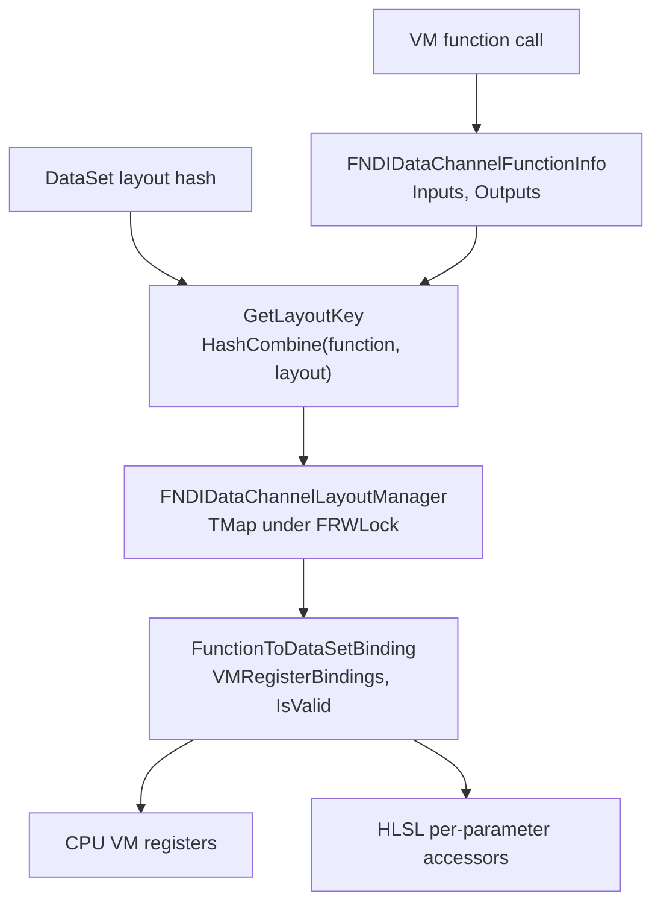

# 09 — GPU Execution and Shader Binding

Both data interfaces share one compiled-data and binding layer (`NiagaraDataInterfaceDataChannelCommon.h`), so a script function call resolves to a buffer, a stride and a register index rather than a fixed parameter slot.

## Compiled data and layout key

`FNDIDataChannelCompiledData` (`:162-219`) records what a script actually uses: `Init` `:167`, `FindFunctionInfoIndex` `:169`, `UsedByCPU()` `:174`, `UsedByGPU()` `:175`, `NeedSpawnDataTable()` `:176`, `SpawnsParticles()` `:177`, `CallsWriteFunction()` `:178`, `GetTotalParams()` `:179`, `GatherAccessInfo()` `:218`. `GatherAccessInfo` (`NiagaraDataInterfaceDataChannelCommon.cpp:183-258`) builds `FunctionInfo` from VM functions (`:186-199`), sets `bUsedByCPU` (`:200`), `GetNDCSpawnData` → `bNeedsSpawnDataTable` (`:202-205`), `SpawnConditional`/`SpawnDirect` → `bSpawnsParticles` (`:207-210`), `Write` → `bCallsWrite` (`:212-215`), keys the GPU script parameter table by `BaseScriptCompileHash` (`:229-230`) and sorts parameters (`:252-257`).

`FNDIDataChannelLayoutManager` (`:117-146`) is the shared cache: `TMap<uint32, FNDIDataChannel_FunctionToDataSetBinding>` (`:120`) under `FRWLock` (`:126`), key `HashCombine(GetTypeHash(FunctionInfo), DataSetLayout.GetLayoutHash())` (`:137-140`), `GetLayoutInfo` (`:145`) with a read-lock fast path (`NiagaraDataInterfaceDataChannelCommon.cpp:161-166`) and write-lock insert (`:170-172`). Console command `fx.Niagara.DataChannels.ResetLayoutInfo` clears it (`:13-22`). The read DI re-queries it on hash change (`NiagaraDataInterfaceDataChannelRead.cpp:536-562`), the write DI on hash change (`NiagaraDataInterfaceDataChannelWrite.cpp:433-450`).

`FNDIDataChannel_FunctionToDataSetBinding` (`:87-107`) holds `VMRegisterBindings` (`:90`), component counts (`:92-94`), `FunctionLayoutHash`/`DataSetLayoutHash` (`:95-96`), `IsValid()` (`:105`) and `GenVMBindings()` (`:106`). The constructor (`...Common.cpp:25-63`) records both hashes (`:32-33`) and collects missing parameters only in non-shipping builds (`:52-54`). `GenVMBindings` (`:65-98`) pairs float/half/int/bool registers (`:70-85`), recurses into structs (`:87-90`) and `checkf`s on an unsupported property (`:93`), setting `DataSetLayoutHash = 0` so the binding is invalid (`:94`). `FNDIDataChannelRegisterBinding` (`:62-83`) packs `RegisterBits = 30` and `DataTypeBits = 2` with `check`s at `:71-72`. `FNDIDataChannelFunctionInfo` (`:41-57`) carries variadic `Inputs`/`Outputs` and `CheckHashConflict` (`:56`).

## HLSL generation

`NDIDataChannelUtilities::GenerateDataChannelAccessHlsl` (`:258`, called from `GetParameterDefinitionHLSL` at `...Read.cpp:2106-2115` and `...Write.cpp:1655-1664` via `BuildFunctionTemplateMap`) emits one function per parameter: `Read_{Param}_{ParameterName}` calls `Context.InitForParameter` (`...Common.cpp:404-414`), `Write_...` calls `InitForGPUWrite()` then `InitForCPUWrite()` (`:419-436`). Function-name FNames are cached at `:246-249`; `SortParameters` `:255`; dummy UAV getters `:221-242` (`FNDIDummyUAV`). `FNDIVariadicInputHandler<EXPECTED_NUM_INPUTS>` (`:266-331`) uses `TInlineAllocator` and a `switch` on `ENiagaraBaseTypes` (`:282-289`).

Shader files (`Shaders/Private/DataChannel/`):

| File | Role | Key anchors |
|---|---|---|
| `...Common.ush` | base type accessors | `NIAGARA_DATACHANNEL_BINDLESSBUFFERS 0` `:12` (bindless TODO `:11-15`); `NiagaraDataChannelRead_Float` `:17-28` (`InBuffer[RegisterIdx * Stride + ParticleIdx]`, returns 0 when `RegisterIdx == -1`), vector overloads `:30-49`, `Read_Int32` `:51-83`, `Read_Bool` `:85-97`, half accessors commented out `:99-134`; `Write_Float` `:138-166`, `Write_Int32` `:168-196`, `Write_Bool` writes `0xFFFFFFFF`/`0` `:198-205`, half write commented `:207-238`; "TODO: More base type accessors" `:240` |
| `...TemplateCommon.ush` | parameter layout | `Buffer<uint> {ParameterName}_ParamOffsetTable` `:10`, `GetParameterLayoutInfo_{ParameterName}` `:18-36` (`NumComponents = 2` `:23`, returns false when both registers are `-1` `:28`), float/int strides `:13-14` |
| `...TemplateReadCommon.ush` | read context | buffers `:7-8`, `InstanceCountOffset` `:13`, `ConsumeInstanceCountOffset` `:16`, `BufferSize` `:18`, `NDCElementCountAtSpawn` `:20`, `NDCSpawnDataBuffer` `:24`; `FNDCAccessContext_{ParameterName}` `:27-131` with `Num()` `:63`, `GetConsumeIndex()` `InterlockedAdd` + `InterlockedMin` clamp `:65-88`, `InitDirect` `:90-95`, `InitConsume` `:97-102`, `InitForParameter` `:104-113`, typed wrappers `:115-125`; `Num_{ParameterName}` `:133-143`; `GetNDCSpawnData_{ParameterName}` `:145-267` (layout documented `:158-170`, per-emitter offset `:187`, `NDCSpawnData_NDCCountsStart = offset + 16` `:198`, `UNROLL` 16-bucket loop `:204-223`, second pass `:225-260`) |
| `...TemplateWriteCommon.ush` | write context | GPU shared buffers `:9-10`, `GPUInstanceCountOffset` `:15`, `GPUBufferSize` `:16`, separate CPU buffers `:21-31`; `FNDCAccessContext_{ParameterName}` `:34-165` with `bReadGPUOrCPU` `:55`, stride selection `:57-58`, `ShouldWriteGPUData`/`ShouldWriteCPUData` `:77-78`, `GetAppendIndex` `InterlockedAdd` + clamp `:80-104`, `InitAppend` `:107-116`, `InitForParameter` `:119-123`, `InitForGPUWrite` `:126-135`, `InitForCPUWrite` `:138-147`, typed wrappers `:149-159` |
| `...Template_Append.ush` | append function | `:8-25` → `Context.InitAppend()` then per-parameter code |
| `...Template_Read.ush` | read function | `:8-25` → `Context.InitDirect(ElementIndex)` |
| `...Template_Consume.ush` | consume function | `:8-30` → `Context.InitConsume()`, `OutIndex = Context.ReadIndex` |
| `...Template_Write.ush` | write function | `:10-15`, GPU `Write` deprecated, body empty |

## Shader parameter binding

Read DI: `BuildShaderParameters` adds `NDIDataChannelReadLocal::FShaderParameters` (`...Read.cpp:2150-2153`); `SetShaderParameters` `:2155-2227` resolves the per-script parameter table offset by compile hash (`:2166-2171`), binds `NDCSpawnDataBuffer` as an SRV (`:2180`) and falls back to dummy resources when there is no data (`:2206-2226`).

Write DI: `BuildShaderParameters` `...Write.cpp:1667-1670`; `SetShaderParameters` `:1672-1750` resolves `GPUScriptParameterTableOffsets` by compile hash (`:1683-1688`), binds `ParamOffsetTable` as an SRV (`:1700`), uses GPU versus CPU strides (`:1702-1703`, `:1719-1720`), GPU UAVs (`:1706-1707`) versus CPU UAVs (`:1713-1714`), `GPUInstanceCountOffset`/`GPUBufferSize` (`:1709-1710`) versus `CPUInstanceCountOffset`/`CPUBufferSize` (`:1716-1717`), half support commented out (`:1704,1708,1715,1721`) and a full dummy fallback (`:1729-1749`). The `ParameterLayoutBuffer` is created as `PF_R32_UINT` (`:1793-1802`).

Dispatch args come from the instance count buffer: `GetDispatchArgs` `...Read.cpp:2332-2346` `SetDirect(Data->GetNumInstancesAllocated())`, indirect args TODO `:2340-2342`.

## Transitions and access counts

`PrepareForWriteAccess` (`NiagaraDataChannelData.cpp:758-789`) warns when a buffer is read and written in the same stage (`:766-775`), adds `SRVMask → UAVCompute` (`:782`) and decrements `CurrBufferAccessCounts` (`:785`); `EndWriteAccess` `:791-804`. `PrepareForReadAccess` `:806-839` warns on the same condition (`:816-825`) and takes the previous-frame path when reading the previous frame (`:835-838`); `EndReadAccess` `:841-849`. `AddTransition` `:851-887` builds an RDG pass named `RDG_EVENT_NAME("NDC Proxy - Transition Buffers")` (`:869-870`) with `BeginUAVOverlap`/`EndUAVOverlap` (`:879-884`). The write DI transitions the CPU buffer `UAVCompute → SRVMask` at final post simulate (`...Write.cpp:1866`).

`check(CurrBufferAccessCounts == 0)` at the end of the proxy frame (`...Data.cpp:704`) is the invariant that every prepared access must be ended — the "cannot mix readers and writers in the same buffer in the same stage" rule (`NiagaraDataChannelData.h:54-55`).

Readback and instance counts: readback enqueue `...Data.cpp:708-753` with `FNiagaraGpuReadbackInfo` (`NiagaraDataChannelData.h:16-22`); the `PublishOnCPU` lambda re-checks the layout hash before consuming (`...Data.cpp:723`) and calls `NDCData->PublishFromGPU` (`:740`). Instance-count entries are acquired through `AcquireOrAllocateEntry` (`:685`) and initialised with `AddInstanceCountInitTask` (`:689-692`); the read DI acquires `ConsumeInstanceCountOffset` in `PreStage` (`...Read.cpp:2242-2245`).

## What a programmer must know

- Bindless buffers are not enabled: `NIAGARA_DATACHANNEL_BINDLESSBUFFERS` is 0 (`...Common.ush:12`), so every parameter binds its own `Buffer<>`/`RWBuffer<>` resource.
- A binding whose layout hash changed is rebuilt through the shared manager; a binding with an unsupported property is invalid rather than wrong (`...Common.cpp:93-94`), and the DI re-generates on hash change (`...Read.cpp:536-562`, `...Write.cpp:433-450`).
- Half (fp16) types have no shader accessors — read and write accessors for half are commented out (`...Common.ush:99-134,207-238`), as is half support in write shader parameters (`...Write.cpp:1704,1708,1715,1721`).
