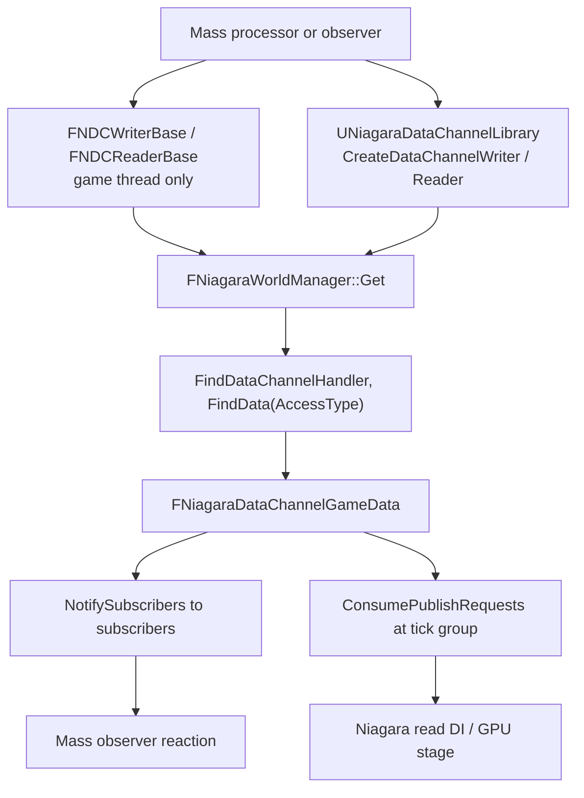

# 11 — Mass and NDC Interop (deep dive)

There is **no engine-side Mass ↔ NDC integration in UE 5.8**. Evidence: no `datachannel` and no `niagara` string anywhere in `MassGameplay/Source`, `AI/MassCrowd/Source` or `Experimental/UAF/UAFMass/Source`; no `MassNiagara` plugin exists; `MassEntity.Build.cs:13-22` (public deps Core, CoreUObject, Engine, DeveloperSettings, MassCore, TraceLog) and `MassCommon.Build.cs:13-23` (Core, CoreUObject, Engine, AIModule, MassCore, MassEntity, MassEngine) have no Niagara dependency. Graphify reports exactly **2** edges between Mass and Niagara nodes, both `references` → `FGraphEventArray` from `Engine/Source/Runtime/MassEntity/Private/MassProcessor.cpp` (`UMassProcessor::DispatchProcessorTasks()`, `UMassCompositeProcessor::DispatchProcessorTasks()`) — scheduling, not semantics.

So interop is the accessor and function-library surface, plus the same publish/tick-order rules as any other consumer.

## The interop surface

**Writing from Mass.** A processor that owns a channel reference builds a writer once (`Init(DataChannel)`, `NiagaraDataChannelAccessor.h:278`) and calls `BeginWrite(WorldContextObject, DataChannel, AccessContext, Count, bVisibleToGame, bVisibleToCPU, bVisibleToGPU)` (`:353`), writes per element through the macro-generated functions (`:451-460`), then `EndWrite()` (`:359`) or a `FNDCScopedWriter` (`:366-375`). `BeginWrite_Internal` does `check(IsInGameThread())` (`NiagaraDataChannelAccessorImpl.h:35`), so a processor executing in task-graph worker tasks cannot use it — `[INFERENCE]` from `UMassProcessor::DispatchProcessorTasks()` (`MassProcessor.cpp`) combined with that check: such a processor must require game-thread execution.

**Reading from Mass.** `BeginRead` (`NiagaraDataChannelAccessor.h:390,393`) resolves `FindData(ReadOnly)` (`NiagaraDataChannelAccessorImpl.h:89`) and takes `Data = NDCData->GetGameData()->AsShared()` (`:91`); `Num()` (`:398`) reports the current count. Previous-frame reads need `KeepPreviousFrameData()` (`NiagaraDataChannel.h:67`).

**Reaction without polling.** `SubscribeToDataChannelUpdates` (`NiagaraDataChannelHandler.h:73` legacy, `:78` `_WithContext`) and `UnsubscribeFromDataChannelUpdates` (`:81`) store `FChannelSubscription` (`:129-135`); `NotifySubscribers(Source, StartIndex, NumNewElements)` (`:91`, implementation `:164-201`) builds `FNiagaraDataChannelUpdateContext` (`NiagaraDataChannelCommon.h:50-66`, fields `Reader`, `FirstNewDataIndex`, `LastNewDataIndex`, `NewElementCount`), drops compactable delegates (`:175-178`), resolves each subscription's data through `FindData` (`:180-187`) and fires only when `ChannelData.Get() == Source` (`:189-193`). It is invoked from `ConsumePublishRequests` (`NiagaraDataChannelData.cpp:362`), i.e. on the game thread inside the manager tick — `[INFERENCE]` a Mass observer hooking this delegate must stay on the game thread and must not re-enter `FindData` for the same channel during the callback.

## Precedent: PCG writes to NDC

`PCGWriteToNiagaraDataChannel` (`Engine/Plugins/Experimental/PCGInterops/PCGNiagaraInterop/Source/PCGNiagaraInterop/`) is the existing non-Niagara consumer and the closest model for a Mass writer.

Settings (`Public/Elements/PCGWriteToNiagaraDataChannel.h:18-57`): `DataChannel` as `TSoftObjectPtr<UNiagaraDataChannelAsset>` `:38`, `NiagaraVariablesPCGAttributeMapping` as `TMap<FName, FPCGAttributePropertyInputSelector>` `:41`, `bVisibleToGame` `:45`, `bVisibleToCPU` `:49`, `bVisibleToGPU` `:53`, `bSynchronousLoad` `:56`. Element (`:61-70`): `IsCacheable` false `:64`, `CanExecuteOnlyOnMainThread` true `:65`, `SupportsBasePointDataInputs` true `:69`.

`ExecuteInternal` (`Private/Elements/PCGWriteToNiagaraDataChannel.cpp:81-216`): resolves the asset (`:93-94`), takes the world from `InContext->ExecutionSource->GetExecutionState().GetWorld()` (`:106-110`), builds per-input attribute accessors/keys (`:131-132`), checks type compatibility with `PCGAttributeNiagaraTraits::AreTypesCompatible(..., bPCGToNiagara=true)` (`:141`), `Count = FMath::Max(Count, Keys->GetNum())` (`:148`, `:141` region), errors on unmatched variables (`:153-162`), builds legacy `FNiagaraDataChannelSearchParameters` with `OwningComponent = TargetActor->GetRootComponent()` (`:171-173`), sets a `DebugSource` string (`:175`), calls `UNiagaraDataChannelLibrary::CreateDataChannelWriter(World, DataChannel, std::move(SearchParameters), Count, bVisibleToGame, bVisibleToCPU, bVisibleToGPU, DebugSource)` (`:177`), then dispatches per type with `FLinearColor` built from `FVector4` and `bool` wrapped as `FNiagaraBool` (`:191-211`).

The pattern a Mass writer must reproduce: main-thread execution, explicit type mapping from fragment to channel variable, one `CreateDataChannelWriter` call per execution, per-type write dispatch, and a `DebugSource` string so `fx.Niagara.DataChannels.LogWritesToOutputLog` can attribute the write (`NiagaraDataChannelDebugUtilities.cpp:86-102,112-146`).

## Coordinate and type rules

Mass fragments typically store `FVector` (double). NDC stores LWC positions, and `WriteToDataSet` converts `FVector` → `FVector3f` (`NiagaraDataChannelGameData.cpp:115-118`) with the tile offset `SimLocalSWC = Src - FVector(SimulationLwcTile) * FLargeWorldRenderScalar::GetTileSize()` (`:152-158`). Accessors take `TNiagaraTypeHelper<T>::TLWCType` (`NiagaraDataChannelAccessor.h:424-431,443-446`), and the header instructs positions as `FNiagaraPosition` rather than `Vector` (`:184`). Enum accessors cast to `uint8`/`int` (`NiagaraDataChannelAccessor.cpp:132-135,277-280`), `bool` wraps `FNiagaraBool` (`:282-285`). Half types have no shader accessors (`Shaders/Private/DataChannel/NiagaraDataInterfaceDataChannelCommon.ush:99-134,207-238`).

`LwcTile` comes from `Instance->GetLWCTile()` for the write DI (`NiagaraDataInterfaceDataChannelWrite.cpp:333`); a game-code writer supplies it through the publish request (`NiagaraDataChannelPublishRequest.h:35`) or the staging buffer path (`NiagaraDataChannelGameData.cpp:110-113`).

## What a Mass programmer must know

- Nothing in Mass knows about NDC; the integration is entirely on the consumer side, so the writer must own the channel reference, the access context and the visibility flags.
- Game-thread-only accessors (`NiagaraDataChannelAccessorImpl.h:35,81`) conflict with task-graph processor execution; `[INFERENCE]` either require game-thread execution for the writing processor or buffer results and write in a game-thread phase.
- Reads see the previous frame unless the channel enforces tick order and the reader runs in a later tick group (`NiagaraDataInterfaceDataChannelRead.h:103-104`, `...Read.cpp:1041-1053`).
- `checkf(false, "Property ... not a supported type")` (`NiagaraDataChannelGameData.cpp:242`) is the failure mode for a fragment type that has no LWC-to-sim conversion.
