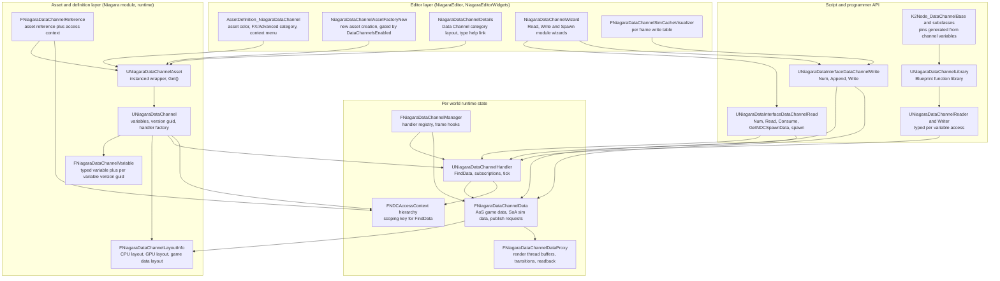
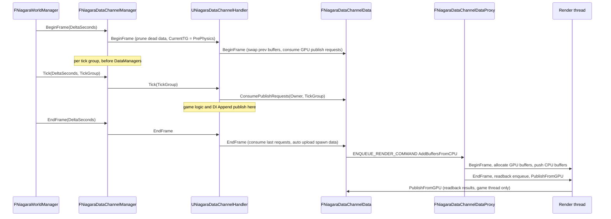
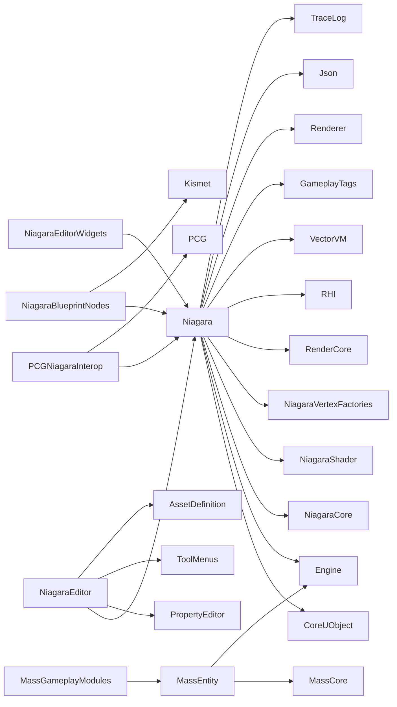

# Niagara Data Channel (NDC) — Architecture & Usage, UE 5.8

Full documentation set for every element of the Unreal Engine 5.8 Niagara Data Channel, grounded in the actual UE 5.8 source (`UE_5.8`). Each file covers **architecture** (types, responsibilities, key APIs, data flow) and **usage** (patterns, pitfalls, what a tech artist must know), plus two deep dives: the programmer query API ([07](07_Programmer_Query_API.md)) and Mass interop ([11](11_Mass_and_NDC_Interop.md)).

Citations are `file:line` against `Engine/Plugins/FX/Niagara/…` unless another path is given. Claims not observed in source are marked `[INFERENCE]`. Graph facts come from `graphify-out/graph.json` (scan root `UE_5.8`).

Niagara simulation, dispatch and shader plumbing is documented in [../UnrealRenderPipeline/](../UnrealRenderPipeline/) and the Mass entity model in [../MASS/](../MASS/); NDC chapters cross-link instead of restating them.

## Index

| File | Scope |
|---|---|
| [01_Overview_and_Architecture.md](01_Overview_and_Architecture.md) | What an NDC is, the layers, the write→publish→read contract, terminology |
| [02_Data_Channel_Asset_Variables_and_Layout.md](02_Data_Channel_Asset_Variables_and_Layout.md) | `UNiagaraDataChannelAsset`, `UNiagaraDataChannel`, variables, version guids, layout info, allowed types |
| [03_Handler_Manager_and_Registry.md](03_Handler_Manager_and_Registry.md) | `FNiagaraDataChannelManager`, `UNiagaraDataChannelHandler`, lazy init, subscriptions, world lifecycle |
| [04_Data_Storage_and_Publish_Pipeline.md](04_Data_Storage_and_Publish_Pipeline.md) | Game data (AoS/LWC), CPU sim data (SoA), publish requests, render thread proxy, readback, allocation modes |
| [05_Channel_Types.md](05_Channel_Types.md) | Global, Islands, Map/GameplayBurst: scoping rules, key generation, pools, entry lifetime |
| [06_Access_Context.md](06_Access_Context.md) | `FNDCAccessContext` hierarchy, legacy search params, instanced struct, BP thunk functions |
| [07_Programmer_Query_API.md](07_Programmer_Query_API.md) | C++ accessor (`UNiagaraDataChannelReader`/`Writer`), function library, Blueprint nodes, query semantics |
| [08_Data_Interfaces_Read_and_Write.md](08_Data_Interfaces_Read_and_Write.md) | Read and Write data interfaces, VM functions, spawn buckets, per-instance data, feedback checks |
| [09_GPU_Execution_and_Shader_Binding.md](09_GPU_Execution_and_Shader_Binding.md) | Layout manager, register bindings, HLSL templates, parameter table, buffers and transitions |
| [10_Tick_Order_and_Frame_Integration.md](10_Tick_Order_and_Frame_Integration.md) | Frame hooks, tick groups, late-write rule, subtick behaviour, latency model |
| [11_Mass_and_NDC_Interop.md](11_Mass_and_NDC_Interop.md) | How Mass (or any game logic) reaches NDC, observed engine facts, worked pattern, PCG precedent |
| [12_Tech_Artist_Guide.md](12_Tech_Artist_Guide.md) | Practical rules, cost model, common mistakes, debugging workflow, checklist |
| [13_File_Reference.md](13_File_Reference.md) | File inventory with sizes and responsibilities |
| [14_Testing.md](14_Testing.md) | Test coverage reality, verification surfaces, console variables |

## Layered architecture

## Frame lifecycle

## Module dependency graph (from `.Build.cs`)

`Niagara` takes `RenderCore`, `RHI`, `VectorVM`, `NiagaraCore`, `NiagaraShader`, `NiagaraVertexFactories` and `GameplayTags` as **public** dependencies (`Niagara.Build.cs:32-48`); `Engine`, `Json`, `TraceLog`, `Renderer` are private (`Niagara.Build.cs:12-29`). `GameplayTags` is what the GameplayBurst channel uses (`NiagaraDataChannel_GameplayBurst.h:54-55,71-72`). `MassEntity` lives in `Engine/Source/Runtime/MassEntity` and has **no** Niagara dependency — see [11](11_Mass_and_NDC_Interop.md). `PCGNiagaraInterop` is the only non-Niagara plugin that consumes NDC as a writer.

## Source roots

- Runtime definitions and handlers: `Engine/Plugins/FX/Niagara/Source/Niagara/Public/` (22 NDC headers), implementation `Source/Niagara/Private/` (19 files, including the private `NiagaraDataChannelManager.h`)
- Data interfaces: `Source/Niagara/Internal/DataInterface/` (3 headers) and `Source/Niagara/Private/DataInterface/` (3 cpp)
- Shaders: `Engine/Plugins/FX/Niagara/Shaders/Private/DataChannel/` (8 `.ush` files)
- Blueprint nodes: `Source/NiagaraBlueprintNodes/Internal/` + `Private/` (4 classes)
- Editor: `Source/NiagaraEditor/Private/AssetDefinitions/`, `Private/Customizations/`, `Private/Widgets/DataChannel/`, `Private/NiagaraDataChannelAssetFactoryNew.cpp`; duplicate detail customization in `Source/NiagaraEditorWidgets/Private/DetailCustomizations/`
- Frame integration: `Source/Niagara/Private/NiagaraWorldManager.cpp` (`:19,422,493,612,830,1339,1391,1673-1680`)
- Non-Niagara consumer precedent: `Engine/Plugins/Experimental/PCGInterops/PCGNiagaraInterop/Source/PCGNiagaraInterop/`
- Mass: `Engine/Source/Runtime/MassEntity/`, `Engine/Plugins/Runtime/MassGameplay/Source/`

## Graph facts (from `graphify-out/graph.json`, scan root `UE_5.8`)

- NDC corpus, excluding `Engine/Source/Runtime/Engine/Private/DataChannel.cpp` (115 nodes, degree 119 — that file is the network `UControlChannel`, not Niagara): **1,927 nodes**.
- Per module: `Niagara:Niagara` 1,228, `Plugin:FX/Niagara` 260, `Niagara:NiagaraBlueprintNodes` 163, `Runtime:Runtime` 45, `Niagara:NiagaraEditor` 130, `Niagara:NiagaraEditorWidgets` 34, `Plugin:Experimental/PCGInterops` 32, `Runtime:ThirdParty` 14, `Plugin:Media/PixelStreaming` 12, `Plugin:FX/NiagaraInsights` 7, `Plugin:Media/PixelStreaming2` 2.
- Highest-degree NDC nodes: `NiagaraDataInterfaceDataChannelRead.cpp` 59, `FNiagaraDataChannelData` 55, `UNiagaraDataChannelHandler` 51, `UNiagaraDataInterfaceDataChannelWrite` 50, `UNiagaraDataInterfaceDataChannelRead` 48, `NiagaraDataInterfaceDataChannelWrite.cpp` 47, `UNiagaraDataChannelLibrary` 45, `NiagaraDataChannelAccessor.cpp` 44, `K2Node_DataChannel_WithContext.cpp` 40, `FNiagaraDataChannelDataProxy` 38, `NiagaraDataChannelCommon.h` 36, `FSelectVariablesPageBase` (wizard) 35, `UK2Node_DataChannelBase` 34.
- Cross-module edges from NDC nodes: `Runtime:Runtime` 447, `Plugin:Experimental/PlainProps` 90, `Niagara:Niagara` 32, `Runtime:Editor` 29, `Runtime:ThirdParty` 18, `Plugin:Runtime/OpenCV` 18, `Niagara:NiagaraBlueprintNodes` 17, `Plugin:VirtualProduction/VirtualCameraCore` 14, `Plugin:Runtime/GeometryProcessing` 11, `Niagara:NiagaraEditor` 9, `Plugin:Media/TimecodeSynchronizer` 6, `Plugin:Experimental/PCGInterops` 3.
- Shortest path `FNiagaraDataChannelDataProxy` → `FRDGBuilder`: proxy → `NiagaraDataChannelCommon.h` → `NiagaraDataChannelData.h` → `FRDGBuilder` (3 hops); alternate proxy → `NiagaraGpuComputeDispatchInterface.h` → `FRDGBuilder`.
- Mass ↔ Niagara edges: **2**, both `references` → `FGraphEventArray` from `Engine/Source/Runtime/MassEntity/Private/MassProcessor.cpp` (`UMassProcessor::DispatchProcessorTasks()`, `UMassCompositeProcessor::DispatchProcessorTasks()`). No semantic coupling — Mass and Niagara meet only through the task graph.
- Niagara plugin totals: 44,024 nodes — Niagara 20,514, NiagaraEditor 20,308, NiagaraEditorWidgets 2,004, NiagaraShader 609, NiagaraVertexFactories 231, NiagaraBlueprintNodes 191, NiagaraAnimNotifies 87, NiagaraCore 80. Shader `.ush` files are not graphify nodes (0 shader nodes), so shader facts come from direct reads only.
