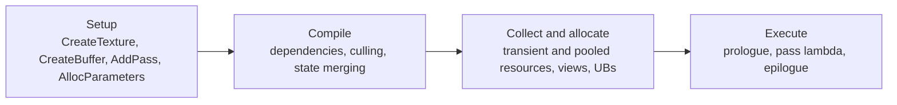

# 01 — Overview and Architecture

**RDG is a build-time dependency graph, not a command list.** A frame's rendering is expressed as passes that declare which graph resources they touch and what access they need. Nothing is executed while the graph is being built: resources are only descriptors, passes are only lambdas. Execution happens once, in `FRDGBuilder::Execute()`, after the graph has been compiled — dependency resolution, pass culling, state merging, resource allocation, view creation, barrier planning. The order in which passes actually run is chosen by the graph and is **not guaranteed** to match the order they were added; only the resulting GPU state is guaranteed to match immediate mode (`RenderGraph.h:37-40`).

That single fact explains most RDG behaviour: pass lambdas may run later, on another thread, in a different order; resources may be freed and reused by a later pass; a pass whose outputs are never consumed may never run at all.

## The four phases

| Phase | What happens | Key code |
|---|---|---|
| Setup | Descriptors recorded, passes registered with parameter structs, extraction/upload queued | `RenderGraphBuilder.inl:41` (`CreateTexture`), `:65` (`CreateBuffer`), `:249/:275/:295/:311` (`AddPass`), `:170` (`AllocParameters`), `RenderGraphBuilder.cpp:2384` (`SetupPassResources`), `:2329` (`SetupPassDependencies`) |
| Compile | Reference counts, dependency edges, cull DFS, pass ops, barrier state merging | `RenderGraphBuilder.cpp:1327` (`Compile`), `:1387-1423` (cull pass loop), `:2668` (`CompilePassOps`), `:3783` (`CompilePassBarriers`) |
| Collect/allocate | Per-pass allocation and deallocation ops, pooled and transient allocation, view and uniform-buffer creation, finalization | `RenderGraphBuilder.cpp:3590` (`CollectAllocations`), `:3632` (`CollectDeallocations`), `:3129` (`AllocatePooledTextures`), `:3180` (`AllocatePooledBuffers`), `:3217` (`AllocateTransientResources`), `:3985` (`FinalizeResources`), `:3315` (`CreateViews`), `:3329` (`CreateUniformBuffers`) |
| Execute | Prologue (barriers + render pass begin), pass lambda, epilogue (render pass end + queued transitions), parallel pass sets, dispatch passes | `RenderGraphBuilder.cpp:1766` (`Execute`), `:3424` (`ExecutePassPrologue`), `:3511` (`ExecutePass`), `:3457` (`ExecutePassEpilogue`), `:3530` (`ExecuteSerialPass`) |

`Execute()` is the only place that turns the graph into GPU work, and it is the only place where a pass lambda is allowed to dereference a graph resource (`RenderGraph.h:19-21`).

## Key types

| Type | File:line | Responsibility |
|---|---|---|
| `FRDGBuilder` | `RenderGraphBuilder.h:50` | Graph owner: pass registration, allocation, compile, execute, extraction, validation gate |
| `FRDGResource` | `RenderGraphResources.h:134` | Base for every graph-tracked object; name, RHI handle, `MarkResourceAsUsed` |
| `FRDGViewableResource` | `RenderGraphResources.h:293` | Resource with a tracked allocation lifetime; parent of views |
| `FRDGTexture` / `FRDGBuffer` | `RenderGraphResources.h:569` / `:1307` | Tracked texture and buffer, with per-subresource state arrays |
| `FRDGView` and subclasses | `RenderGraphResources.h:500`, `:696`, `:719`, `:837`, `:903`, `:1417`, `:1443` | SRV/UAV views referencing one viewable resource |
| `FRDGTextureDesc` / `FRDGBufferDesc` | `RenderGraphDefinitions.h:628`, `RenderGraphResources.h:939` | Creation descriptors; `Create2D` (`:630`), `CreateStructuredDesc` (`:993`) |
| `FRDGSubresourceState` | `RenderGraphResources.h:72` | Per-subresource access, first/last pass, flags, barrier location |
| `FRDGPass` | `RenderGraphPass.h:217` | A node: name, flags, pipeline, parameters, producers/consumers, workload |
| `FRDGDispatchPass` | `RenderGraphPass.h:715` | Pass whose command lists are recorded by a task lambda |
| `FRDGSentinelPass` | `RenderGraphPass.h:821` | Prologue/epilogue pass that owns graph-boundary transitions |
| `FRDGParameterStruct` | `RenderGraphParameter.h:202` | Non-owning view over a pass parameter struct plus its shader metadata |
| `FRDGParameter` | `RenderGraphParameter.h:9` | Typed accessor for one parameter member (SRV, UAV, UB, binding slots) |
| `FRDGBlackboard` | `RenderGraphBlackboard.h:56` | Map of struct instances with graph-allocator lifetime |
| `FRDGEventName` / `FRDGScope` | `RenderGraphEvent.h:43`, `:173` | Pass names and the hierarchical scope tree |
| `FRDGUserValidation` | `RenderGraphValidation.h:40` | User-facing checks, compiled out in Shipping |
| `FRDGBarrierValidation` | `RenderGraphValidation.h:153` | Logs and validates submitted barrier batches |
| `FRDGTrace` | `RenderGraphTrace.h:25` | Emits graph/pass/resource records to the `RDGChannel` |
| `FRDGAllocator` / `FRDGAllocatorScope` | `RenderGraphAllocator.h:17`, `:141` | Graph-lifetime allocation domains |
| `FRDGBufferPool`, `FRDGTransientResourceAllocator` | `RenderGraphResourcePool.h:14`, `:113` | Cross-frame pooled buffers and transient allocation |

## Compile-time gates

| Gate | Definition | Effect |
|---|---|---|
| `RDG_ENABLE_DEBUG` | `RenderGraphDefinitions.h:17` (engine variant `:27`) | Enables user validation, clobber, filters, transition log; `IF_RDG_ENABLE_DEBUG` helper `:20-24` |
| `RDG_ENABLE_TRACE` | `RenderGraphDefinitions.h:30` | Enables `FRDGTrace` and the `RDGChannel` |
| `RDG_DUMP_RESOURCES` | `RenderGraphDefinitions.h:39` | Enables DumpGPU resource registration under `WITH_DUMPGPU` |
| `RDG_EVENTS` | `RenderGraphDefinitions.h:46-61` | 0 disabled, 1 string reference, 2 string copy |
| `SUPPORTS_VISUALIZE_TEXTURE` | `RenderGraphDefinitions.h:63` | Shader-runtime visualisation of pass outputs |
| `RDG_ENABLE_PARALLEL_TASKS` | `RenderGraphPrivate.h:20-22` | Parallel setup/compile/execute code paths |

Validation is compiled out when `RDG_ENABLE_DEBUG` is 0 (`RenderGraphValidation.h:24`, `RenderGraphBuilder.cpp:592-595`), so a Shipping build silently accepts graphs that a Development build would assert on.

## The usage contract

`RenderGraph.h:5-57` is the normative statement of the rules; the rest of this set expands them.

1. A pass must declare every graph resource it uses in its parameter struct (`RenderGraph.h:17-21`). Resources are only guaranteed allocated during execution.
2. Parameter structs must be allocated with `AllocParameters()` because the lambda is deferred (`RenderGraph.h:10-12`, `RenderGraphBuilder.inl:170`).
3. Extra references extend tracked lifetimes, raising memory peaks and blocking overlap (`RenderGraph.h:23-27`).
4. Passes must not mutate external data structures; results that survive the graph must be extracted (`RenderGraph.h:42-46`).
5. Do not bundle unrelated work in one pass — it creates a dependency bundle the scheduler cannot split (`RenderGraph.h:48-52`).
6. Execution order is not guaranteed; only GPU-visible results are (`RenderGraph.h:37-40`).

## Immediate mode

`r.RDG.ImmediateMode` (`RenderGraphPrivate.cpp:18`, default 0) executes passes as they are created, which keeps the callstack of the wiring code when a pass lambda crashes (`RenderGraph.h:29-32`, `-rdgimmediate`). It also disables render-pass merging (`RenderGraphPrivate.h:224-227`) and async compute (`RenderGraphPrivate.h:229-234`), so an immediate-mode frame is not representative of a normal frame. `IsImmediateMode()` is `RenderGraphPrivate.h:219-222` and is checked throughout the compile and execute paths (`RenderGraphBuilder.cpp:468`).
