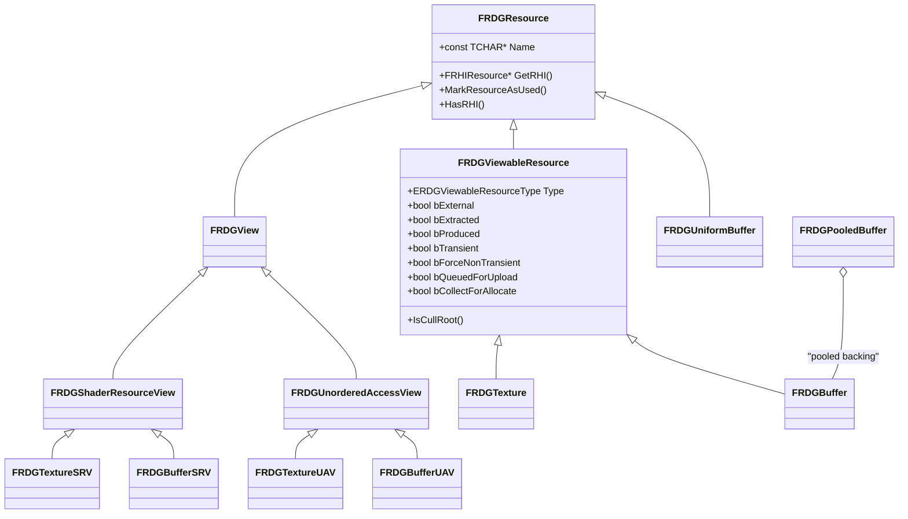
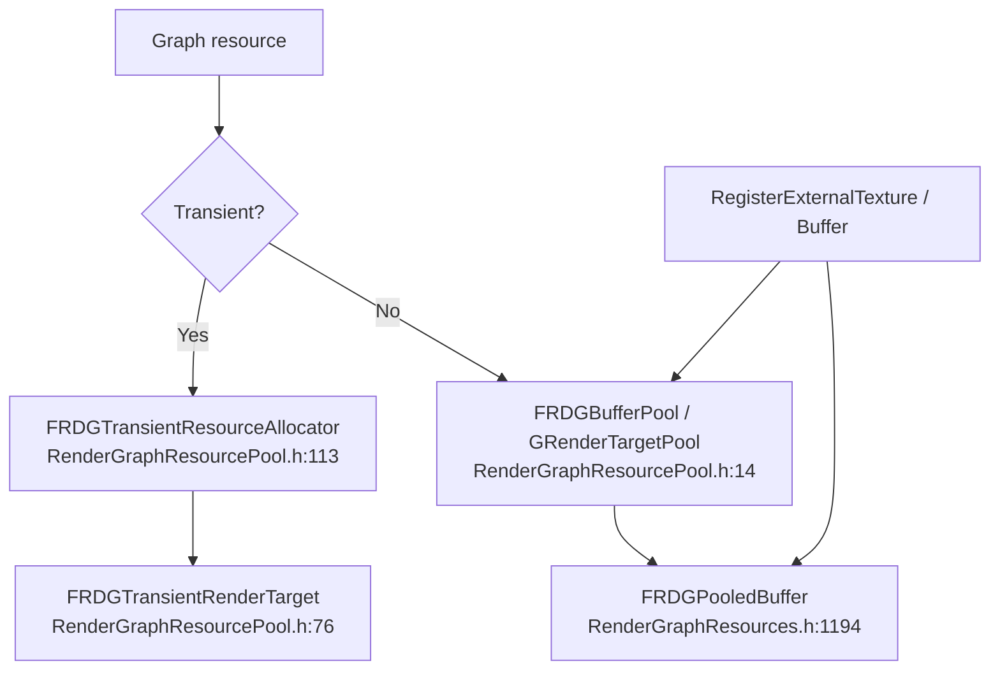

# 02 — Resources and Allocation

**A graph resource is a descriptor plus a tracked lifetime, not an allocation.** `CreateTexture` and `CreateBuffer` record a desc and a name; the RHI object appears only during the collect phase of `Execute()` (`RenderGraph.h:13-15`, `RenderGraphBuilder.inl:41`, `:65`). The graph decides *when* the memory exists, and it can free and reuse that memory as soon as no remaining pass references the resource.

## Type hierarchy

Anchors: `FRDGResource` `RenderGraphResources.h:134`; `FRDGViewableResource` `:293`; `FRDGView` `:500`; `FRDGShaderResourceView` `:696`; `FRDGUnorderedAccessView` `:719`; `FRDGTextureSRV` `:837`; `FRDGTextureUAV` `:903`; `FRDGBufferSRV` `:1417`; `FRDGBufferUAV` `:1443`; `FRDGUniformBuffer` `:195`; `FRDGTexture` `:569`; `FRDGBuffer` `:1307`; `FRDGPooledBuffer` `:1194`.

## Descriptors

`FRDGTextureDesc` (`RenderGraphDefinitions.h:628-742`) is the creation input; the factory helpers are the highest-degree RDG symbols in the graph (`Create2D` 248 uses):

| Helper | Line |
|---|---|
| `Create2D` | `RenderGraphDefinitions.h:630` |
| `Create2DArray` | `:645` |
| `Create3D` | `:660` |
| `CreateCube` | `:677` |
| `CreateCubeArray` | `:694` |
| `CreateRenderTargetTextureDesc` | `:711` |

`FRDGBufferDesc` (`RenderGraphResources.h:939`) offers `CreateByteAddressDesc` (`:941`), `CreateStructuredDesc` (`:993`, 171 uses), `CreateBufferDesc` (`:1010`, 146 uses). Buffer size can be unknown at setup time: `FRDGBufferNumElementsCallback` (`RenderGraphResources.cpp:37-41`) defers the size decision to `FinalizeDescs()` (`RenderGraphBuilder.cpp:3580`), which runs after compile.

Subresource geometry lives in `RenderGraphTextureSubresource.h`: `FRDGTextureSubresource` (`:11`, MipIndex 8-bit, PlaneSlice 8-bit, ArraySlice 16-bit), `FRDGTextureSubresourceLayout` (`:67`), `FRDGTextureSubresourceRange` (`:126`), with bounds checks at `:112` and `:232-233`. A texture keeps one `FRDGSubresourceState` per subresource (`RenderGraphResources.h:638-652`, allocated in the constructor `RenderGraphResources.cpp:24-27`).

## Lifetime and reference counts

`FRDGViewableResource` is the lifetime-tracked object (`RenderGraphResources.h:292-293`). The fields that decide its lifetime:

| Field | Line | Meaning |
|---|---|---|
| `bExternal` | `:409` | Registered from outside the graph; the caller owns the RHI object |
| `bExtracted` | `:412` | Queued for extraction, so it must survive execution |
| `bProduced` | `:406` | Some pass wrote to it; set by the async setup queue, hence not a bitfield |
| `bTransient` | `:377` | Allocated through the transient allocator |
| `bForceNonTransient` | `:380` | Cannot be made transient |
| `bSkipLastTransition` | `:383` | Used for aliased pooled resources |
| `bSplitFirstTransition` | `:386` | Skip the first split barrier and transition immediately |
| `bQueuedForUpload` | `:389` | Upload pending |
| `bCollectForAllocate` | `:392` | Needs to be collected for allocation |
| `ReferenceCount` | `RenderGraphResources.h:445` (comment `:444`); initialised `IsImmediateMode() ? 1 : 0` at `RenderGraphResources.cpp:59` | Number of passes referencing the resource |
| `AcquirePass`, `DiscardPass`, `FirstPass`, `LastPasses` | `:439-442` | Passes that acquire, discard, first and last touch the resource |
| `TransientExtractionHint` | `:415` | `None` / `Disable` / `Enable` (`:363-368`) |

`IsCullRoot()` is `bExternal || bExtracted` (`:356-359`): a resource that leaves the graph, or entered it from outside, anchors the cull DFS (`RenderGraphBuilder.cpp:1278` `AddCullRootTexture`, `:1290` `AddCullRootBuffer`, `:1311` `FlushCullStack`).

Reference counts are added during pass setup (`RenderGraphBuilder.cpp:1361-1369`) and subtracted for culled passes (`:1409-1417`), so a pass that never runs never forces its resources to be allocated. Extracted resources get an extra reference at compile (`:1373-1381`). `DeallocatedReferenceCount` is the sentinel `~0` (`RenderGraphResources.h:457`); `IsFree()` tests `ReferenceCount == 0` for textures (`:624`) and for buffers also requires `PendingCommitSize == 0` (`:1361`).

## Allocation domains

- Transient path: `AllocateTransientResources` (`RenderGraphBuilder.cpp:3217`), gated by `r.RDG.TransientAllocator` (default 1, `RenderGraphPrivate.cpp:251`) and `TransientResourceAllocator` validity. Pending deallocations are released at the start of `Execute()` (`RenderGraphBuilder.cpp:1788`) so the previous frame's memory can be reused this frame.
- Pooled path: `AllocatePooledTextures` (`RenderGraphBuilder.cpp:3129`), `AllocatePooledBuffers` (`:3180`), `GRenderGraphResourcePool` (`RenderGraphResourcePool.h:67`), trimmed once per frame by `TickPoolElements()` (`RenderGraphBuilder.cpp:398`).
- Transient aliasing fences come from `GetAllocateFences` (`RenderGraphBuilder.cpp:4616`) and `GetDeallocateFences` (`:4640`), which use the resource's first and last pass per pipeline. Async-compute aliasing on the same heap is gated by `r.RDG.AsyncComputeTransientAliasing` (default 1, `RenderGraphPrivate.cpp:269`) plus `GRHIGlobals.SupportsAsyncComputeTransientAliasing` (`RenderGraphPrivate.h:240-243`).
- Pooled buffer alignment is `ERDGPooledBufferAlignment` (`RenderGraphDefinitions.h:291-301`); the pool page-aligns to `64 * 1024` with a PowerOfTwo fallback (`RenderGraphResourcePool.cpp:34`, `:40`).
- `FRDGTransientRenderTarget::GetTransientTexture()` asserts `LifetimeState == Allocated` (`RenderGraphResourcePool.h:91`), so a transient resource cannot be dereferenced after its last pass.

## Flags that change allocation behaviour

| Flag | Line | Consequence |
|---|---|---|
| `ERDGBufferFlags::MultiFrame` | `RenderGraphDefinitions.h:169` | Resource must survive the graph; forces non-transient pooled allocation |
| `ERDGBufferFlags::SkipTracking` | `:176` | No dependency tracking; locks the resource into external access mode (`RenderGraphResources.cpp:61-66`) |
| `ERDGBufferFlags::ForceImmediateFirstBarrier` | `:181` | First transition is not split into the prologue |
| `ERDGTextureFlags::SkipTracking` | `:186-208` | Same as buffer `SkipTracking`; validation restricts it to registered textures (`RenderGraphValidation.cpp:241`) |
| `ERDGTextureFlags::MaintainCompression` | `:206` | Keeps compressed format when creating views |
| `ERDGResourceExtractionFlags::AllowTransient` | `:271` | Extracted resource may still be transient |
| `ERDGInitialDataFlags::NoCopy` | `:287` | Upload data is not copied into the graph allocator |

`SkipTracking` resources are `bLocked = 1` in external access mode (`RenderGraphResources.cpp:61-66`), which is why they cannot participate in state merging: the graph has no knowledge of their usage.

## Views

Views are graph resources too (`RenderGraphResources.h:500`), created by `CreateSRV`/`CreateUAV` (`RenderGraphBuilder.inl:102`, `:110`, `:118`, `:126`) and only bound to RHI objects during `CreateViews()` (`RenderGraphBuilder.cpp:3315`), after allocation. UAV flags `ERDGUnorderedAccessViewFlags::SkipBarrier` (`RenderGraphDefinitions.h:227`) allow a UAV to be used without a barrier when the same view is reused — this is the mechanism behind `SkipUAVBarrier` (`RenderGraphPrivate.h:208-217`).

Uniform buffers are created from a parameter struct (`RenderGraphBuilder.inl:234`) and materialised in `CreateUniformBuffers()` (`RenderGraphBuilder.cpp:3329`).
