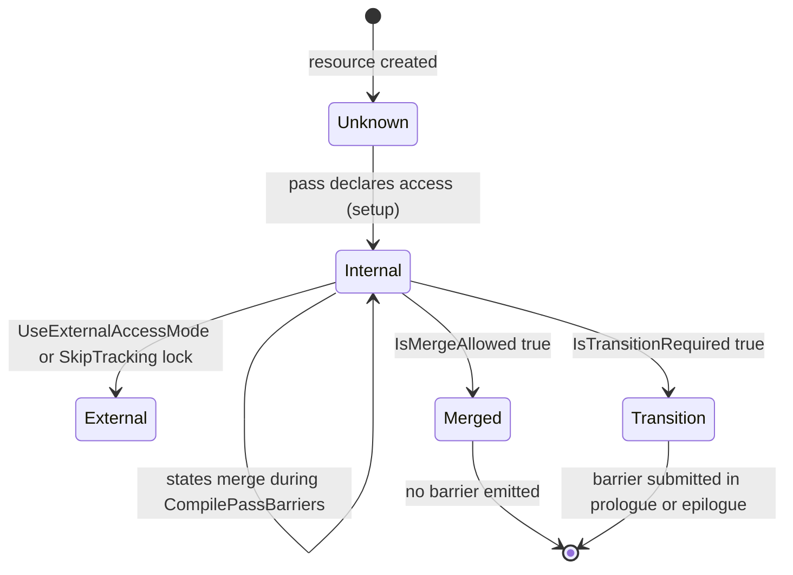
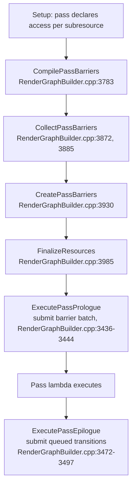

# 03 — Declared Access and Transitions

**RDG does not transition resources at the point of use; it collects declared access states per subresource, merges what can be merged, and emits the minimum set of barriers during execution.** The RHI access-state model itself is covered in [../RHI/04_Access_States_and_Transitions.md](../RHI/04_Access_States_and_Transitions.md); this chapter is the RDG side: how access is declared, tracked, merged, and submitted.

## Declaration

Access is declared through parameter metadata, not through calls:

| Macro | Line | Form |
|---|---|---|
| `RDG_BUFFER_ACCESS(MemberName, Access)` | `ShaderParameterMacros.h:1868` | Compile-time access baked into the member type `TRDGBufferAccess<Access>` |
| `RDG_BUFFER_ACCESS_DYNAMIC(MemberName)` | `:1871` | Access chosen at runtime (`FRDGBufferAccess`) |
| `RDG_BUFFER_ACCESS_ARRAY(MemberName)` | `:1874` | Array of buffer accesses |
| `RDG_TEXTURE_ACCESS(MemberName, Access)` | `:1878` | Compile-time texture access |
| `RDG_TEXTURE_ACCESS_DYNAMIC(MemberName)` | `:1881` | Runtime texture access |
| `RDG_TEXTURE_ACCESS_ARRAY(MemberName)` | `:1884` | Array of texture accesses |

The compile-time form is preferred: the access is part of the shader metadata, so `FRDGParameterStruct::Enumerate` can see it without executing the pass (`RenderGraphParameters.inl:6-58`). `SHADER_PARAMETER_RDG_BUFFER` is deprecated since 5.0 in favour of `RDG_BUFFER_ACCESS` with an explicit RHI state (`ShaderParameterMacros.h:1920-1930`).

## State tracking

`FRDGSubresourceState` (`RenderGraphResources.h:72-129`) is the unit of tracking:

| Field | Line | Content |
|---|---|---|
| `Access` | `:110` | Last used access on the pass, `ERHIAccess::Unknown` before use |
| `FirstPass` / `LastPass` | `:113` / `:116` | Per-pipeline pass handles in this state |
| `NoUAVBarrierFilter` | `:119` | Last no-UAV-barrier view, used to allow UAV overlap |
| `ReservedCommitHandle` | `:122` | Marks a reserved-buffer commit state |
| `Flags` | `:125` | `EResourceTransitionFlags` on the pass |
| `BarrierLocation` | `:128` | `Prologue` or `Epilogue` — only used when transitioning on the same pass/pipeline |

Textures hold one state per subresource (`RenderGraphResources.h:638-652`); buffers hold one (`FRDGBuffer`, `:1307`). The resource-level `FAccessModeState` (`RenderGraphResources.h:417-437`) records the access mode (`Internal`/`External`), pipeline mask, lock flag, queue flag, and the replayed `ActiveMode`.

## Merge rules

`FRDGSubresourceState::IsMergeAllowed` (`RenderGraphResources.cpp:69-133`) runs during compile, before barriers are collected. A transition cannot occur inside a merged state, so any potential barrier blocks the merge.

| Rule | Line |
|---|---|
| Same access on both states → merge allowed | `:81` |
| Read-only state cannot merge with a writable state | `:84` |
| Write-only state cannot merge with a readable state | `:90` |
| UAV merges only with UAV | `:96` |
| Depth read and depth write merge only with themselves | `:102` |
| Access outside `GRHIMergeableAccessMask` blocks the merge | `:108` |
| UAV needing a barrier blocks the merge | `:115` |
| Cross-pipeline merge requires `GRHIMultiPipelineMergeableAccessMask` | `:121` |
| Differing transition flags block the merge | `:127` |

`MakeValidAccess` (`RenderGraphBuilder.cpp:43-62`) applies the same mask logic when a merged access value is produced: it keeps the union when mergeable, otherwise keeps the non-mergeable side.

`IsTransitionRequired` (`RenderGraphResources.cpp:135-152`) is deliberately narrow: it returns true when access, pipeline, or flags differ, or when a UAV state needs a barrier even though the states match (`:146`). Read-to-read is not a transition.

UAV overlap is the main lever: `SkipUAVBarrier` (`RenderGraphPrivate.h:208-217`) returns true only when `r.RDG.OverlapUAVs` is on (default 1, `RenderGraphPrivate.cpp:71`) and the previous and next no-barrier view handles match — i.e. the same view was used without an intervening barrier. `ERDGUnorderedAccessViewFlags::SkipBarrier` (`RenderGraphDefinitions.h:227`) is how a view opts in.

## Barrier pipeline

Transition emission functions: `AddTextureTransition` (`RenderGraphBuilder.cpp:4298`), `AddBufferTransition` (`:4413`), `AddTransition` (`:4439`), first/last graph-boundary transitions `AddFirstTextureTransition` (`:4045`) / `AddLastTextureTransition` (`:4094`) / `AddFirstBufferTransition` (`:4196`) / `AddLastBufferTransition` (`:4232`), aliasing transitions `AddAliasingTransition` (`:4586`), culled reserved-commit transitions (`:4275`).

Barrier batches are objects, not immediate calls: `FRDGBarrierBatchBegin` (`RenderGraphPass.h:108`) and `FRDGBarrierBatchEnd` (`:188`), keyed by pass handle and barrier location (`:89-92`, `:104-105`, `:188-190`, `:209-210`). The location field is what allows a transition to be attributed to the prologue of a pass rather than the epilogue of the previous one (`RenderGraphResources.h:128`).

External-mode resources are handled by a separate queue: `UseExternalAccessMode` (`RenderGraphBuilder.cpp:898`), `UseInternalAccessMode` (`:931`), `FRDGExternalAccessQueue::Submit()` (`RenderGraphUtils.cpp:990`), flushed by `FlushAccessModeQueue()` (`RenderGraphBuilder.cpp:960`) at the start of `Execute()` (`:1790`). Final access for extracted resources is set with `SetTextureAccessFinal` (`RenderGraphBuilder.inl:747`) and `SetBufferAccessFinal` (`:753`).

## Logging and validation

- `r.RDG.TransitionLog` (`RenderGraphPrivate.cpp:77`, default 0) logs transitions to the console; `>0` enables it for N frames.
- `FRDGBarrierValidation` (`RenderGraphValidation.h:153-179`) records submitted batches and validates begin/end against the pass registry.
- Validation rejects incompatible access states on the same subresource (`RenderGraphValidation.cpp:583`), resources locked in external access mode (`:522`), and `SkipTracking` on non-registered textures (`:241`).

Practical consequence: a barrier storm in a frame is almost always a merge failure — a UAV that cannot overlap, a depth state mixed with a readable state, or a resource used across pipelines that the platform cannot merge (`RenderGraphResources.cpp:96-121`).
