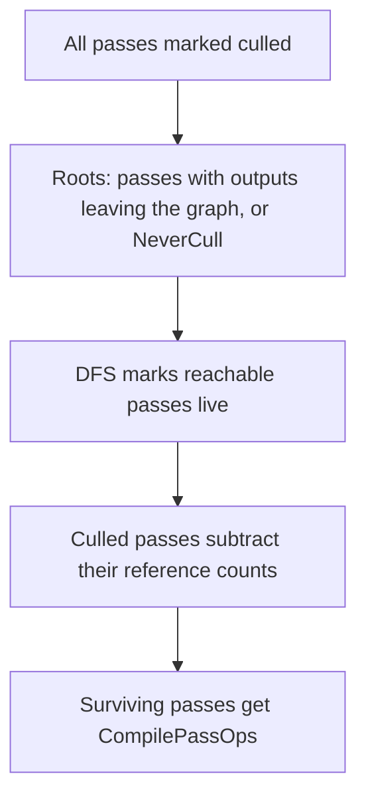

# 04 — Pass Model and Ordering

**A pass is a node in a dependency graph, not a command list.** `AddPass` records a name, flags, a parameter struct, and an execute lambda (`RenderGraphBuilder.h:220-233`, `RenderGraphBuilder.inl:249-311`). Ordering is derived from resource access: the graph knows which pass produced a resource and which consumed it (`FRDGPass::Producers` `RenderGraphPass.h:478`, `Consumers` `:455`), and execution order is only required to be GPU-equivalent to immediate mode (`RenderGraph.h:37-40`).

## Pass object

`FRDGPass` (`RenderGraphPass.h:217-241`) is a packed-bit object. Predicates that define what a pass *is*:

| Predicate | Line | Meaning |
|---|---|---|
| `GetName` | `:224-231` | Event name, may be empty |
| `GetPipeline` | `:243` | `ERHIPipeline` from the packed `Pipeline` field `:392` |
| `GetParameters` | `:248` | `FRDGParameterStruct` |
| `GetHandle` | `:253` | Index in `FRDGBuilder::Passes` |
| `GetWorkload` | `:258` | Estimated cost used for parallel grouping |
| `GetTaskMode` | `:263` | Serial or task execution |
| `IsParallelExecuteAllowed` | `:268` | Eligible for a parallel pass set |
| `IsMergedRenderPassBegin` / `End` | `:273` / `:278` | Boundaries of a merged render pass |
| `SkipRenderPassBegin` / `End` | `:283` / `:288` | Pass that does not open/close a render pass |
| `IsAsyncCompute` | `:293` | Runs on the async compute pipeline |
| `IsAsyncComputeBegin` / `End` | `:298` / `:303` | Fence boundaries of the async region |
| `IsGraphicsFork` / `IsGraphicsJoin` | `:308` / `:313` | Graphics fork/join boundaries |
| `IsCulled` | `:318` | Removed by culling |
| `IsSentinel` | `:323` | Prologue or epilogue pass |

`GetGraphicsForkPass` (`:329-332`) and `GetGraphicsJoinPass` (`:335-338`) resolve the fork/join pair. `FRDGDispatchPass` (`:715`) adds the task-based command-list recording path; `FRDGSentinelPass` (`:821`) is the prologue/epilogue type.

## Pass flags

`ERDGPassFlags` (`RenderGraphDefinitions.h:129-161`):

| Flag | Line | Effect |
|---|---|---|
| `None` | `:132` | No pipeline; parameter-only pass |
| `Raster` | `:135` | Graphics pipeline |
| `Compute` | `:138` | Compute pipeline |
| `AsyncCompute` | `:141` | Async compute pipeline |
| `Copy` | `:144` | Copy pipeline |
| `NeverCull` | `:147` | Pass is never culled even if its outputs are unused |
| `SkipRenderPass` | `:150` | Does not participate in render-pass merging |
| `NeverMerge` | `:153` | Must not be merged into a render pass; validation requires `Raster` (`RenderGraphValidation.cpp:623`) |
| `NeverParallel` | `:156` | Excluded from parallel execution |
| `Readback` | `:159` | `Copy \| NeverCull` — readback passes are never culled |

`ERDGBuilderFlags` (`RenderGraphDefinitions.h:111-126`): `ParallelSetup` `:116`, `ParallelCompile` `:119`, `ParallelExecute` `:122`, `Parallel` `:124` (all three).

## Dependency edges

Edges are implicit from parameter access. `SetupPassResources` (`RenderGraphBuilder.cpp:2384`) records which pass touched which resource; `SetupPassDependencies` (`:2329`) builds producer/consumer sets. Explicit edges can be added with `AddPassDependency` (`RenderGraphBuilder.h:249`, impl `RenderGraphBuilder.cpp:1160`) when a pass writes something the graph cannot see.

Culling runs in `Compile()` (`RenderGraphBuilder.cpp:1327`):

- `bCullPasses = GRDGCullPasses > 0` (`RenderGraphBuilder.cpp:1339`; `r.RDG.CullPasses` default 1, `RenderGraphPrivate.cpp:233`).
- The dependency pass runs only when culling or async-compute passes exist (`:1341-1352`); otherwise reference counts are simply summed (`:1355-1370`).
- Extracted resources always get `ReferenceCount++` (`:1373-1381`).
- Prologue and epilogue are forced unculled (`:1392-1393`).
- Culled passes decrement reference counts (`:1409-1417`) and increment `GRDGStatPassCullCount` (`:1403-1405`).
- Roots come from `IsCullRoot()` (`RenderGraphResources.h:356-359`) plus `AddCullRootTexture` (`RenderGraphBuilder.cpp:1278`) / `AddCullRootBuffer` (`:1290`), flushed by `FlushCullStack` (`:1311`); `AddLastProducersToCullStack` (`:1299`) seeds the stack.

Consequence for a tech artist: a pass whose only purpose is a side effect outside the graph (writing to a CPU buffer, updating an external texture not registered as a cull root) can be culled silently, with a warning (`RenderGraph.h:46`). `NeverCull` or `Readback` is the fix.

## Sentinel passes

`FRDGBuilder` reserves handle 0 as the prologue and the last handle as the epilogue (`RenderGraphBuilder.h:464-465`, comment `:458-463`; `GetProloguePassHandle` `:485-488`, `GetEpiloguePassHandle` `:491-495`). They own graph-boundary transitions: first transitions are attributed to the prologue (`RenderGraphBuilder.cpp:4045`, `:4196`), last transitions to the epilogue (`:4094`, `:4232`), and the epilogue pass is created inside `Execute()` (`:1793`). `PrologueBarrierPass` and `EpilogueBarrierPass` fields (`RenderGraphPass.h:470-471`) point at the barrier owners.

## Workload and parallel grouping

`SetPassWorkload` (`RenderGraphBuilder.h:246`, impl `RenderGraphBuilder.inl:365`) attaches an estimated cost. `SetupParallelExecute` (`RenderGraphBuilder.cpp:2841`) groups passes into parallel pass sets (`:2932-3060`) using `r.RDG.ParallelExecute.PassMin` (`RenderGraphPrivate.cpp:353`), `.PassMax` (`:359`), and `.PassTaskModeThreshold` (`:365`). Dispatch passes get their own task path (`SetupDispatchPassExecute` `RenderGraphBuilder.cpp:3068`).

CVars that change grouping: `r.RDG.ParallelExecute` (`RenderGraphPrivate.cpp:329`), `r.RDG.ParallelSetup` (`:299`), `r.RDG.ParallelCompile` (`:307`), `r.RDG.AsyncSetupQueue` (`:315`), `r.RDG.ParallelSetup.TaskPriorityBias` (`:323`), `r.RDG.ParallelExecuteStress` (`:373`), `r.RDG.ParallelMobile` (`:410`, default 0). `r.RDG.Debug.FlushGPU` (`:34`) disables async compute and parallel execute when set (`RenderGraphPrivate.cpp:34`).

Async compute is mutually exclusive with render-pass merging (`RenderGraphPrivate.h:229-234`) and requires `GSupportsEfficientAsyncCompute` plus `GRHISupportsSeparateDepthStencilCopyAccess`. `IsAsyncComputeEnabled` is `RenderGraphBuilder.h:292`; `SkipInitialAsyncComputeFence` is `RenderGraphBuilder.inl:370`.

Practical rule: a pass marked `AsyncCompute` that also touches a resource the graphics pipeline uses in a non-mergeable state forces a cross-pipeline barrier, which is exactly the case `GRHIMultiPipelineMergeableAccessMask` rejects (`RenderGraphResources.cpp:121`).
