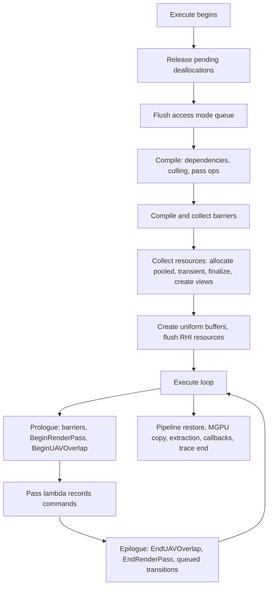

# 05 — Execution and Submission

**`FRDGBuilder::Execute()` is where the graph becomes GPU work** (`RenderGraphBuilder.cpp:1766-2234`). Everything before it is bookkeeping; everything after it is cleanup. The order inside `Execute()` is fixed and observable, and it explains why resources are unusable outside a pass lambda.

## Phase order

| # | Line | Phase |
|---|---|---|
| 1 | `1768` | CSV timing stat opens |
| 2 | `1769` | Breadcrumb node for the graph |
| 3 | `1776-1782` | Crash-context scope (graph name, pass name) |
| 4 | `1788` | `GRDGTransientResourceAllocator.ReleasePendingDeallocations()` — previous frame's memory becomes reusable |
| 5 | `1790` | `FlushAccessModeQueue()` — external access modes applied |
| 6 | `1793` | Epilogue pass created |
| 7 | `1801` | `ValidateExecuteBegin()` |
| 8 | `1810` | `BeginFlushResourcesRHI()` |
| 9 | `1811` | `WaitForParallelSetupTasks(ERDGSetupTaskWaitPoint::Compile)` |
| 10 | `1814` | `ProcessAsyncSetupQueue()` |
| 11 | `1816-1844` | Pre-allocation of resources above `ParallelCompileResourceThreshold = 32` |
| 12 | `1852-1856` | Buffer-size callback task (deferred `FRDGBufferDesc` sizes) |
| 13 | `1858-1892` | `PrepareCollectResources()` |
| 14 | `1896-1900` | `SubmitBufferUploads()` |
| 15 | `1902` | `Compile()` — dependencies, culling, `CompilePassOps` |
| 16 | `1904-1909` | `CompilePassBarriers()` + `CollectPassBarriers()` |
| 17 | `1911-1918` | `SetupParallelExecute()` |
| 18 | `1923-2019` | `CollectResources()`: extended-lifetime refcounts `1930-1938`, culled external resources `1942-1960`, per-pass `CollectAllocations`/`CollectDeallocations` `1962-1971`, `AllocatePooledBuffers` `1985-1989`, `AllocatePooledTextures` `1991-1995`, `AllocateTransientResources` `1997`, `FinalizeResources` `1999-2003`, `CreateViews` `2005-2009`, transient `Flush` `2011-2018` |
| 19 | `2021-2025` | `CreateUniformBuffers()` |
| 20 | `2030-2034` | Immediate-mode branch |
| 21 | `2036` | `EndFlushResourcesRHI()` |
| 22 | `2037` | `WaitForParallelSetupTasks(Execute)` |
| 23 | `2040` | `Trace.OutputGraphBegin()` |
| 24 | `2044-2176` | Execute loop (below) |
| 25 | `2182-2183` | Pipeline restore |
| 26 | `2185-2190` | `ForceCopyCrossGPU()` (`#if WITH_MGPU` `2185`) |
| 27 | `2192` | `SetTrackedAccess()` |
| 28 | `2195-2200` | Parallel await |
| 29 | `2202-2212` | Extraction fill |
| 30 | `2214-2218` | Post-execute callbacks |
| 31 | `2220` | `Trace.OutputGraphEnd()` |
| 32 | `2222` | `ValidateExecuteEnd()` |
| 33 | `2225-2230` | `RDG_STATS` counters |

## Execute loop

The loop (`RenderGraphBuilder.cpp:2044-2176`) does three things per iteration:

- `STAT_RDG_ExecuteTime` (`2048`).
- Dispatch passes launch their task lambda (`2053-2061`); a thread-wake task is inserted when needed (`2065-2079`).
- The initial async-compute fence is emitted once (`2098-2102`).
- Per pass (`2104-2167`): parallel passes run through `QueuedCmdLists` (`2113-2144`); serial passes run through `ExecuteSerialPass` (`2146-2166`, which calls `ValidateExecutePassBegin` at `3532`). `GRDGDebugFlushGPU` inserts a flush between passes when enabled (`2162-2165`).

Per-pass execution is split into three functions:

| Function | Line | What it does |
|---|---|---|
| `ExecutePassPrologue` | `3424-3455` | Push scopes `3430`; submit barrier batch `3436-3444`; `BeginRenderPass` `3446-3451`; `BeginUAVOverlap` `3454` |
| `ExecutePass` | `3511-3528` | `RenderTracing::BeginExecuteRDGPass` `3513`; `SCOPED_GPU_MASK` `3518`; `SwitchPipeline` `3519`; `Pass->Execute` `3523` |
| `ExecutePassEpilogue` | `3457-3509` | `EndUAVOverlap` `3461`; `EndRenderPass` `3467-3470`; submit queued transitions `3472-3497`; pop scopes `3505-3508` |

The prologue/epilogue split is why a transition can be attributed to a pass boundary rather than to the middle of a pass, and why `BeginRenderPass` happens before the lambda body: a merged render pass spans several passes, so its begin/end are attached to the first and last pass of the group (`RenderGraphPass.h:273-288`).

## Immediate mode

When `IsImmediateMode()` is true (`RenderGraphBuilder.cpp:468`, `RenderGraphPrivate.h:219-222`), `Execute()` takes the branch at `2030-2034` and passes execute as they were added. Merging and async compute are disabled in that mode (`RenderGraphPrivate.h:224-234`), so immediate mode is a debugging tool, not a performance configuration.

## Async and parallel execution

- Parallel setup tasks are awaited at two points: `Compile` (`1811`) and `Execute` (`2037`), matching `ERDGSetupTaskWaitPoint` (`RenderGraphDefinitions.h:210-219`).
- The async setup queue is processed at `1814` (`ProcessAsyncSetupQueue` `1692`, launched by `LaunchAsyncSetupQueueTask` `1678`).
- Parallel pass sets are prepared by `SetupParallelExecute` (`2841`) and `SetupDispatchPassExecute` (`3068`).
- Async delete tasks (`FAsyncDeleter` `RenderGraphBuilder.h:53-61`) are awaited by `WaitForAsyncDeleteTask` (`RenderGraphBuilder.cpp:665`); `r.RDG.ParallelDestruction` default 1 (`RenderGraphPrivate.cpp:291`).
- `check(!EnumHasAnyFlags(Pass->Pipeline, ERHIPipeline::AsyncCompute))` at `RenderGraphBuilder.cpp:2610` asserts that a pass reaching the serial path is not an async-compute pass.

## Submission boundary

RDG never submits commands itself; it records into the RHI command list, and submission is the RHI's job (see [../RHI/09_Frame_Flow_and_Mesh_Passes.md](../RHI/09_Frame_Flow_and_Mesh_Passes.md)). RDG's contribution to submission order is the barrier plan and the render-pass grouping. `SetFlushResourcesRHI` (`RenderGraphBuilder.cpp:330`) and the begin/end flush calls (`345`, `368`) are the points where graph resources become RHI-visible.
