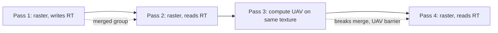

# 06 — Render Passes and Subpasses

**RDG groups consecutive raster passes into a single RHI render pass when their state can be merged.** The RHI-side model (`FRHIRenderPassInfo`, load/store actions, subpasses) is documented in [../RHI/05_Render_Passes_and_Subpasses.md](../RHI/05_Render_Passes_and_Subpasses.md); this chapter covers what RDG decides and what it cannot decide.

Terminology note for 5.8: there is no `FRenderPassDesc` and no `enum class ELoadAction` in the source. The live types are `FRHIRenderPassInfo` (`RHIResources.h:5346`), `FRHIParallelRenderPassInfo` (`:5646`), `ERenderTargetActions` (`:5229`), `EDepthStencilTargetActions` (`:5264`). RDG reaches them through `FRDGParameterStruct::GetRenderPassInfo()` (`RenderGraphBuilder.h:497`), called at `RenderGraphBuilder.cpp:3450`.

## Gating

`IsRenderPassMergeEnabled` (`RenderGraphPrivate.h:224-227`) is a single return at `:226`; all conditions must hold:

| Condition | CVar / source |
|---|---|
| `GRDGMergeRenderPasses` non-zero | `RenderGraphPrivate.h:226`; `r.RDG.MergeRenderPasses` default 1 (`RenderGraphPrivate.cpp:242`) |
| Not immediate mode | `RenderGraphPrivate.h:226` via `IsImmediateMode()` (`:219-222`) |
| `FDataDrivenShaderPlatformInfo::IsValid(ShaderPlatform)` | `RenderGraphPrivate.h:226` |
| `RHIHasTiledGPU(ShaderPlatform)` | `RenderGraphPrivate.h:226` |
| `!GRDGDebugFlushGPU` | `RenderGraphPrivate.h:226`; `r.RDG.Debug.FlushGPU` (`RenderGraphPrivate.cpp:34`) |

Merging is mutually exclusive with async compute (`RenderGraphPrivate.h:229-234`). On a non-tiled GPU, RDG still emits render passes but the merge count stays 0 — a common source of confusion when comparing desktop and mobile profiles.

## Merge decision

The per-pass check (`RenderGraphBuilder.cpp:1511-1536`):

1. A pass with `SkipRenderPass` or `NeverMerge` cannot be merged (`1512`).
2. The previous group's render-target set must satisfy `CanMergeBefore(RenderTargets)` (`1531`).
3. Under `WITH_MGPU`, the GPU mask must be equal (`1533`).
4. Merged passes increment `GRDGStatRenderPassMergeCount` (`1492`).

The underlying state rules are the merge rules in `FRDGSubresourceState::IsMergeAllowed` (`RenderGraphResources.cpp:69-133`): a UAV that needs a barrier (`:115`), a depth read mixed with a depth write (`:102`), or a cross-pipeline access outside `GRHIMultiPipelineMergeableAccessMask` (`:121`) breaks the group. That is the mechanism a tech artist can observe: adding a compute UAV write between two raster passes splits the render pass and adds a barrier.

## Begin and end

`ExecutePassPrologue` calls `BeginRenderPass` only for passes that open a group (`RenderGraphBuilder.cpp:3446-3451`), and `ExecutePassEpilogue` calls `EndRenderPass` only for passes that close one (`3467-3470`). The predicates `IsMergedRenderPassBegin` / `IsMergedRenderPassEnd` (`RenderGraphPass.h:273-278`) and `SkipRenderPassBegin` / `SkipRenderPassEnd` (`:283-288`) decide which side of the boundary a pass is on.

## Load actions come from production state

RDG derives load actions from whether a resource was produced inside the graph, not from an explicit request:

| Helper | Line | Behaviour |
|---|---|---|
| `HasBeenProduced` | `RenderGraphUtils.h:51` | True if a pass wrote the resource |
| `GetLoadActionIfProduced` | `:69` | `Clear`/`Load` depending on production |
| `GetLoadBindingIfProduced` | `:75` | `FClearValueBinding` or `Unknown` |
| `GetRenderTargetBindings` | `:121` | Bindings for the render pass info |
| `ExtractRenderTargetsInfo` | `RenderGraphResources.h:1512-1513` | Builds `FRHIRenderPassInfo` from parameter slots; implementation `RenderGraphResources.inl:208-210`, slot conversion from `:213` |

Consequence: a pass that reads a texture it never wrote in this graph gets a `Load` action, which on tile-based hardware means the texture must be resolved from memory. A pass that writes first gets `Clear`/`DontCare`, which is cheaper. `FClearValueBinding` appears 7 times in the RDG graph (`RHIDefinitions.h`), all through these helpers.

## Subpasses

RDG has no subpass API of its own. Subpass behaviour is an RHI/platform feature; RDG participates only through:

- render-target and depth bindings declared in the parameter struct (`SHADER_PARAMETER_RENDER_TARGET` / `SHADER_PARAMETER_STRUCT_INCLUDE(FRenderTargets, ...)`), converted by `ExtractRenderTargetsInfo` (`RenderGraphResources.h:1512-1513`);
- `ERDGPassFlags::SkipRenderPass` (`RenderGraphDefinitions.h:150`) and `NeverMerge` (`:153`) to opt a pass out of a group;
- `SUPPORTS_VISUALIZE_TEXTURE` (`RenderGraphDefinitions.h:63`) for pass-output visualisation.

See [../RHI/05_Render_Passes_and_Subpasses.md](../RHI/05_Render_Passes_and_Subpasses.md) for the subpass descriptor model and [../RHI/06_Pipeline_States_and_Shader_Binding.md](../RHI/06_Pipeline_States_and_Shader_Binding.md) for pipeline state binding.

## What to watch

- A merged group cannot contain a barrier, so any state that requires one splits the group and costs a full resolve on tiled hardware.
- `NeverMerge` requires `Raster` (`RenderGraphValidation.cpp:623`), so marking a compute pass `NeverMerge` is a validation error, not a no-op.
- Merging is disabled by `r.RDG.Debug.FlushGPU` (`RenderGraphPrivate.h:226`), so a debug frame is not comparable to a production frame.
