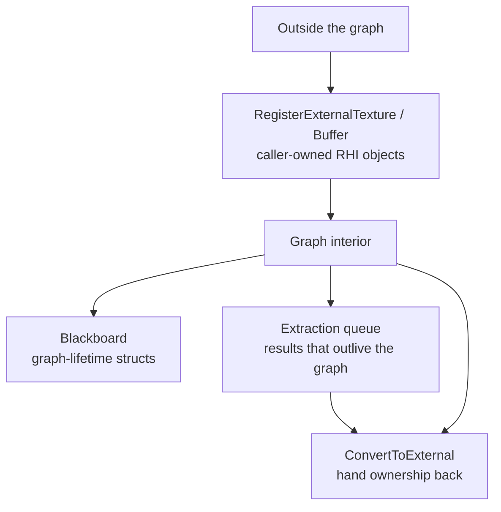

# 07 — Blackboard and External Resources

**Three mechanisms cross the graph boundary: the blackboard for graph-lifetime data, external registration for resources owned outside the graph, and extraction for results that must survive execution.** All three exist because a pass lambda is not allowed to mutate anything outside the graph (`RenderGraph.h:42-44`).

## Blackboard

`FRDGBlackboard` (`RenderGraphBlackboard.h:56-180`) is a map of struct instances allocated from the graph allocator (`private ctor taking FRDGAllocator` `:129-131`), so entries die with the graph. The design comment (`:22-55`) states the intent: good for data created once and read immutably across passes; data that needs tighter constraints should be marshalled through function calls instead.

| API | Line | Notes |
|---|---|---|
| `RDG_REGISTER_BLACKBOARD_STRUCT` | `:15-20` | Registration macro; unregistered struct fails a `static_assert` at `:158` |
| `Create` | `:61-76` | Duplicate registration asserts (`checkf` `:71`) |
| `GetMutable` | `:79-93` | Mutable access |
| `Get` | `:96-100` | Const access |
| `GetOrCreate` | `:102-110` | Lazily creates from the graph allocator |
| `GetMutableChecked` / `GetChecked` | `:113-119` / `:122-126` | Assert if the entry does not exist |
| `Clear` | `:133-136` | Empties the map |
| `FStruct` / `TStruct` | `:138-152` | Storage records |
| `AllocateIndex`, `GetStructIndex` | `:163`, `:165-174` | Index bookkeeping |
| `friend class FRDGBuilder` | `:180` | Only the builder can construct it |

The builder exposes it as `Blackboard` (`RenderGraphBuilder.h:433`). Blackboard entries are not tracked as graph resources: they carry no access state, so nothing in the graph orders writes to them — the caller must guarantee the write happens before the read.

## External resources

`RegisterExternalTexture` (`RenderGraphBuilder.h:79-87`, impl `RenderGraphBuilder.cpp:1081`, `:1097`) and `RegisterExternalBuffer` (`:90-97`, impl `:1122`, `:1136`) wrap an RHI object the caller owns. `FindExternalTexture` / `FindExternalBuffer` (`:71-76`) look up an already-registered resource. Legacy `FPooledRenderTarget` callers go through `RegisterExternalTexture` (`RenderGraph.h:34-35`).

Registered resources are `bExternal` (`RenderGraphResources.h:409`), are cull roots (`:356-359`), and are not considered produced until a pass writes them (`:322-328`). They are locked into external access mode (`RenderGraphResources.cpp:61-66`), which is why `SkipTracking` is only legal on registered textures (`RenderGraphValidation.cpp:241`) and why a locked resource cannot be transitioned by the graph (`RenderGraphValidation.cpp:522`).

`UseExternalAccessMode` (`RenderGraphBuilder.h:384-392`, impl `RenderGraphBuilder.cpp:898`) and `UseInternalAccessMode` (`:398-406`, impl `:931`) switch a resource between the two modes; the queue is flushed at the start of `Execute()` (`RenderGraphBuilder.cpp:960`, `:1790`), and `FRDGExternalAccessQueue::Submit()` is `RenderGraphUtils.cpp:990`.

## Extraction

Results that must survive the graph are queued, not returned:

| API | Line |
|---|---|
| `QueueTextureExtraction` | `RenderGraphBuilder.h:345-346`, impl `RenderGraphBuilder.inl:441`, `:447` |
| `QueueBufferExtraction` | `:352-353`, impl `:477`, `:495` |
| `FExtractedTexture` / `FExtractedBuffer` | `RenderGraphBuilder.h:539-565` |
| Extraction fill during execute | `RenderGraphBuilder.cpp:2202-2212` |
| `ERDGResourceExtractionFlags::AllowTransient` | `RenderGraphDefinitions.h:271` |
| `ConvertToExternalTexture` / `ConvertToExternalBuffer` | `RenderGraphBuilder.h:359-360` |
| `ConvertToExternalUniformBuffer` | `:366` |

Extracted resources always get a reference count at compile (`RenderGraphBuilder.cpp:1373-1381`), so they cannot be culled away. `r.RDG.TransientExtractedResources` (default 1, `RenderGraphPrivate.cpp:260`) allows extracted resources to remain transient; `r.RDG.TransientAllocator` (default 1, `:251`) controls the whole transient path.

Practical consequence: reading an extracted resource before `Execute()` returns is undefined — the value is filled at `2202-2212`, after the execute loop.

## Pooled and reserved resources

- `GetPooledTexture` / `GetPooledBuffer` (`RenderGraphBuilder.h:369-370`) return cross-frame resources; `FRDGPooledBuffer` is `RenderGraphResources.h:1194`, the pool is `GRenderGraphResourcePool` (`RenderGraphResourcePool.h:67`), trimmed by `TickPoolElements()` (`RenderGraphBuilder.cpp:398`).
- `ERDGBufferFlags::MultiFrame` (`RenderGraphDefinitions.h:169`) forces a buffer to survive the graph, which is the only way to get a stable cross-frame buffer.
- Reserved buffers are allocated empty and filled later: `QueueCommitReservedBuffer` (`RenderGraphBuilder.h:339`, impl `RenderGraphBuilder.inl:427`), commit handle recorded in `FRDGSubresourceState::ReservedCommitHandle` (`RenderGraphResources.h:122`), culled-commit transitions handled by `AddCulledReservedCommitTransition` (`RenderGraphBuilder.cpp:4275`).
- Uploads are queued during setup and submitted in `SubmitBufferUploads()` (`RenderGraphBuilder.cpp:2691`, called at `1896-1900`): `QueueBufferUpload` (`RenderGraphBuilder.h:309-333`, impl `RenderGraphBuilder.inl:375-419`), `FRDGUploadData` (`RenderGraphUtils.h:849-858`), `CreateUploadBuffer` (`:1086-1128`), `CreateStructuredUploadBuffer` (`:1134-1144`), `CreateByteAddressUploadBuffer` (`:1150-1160`). `ERDGInitialDataFlags::NoCopy` (`RenderGraphDefinitions.h:287`) skips copying the data into the graph allocator, which means the caller's buffer must stay valid until upload.

Validation hooks for these paths: `ValidateRegisterExternal*` (`RenderGraphValidation.h:65-76`), `ValidateUploadBuffer` (`:78-82`), `ValidateCommitBuffer` (`:84`), `ValidateExtract*` (`:87-88`), `ValidateConvertToExternal*` (`:90-91`), `ValidateGetPooled*` (`:113-114`), `ValidateUseExternalAccessMode` / `ValidateUseInternalAccessMode` (`:120-121`), `ValidateExternalAccess` (`:123`).
