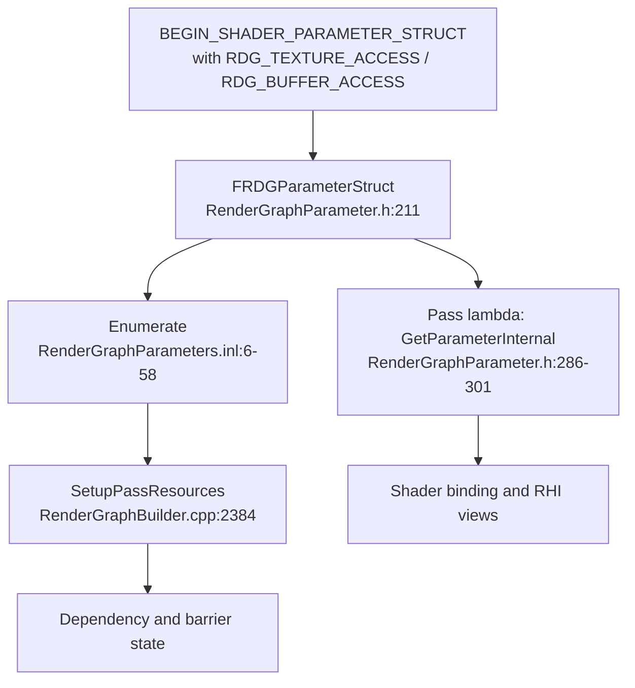

# 08 — Parameters and Shader Binding

**The parameter struct is the only channel between a pass and the graph.** It carries the resources, the declared access states, and the shader binding layout; RDG reads it during setup to build dependencies and barriers, and the pass lambda reads it during execution to bind shaders. A resource used by a pass but absent from its parameters is invisible to the graph (`RenderGraph.h:17-18`).

## Macros

| Macro | Line | Metadata type |
|---|---|---|
| `SHADER_PARAMETER_RDG_TEXTURE` | `ShaderParameterMacros.h:1697` | `UBMT_RDG_TEXTURE` |
| `SHADER_PARAMETER_RDG_TEXTURE_ARRAY` | `:1700` | array form |
| `SHADER_PARAMETER_RDG_TEXTURE_SRV` | `:1709` | `UBMT_RDG_TEXTURE_SRV` |
| `SHADER_PARAMETER_RDG_TEXTURE_SRV_ARRAY` | `:1712` | array form |
| `SHADER_PARAMETER_RDG_TEXTURE_NON_PIXEL_SRV` | `:1721` | non-pixel SRV |
| `SHADER_PARAMETER_RDG_TEXTURE_UAV` | `:1733` | `UBMT_RDG_TEXTURE_UAV` |
| `SHADER_PARAMETER_RDG_BUFFER_SRV` | `:1739` | `UBMT_RDG_BUFFER_SRV` |
| `SHADER_PARAMETER_RDG_BUFFER_UAV` | `:1751` | `UBMT_RDG_BUFFER_UAV` |
| `SHADER_PARAMETER_RDG_UNIFORM_BUFFER` | `:1763` | `UBMT_RDG_UNIFORM_BUFFER` |
| `RDG_TEXTURE_ACCESS` | `:1878` | declared access, compile-time |
| `RDG_TEXTURE_ACCESS_DYNAMIC` | `:1881` | declared access, runtime |
| `RDG_BUFFER_ACCESS` | `:1868` | declared access, compile-time |
| `RDG_BUFFER_ACCESS_DYNAMIC` | `:1871` | declared access, runtime |
| `SHADER_PARAMETER_RDG_BUFFER` / `_ARRAY` | `:1920-1930` | Deprecated since 5.0; directs callers to `RDG_BUFFER_ACCESS` with an explicit RHI state |

The deprecated forms are the common source of missing barriers: they bind a buffer without declaring an access state, so the graph cannot order it.

## Parameter object model

`FRDGParameter` (`RenderGraphParameter.h:9-209`) is a typed accessor. Type predicates (`:14-84`) classify a member; accessors resolve it:

| Accessor | Line |
|---|---|
| `GetAsResource` | `:91` |
| `GetAsUniformBuffer` | `:97` |
| `GetAsViewableResource` | `:103` |
| `GetAsView` | `:109` |
| `GetAsSRV` | `:115` |
| `GetAsUAV` | `:121` |

`FRDGParameterStruct` (`:211-255`) is a non-owning view: the typed constructor (`:216-229`) binds a struct pointer to its shader metadata; layout counts, flags, and render-target slots are stored at `:240-255`. `GetStaticUniformBuffers` (`:278-279`) returns static UBs referenced by the struct; their implementation is `RenderGraphPass.cpp:10-34`. `GetParameterInternal` (`:286-301`) is the lookup used inside pass lambdas; the helper wrapper is `:341-346`. `GetRenderPassInfo()` (`RenderGraphBuilder.h:497`) is the render-pass view of the same metadata.

Enumeration is what makes setup-time analysis possible without executing a pass: `RenderGraphParameters.inl:6-17` walks members, `:20-45` traverses texture and buffer resources, `:48-58` visits non-null graph uniform buffers.

## Allocation

`AllocParameters<T>()` (`RenderGraphBuilder.h:179-192`) allocates the struct from the graph allocator, which is required because the lambda is deferred (`RenderGraph.h:10-12`). Implementations: `RenderGraphBuilder.inl:170` (typed), `:176` (copy), `:184` (metadata), `:190` (strided). Contents are always zero-initialised (`:192`), so an unset member is null rather than garbage. All other `Alloc*` helpers (`Alloc` `:156`, `AllocPOD` `:159`, `AllocPODArray` `:163`, `AllocPODArrayView` `:167`, `AllocObject` `:171`, `AllocArray` `:175`) allocate from `Allocators.Root` (`RenderGraphAllocator.h:17`).

Uniform buffers created from a parameter struct (`RenderGraphBuilder.inl:234`) are materialised in `CreateUniformBuffers()` (`RenderGraphBuilder.cpp:3329`), after resource allocation.

## Unused references

`ClearUnusedGraphResources` (`RenderGraphUtils.h:171-208` single-shader wrapper, `:220-240` multi-shader overload; implementation `RenderGraphUtils.cpp:22-100`, second overload `:103`) nulls shader references that the shader does not actually read. It runs inside the helper-pass `AddPass` variants (`RenderGraphUtils.h:549-564`). The point is not cosmetic: a reference in the parameter struct extends the tracked lifetime of the resource (`RenderGraph.h:23-27`), so a stale reference can keep a texture allocated across passes that never touch it and prevent overlap. `MarkResourceAsUsed()` (`RenderGraphResources.h:147-151`) is the debug hook that reports which declared dependencies were real.

## Validation

`ValidateAddPass` (`RenderGraphValidation.h:98-100`) checks the parameter struct at setup time; `bSkipPassAccessMarking` is documented at `:93-97` for passes that intentionally do not mark access. `ValidateCreateUniformBuffer` is `:54`, `ValidateAddSubresourceAccess` is `:118`. The whole validation surface is compiled out when `RDG_ENABLE_DEBUG` is 0 (`RenderGraphValidation.h:24`, `RenderGraphBuilder.cpp:592-595`).

Practical consequence: a Shipping build accepts a pass whose parameter struct omits a resource the lambda dereferences. The failure is a null RHI pointer at execution, not an assert.
