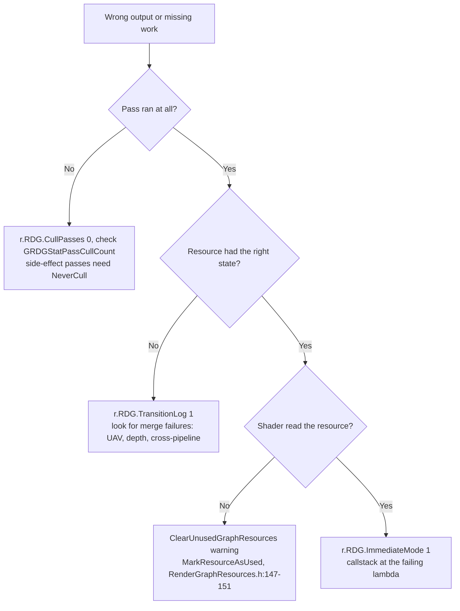

# 10 — Validation and Debugging

**RDG validation is user-facing, not internal, and it is compiled out in Shipping** (`RenderGraphValidation.h:26-38`): it catches mistakes at setup time — a resource used without being declared, an illegal access state, a barrier submitted for a resource the graph does not own. Everything in `RenderGraphValidation.h` is inside `#if RDG_ENABLE_DEBUG` (`:24`), and the builder gates its calls at `RenderGraphBuilder.cpp:592-595`.

## User validation surface

`FRDGUserValidation` (`RenderGraphValidation.h:40-150`):

| Check | Line |
|---|---|
| `ValidateCreateTexture` / `ValidateCreateBuffer` | `:48-49` |
| `ValidateCreateSRV` / `ValidateCreateUAV` | `:50-53` |
| `ValidateCreateUniformBuffer` | `:54` |
| External-resource create variants | `:57-63` |
| `ValidateRegisterExternal*` | `:65-76` |
| `ValidateUploadBuffer` | `:78-82` |
| `ValidateCommitBuffer` | `:84` |
| `ValidateExtract*` | `:87-88` |
| `ValidateConvertToExternal*` | `:90-91` |
| `ValidateAddPass` | `:98-100` (`bSkipPassAccessMarking` documented `:93-97`) |
| `ValidateExecutePassBegin` / `End` | `:103-104` |
| `ValidateExecuteBegin` / `End` | `:107-108` |
| `TryMarkForClobber` | `:111` |
| `ValidateGetPooled*` | `:113-114` |
| `ValidateSetAccessFinal` | `:116` |
| `ValidateAddSubresourceAccess` | `:118` |
| `ValidateUseExternalAccessMode` / `ValidateUseInternalAccessMode` | `:120-121` |
| `ValidateExternalAccess` | `:123` |
| `SetAllowRHIAccess` | `:126` |
| `ResourceMap` | `:141` |
| `ExecuteGuard` | `:149` |

`FRDGBarrierValidation` (`:153-179`) validates submitted barrier batches (`ValidateBarrierBatchBegin` `:160`, `ValidateBarrierBatchEnd` `:163`) against its own resource map (`FResourceMap` `:166-171`) and batch map (`FBarrierBatchMap` `:173`).

Concrete checks observed in `RenderGraphValidation.cpp`:

| Check | Line |
|---|---|
| `SkipTracking` only legal on registered textures | `:241` |
| Resource locked in external access mode cannot be transitioned | `:522` |
| Incompatible access states on the same subresource | `:583` |
| `NeverMerge` requires `Raster` | `:623` |

RHI access outside a pass is guarded by `FRDGAllowRHIAccessScope` (`RenderGraphPrivate.h:39-53`) and `RDG_ALLOW_RHI_ACCESS_SCOPE` (`:55`); `ValidateRHIAccess()` (`RenderGraphResources.h:181-183`) asserts when a resource's RHI handle is dereferenced outside execution (`GetRHI()` `:153-157`).

## Debug controls

| CVar | Line | Default | Effect |
|---|---|---|---|
| `r.RDG.ImmediateMode` | `RenderGraphPrivate.cpp:18` | 0 | Executes passes as created; keeps callstacks (`RenderGraph.h:29-32`) |
| `r.RDG.Validation` | `:25` | 1 | Enables user validation |
| `r.RDG.Debug.FlushGPU` | `:34` | 0 | Flush after each pass; disables async compute and parallel execute |
| `r.RDG.Debug.ExtendResourceLifetimes` | `:43` | 0 | Forces resources to live to the end of the graph |
| `r.RDG.Debug.DisableTransientResources` | `:53` | 0 | Forces non-transient allocation |
| `r.RDG.ClobberResources` | `:60` | 0 (`ECVF_Cheat` `:67`) | Pass outputs get a recognisable value |
| `r.RDG.OverlapUAVs` | `:71` | 1 | Allows UAV overlap; `SkipUAVBarrier` only works when set |
| `r.RDG.TransitionLog` | `:77` | 0 | Logs transitions |
| `r.RDG.Debug.GraphFilter` | `:85` | "" | Restricts debug output to matching graphs |
| `r.RDG.Debug.PassFilter` | `:135` | "" | Restricts to matching passes |
| `r.RDG.Debug.ResourceFilter` | `:152` | "" | Restricts to matching resources |
| `r.RDG.CullPasses` | `:233` | 1 | Pass culling |
| `r.RDG.MergeRenderPasses` | `:242` | 1 | Render-pass merging |
| `r.RDG.TransientAllocator` | `:251` | 1 | Transient allocation |
| `r.RDG.AsyncSetupQueue` | `:315` | 1 | Parallel setup |

Dump flags: `RDG_DUMP_GRAPH_PRODUCERS`, `RDG_DUMP_GRAPH_RESOURCES`, `RDG_DUMP_GRAPH_TRACKS` (`RenderGraphPrivate.h:12-14`), gated by `RDG_DUMP_RESOURCES` (`RenderGraphDefinitions.h:39` under `WITH_DUMPGPU`). `IsDebugAllowedForGraph` / `ForPass` / `ForResource` (`RenderGraphPrivate.h:63-65`) implement the filters; `EmitRDGWarning` is `:67`.

## Debugging flow

Order of operations that reliably separates causes:

1. `r.RDG.ImmediateMode 1` — restores execution order to creation order, so a crash points at the wiring code (`RenderGraph.h:29-32`).
2. `r.RDG.Validation 1` with filters (`RenderGraphPrivate.cpp:85`, `135`, `152`) — isolates the graph, pass, or resource.
3. `r.RDG.ClobberResources 1` — distinguishes "never written" from "written with wrong values".
4. `r.RDG.Debug.ExtendResourceLifetimes 1` and `r.RDG.Debug.DisableTransientResources 1` — removes memory reuse as a variable (`RenderGraphPrivate.cpp:43`, `:53`).
5. `r.RDG.Debug.FlushGPU 1` — removes async compute and parallel execution as variables (`RenderGraphPrivate.cpp:34`).

Each of these changes behaviour, so a bug that reproduces only under one setting is a scheduling or lifetime bug, not a shader bug.

## Warnings worth reading

- A pass that does nothing may not execute, with a warning (`RenderGraph.h:46`).
- Surplus references increase memory and prevent overlap (`RenderGraph.h:23-27`); `MarkResourceAsUsed` reports which references were real.
- A pass that mutates data outside the graph is undefined (`RenderGraph.h:42-44`); results must be extracted.
