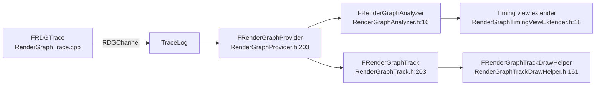

# 11 — Profiling and Insights

**RDG emits three independent signals**: stat counters (`STATGROUP_RDG`), trace records on `RDGChannel`, and event scopes. They answer different questions — counts and memory, per-pass timing and dependencies, and hierarchical frame structure.

## Counters

`STATGROUP_RDG` is declared at `Core/Public/Stats/GlobalStats.inl:62`; the counters themselves are `RenderGraphPrivate.h:164-180`:

| Counter | Line |
|---|---|
| Passes | `164` |
| Passes With Parameters | `165` |
| Passes Culled | `166` |
| Render Passes Merged | `167` |
| Pass Dependencies | `168` |
| Textures | `169` |
| Texture References / average | `170` / `171` |
| Buffers, references, average | `172-174` |
| Views | `175` |
| Transient Textures | `176` |
| Transient Buffers | `177` |
| Resource Transitions | `178` |
| Acquires and Discards | `179` |
| Transition Batches | `180` |

Cycle counters (`RenderGraphPrivate.h:182-188`): Setup, Compile, Execute, Collect Resources, Collect Barriers, Clear, Flush RHI Resources. `STAT_RDG_MemoryWatermark` is `:190`.

The counters are written at the end of `Execute()` (`RenderGraphBuilder.cpp:2225-2230`) and reset per graph (`:451-455`); `SET_DWORD_STAT` calls are `:433-437`, `TRACE_COUNTER_SET` calls `:416-419`. `RDG_STATS` is `STATS || COUNTERSTRACE_ENABLED` (`RenderGraphPrivate.h:125`), so counter values reach Insights only when counter tracing is enabled. `GRDGVerboseCSVStats` (`:117-121`) controls the exclusive CSV timing scope in `Execute()` (`RenderGraphBuilder.cpp:1768`); `STAT_RDG_ExecuteTime` is scoped at `:2048`. `CSV_DECLARE_CATEGORY_EXTERN(RDGCount)` is `:123`.

Interpretation: `Passes Culled` non-zero with a pass you expected to run means culling removed it (`RenderGraphBuilder.cpp:1387-1423`). `Resource Transitions` high relative to `Transition Batches` means states are not merging (`RenderGraphResources.cpp:69-133`). `Texture References` average high means surplus references extending lifetimes (`RenderGraph.h:23-27`).

## Event scopes

| Macro | Line | Behaviour |
|---|---|---|
| `RDG_EVENT_SCOPE_CONSTRUCT` | `RenderGraphEvent.h:438` | Scope construction |
| `RDG_EVENT_SCOPE_IMPL` | `:455` | Implementation |
| `RDG_EVENT_NAME` | `:477` | Pass name with format arguments |
| `RDG_EVENT_SCOPE` | `:479` | Standard scope |
| `RDG_EVENT_SCOPE_STAT` | `:480` | Scope plus stat counter |
| `RDG_EVENT_SCOPE_CONDITIONAL` | `:481` | Conditional scope |
| `RDG_EVENT_SCOPE_CONDITIONAL_STAT` | `:482` | Conditional plus stat |
| `RDG_EVENT_SCOPE_FINAL` | `:484` | Comment `:483`: disables further child scopes/pass events, groups overlapping passes |
| `RDG_EVENT_SCOPE_CONDITIONAL_NAME` | `:486` | Name-only variant |
| `RDG_GPU_STAT_SCOPE` / `_VERBOSE` | `:520` / `:521` | Deprecated in 5.8; the legacy GPU profiler was removed |

When events are disabled (`RDG_EVENTS` 0, `RenderGraphDefinitions.h:46-61`), only STAT scopes survive (`RenderGraphEvent.h:495-503`); the no-event fallbacks are `:509-516`. `FRDGEventName` is `:43-69`, `FRDGScope` is `:173-280`.

## Trace channel

`RDGChannel` is declared at `RenderGraphTrace.h:23` and defined at `RenderGraphTrace.cpp:13`. Records: `GraphMessage` (`:15-22`), `PassMessage` (`:25-47`), `BufferMessage` / `TextureMessage` (`:49-113`), `ScopeMessage` (`:115-121`). `FRDGTrace` (`RenderGraphTrace.h:25-45`) emits them: `OutputGraphBegin` `:30`, `OutputGraphEnd` `:31`, `AddResource` `:33`, `AddTexturePassDependency` `:34`, `AddBufferPassDependency` `:35`, `TransientAllocationStats` `:37`. `RenderTracing` functions are `:51-60`; the `RDGPasses` channel is part of `RenderTracing.h`, and `r.Trace.Channels` defaults to `Submission` (`RenderTracing.cpp:12-14`, `24-58`, `62-68`). `r.Trace.RDG.UseFullPassNames` (`RenderGraphTrace.cpp:544`, default 0) switches to full pass names; trace event names are `:516-540`.

Trace is gated by `RDG_ENABLE_TRACE` (`RenderGraphDefinitions.h:30`).

## RenderGraphInsights

Plugin modules: `Engine/Plugins/RenderGraphInsights/Source/RenderGraphInsights/Private/`, dependencies Core, CoreUObject, RenderCore, RHI, SlateCore, Slate, TraceLog, TraceAnalysis, TraceServices, TraceInsights, TraceInsightsCore, InputCore (`RenderGraphInsights.Build.cs:9-24`).

| Component | Line | Role |
|---|---|---|
| `FRenderGraphInsightsModule` | `RenderGraphInsightsModule.h:17` | Module entry |
| `FRenderGraphProvider` | `RenderGraphProvider.h:203` | Decodes trace records into packets |
| `FPacket` / `FPassIntervalPacket` / `FScopePacket` / `FResourcePacket` | `:39`, `:53`, `:63`, `:74` | Packet model |
| `FTexturePacket` / `FBufferPacket` / `FPassPacket` / `FGraphPacket` | `:101`, `:113`, `:125`, `:153` | Typed records |
| `FRenderGraphAnalyzer` | `RenderGraphAnalyzer.h:16` | Trace analysis |
| `FRenderGraphTrack` | `RenderGraphTrack.h:203` | Timing track |
| `FBoundingBox`, `FVisibleItem`, `FVisiblePass`, `FVisibleGraph` | `:23`, `:37`, `:97`, `:142` | Track geometry and visibility |
| `FRenderGraphTimingEvent`, `FVisibleScopeEvent`, `FVisiblePassEvent`, `FVisibleTextureEvent`, `FVisibleBufferEvent` | `RenderGraphTrack.cpp:143`, `:192`, `:201`, `:210`, `:221` | Event model |
| `FPacketFilter` | `RenderGraphTrack.cpp:248` | Filtering |
| `EDrawLayer`, `FSplinePrimitive`, `FRenderGraphTrackDrawState`, `FRenderGraphTrackDrawStateBuilder`, `FRenderGraphTrackDrawHelper` | `RenderGraphTrackDrawHelper.h:49`, `:63`, `:73`, `:109`, `:161` | Drawing; `DrawTrackHeader` `:177-178`, `DrawSpline` `:180` |
| `FRenderGraphTimingViewSession` / `FRenderGraphTimingViewExtender` | `RenderGraphTimingViewSession.h:19`, `RenderGraphTimingViewExtender.h:18` | Timing view integration |
| `FRenderGraphTraceModule` | `RenderGraphTraceModule.h:12` | Trace module registration |

The dependency edges in the trace (`AddTexturePassDependency` `:34`, `AddBufferPassDependency` `:35`) are what make the Insights view show pass ordering rather than just durations; they come from the same producer/consumer sets the compiler built (`RenderGraphBuilder.cpp:2329`).

## DumpGPU

`RDG_DUMP_RESOURCES` (`RenderGraphDefinitions.h:39`) plus `RDG_DUMP_GRAPH_PRODUCERS` / `RESOURCES` / `TRACKS` (`RenderGraphPrivate.h:12-14`) drive resource dumping. In the project graph, the `FRDGPass` neighbourhood is dominated by DumpGPU symbols (`RegisterResourceAsDumped`, `AddDumpBufferPass`, `AddDumpTextureAllSubResourcesPasses`, `DumpResourcePassOutputs`, `GetPassEventNameWithGPUMask`, `IsDumpingPass`, `UpdateResourceLastModifyingPass`) — pass objects are the anchor for dump instrumentation, and `UpdateResourceLastModifyingPass` is the record that identifies which pass produced a dumped resource.
