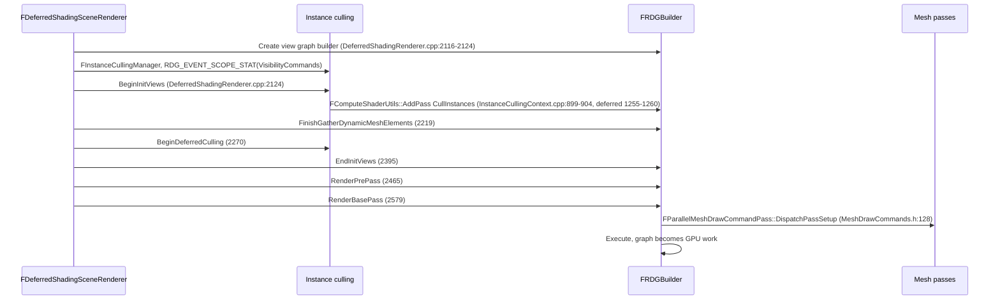

# 12 — Pipeline Integration

**The renderer is RDG's largest consumer, and in 5.8 the mesh-pass layer hands command recording to RDG dispatch passes.** Frame flow at the RHI level is documented in [../RHI/09_Frame_Flow_and_Mesh_Passes.md](../RHI/09_Frame_Flow_and_Mesh_Passes.md); this chapter is the RDG boundary: what the renderer declares, what the graph decides, and where the two meet.

## Frame flow

Anchors: `FRendererViewDataManager` and `FInstanceCullingManager` construction plus the `RDG_EVENT_SCOPE_STAT(GraphBuilder, VisibilityCommands, ...)` scope at `DeferredShadingRenderer.cpp:2116-2124`; `FinishGatherDynamicMeshElements` `:2219`; `BeginDeferredCulling` `:2270`; `EndInitViews` `:2395`; `RenderPrePass` `:2465`; `RenderBasePass` `:2579`; occlusion-query renderer `:632`; scene culling `:1711`, `:1776`; `NaniteRenderer->DrawGeometry` `:1777`; culling dispatch passes `InstanceCulling/InstanceCullingContext.cpp:899-904` (synchronous) and `:1255-1260` (deferred bins), with `AddClearUAVPass` for compaction block counts at `:786`, `:959`, `:1123`.

## Mesh passes and dispatch passes

`EMeshPass::Type` is the pass catalog (`MeshPassProcessor.h:56-100`). `FParallelMeshDrawCommandPass` (`MeshDrawCommands.h:113`) records draw commands through `DispatchPassSetup` (`:128`), which is an RDG dispatch pass (`FRDGDispatchPass`, `RenderGraphPass.h:715`). `FParallelCommandListSet` is deprecated since 5.5 in favour of RDG dispatch passes (`SceneRendering.h:550`); `r.RHICmdMinDrawsPerParallelCmdList` (default 64) is still read (`SceneRendering.cpp:512-515`).

Indirect-argument buffers reach the shader through RDG access declarations, not through manual transitions: `RDG_BUFFER_ACCESS(NaniteIndirectArgs, ERHIAccess::IndirectArgs)` (`BasePassRendering.h:162`) and `SHADER_PARAMETER_STRUCT_INCLUDE(FInstanceCullingDrawParams, InstanceCullingDrawParams)` (`:163`). `bUseGPUScene` gates the path (`MeshPassProcessor.h:2076`, `2108`).

## What the graph adds on top of the renderer

Three things the renderer cannot do by itself:

1. **Ordering from access, not from code order.** A visibility compute pass and a base-pass raster pass can overlap only if their declared states merge (`RenderGraphResources.cpp:69-133`) and the platform allows it (`RenderGraphPrivate.h:229-234`).
2. **Culling of unused work.** Renderer passes whose outputs never leave the graph are removed (`RenderGraphBuilder.cpp:1387-1423`), which is why a disabled feature costs nothing only if nothing downstream reads its output.
3. **Memory reuse.** Transient allocation reuses memory between passes whose lifetimes do not overlap (`RenderGraphResourcePool.h:113`, `RenderGraphBuilder.cpp:3217`), so peak memory tracks the longest overlapping chain, not the sum of all textures.

## Consumer map (graph facts)

Top Renderer symbols that consume RDG: `AddRenderCurveRasterPipeline` 7, `Render` 6, `RenderLumenReflections` 6, `ShadeBinning` 6, `PrepareLightGrid` 6, `Update` 6, `RenderCapsuleDirectShadows` 5, `AddHairStrandsForwardRasterPass` 5, `AddVisibilityComputeRasterPass` 5, `CreateViewLocalFogVolumeBufferSRV` 5, `UpdateRadianceCaches` 5, `RenderLumenScreenProbeGather` 5, `AddPass_Binning` 5, `UpdateBLAS` 5, `DrawVisibleBricks` 5.

RDG edges by destination module: RenderCore 1988, unresolved 1063, Core 199, RHI 157, Other 62, Renderer 24, Engine 22, OtherRuntime 12. The low Renderer→RDG edge count (24) is the import boundary, not usage: the renderer includes `RenderGraph.h` and calls the builder API; the graph facts above count symbol-level usage.

Cross-module consumers outside Renderer: `NiagaraRenderGraphUtils.h` (30 nodes) is the particle-system surface; `Engine/Source/Runtime/Engine/Private/` contributes 22 edges (streaming, Nanite shared helpers).

## Where the boundary is enforced

- A pass lambda may only touch resources in its parameters (`RenderGraph.h:17-21`); the renderer's mesh passes obey this through `FInstanceCullingDrawParams` and the `RDG_*_ACCESS` macros.
- Results the renderer needs after the graph must be extracted (`RenderGraph.h:44-46`, `RenderGraphBuilder.h:345-353`).
- Passes must not mutate renderer state (culling results, view structs) — that is why culling happens through dispatch passes with explicit indirect-argument access rather than inside a pass lambda.
