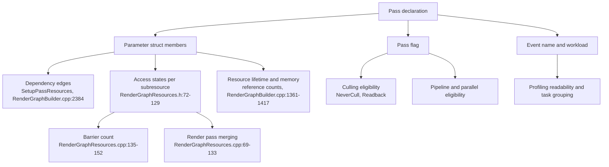

# 13 — Tech Artist Guide

**What a tech artist controls in RDG is declarations, not commands.** Every performance and correctness consequence comes from what a pass declares: which resources, which access states, which flag, which event name. The graph then decides order, barriers, memory, and whether the pass runs at all.

## What each declaration decides

## Cost model

| Decision | Cost when wrong | Evidence |
|---|---|---|
| Declaring a resource the shader does not read | Longer tracked lifetime, higher memory peak, blocked overlap | `RenderGraph.h:23-27`; `ClearUnusedGraphResources` `RenderGraphUtils.cpp:22-100` |
| UAV write that cannot overlap | Extra barrier, breaks render-pass merge | `RenderGraphResources.cpp:96`, `:115`; `SkipUAVBarrier` `RenderGraphPrivate.h:208-217` |
| Mixing depth read and depth write in one group | Merge failure, full resolve on tiled hardware | `RenderGraphResources.cpp:102` |
| Cross-pipeline access on a non-mergeable state | Cross-pipeline barrier | `RenderGraphResources.cpp:121` |
| Async compute plus render-pass merging | Mutually exclusive; one of them is lost | `RenderGraphPrivate.h:229-234` |
| Bundling unrelated work in one pass | Scheduler cannot split it; whole bundle runs as one unit | `RenderGraph.h:48-52` |
| Side-effect pass with no graph output | Silently culled | `RenderGraph.h:46`; `RenderGraphBuilder.cpp:1387-1423` |
| `MultiFrame` buffer | Forces non-transient pooled allocation, survives the frame | `RenderGraphDefinitions.h:169` |
| Missing `AllocParameters` | Deferred lambda reads a freed struct | `RenderGraph.h:10-12` |

## Common mistakes

1. **Deprecated buffer binding.** `SHADER_PARAMETER_RDG_BUFFER` declares no access state (`ShaderParameterMacros.h:1920-1930`); use `RDG_BUFFER_ACCESS` with an explicit `ERHIAccess`.
2. **Reading an extracted resource too early.** Extraction is filled after the execute loop (`RenderGraphBuilder.cpp:2202-2212`); reading before `Execute()` returns is undefined.
3. **Assuming execution order.** Order is only GPU-equivalent (`RenderGraph.h:37-40`); a lambda may run on another thread (`RenderGraph.h:19-21`).
4. **Mutating external state inside a pass.** Not allowed (`RenderGraph.h:42-44`); use extraction or the blackboard with explicit ordering.
5. **Blackboard writes without an ordering guarantee.** Blackboard entries are not tracked resources (`RenderGraphBlackboard.h:22-55`); the graph does not order writes to them.
6. **Hand-written lambda where a helper exists.** Helpers declare access, clear unused references, and emit readable event names (`RenderGraph.h:54-56`, `RenderGraphUtils.h:538-686`).
7. **Event name without parameters.** `RDG_EVENT_NAME` with size and resource name is what makes a trace diagnosable (`RenderGraphUtils.cpp:396`).
8. **Debugging with immediate mode and reading the result as production behaviour.** Immediate mode disables merging and async compute (`RenderGraphPrivate.h:224-234`).
9. **Shipping builds accept bad graphs.** Validation is compiled out (`RenderGraphValidation.h:24`, `RenderGraphBuilder.cpp:592-595`); a missing declaration becomes a null RHI pointer at execution.

## Checklist before shipping a graph

- Every resource the lambda dereferences is in the parameter struct (`RenderGraph.h:17-18`).
- Access states are the minimum required: read-only where possible (`RenderGraphResources.cpp:84`, `:90`).
- UAV usage declares whether overlap is allowed (`ERDGUnorderedAccessViewFlags::SkipBarrier`, `RenderGraphDefinitions.h:227`).
- Side-effect passes carry `NeverCull` or `Readback` (`RenderGraphDefinitions.h:147`, `:159`).
- Pass flag matches the work (`ERDGPassFlags`, `RenderGraphDefinitions.h:129-161`); `NeverMerge` requires `Raster` (`RenderGraphValidation.cpp:623`).
- Event name includes identifying parameters (`RenderGraphEvent.h:477`).
- Workload set for passes that should be grouped for parallel execution (`RenderGraphBuilder.h:246`, `RenderGraphPrivate.cpp:365`).
- Results that survive the graph are extracted (`RenderGraphBuilder.h:345-353`).

## Verification

Run the graph, not just the shader: `r.RDG.TransitionLog 1` for barrier counts, `STATGROUP_RDG` for pass and transition counts (`RenderGraphPrivate.h:164-180`), RenderGraphInsights for ordering and dependencies (`RenderGraphProvider.h:203`, `RenderGraphTrack.h:203`), and `r.RDG.ClobberResources 1` to separate "never written" from "written wrong" (`RenderGraphPrivate.cpp:60`).
