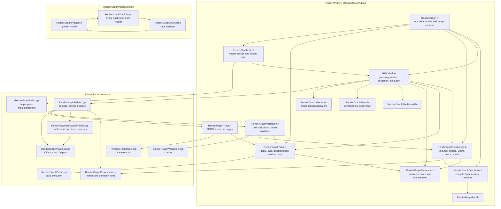
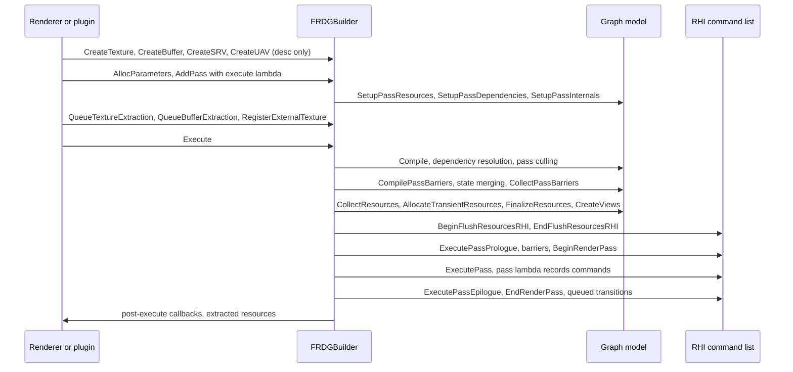
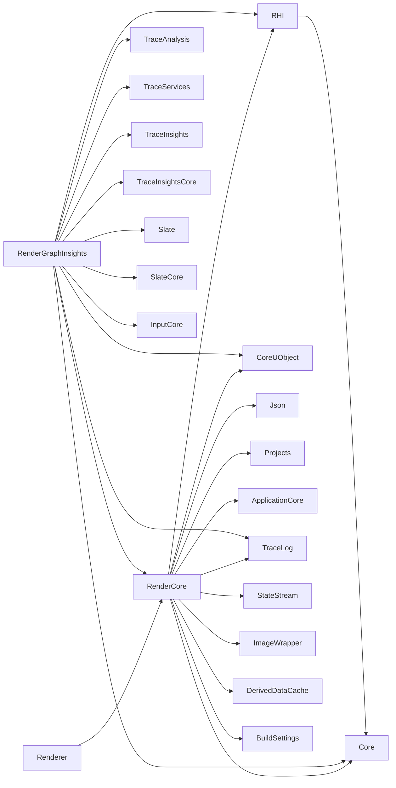

# Render Dependency Graph (RDG) — Architecture & Usage, UE 5.8

Full documentation set for every element of the Unreal Engine 5.8 Render Dependency Graph, grounded in the actual UE 5.8 source (`UE_5.8`). Each file covers **architecture** (types, responsibilities, key APIs, data flow) and **usage** (patterns, pitfalls, what a tech artist must know).

Citations are `file:line` against `Engine/Source/Runtime/RenderCore/…` unless another path is given. Claims not observed in source are marked `[INFERENCE]`. Graph facts come from `graphify-out/graph.json` (scan root `UE_5.8`, `built_at_commit bbf056d8568cdd48992ca50f5b36a2b6896930bd`).

RHI-level behaviour (access states, command lists, pipeline states, subpasses) is documented in [../RHI/](../RHI/); RDG chapters cross-link instead of restating it.

## Index

| File | Scope |
|---|---|
| [01_Overview_and_Architecture.md](01_Overview_and_Architecture.md) | What RDG is, the four graph phases, key types, the usage contract from `RenderGraph.h` |
| [02_Resources_and_Allocation.md](02_Resources_and_Allocation.md) | `FRDGResource`, textures, buffers, views, descs, reference counts, transient allocator, resource pool |
| [03_Declared_Access_and_Transitions.md](03_Declared_Access_and_Transitions.md) | Access modes, subresource states, state merging, barrier batches, UAV barriers, external access queue |
| [04_Pass_Model_and_Ordering.md](04_Pass_Model_and_Ordering.md) | `FRDGPass`, pass flags, dispatch passes, sentinel passes, dependency edges, culling, workload |
| [05_Execution_and_Submission.md](05_Execution_and_Submission.md) | `Execute()` phase order, prologue/epilogue, parallel execute, async compute, immediate mode |
| [06_Render_Passes_and_Subpasses.md](06_Render_Passes_and_Subpasses.md) | Render-pass merging, `FRHIRenderPassInfo`, load actions, bindings, subpass rules |
| [07_Blackboard_and_External_Resources.md](07_Blackboard_and_External_Resources.md) | Blackboard, external/pooled resources, extraction, conversion, access-mode locking |
| [08_Parameters_and_Shader_Binding.md](08_Parameters_and_Shader_Binding.md) | `FRDGParameter`, `FRDGParameterStruct`, `SHADER_PARAMETER_RDG_*` macros, enumeration, UB creation |
| [09_Utilities_and_Helper_Passes.md](09_Utilities_and_Helper_Passes.md) | Helper pass catalog, compute/pixel shader utils, clear/copy/upload/readback, `ClearUnusedGraphResources` |
| [10_Validation_and_Debugging.md](10_Validation_and_Debugging.md) | `FRDGUserValidation`, barrier validation, clobber, filters, immediate mode, warnings |
| [11_Profiling_and_Insights.md](11_Profiling_and_Insights.md) | `STATGROUP_RDG`, counters, CSV stats, `RDGChannel` trace, RenderGraphInsights plugin |
| [12_Pipeline_Integration.md](12_Pipeline_Integration.md) | How the renderer drives RDG: frame flow, dispatch passes, instance culling, mesh passes |
| [13_Tech_Artist_Guide.md](13_Tech_Artist_Guide.md) | Practical rules, cost model, common mistakes, debugging workflow, checklist |
| [14_File_Reference.md](14_File_Reference.md) | File inventory with sizes and responsibilities |
| [15_Testing.md](15_Testing.md) | Test coverage reality, RDG-adjacent test surfaces, how to verify RDG behaviour |

## Layered architecture

## Graph lifecycle

## Module dependency graph (from `.Build.cs`)

`RenderCore` takes `RHI` and `CoreUObject` as **public** dependencies (`RenderCore.Build.cs:12`); `Json`, `Projects`, `ApplicationCore`, `TraceLog`, `StateStream` are private (`RenderCore.Build.cs:17,41-46`). `ImageWrapper` is added only for non-editor desktop Development/DebugGame targets (`RenderCore.Build.cs:28-31`), which is why shader-runtime visualisation is unavailable in Shipping. `DerivedDataCache` is a private dependency only in editor builds (`RenderCore.Build.cs:50-57`). `OpenGLDrv` is an include-path dependency for Windows/Android/Linux, needed by `IGenerateMips` (`RenderCore.Build.cs:59-65`).

## Source roots

- RDG public API: `Engine/Source/Runtime/RenderCore/Public/` (18 files, see [14_File_Reference.md](14_File_Reference.md))
- RDG implementation: `Engine/Source/Runtime/RenderCore/Private/` (14 files)
- Insights tooling: `Engine/Plugins/RenderGraphInsights/Source/RenderGraphInsights/Private/`
- RHI boundary: `Engine/Source/Runtime/RHI/Public/` (`RHIDefinitions.h`, `RHICommandList.h`, `RHITransientResourceAllocator.h`)
- Renderer consumers: `Engine/Source/Runtime/Renderer/Private/`
- Cross-module consumers: `Engine/Source/Runtime/Engine/Private/` (Niagara, Nanite, streaming), `Engine/Source/Editor/`

## Graph facts (from `graphify-out/graph.json`, scan root `UE_5.8`)

- RDG corpus: **1,796 nodes** across the RenderCore RDG files plus `RenderGraphInsights` and `NiagaraRenderGraphUtils.h`.
- Per-file node counts (top): `RenderGraphResources.h` 273, `RenderGraphBuilder.h` 190, `RenderGraphPass.h` 121, `RenderGraphBuilder.cpp` 103, `RenderGraphInsights/RenderGraphTrack.h` 101, `RenderGraphProvider.h` 91, `RenderGraphUtils.h` 84, `RenderGraphEvent.h` 74, `RenderGraphTrackDrawHelper.h` 61, `RenderGraphParameter.h` 60, `RenderGraphDefinitions.h` 59, `RenderGraphValidation.h` 53, `RenderGraphResourcePool.h` 44, `RenderGraphTrack.cpp` 40, `RenderGraphValidation.cpp` 39, `RenderGraphEvent.cpp` 38, `RenderGraphTextureSubresource.h` 35, `NiagaraRenderGraphUtils.h` 30, `RenderGraphAllocator.h` 29, `RenderGraphUtils.cpp` 21.
- Highest-degree RDG files: `RenderGraphResources.h` 1483, `RenderGraphBuilder.h` 793, `RenderGraphBuilder.cpp` 680, `RenderGraphUtils.h` 631, `RenderGraphDefinitions.h` 623, `RenderGraphTrack.h` 442, `RenderGraphUtils.cpp` 421, `RenderGraphPass.h` 341, `RenderGraphProvider.h` 310, `RenderGraphTrackDrawHelper.h` 258, `RenderGraphEvent.h` 245, `RenderGraphParameter.h` 228, `RenderGraphValidation.cpp` 205, `RenderGraphResourcePool.h` 198, `RenderGraphTrack.cpp` 192.
- Highest-degree RDG symbols: `FRDGTextureDesc::Create2D` 248 (`RenderGraphDefinitions.h:630`), `FRDGBuilder` 218 (`RenderGraphBuilder.h:50`), `AddClearUAVPass` 187 (`RenderGraphUtils.cpp:509`), `FRDGBufferDesc::CreateStructuredDesc` 171 (`RenderGraphResources.h:993`), `CreateBufferDesc` 146 (`RenderGraphResources.h:1010`), `ERDGPassFlags` 109 (`RenderGraphBuilder.h:477`), `ClearUnusedGraphResources` 98 (`RenderGraphUtils.h:195`), `FRDGPass` 76 (`RenderGraphPass.h:217`), `FRenderGraphTrack` 60, `AddClearRenderTargetPass` 53 (`RenderGraphUtils.cpp:650`), `FRDGViewableResource` 47 (`RenderGraphResources.h:293`), `FRDGTexture` 47 (`RenderGraphResources.h:569`).
- RDG edge relations: references 2034, calls 1924, defines 752, contains 701, imports 406, method 329, inherits 58.
- RDG edges by destination module: RenderCore 1988, unresolved 1063, Core 199, **RHI 157**, Other 62, Renderer 24, Engine 22, OtherRuntime 12. RDG is a RenderCore-internal cluster whose only hard external dependency is RHI.
- Top RHI symbols RDG depends on: `FRHIComputeCommandList()` 33, `ERHIPipeline` 20, `IsWritableAccess()` 7, `FClearValueBinding` 7, `FRHITransientAllocationFences` 7, `GetRHIAccessName()` 5, `RHIDefinitions.h` 5, `GetRHIPipelineName()` 4, `FRHICommandList()` 4, `FRHIBufferSRVCreateInfo` 4, `FRHIBreadcrumbNode` 3, `FRHITextureSRVCreateInfo` 3, `IsMobilePlatform()` 2.
- Top Renderer symbols that consume RDG: `AddRenderCurveRasterPipeline` 7, `Render` 6, `FDeferredShadingSceneRenderer::RenderLumenReflections` 6, `ShadeBinning` 6, `PrepareLightGrid` 6, `Update` 6, `FSceneRenderer::RenderCapsuleDirectShadows` 5, `AddHairStrandsForwardRasterPass` 5, `AddVisibilityComputeRasterPass` 5, `CreateViewLocalFogVolumeBufferSRV` 5, `UpdateRadianceCaches` 5, `RenderLumenScreenProbeGather` 5, `AddPass_Binning` 5, `UpdateBLAS` 5, `DrawVisibleBricks` 5.
- `graphify path "FRDGBuilder" "FRHICommandList"` resolves to 4 hops: `FRDGBuilder` → `RenderGraphBuilder.h` → `RHIDefinitions.h` (import at `RenderGraphBuilder.h:17`) → `RHI.h` → `FRHICommandList` (`RHI.h:27`). The builder touches RHI only through definitions and the command list reference, not through a direct class link.
- `FRDGBuilder` has **181** direct neighbours in the graph; the neighbourhood is dominated by its own private members (`AccessModeQueue`, `ActivePooledBuffers`, `ActivePooledTextures`, `AddAliasingTransition`, `AddFirstTextureTransition`, `AddCullingDependency`, `AddDispatchHint`) — the builder is the single hub through which every graph operation passes.
- `graphify explain "RenderGraphUtils.cpp"` places it in community 37 with degree 20, containing `AddClearUAVPass`, `AddClearRenderTargetPass`, `AddClearDepthStencilPass`, `ClearUnusedGraphResourcesImpl`, `CreateStructuredBuffer`, `CreateUploadBuffer`, `AllocatePooledTexture`, `FRDGExternalAccessQueue::Submit()`.
- RDG communities (top): 817 (280 nodes), 985 (271), 1054 (252), 3057 (144), "Scene View and Materials" 18 (126), 3454 (112), 27 (85), 7459 (62), 7774 (55), 8941 (46), 2764 (44), 11912 (33). `FRDGBuilder` sits in community 1017.
- The `FRDGPass` neighbourhood is dominated by DumpGPU symbols (`RegisterResourceAsDumped`, `AddDumpBufferPass`, `AddDumpTextureAllSubResourcesPasses`, `FRDGBuilder::DumpResourcePassOutputs`, `GetPassEventNameWithGPUMask`, `IsDumpingPass`, `UpdateResourceLastModifyingPass`) — pass objects are the anchor point for GPU dump instrumentation.
