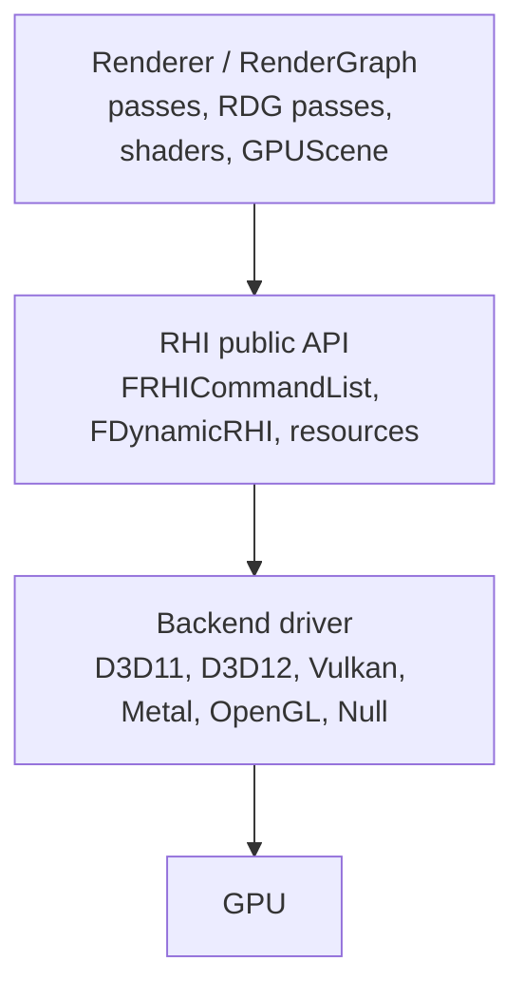
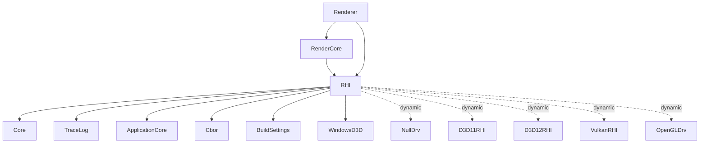

# Overview and Architecture — UE 5.8 RHI

## What the RHI is

The Render Hardware Interface is the layer between the renderer and the graphics API. It is not a thin wrapper: it defines a command-recording model, a resource model with explicit access states, a pipeline-state model, and a capability contract (`GRHIGlobals`) that the renderer queries to decide which features exist.

Three layers:

The renderer never calls a backend. It calls `RHICmdList.DrawIndexedPrimitive(...)` or an `FDynamicRHI` virtual; the backend implements it.

## Dispatch mechanism

`FDynamicRHI` (`RHI/Public/DynamicRHI.h:198`) is the backend vtable — resource creation, shader creation, pipeline creation, context creation. `GDynamicRHI` (`DynamicRHI.h:1000`, defined `DynamicRHI.cpp:33`) points at the live implementation. Inline free-function wrappers (e.g. `RHICreateUniformBuffer` at `DynamicRHI.h:414` virtual, wrapper at `1165`) exist so callers do not touch the global.

`RHIInit()` (`RHI/Private/DynamicRHI.cpp:291`) is the selection point: `InitNullRHI()` when the app cannot render (`L306`), otherwise `PlatformCreateDynamicRHI()` (`L312`), then `GDynamicRHI->Init()` (`L335`). Driver info is read from `GRHIAdapterName` (`L316-330`).

Backends are dynamically loaded modules, listed in `RHI/RHI.Build.cs:27-53`: `NullDrv` always, `D3D11RHI` and `D3D12RHI` on Windows, `VulkanRHI` on Windows/Unix, `OpenGLDrv` on Windows/Linux, Metal under `Engine/Source/Runtime/Apple/MetalRHI`. Dedicated servers load only `NullDrv` (`RHI.Build.cs:29`).

## Design invariants

- **Record, then execute.** Commands are arena-allocated nodes (`RHIAllocators.h:19`, 64 KiB blocks), not heap objects. Bypass mode is the only exception and is unavailable in Shipping/Test (`RHICommandList.h:417`).
- **Access is explicit.** Every viewable resource carries a tracked access state (`FRHIResource.h:1317` `GetTrackedAccess_Unsafe`); transitions are a first-class command (`RHITransition.h:118`), not an implicit side effect of binding.
- **Capability is data, not `#ifdef`.** `GRHIGlobals` (`RHIGlobals.h:805`) plus `DataDrivenShaderPlatformInfo` decide features at runtime; the old `GRHISupports*` globals are deprecated aliases (`RHIGlobals.h:810-828`).
- **Feature level and shader platform are separate.** Feature level is a capability tier (`RHIFeatureLevel.h:15`); shader platform is a compile target (`RHIShaderPlatform.h:10`); `GetFeatureLevelShaderPlatform` (`RHIGlobals.h:1016`, table `ShaderPlatformForFeatureLevel` `L1018`) maps between them, and `GetFeatureLevelShaderPlatform_Checked` (`L1021-1025`) rejects use inside a cook commandlet.
- **Resource lifetime is deferred.** `Release()` queues for deletion (`RHIResources.h:88`, `DeleteResources` `L69`), so a resource can still be in flight on the RHI thread.

## Subsystems

| Subsystem | Primary files | Chapter |
|---|---|---|
| Resources, views, lifetime | `RHIResources.h`, `RHIDefinitions.h`, `RHIFwd.h` | 02 |
| Command lists, execution, threads | `RHICommandList.h`, `RHICommandList.cpp`, `RHIAllocators.h` | 03 |
| Access states, transitions, descriptors | `RHIAccess.h`, `RHITransition.h`, `RHIDescriptorRange.h` | 04 |
| Render passes, subpasses, attachments | `RHIResources.h` (L5229-5646), `RenderGraphPass.h` | 05 |
| Pipeline states, shader binding | `PipelineStateCache.*`, `PipelineFileCache.*`, `PsoLruCache.h`, `RHIShaderBindingLayout.h` | 06 |
| Draw calls, instancing, state cache | `MeshPassProcessor.*`, `MeshDrawCommands.*`, `MeshBatch.h` | 07 |
| Instance culling, GPUScene | `InstanceCulling/*`, `GPUScene.*` | 08 |
| Frame flow, mesh passes | `DeferredShadingRenderer.cpp`, `SceneRendering.*` | 09 |
| Feature levels, shader platforms | `RHIFeatureLevel.h`, `RHIShaderPlatform.h`, `DataDrivenShaderPlatformInfo.*` | 10 |
| Backends | `D3D11RHI`, `D3D12RHI`, `VulkanRHI`, `MetalRHI`, `OpenGLDrv`, `NullDrv` | 11 |
| Multi-GPU, threading | `MultiGPU.h`, `RHICommandList.h` | 12 |
| Profiling, validation, tracing | `RHIStats.h`, `RHIBreadcrumbs.*`, `GPUProfiler.*`, `RHIValidation*`, `RenderTracing.*` | 13 |
| Testing | `Engine/Plugins/Tests/RHITests` | 16 |

## Module dependencies

`WindowsD3D` is Windows-only (`RHI.Build.cs:18-21`). `ProfileVisualizer` is an include-path module in non-Shipping (`L57-60`); `TargetPlatform` only in editor builds (`L62-66`).

## Graph facts

From `graphify-out/graph.json` (2,688,593 nodes, 5,061,968 links, scan root `UE_5.8`, commit `bbf056d8568cdd48992ca50f5b36a2b6896930bd`, graphify 0.9.80), restricted to `Runtime/{RHI,Renderer,CoreRender,RenderCore}`: 35,306 nodes, 61,338 internal links.

| Module | Nodes |
|---|---|
| Renderer | 22,449 |
| RenderCore | 7,571 |
| RHI | 5,286 |

Largest files in the subgraph: `Renderer/Private/ScenePrivate.h` (862), `RHI/Public/RHIResources.h` (840), `Renderer/Private/SceneRendering.h` (548), `RHI/Public/RHICommandList.h` (446), `RenderCore/Public/Shader.h` (379), `Renderer/Private/Nanite/NaniteShared.h` (356), `RHI/Private/PipelineStateCache.cpp` (318), `Renderer/Public/MeshPassProcessor.h` (289), `RenderCore/Public/RenderGraphResources.h` (273).

Top communities (hub node, size): `RendererInterface.h` (2,702), `RenderGraphDefinitions.h` (2,111), `FStaticShaderPlatform` (1,882), `RenderGraphUtils.cpp` (1,571), `FRHICommandList` (950), `FSceneRenderer` (910), `FRHIResource` (858), `FMeshDrawCommand` (805), `FNaniteGlobalShader` (676), `FRHICommandListBase::Bypass` (397).
