# Resources and Lifetime — UE 5.8 RHI

## Scope

The RHI resource model: what a resource is, how views relate to it, how usage flags constrain it, and when it is actually destroyed.

## Base class

`FRHIResource` (`RHI/Public/RHIResources.h:53`) — every RHI object derives from it. It carries an `ERHIResourceType` tag (constructor `L56`), atomic reference counting (`AddRef` `L81`, `Release` `L88`), and, when resource info is enabled, an owner name (`L115`) and `GetResourceInfo()` (`L132`).

`TRefCountPtr<T>` is the ownership handle: `AddRef()` on copy, `Release()` on destruction. `Release()` does **not** destroy immediately — resources go to a deferred deletion queue owned by `FDynamicRHI` (`RHIResources.h:69` `DeleteResources`, `L70` `GatherResourcesToDelete`), because the RHI thread may still be using them.

`RHI_WANT_RESOURCE_INFO` (`RHIFwd.h:8`) → `RHI_ENABLE_RESOURCE_INFO` (`L17`); `RHI/RHI.Build.cs:32-35` sets it for every non-Shipping build (and Test builds when `bTrackRHIResourceInfoForTest`). So in editor/Development you get names and `stat RHI` memory accounting; in Shipping you do not.

## Hierarchy

```mermaid
graph TD
    A["FRHIResource (L53)"] --> B["FRHIViewableResource (L1314)"]
    B --> C["FRHIBuffer (L1627)"]
    B --> D["FRHITexture (L2167)"]
    D --> E["FRHITextureReference (RHITextureReference.h:7)"]
    A --> F["FRHIView (L3304)"]
    F --> G["FRHIShaderResourceView (L3369)"]
    F --> H["FRHIUnorderedAccessView (L3359)"]
    A --> I["FRHIUniformBuffer (L1262)"]
    A --> J["FRHIShader (L842)"]
    A --> K["FRHIGraphicsPipelineState (L1091)"]
    A --> L["FRHIComputePipelineState (L1111)"]
    A --> M["FRHIWorkGraphPipelineState (L1139)"]
    A --> N["FRHIRayTracingPipelineState (L1145)"]
    A --> O["FRHIVertexDeclaration (L687)"]
    A --> P["FRHISamplerState (L633)"]
    A --> Q["FRHIRasterizerState (L641)"]
    A --> R["FRHIDepthStencilState (L648)"]
    A --> S["FRHIBlendState (L658)"]
    A --> T["FRHIBoundShaderState (L695)"]
    A --> U["FRHIResourceCollection (RHIResourceCollection.h:45)"]
    A --> V["FRHIShaderLibrary (RHIShaderLibrary.h:14)"]
    A --> W["FRHIStagingBuffer (L4052)"]
    A --> X["FRHIGPUFence (L2397)"]
    A --> Y["FRHIRenderQuery (L2454) / FRHIRenderQueryPool (L2490)"]
    A --> Z["FRHIViewport (L2544)"]
```

`FRHIViewableResource` is the subset that can have views and therefore tracked access: `GetTrackedAccess_Unsafe()` (`L1317`). Non-viewable resources (samplers, blend states, PSOs, viewports) have no access state.

## Views and view caches

A view is a separate resource object (`FRHIView` `L3304`) that describes how a viewable resource is read: format reinterpretation, mip/slice range, UAV flag. `FRHITextureViewCache` (`L5883`) and `FRHIBufferViewCache` (`L5904`) memoize them (`GetOrCreateSRV`, `GetOrCreateUAV`) so repeated binding of the same view does not recreate the descriptor. This matters for bindless and descriptor-range RHIs, where a view is a slot in a heap rather than a handle.

## Usage flags

`EBufferUsageFlags` (`RHIDefinitions.h:885`):

| Flag | Value | Meaning |
|---|---|---|
| `Static` | 1<<0 | written once |
| `Dynamic` | 1<<1 | occasional CPU write, GPU read |
| `Volatile` | 1<<2 | one-frame lifetime |
| `UnorderedAccess` | 1<<3 | UAV allowed |
| `ByteAddressBuffer` | 1<<4 | byte-addressed uint32 |
| `SourceCopy` | 1<<5 | copy source allowed |
| `DrawIndirect` | 1<<7 | indirect args |
| `ShaderResource` | 1<<8 | SRV allowed |
| `KeepCPUAccessible` | 1<<9 | CPU access requested |
| `FastVRAM` | 1<<10 | FastVRAM hint |
| `NNE` | 1<<11 | NNE use |
| `Shared` | 1<<12 | cross-process/RHI sharing |
| `AccelerationStructure` | 1<<13 | BVH |
| `VertexBuffer` | 1<<14 | vertex buffer |
| `IndexBuffer` | 1<<15 | index buffer |
| `StructuredBuffer` | 1<<16 | structured |
| `MultiGPUAllocate` | 1<<17 | per-GPU allocation |
| `MultiGPUGraphIgnore` | 1<<18 | skip cross-GPU transfer in RDG |
| `RayTracingScratch` | (1<<19)\|UAV | RT scratch |
| `NullResource` | 1<<20 | streaming placeholder |
| `UniformBuffer` | 1<<21 | uniform buffer |
| `ReservedResource` | 1<<22 | virtual/sparse |

`FRHIBufferDesc` (`RHIResources.h:1370`) = `Size`, `Stride`, `Usage`, `GPUMask`. RDG factories (`RenderCore/Public/RenderGraphResources.h:944-1016`) build these.

`ETextureCreateFlags` (`RHIDefinitions.h:1087`) covers `RenderTargetable`, `ResolveTargetable`, `DepthStencilTargetable`, `ShaderResource`, `SRGB`, `CPUWritable`, `NoTiling`, `VideoDecode`, `Dynamic`, `InputAttachmentRead`, `Foveation`, `Tiling3D`, `Memoryless`, `GenerateMipCapable`, `FastVRAMPartialAlloc`, `DisableSRVCreation`, `DisableDCC`.

Flags are contracts, not hints: validation asserts them. An indexed draw on a buffer without `IndexBuffer` fails (`RHI/Public/RHIValidationContext.h:935-970`); a staging copy on a buffer without `SourceCopy` fails when `GRHIValidateBufferSourceCopy` is true (`RHI/Private/RHIValidation.cpp:25`, `1464-1479`).

## FRenderResource: the game-facing pattern

`FRenderResource` (`RenderCore/Public/RenderResource.h:36`) pairs a UObject-ish lifetime with RHI resources:

- `InitRHI(FRHICommandListBase&)` `L83`, `ReleaseRHI()` `L90` — RHI work happens on the render thread only.
- `EInitPhase` `Pre`/`Default` (`L42-45`, `GetInitPhase` `L117`, `SetInitPhase` `L182`) — `Pre` exists for engine resources that must initialize before static-init ordering settles.
- `ERenderResourceState` (`L19`) and `ListIndex` (`L116`) track whether the resource is initialized; `IsInitialized()` `L114`.
- Feature level is stored per resource (`L207`), `SetFeatureLevel` `L154`, `HasValidFeatureLevel` `L156`; `ChangeFeatureLevel` (`L56`) reinitializes everything at a new tier — this is why mobile/editor feature-level switches rebuild resources.
- Names for diagnostics: `SetResourceName` `L136`, `SetOwnerName` `L120`, `GetFriendlyName` `L111`.
- `TGlobalResource<T, InitPhase>` (`L445`) initializes on static construction on the render thread (`L478`).

Concrete subclasses: `FStaticSamplerState`, `FStaticTexture` (SRV for the whole texture, `L334`), `FStaticVertexBuffer` (`L389`), `FStaticIndexBuffer` (`L424`).

## Lifetime rules that actually bite

1. **Deferred deletion.** `Release()` queues; the queue is drained when no in-flight work references the resource. A resource destroyed while the RHI thread still reads it is the classic failure.
2. **Lock tracking.** `FRHILockTracker` (`RHILockTracker.h:8`) records `OutstandingTextureLocks`, `OutstandingLocks`, `OutstandingUnlocks`, `WaitForUnlock`, `FlushCompleteUnlocks`. Mismatched lock/unlock is fatal (`RHI/Private/RHILockTracker.cpp`). `LockBuffer` on a command list is record-time only (`RHICommandList.h:753`).
3. **Transient aliasing.** `IRHITransientResourceAllocator` (`RHITransientResourceAllocator.h:535`) reuses frame memory; `FRHITransientAllocationFences` (`L22`) returns the fence at which a `Discard → Acquire` pair is safe. `GRHIGlobals.NeedsTransientDiscardOnGraphicsWorkaround` (`L63`, `L238`) exists because some RHIs cannot alias across the graphics pipe.
4. **Extended lifetime.** `FRHICommandListScopedExtendResourceLifetime` (`RHICommandList.h:4816`) keeps a resource alive past the normal drain point — used when a resource outlives the command list that referenced it.
5. **Defragmentation.** `FGPUDefragAllocator` (`GPUDefragAllocator.h:42`) moves allocations; resources hold a `FMemoryChunk*` (`L1263`) and a friend relationship (`L1265`), so a resource's address can change — never cache a pointer to buffer contents.
6. **Indirection handle.** `FRHITextureReference` (`RHITextureReference.h:7`) is not a tile-resident texture: `SetReferencedTexture` (`L48`) swaps which whole texture the reference points at and is called only from `FDynamicRHI::RHIUpdateTextureReference` (`DynamicRHI.h:434`); `SetTrackedAccessFromContext` (`L45`) only from the platform context; it carries a bindless handle (`GetDefaultBindlessHandle` `L18`). Tile residency and page mapping live in the virtual-texture page pool (chapter 14). Reserved resources require `GRHIGlobals.ReservedResources.Supported` (`RHITransition.h:110`).
7. **Bindless collections.** `FRHIResourceCollection` (`RHIResourceCollection.h:45`) holds `FRHIResourceCollectionMember` entries; `FRHIResourceReplaceInfo`/`FRHIResourceReplaceBatcher` (`RHIResourceReplace.h:11`, `L54`) batch descriptor updates on a command list.

## Practical consequences

- A texture used as UAV must have `UnorderedAccess` in its create flags *and* be in `UAVCompute`/`UAVGraphics` access when bound; RDG gives you both (`RDG_TEXTURE_ACCESS`), raw RHI does not.
- `Volatile` buffers are unsafe to keep across frames; `Dynamic` buffers are unsafe to keep in a bindless slot that assumes stability.
- In Shipping, resource names and `stat RHI` memory rows disappear — profiling a Shipping build for memory requires `bTrackRHIResourceInfoForTest` or a non-Shipping config.
