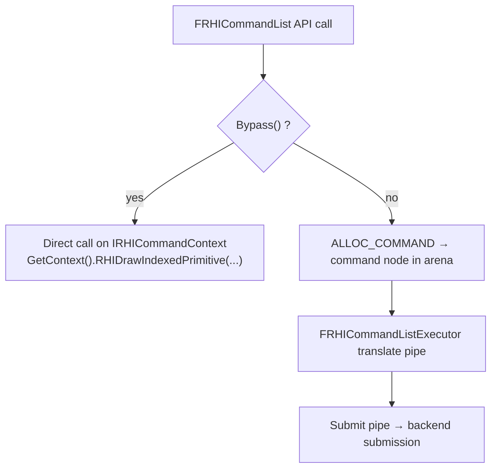
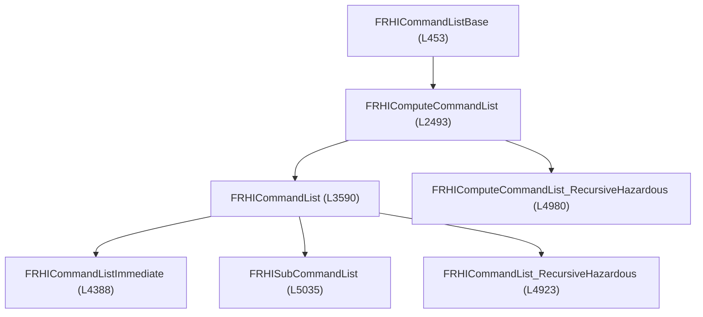

# Command Lists and Execution — UE 5.8 RHI

## Scope

How RHI work is recorded, stored, translated, and submitted to a backend; the thread model that decides when recorded commands actually run.

## Two execution models

`r.RHICmdBypass` (default `0`, `RHI/Private/RHICommandList.cpp:56-58`) — "0: Disable (required for the multithreaded renderer)". Bypass is only togglable outside Shipping/Test: `CAN_TOGGLE_COMMAND_LIST_BYPASS` (`RHI/Public/RHICommandList.h:417`). Every draw API has both paths, e.g. `DrawPrimitive` L3745 records `ALLOC_COMMAND(FRHICommandDrawPrimitive)` L3753 but calls `GetContext().RHIDraw*` directly at L3750 when bypassing.

## Command storage

| Element | Line | Detail |
|---|---|---|
| `ALLOC_COMMAND` / `ALLOC_COMMAND_CL` | 413, 414 | place-construct into the list's `FMemStackBase MemManager` (L456) |
| `FRHICommandBase` | 347 | `Next` pointer + pure virtual `ExecuteAndDestruct(FRHICommandListBase&)` |
| `TRHILambdaCommand` | 354 | arbitrary lambda, optional CPU trace scope |
| `TRHILambdaCommand_NoMarker` | 377 | no trace marker |
| `TRHILambdaCommandMultiPipe` | 393 | valid across pipelines |
| Arena | `RHIAllocators.h:19` | `TConcurrentLinearAllocator<FCommandListBaseBlockAllocationTag>`, `BlockSize = 64 * 1024` |
| `Alloc` / `AllocCopy` / `AllocString` | 521, 526, 558 | command payload allocation |

Commands are singly-linked; execution walks them (`FRHICommandListIterator`) and calls `ExecuteAndDestruct`, which destructs the command in place — no per-command allocation on the hot path.

## Class hierarchy

`FRHISubCommandList` takes a `FRHIParallelRenderPassInfo` (L5038) — used by RDG dispatch passes, which record into sub-lists and dispatch them (`RenderGraphPass.h:764`, `TArray<FRHISubCommandList*>`).

Scoped helpers: `FRHICommandListScopedFence` (L421, batches fences to avoid N fences for N resources), `FRHICommandListScopedPipelineGuard` (L433), `FRHICommandListScopedAllowExtraTransitions` (L443), `FRHICommandListScopedFlushAndExecute` (L4792), `FRHICommandListScopedExtendResourceLifetime` (L4816), `FRHICommandListScopedPipeline` (L4839).

## Execution

`FRHICommandListExecutor GRHICommandList` (`RHI/Private/RHICommandList.cpp:127`).

`FRHICommandListBase::Execute()` (`RHICommandList.cpp:517-548`): sets `bExecuting`, restores `CurrentGPUMask`, installs the crash context with the breadcrumb (thread name resolved L529-532), then iterates commands calling `Cmd->ExecuteAndDestruct(*this)`.

Pipes (`RHICommandList.cpp:808-821`): `SingleTranslatePipe` when `bAllowParallelTranslate`, otherwise `SubmitPipe`; `LastMutate` (L941, L946) blocks future translates until a lock fence signals; `LastClose` (L959, L1084) and `CompletionEvent` (L1937) gate completion. `SupportsConcurrentTranslateAndSubmit` (L949) decides whether translate and submit can overlap.

Flags on `FRHICommandListBase`: `bExecuting` L1182, `bAllowParallelTranslate` L1183, `bUsesSetTrackedAccess` L1184, `bUsesShaderBundles` L1185, `bUsesLockFence` L1186, `bAllowExtraTransitions` L1187. `LockBuffer` (L753) is record-time only; `RHIThreadFence` (L751) produces the graph event a fence waits on.

## Thread model

| Symbol | Line | Meaning |
|---|---|---|
| `ERHIThreadMode` | 98 | `None`, `DedicatedThread`, (task mode) |
| `GPendingRHIThreadMode` | 106 | handles `r.RHIThread.Enable` |
| `GRenderThreadIdle` | 120 | idle-cycle accounting per idle type |
| `FRenderThreadIdleScope` | 123 | marks scopes as render/RHI idle |
| `IsRunningRHIInSeparateThread` | 158 | separate RHI thread |
| `IsRunningRHIInDedicatedThread` | 166 | dedicated RHI thread |
| `IsRunningRHIInTaskThread` | 174 | RHI runs on task-graph threads |
| `CVarRHICmdWidth` | 179 | default 8 (`RHICommandList.cpp:63-65`), task granularity |
| `CVarRHICmdMinDrawsPerParallelCmdList` | `Renderer/Private/SceneRendering.cpp:512-515` | default 64 |

`AllowParallel()` (`RHICommandList.h:5087`) requires `FApp::ShouldUseThreadingForPerformance()`, no bypass, and the RHI-thread compatibility condition.

`FParallelCommandListSet` (`SceneRendering.cpp:919-972`) is `UE_DEPRECATED(5.5, "Use GraphBuilder.AddDispatchPass instead")` (`Renderer/Public/SceneRendering.h:550`); it still shows the mechanics: `Width = CVarRHICmdWidth` L926, `MinDrawsPerCommandList` L927, lists default to the graphics pipeline L963.

## Contexts and pipelines

`IRHIComputeContext` (`RHI/Public/RHIContext.h:254`) is the per-backend vtable: draw, dispatch, transitions, binding. `IRHICommandContext` (L686) extends it with graphics state; `IRHIUploadContext` (L570) is a marker for upload commands. `IRHICommandContextPSOFallback` (L877) exists for RHIs without real pipeline states — it takes `RHISetBoundShaderState` instead of a PSO.

`ERHIPipeline` (`RHI/Public/RHIPipeline.h`): `Graphics = 1 << 0`, `AsyncCompute = 1 << 1`, `None = 0`, `All`. `GetPipelineFromFlags` (L46-50) returns `All` only when `GRHIGlobals.SupportsEfficientAsyncCompute`. Command-list accessors: `GetGraphicsContext` L697, `GetComputeContext` L703, `GetUploadContext` L710; `ActivatePipelines` L730, `SwitchPipeline` L742, `TransitionInternal` L736. `Contexts` L1179, `ComputeContext` L1172, `CommandLink` L1166, `ActivePipelines` L1191.

## Practical consequences

- Recorded commands are cheap but not free: each is a node in a 64 KiB arena plus a virtual `ExecuteAndDestruct`. Batching state changes (see the draw-command state cache, chapter 07) is what keeps the command stream small.
- Anything that must run on the RHI thread has to be a command or a lambda command; a lambda captured by value is the only safe pattern (`TRHILambdaCommand` captures, `EnqueueLambda` for named scopes).
- A lock fence at record time (`LockBuffer`, L753) is what makes a resource safe to destroy later; forgetting it is the classic RHI-thread use-after-free.
- `r.RHICmdWidth` and `r.RHICmdMinDrawsPerParallelCmdList` only matter when there is enough work to split; below the threshold no parallel command lists are created at all.
