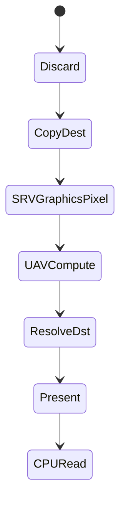

# Access States and Transitions — UE 5.8 RHI

## Scope

`ERHIAccess` is the RHI's explicit usage-state model. It is what makes D3D12 barriers, Vulkan layout transitions, and Metal encoders correct — and it is the model RDG automates.

## The state set

`ERHIAccess` (`RHI/Public/RHIAccess.h:10-85`):

| State | Line | Meaning |
|---|---|---|
| `CPURead` | 17 | CPU readback |
| `Present` | 18 | scanout / swapchain |
| `IndirectArgs` | 19 | read as draw/dispatch arguments |
| `VertexOrIndexBuffer` | 20 | bound as vertex or index stream |
| `SRVCompute` | 21 | read in compute |
| `SRVGraphicsPixel` | 22 | read in a pixel shader |
| `SRVGraphicsNonPixel` | 23 | read in a non-pixel stage (vertex fetch) |
| `CopySrc` | 24 | copy source |
| `ResolveSrc` | 25 | resolve source |
| `DSVRead` | 26 | depth/stencil read |
| `UAVCompute` | 29 | write in compute |
| `UAVGraphics` | 30 | write in a graphics stage |
| `RTV` | 31 | render target write |
| `CopyDest` | 32 | copy destination |
| `ResolveDst` | 33 | resolve destination |
| `DSVWrite` | 34 | depth/stencil write |
| `BVHRead` | 40 | ray tracing acceleration structure read |
| `BVHWrite` | 41 | acceleration structure build/write |
| `Discard` | 44 | contents discarded (transient aliasing) |
| `ShadingRateSource` | 47 | variable-rate shading source |

Masks (`L54-84`) group them: `SRVMask`, `UAVMask`, `DSVMask`, `CopyMask`, `ResolveMask`, `VertexOrIndexBufferMask`, `IndirectArgs`, `All`.

Predicates (`L88-120`): `IsReadOnlyExclusiveAccess` `L88`, `IsReadOnlyAccess` `L93`, `IsWriteOnlyAccess` `L98`, `IsWritableAccess` `L103`, `IsReadableAccess` `L108`, `IsInvalidAccess` `L113`, `IsValidAccess` `L120`. These decide whether a transition is required at all — read-only to read-only is free on most RHIs.

## Transition objects

`FRHISubresourceRange` (`RHI/Public/RHITransition.h:20-101`): mip range, array-slice range, plane-slice range, `kAllSubresources`, `IsWholeResource()` `L70`, `IgnoreDepthPlane()` `L80`. Transitions are per-subresource, not per-resource; a full-resource transition is a special case.

`FRHITransitionInfo` (`L118-226`): resource, `EType` `L130` (transition / alias / discard), `AccessBefore`, `AccessAfter`, `EResourceTransitionFlags`, `FRHICommitInfo` (`L112`) for reserved resources. `GRHIGlobals.ReservedResources.Supported` (`L110`) gates commit/decommit.

Command-list entry points: `RHITransition` / `TransitionResource` (`RHICommandList.h:2120-2166`), `SetTrackedAccess` (`RHIResources.h:1317` for the tracked state itself), `FRHICommandListScopedAllowExtraTransitions` (`RHICommandList.h:443`), `BeginUAVOverlap`/`EndUAVOverlap` (`L1933-1957`) for explicit overlap on RHIs that need it.

`NeedsExtraTransitions` (`RHIGlobals.h:778`) and `NeedsShaderUnbinds` (`L760`) are backend capabilities the command list consults (`RHICommandList.h:1025`, `1031`) — some RHIs require a transition even when the state is unchanged, and some require unbinding shaders when a UAV changes.

## Descriptors

`FRHIDescriptorRange` / `FRHIDescriptorRangeDesc` / `FRHIDescriptorResource` (`RHI/Public/RHIDescriptorRange.h`), `TypeMask` `L50-52`. Header notes `L15` and `L26`: `GRHIGlobals.DescriptorTypeGroups` (`RHIGlobals.h:718`) and `GRHIGlobals.bSupportsDescriptorRange`, which publishes the shader define `PLATFORM_SUPPORTS_DESCRIPTOR_RANGE`. Static shader binding layout support per platform comes from `RHIGetStaticShaderBindingLayoutSupport` (`DataDrivenShaderPlatformInfo.h:1299`, section lookup `Private/DataDrivenShaderPlatformInfo.cpp:120`).

Immutable samplers are deprecated in 5.8 (`RHI/Public/RHIImmutableSamplerState.h:8`) — samplers now come through descriptor ranges or bindless heaps.

## RDG state machine

RDG tracks state per subresource: `FRDGSubresourceState` (`RenderCore/Public/RenderGraphResources.h:74-128`) with `IsTransitionRequired()` `L75`, `IsMergeAllowed()` `L78`, `BarrierLocation` `L128`. `FAccessModeState` (`L417-437`) records the access mode for a resource; `EAccessMode` `L370`; `DefaultEpilogueAccess = ERHIAccess::SRVMask` `L361`; `bSkipLastTransition` `L383`, `bSplitFirstTransition` `L386`.

Pass-level access comes from `RDG_TEXTURE_ACCESS(...)` / `RDG_BUFFER_ACCESS(...)` in a pass's parameter struct; RDG computes the minimal transition set at pass prologue (`RenderGraphPrivate.cpp` prologue `RenderGraphBuilder.cpp:598`, epilogue `L1793`) and emits barriers only where required. Access-mode transitions for externally-tracked resources are queued as auxiliary passes (`RenderGraphBuilder.h:378-384` `UseExternalAccessMode`, `L394-406` `UseInternalAccessMode`; implementation `RenderGraphBuilder.cpp:898-928`, `931-948`, access-mode passes `L1044`, `L1065`).

Debug builds can clobber resources on transition to catch reads-before-write: `r.RDG.ClobberResources` default off, depth `0.123456789f`, stencil `123` (`RenderGraphPrivate.cpp:58-65`, `168-203`); `RDG_ENABLE_DEBUG` is `!UE_BUILD_SHIPPING && !UE_BUILD_TEST` (`RenderGraphDefinitions.h:17`).

## Validation view

`FValidationContext` (`RHI/Public/RHIValidationContext.h:472`) wraps a real context, forwards commands, and asserts the access state at use time: draw asserts `ERHIAccess::VertexOrIndexBuffer` for streams and index buffer (`L769-771`, `935-970`), indirect args assert `IndirectArgs`, shader parameters are checked against required access (`L165-200`, `300-304`). Validation operations are queued for deferred replay — `EOpType` covers transitions, tracked-access changes, aliasing, transient acquire/discard/init, asserts, rename, signal/wait, UAV overlap, and breadcrumb ranges (`RHI/Public/RHIValidationCommon.h:572-592`, `SetBreadcrumbRange` `L869-879`) — so the validation model mirrors the real execution order rather than the call order.

## Practical consequences

- A resource read in a vertex shader must be in `SRVGraphicsNonPixel`, not `SRVGraphicsPixel`; RHIs that split those states (tiling-based, mobile) fail if you conflate them.
- `Discard` is not "clear": it means contents are undefined and the memory may be aliased. Using `Discard` on a resource you then read is a silent correctness bug that only shows up under RDG clobber or on a defragmenting allocator.
- Every transition has a cost on D3D12/Vulkan; the reason RDG exists is to compute the minimum set. Hand-written RHI code that re-asserts the same access every pass generates redundant barriers (`IsTransitionRequired()` returns false, but you still pay the call).
