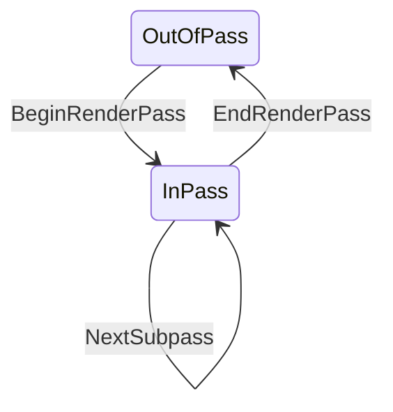
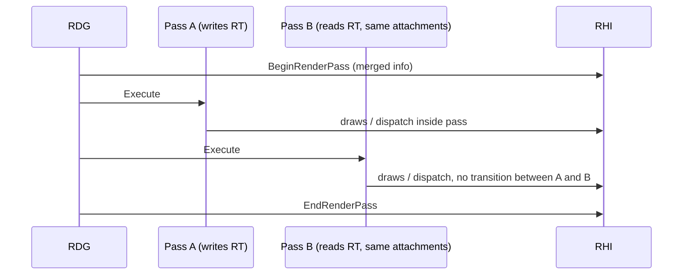

# Render Passes and Subpasses — UE 5.8 RHI

## Scope

The render pass is the unit the GPU optimizes: a set of attachments with declared load/store behaviour, inside which subpasses can read the attachments they write. UE 5.8 has no `FRenderPassDesc`/`ELoadAction` — the live types are `FRHIRenderPassInfo` plus the action enums.

## Actions

`ERenderTargetActions` (`RHI/Public/RHIResources.h:5229`), helpers `MakeRenderTargetActions` / `GetLoadAction` / `GetStoreAction` (`L5249-5262`). `EDepthStencilTargetActions` (`L5264`), `MakeDepthStencilTargetActions` (`L5292`). Load actions decide whether the attachment is cleared, loaded, or undefined at pass start; store actions decide whether it is written back to memory. `FResolveRect` (`L5307`) describes an in-pass resolve.

The action is part of the PSO identity: `DepthTargetLoadAction`, `DepthTargetStoreAction`, `StencilTargetLoadAction`, `StencilTargetStoreAction` are fields of `FGraphicsPipelineStateInitializer` (`L4655`) and are compared in `operator==` (`L4748`). Changing a load action can therefore create a new PSO — a real hitch source when a pass switches from clear to load.

## FRHIRenderPassInfo

`FRHIRenderPassInfo` (`RHIResources.h:5346-5637`): color attachment entries with `Action` (`L5354`), depth-stencil entry with `Action` and `ExclusiveDepthStencil` (`L5362-5363`), `ESubpassHint SubpassHint` (`L5385`), `NumOcclusionQueries`, constructors at `L5392` and `L5404`. RDG builds it from `FDepthStencilBinding` plus `ERenderTargetLoadAction`/`ERenderTargetStoreAction` (`RenderCore/Private/RenderGraphUtils.cpp:800`, `807`, `817`).

`FRHIParallelRenderPassInfo` (`L5646`) is the shared object RDG dispatch passes use so multiple command lists can record into the same pass.

## Command-list state machine

`BeginRenderPass` (`RHICommandList.h:4051-4055`) caches active render targets, calls `ResetSubpass(InInfo.SubpassHint)` (`L4052`), sets `PersistentState.bInsideRenderPass = true` (`L4053`), and handles `NumOcclusionQueries` (`L4055`). `EndRenderPass` clears the flag (`L4081`) and resets the subpass hint to `None` (`L4082`). `NextSubpass` (`L4091-4103`) requires being inside a pass (`check` `L4093`), records `FRHICommandNextSubpass` (`L1776`, executed at `RHICommandListCommandExecutes.inl:194-198`), and increments `PersistentState.SubpassIndex` (`L1131-1134`).

Validation enforces the boundary: a graphics PSO may only be set inside an active render pass (`RHI/Private/RHIValidation.cpp:1494-1500`; `RHI/Public/RHIValidationContext.h:801-824`), and drawing without a graphics PSO is rejected (`RHIValidation.cpp:1494-1500`).

## Subpasses

`ESubpassHint` (`RHIResources.h:4609`): `None` (`L4612`), `DepthReadSubpass` (`L4615`), `DeferredShadingSubpass` (`L4618`), `CustomResolveSubpass` (`L4621`, includes depth read). A texture used as an input attachment needs `ETextureCreateFlags::InputAttachmentRead` (`RHIDefinitions.h:1110`, legacy macro `L1198`).

`SubpassHint` and `SubpassIndex` are part of the PSO key (`RHIResources.h:4777-4778`, `4852-4853`; serialized in `PipelineFileCache.h:146-147`). A pipeline compiled for subpass 0 is not valid for subpass 1 — RHIs that support subpasses build a distinct pipeline per subpass.

Subpasses are only useful where the hardware exposes on-tile memory: `TexCreate_Memoryless` (`RHIDefinitions.h:1201`) plus `InputAttachmentRead` is the mobile deferred-shading pattern (`ESubpassHint::DeferredShadingSubpass`). On desktop RHIs the hint is inert.

## RDG pass merging

RDG decides which passes can share one physical render pass:

- `ERDGPassFlags` (`RenderCore/Public/RenderGraphDefinitions.h:129-161`): `SkipRenderPass` (`L150`) — the pass runs outside any render pass; `NeverMerge` (`L153`) — cannot be merged with neighbours.
- `FRDGPass` (`RenderCore/Public/RenderGraphPass.h:217-241`): `GetEventName()` `L233`, `GetFlags()` `L238`; merge predicates `L273-291`; `Pipeline` `L392`; `bSkipRenderPassBegin/End` `L401-402`; `bRenderPassOnlyWrites` `L442`.
- `FRDGDispatchPass` (`L719`) carries `FRHIParallelRenderPassInfo` obtained from `ParameterStruct.GetRenderPassInfo()` (`L754`, `L762`) and a `TArray<FRHISubCommandList*>` (`L764`) — the command lists are inserted logically into the pass (`RHICommandList.h:4085`).
- `FRDGSentinelPass` (`L825`) marks pass boundaries.

Merging is only legal when the access states are compatible (`FRDGSubresourceState::IsMergeAllowed()`, `RenderGraphResources.h:78`) and no barrier is required between the passes (`IsTransitionRequired()` `L75`). A pass that reads an attachment it did not write, or that needs a UAV→SRV transition, breaks the merge.

## Practical consequences

- Declaring a load action as `Clear` when the content is actually preserved forces a clear and discards data; declaring `Load` when nothing was written reads undefined memory. RDG's `bRenderPassOnlyWrites` (`RenderGraphPass.h:442`) exists to detect the second case.
- Store actions matter on tile-based hardware: a pass that writes an attachment nobody reads should not store it.
- Subpass-sensitive PSOs mean a mobile deferred pipeline is a separate cache entry per subpass; PSO warm-up must cover each subpass, not just each material.
