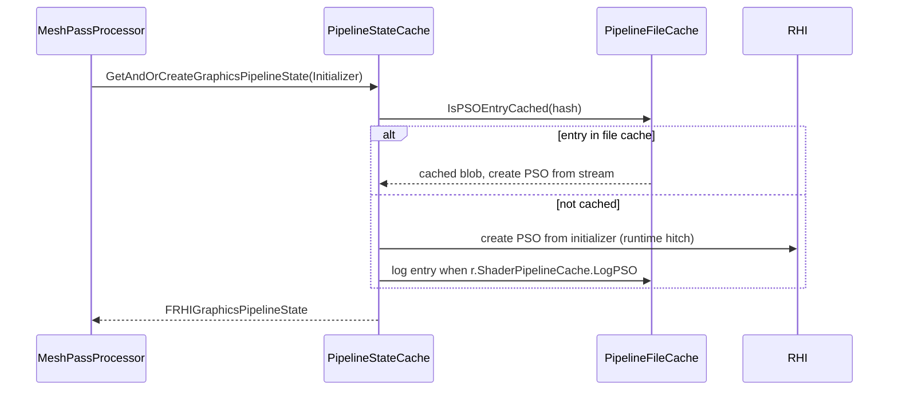

# Pipeline States and Shader Binding — UE 5.8 RHI

## Scope

What a PSO is in UE, how it is keyed, cached, and persisted, and how shader resources (uniform buffers, descriptor ranges, root constants, samplers) are bound to it.

## Pipeline state objects

`FGraphicsPipelineStateInitializer` (`RHI/Public/RHIResources.h:4655`): `BoundShaderState`, `BlendState`, `RasterizerState`, `DepthStencilState`, `PrimitiveType`, `RenderTargetsEnabled`, `RenderTargetFormats`, `RenderTargetFlags`, `DepthStencilTargetFormat`, `DepthStencilTargetFlag`, depth/stencil load and store actions, `DepthStencilAccess`, `NumSamples`, `SubpassHint`, `SubpassIndex`, `ConservativeRasterization`, `bDepthBounds`, `MultiViewCount`, `bHasFragmentDensityAttachment`, `bAllowVariableRateShading`, `ShadingRate`, `Flags`, `StatePrecachePSOHash`.

`FComputePipelineStateInitializer` (`L4899`): `ComputeShader`, `SpecializationConstants`, `Flags`.

Identity is `operator==` (`L4748`): every shader stage (VS, PS, GS, MS, AS), every state object, primitive type, render-target formats and the *relevant* flag subset (`RelevantRenderTargetFlagMask` `L4828`), depth/stencil formats and flags, load/store actions, and rasterization mode. Two materials with the same shader and different render-target flags are different PSOs.

Result objects: `FRHIGraphicsPipelineState` (`L1091`), `FRHIComputePipelineState` (`L1111`), `FRHIWorkGraphPipelineState` (`L1139`), `FRHIRayTracingPipelineState` (`L1145`).

Usage of the last two — SBT lifetimes and binding modes, build/dispatch commands, capability gates, work graph node tables and dispatch path — is in [17_Ray_Tracing_WorkGraph_States_and_Presentation.md](17_Ray_Tracing_WorkGraph_States_and_Presentation.md).

## Lookup and caching

Runtime LRU: `TPsoLruCache` (`RHI/Public/PsoLruCache.h:20`). File cache entry format: `FPipelineCacheFileFormatPSO` (`RHI/Public/PipelineFileCache.h:111`), hashed with `GetTypeHash`; `FPipelineCacheFile` (`Private/PipelineFileCache.cpp:202`), `FPipelineFileCacheManager` (`Public/PipelineFileCache.h:314`).

Key functions: `OpenPipelineFileCache` (`PipelineFileCache.cpp:1921`, `2183`), `SavePipelineFileCache` (`L2392`), `IsPSOEntryCached` (`PipelineFileCache.h:418`, impl `L3085`), `IsBSSEquivalentPSOEntryCached` (`L3070`), `IsPipelineFileCacheEnabled` (`L3096`), `SortVertexElements` (`L1574`), `Verify` (`L1034`).

Cache API (`RHI/Public/PipelineStateCache.h`): `SetComputePipelineState` `L163`, `SetGraphicsPipelineStateCheckApply` `L164`, `SetGraphicsPipelineState` `L165`, `GetAndOrCreateGraphicsPipelineState` `L189`, `FindComputePipelineState` `L191`, `FindGraphicsPipelineState` `L201`, `GetPipelineStates` `L203`, `PrecacheGraphicsPipelineState` `L244`, `CheckPipelineStateInCache` `L247`/`L248`, `IsPrecaching` `L274`/`L277`.

The draw path only sets a PSO when it changes (`Renderer/Private/MeshPassProcessor.cpp:1264`), and can skip a draw entirely while a PSO is still being precached when `bAllowSkipDrawCommand && GSkipDrawOnPSOPrecaching` (`L1291`).

### CVars

| CVar | Default | Source |
|---|---|---|
| `r.ShaderPipelineCache.Enabled` | `!WITH_EDITOR` | `PipelineFileCache.cpp:112` |
| `r.ShaderPipelineCache.LogPSO` | `!WITH_EDITOR` | `PipelineFileCache.cpp:119` |
| `r.ShaderPipelineCache.SaveUserCache` | `!WITH_EDITOR && Shipping` | `PipelineFileCache.cpp:159` |
| `r.pso.evictiontime` | 60 | `PipelineStateCache.cpp:188` |
| `r.PSO.RuntimeCreationHitchThreshold` | 20 ms | `PipelineStateCache.cpp:195` |

PSO hitch messages include the breadcrumb that produced the PSO when breadcrumbs are compiled in (`PipelineStateCache.cpp:290-297`, `315-336`).

`PSO_VERIFY` (`RHICommandList.h:341-345`) is `ensure` when `CONTINUABLE_PSO_VERIFY` is defined, otherwise `check`.

## Legacy path

`FBoundShaderStateCache` (`RHI/Public/BoundShaderStateCache.h:12`: `FBoundShaderStateKey`, `FBoundShaderStateLookupKey`, `FCachedBoundShaderStateLink`) — `GetCachedBoundShaderState` (`Private/BoundShaderStateCache.cpp:90`), `_Threadsafe` (`L128`), `EmptyCachedCachedBoundShaderStates` (`L162`). Used when `PLATFORM_USE_FALLBACK_PSO` is active (`RHICommandList.h:3896`) and by `FDynamicRHIPSOFallback` (`DynamicRHI.h:1003`) / `IRHICommandContextPSOFallback` (`RHIContext.h:877`) — RHIs without real pipeline objects bind a `FRHIBoundShaderState` (`RHIResources.h:695`) instead.

## Binding model

`FRHIShaderBindingLayout` (`RHI/Public/RHIShaderBindingLayout.h:71`) manages uniform-buffer entries and `EShaderBindingLayoutFlags`. `EUniformBufferBindingFlags` (`RHIDefinitions.h:676`): `Shader = 1<<0` (bindable as a shader parameter), `Static = 1<<1` (bound through a static slot), `StaticAndShader = 3`.

Static slots: `IMPLEMENT_STATIC_UNIFORM_BUFFER_SLOT(SlotName)` (`RenderCore/Public/ShaderParameterMacros.h:1588`); `IMPLEMENT_STATIC_AND_SHADER_UNIFORM_BUFFER_STRUCT_EX` with `EUsageFlags::UniformView` for GPUScene (`Renderer/Private/InstanceCulling/InstanceCullingContext.cpp:58`, slot `L57`, lookup `L118-119`). Binding: `SetStaticUniformBuffer` (`RHICommandList.h:2575`, command `L2233`), `SetUniformBufferDynamicOffset` (`L2585`, command `L2246`), `RHISetStaticUniformBuffers` (`RHIContext.h:360`).

Root constants: `SetShaderRootConstants` (`RHICommandList.h:2840`, command `L1917`), `SetComputeShaderRootConstants` (`L2850`).

Descriptor ranges: `FRHIDescriptorRange`, `FRHIDescriptorRangeDesc` (`TypeMask` `L50-52`), `FRHIDescriptorResource` (`RHIDescriptorRange.h`); gated by `GRHIGlobals.bSupportsDescriptorRange` and `GRHIGlobals.DescriptorTypeGroups` (`RHIGlobals.h:718`), exposed to shaders as `PLATFORM_SUPPORTS_DESCRIPTOR_RANGE`. Immutable samplers are deprecated in 5.8 (`RHI/Public/RHIImmutableSamplerState.h:8`).

Shader bundles: `ERHIShaderBundleMode` (`CS`, `MSPS`, `VSPS`) (`RHIResources.h:3966`), `FRHIShaderBundle` (`L3990`), `RenderCore/Public/ShaderBundles.h`, dispatch via `DispatchComputeShaderBundle` (`RHICommandList.h:2860`, commands `L1851-1915`), gated by `GRHIGlobals.ShaderBundles.SupportsDispatch` (`RHIGlobals.h:661`) and `RequiresSharedBindlessParameters` (`RHIValidationContext.h:180`, `222`, `568`, `612`). Bundles exist to dispatch without per-command translation overhead.

Uniform buffers: `RHICreateUniformBuffer` virtual (`DynamicRHI.h:414`), wrapper (`L1165`); `EUniformBufferValidation` (`RHIDefinitions.h:527`): `None`, `ValidateResources`. `RHISetShaderUnbinds` is asserted where required (`RHIContext.h:357`, `765`).

### Parameter structs and batched parameters

`FShaderParametersMetadata` (`RenderCore/Public/ShaderParameterMetadata.h:135`) is the runtime description of a `LAYOUT_FIELD` struct; `FTypeInfo::GetStructMetadata()` (`L238`) resolves it and nested structs resolve through member metadata (`L452`); layout is hashed (`HashLayout` `L277`). `FShaderParameterMap` (`RenderCore/Public/ShaderCore.h:324`) maps parameter names to offsets for a permutation, and `FShaderResourceParameterInfo` (`Shader.h:176`) / `FShaderParameterMapInfo` (`L289`) are the exported-layout forms the shader map uses. Declaration and registration are `DECLARE_UNIFORM_BUFFER_STRUCT` (`ShaderParameterStructDeclaration.h:10`) and `IMPLEMENT_GLOBAL_SHADER_PARAMETER_STRUCT` (`ShaderParameterMacros.h:1601`), with lazy registration through `FShaderParametersMetadataRegistration` (`L1453`).

Binding is data-driven: `SHADER_USE_PARAMETER_STRUCT` (`ShaderParameterStruct.h:62`) plus `SHADER_ROOT_PARAMETERS_SIGNATURE()` (`L58-59`), a `FShaderParameterBindings` filled by `BindForLegacyShaderParameters` (`L31`), and `SetShaderParameters(BatchedParameters, Bindings, Metadata, Data, ResourceExclusions)` (`L258-263`). The `UE_DEPRECATED(5.8, "Calls to SetShaderParameters now require ResourceExclusions to be specified.")` annotations are **commented out** (`L311`, `L326`, `L341`), so the five-argument overloads (`L312`, `L327`, `L342`) still compile; they `checkf` that the shader has no specialization constants (`L314`, `L329`, `L344`) and forward an empty `FResourceExclusionArrayView()` to the six-argument form — the exclusion array is what tells the binder which resources are static. `ValidateShaderParameters` (`L142`) is the debug-time check.

`FRHIBatchedShaderParameters` (`RHI/Public/RHIShaderParameters.h:245-249`) is a parameter buffer over `FRHIBatchedShaderParametersAllocator` mem stacks (`L101-112`, page-size enum `L95`) and is not bound to any shader until `SetBatchedShaderParameters` runs; the command list hands out a scratch instance (`RHICommandList.h:996`). `SetAllShaderParametersAsBindless` (`ShaderParameterStruct.h:243-256`) is the bindless path. UAV/SRV unbinds are collected by parameter index (`L154`, `L169`, `L174-182`) and are rejected for the root parameter buffer index (`L190`, `L201`) — this is the mechanism behind `NeedsShaderUnbinds` (chapter 04). RDG passes reach the same machinery through `FRDGParameterStruct` (`RenderGraphResources.h:202`, `L243`) and `ExtractRenderTargetsInfo` (`L1512`).

[INFERENCE] Because the layout is hashed, adding or reordering a `LAYOUT_FIELD` in a shared struct changes the shader-map key for every shader that uses it — a common cause of full shader recompiles in the editor.

## Practical consequences

- PSO identity includes render-target format and the relevant flags, so a material rendered into a different-format buffer is a new PSO. That is why format changes in post-processing cause cache misses.
- The file cache is disabled in editor by default (`r.ShaderPipelineCache.Enabled` = `!WITH_EDITOR`), so editor hitches are expected; shipping builds read a pre-baked `.pso` cache and only miss on unlogged combinations.
- Static uniform buffer slots are compile-time layout contracts. A shader permutation compiled for a different layout than the bound buffer is a validation failure, not a silent bug (`EUniformBufferValidation::ValidateResources`).
