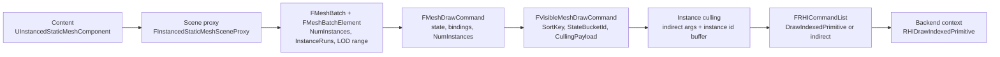
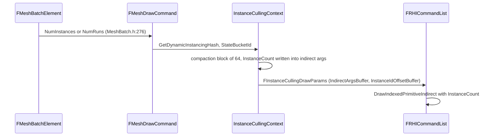

# Draw Calls and Instancing — UE 5.8 RHI

## Scope

What happens between "an instance exists in content" and "the GPU executes a draw". Three distinct levels, each with its own data structure and its own performance consequences.

## Three levels

| Level | Structure | Module | What it decides |
|---|---|---|---|
| Content | `FMeshBatch` / `FMeshBatchElement` | `Engine/Public/MeshBatch.h` | which mesh, which LOD range, how many instances, screen-size range |
| Renderer | `FMeshDrawCommand` / `FVisibleMeshDrawCommand` | `Renderer/Public/MeshPassProcessor.h` | state (PSO, bindings, streams), instance count, sort order, culling payload |
| RHI | `FRHICommandDrawIndexedPrimitive` / indirect args | `RHI/Public/RHICommandList.h`, `RHI.h` | the actual submission to the backend |



## Content level: what an author controls

`FMeshBatchElement` (`Engine/Public/MeshBatch.h:231`) is the contract between a scene proxy and the renderer.

| Field | Line | Meaning |
|---|---|---|
| `InstanceRuns` | 258 | `uint32*` pairs `[StartInstanceIndex, EndInstanceIndex]`; `NumInstances` is the number of runs when set |
| `IndirectArgsBuffer` / `IndirectArgsOffset` | 265, 266 | per-batch indirect args; used when `NumPrimitives == 0` |
| `PrimitiveIdMode` | 269 | `PrimID_FromPrimitiveSceneInfo` default; assigned by the renderer |
| `NumPrimitives` | 273 | "When 0, IndirectArgsBuffer will be used" |
| `NumInstances` | 276 | instance count, or run count if `InstanceRuns` is valid |
| `MinScreenSize` / `MaxScreenSize` | 281, 282 | screen-size range this batch is valid for |
| `InstancedLODIndex : 4` / `InstancedLODRange : 4` | 284, 285 | LOD index and range width for instanced LOD selection |
| `bIsInstanceRuns` | 287 | selects run semantics |
| `bForceInstanceCulling` | 288 | force this batch through instance culling |
| `bPreserveInstanceOrder` | 289 | no reordering (needed for order-dependent effects) |
| `bFetchInstanceCountFromScene` | 290 | instance count comes from scene data, not the batch |
| `DynamicPrimitiveData` / `DynamicPrimitiveIndex` / `DynamicPrimitiveInstanceSceneDataOffset` | 303-305 | required for dynamic primitives with more than one instance |
| `GetNumPrimitives()` | 307-322 | sums runs, else `NumPrimitives * NumInstances` |

`FMeshBatch` (`MeshBatch.h:364`) carries the material (`MaterialRenderProxy` L372), vertex factory (L369), LOD index (L390), `ReverseCulling` (L392), `bDitheredLODTransition` (L429), and the flags that decide which passes a batch participates in (`CastShadow` L399, `bUseForDepthPass` L401, `bUseAsOccluder` L402, `bUseForVirtualTexturing` L432, `bUseForLumenSurfaceCacheCapture` L454).

Content-level instancing entry point: `FMeshElementCollector::DrawBatchedElements(..., uint32 NumInstances = 1)` (`Engine/Public/SceneManagement.h:1382`). `FInstancedStaticMeshInstanceData` is a `USTRUCT` (`Engine/Public/InstancedStaticMeshComponent.h:40`); `FInstancedStaticMeshSceneProxy : public FStaticMeshSceneProxy` (`InstancedStaticMesh.h:435`) overrides `GetTypeHash` (L438) so per-instance data is stable across frames.

## Renderer level: the draw command

`FMeshDrawCommand` (`Renderer/Public/MeshPassProcessor.h:1281`) is a *state + geometry* pair, deliberately free of per-instance data:

| Field | Line | Note |
|---|---|---|
| `ShaderBindings` | 1288 | `FMeshDrawShaderBindings`, inline storage with `NumInlineShaderBindings` |
| `VertexStreams` | 1289 | `FVertexInputStreamArray` |
| `IndexBuffer` | 1290 | `FRHIBuffer*` |
| `CachedPipelineId` | 1295 | `FGraphicsMinimalPipelineStateId` — the PSO identity |
| `FirstIndex`, `NumPrimitives`, `NumInstances` | 1300-1302 | instance count is the only instancing field |
| `union VertexParams / IndirectArgs` | 1304-1317 | direct params or indirect args buffer + offset, mutually exclusive |
| `PrimitiveIdStreamIndex` | 1319 | `-1` when instance data comes from a static UB slot instead of a stream |
| `StencilRef` | 1322 | non-pipeline state |
| `PrimitiveType` | 1325 | kept redundantly "for dynamic instancing on GPU" |

`MatchesForDynamicInstancing` (L1333) and `GetDynamicInstancingHash` (L1348, CityHash64 over a fixed `FHashKey`) define what "same state" means: pipeline id, stencil, shader bindings, vertex streams, primitive-id stream, index buffer, first index, primitive count, instance count.

`FVisibleMeshDrawCommand` (L1762) is the per-frame view of that command: `StateBucketId` (L1809), `RunArray`/`NumRuns` (L1812), `SortKey`, `Flags`, `CullingPayload` (`FMeshDrawCommandCullingPayload` L1672, `LodIndex:4`, `MinScreenSize:13`, `MaxScreenSize:13`, fixed-point 3.10 via `PackScreenSize` L1688).

## State caching is the performance story

`FMeshDrawCommandStateCache` (`MeshPassProcessor.h:905-960`) holds `PipelineId`, `StencilRef`, `ShaderBindings[SF_NumStandardFrequencies]`, `VertexStreams[MaxVertexElementCount]`, initialised to impossible values (L914-919). `SetPipelineState` resets streams and bindings (L921-944) because a new PSO invalidates them.

`SubmitDrawBegin` (`MeshPassProcessor.cpp:1248-1330`) only emits work on change:

- `checkSlow(CachedPipelineId.IsValid())` L1257
- resolve `CachedPipelineId.GetPipelineState(GraphicsMinimalPipelineStateSet)` L1262
- set the PSO **only if** `CachedPipelineId.GetId() != StateCache.PipelineId` L1264 → `AsGraphicsPipelineStateInitializer` L1266, `ApplyCachedRenderTargets` L1267, `RetrieveAndCachePSOPrecacheResult` L1269, `SetGraphicsPipelineStateCheckApply` L1297, `StateCache.SetPipelineState` L1298
- skip the draw entirely when `bAllowSkipDrawCommand && GSkipDrawOnPSOPrecaching && result == Active` L1291
- stencil only on change L1302
- vertex streams only on change L1311-1325, with the primitive-id stream overridden by `SceneArgs.PrimitiveIdOffset` L1315-1318
- shader bindings `SetOnCommandList` L1327

Sorting exists to make that cache hit. `FCompareFMeshDrawCommands` (L1826) orders by `SortKey`, then `StateBucketId` (L1836-1839). Sort keys are built in `MeshDrawCommands.cpp`: `GetSortKey_FrontToBack` (L276-302, bitfields `StateBucketId:25`, `PipelineId:22`, `DepthBits:15`) and `GetSortKey_ByState` (L316-346, `DepthBits:12`, `StateBucketId:20`, `StateBucketDepthBits:4`, `PipelineId:22`, `PipelineDepthBits:4`). `StateBucketId` comes from `FScene::CachedMeshDrawCommandStateBuckets` (`MeshPassProcessor.h:1954`, assigned at `MeshPassProcessor.cpp:2100`, `2145`, `2175`); the header comment is explicit: "Any commands with the same StateBucketId can be merged into one draw call with instancing" (L1807).

## Instancing merge

`SortAndMergeDynamicPassMeshDrawCommands` (`MeshDrawCommands.cpp:506-569`, `MeshDrawCommands.h:209`):

1. Walk commands in sorted order, tracking `CurrentStateBucketId` L506.
2. Same bucket → increment the live `NumInstances` of the first command in the bucket L514-521, tracking `MaxInstances` L508, L520.
3. A new command is only created when the bucket actually contains more than one draw, `PrimitiveIdStreamIndex >= 0`, `NumInstances == 1`, and the next command shares the bucket L534-540.
4. Per-instance primitive ids are written per `InstanceFactor` L574-577 ("refactor into instance step rate in the RHI" L573).

Consequence: **instancing only works when the state is identical**. Two instances of the same mesh with different materials, different LODs, or different shader parameters produce different state buckets and cannot be merged into one draw.

The GPU-culling path applies the same rule plus the culling payload: `InstanceCullingContext.cpp:1539-1543` requires same `StateBucketId`, same `CullingPayloadFlags` and same `CullingPayload`, and no direct→indirect transition, before compacting commands.

## Indirect args

Indirect argument layouts (`RHI/Public/RHI.h`): `FRHIDrawIndirectParameters` L561-567, `FRHIDrawIndexedIndirectParameters` L569-576 (`IndexCountPerInstance`, `InstanceCount`, `StartIndexLocation`, `BaseVertexLocation`, `StartInstanceLocation`), `FRHIDispatchIndirectParameters` padded to 64 bytes L554.

`FInstanceCullingContext` (`Renderer/Public/InstanceCulling/InstanceCullingContext.h`): `IndirectArgsNumWords = 5` L92, `CompactionBlockNumInstances = 64` L93. `AllocateIndirectArgs` (`InstanceCullingContext.cpp:253-281`) writes `FRHIDrawIndexedIndirectParameters{NumVerticesOrIndices, 0, FirstIndex, BaseVertexIndex, 0}` L278 — `InstanceCount` is left 0 and filled by the culling pass.

`SubmitDrawEnd` (`MeshPassProcessor.cpp:1332-1386`) chooses the path per command:

- `bDoOverrideArgs = SceneArgs.IndirectArgsBuffer != nullptr && PrimitiveIdStreamIndex >= 0` L1334
- static UB slot → `SetUniformBufferDynamicOffset(BatchedPrimitiveSlot, PrimitiveIdOffset)` L1338
- root constants → `SetShaderRootConstants` L1343
- direct `DrawIndexedPrimitive` with `NumInstances * InstanceFactor` L1350-1358, else `DrawIndexedPrimitiveIndirect` L1362-1366; non-indexed equivalents L1373, L1380

**Fallback rule** (`MeshDrawCommands.cpp:930-936`): indirect is forced off when `NumPrimitives > 0 && PrimitiveIdStreamIndex < 0`, and `NumInstances` is clamped to 1. A draw command that cannot address instance data through a stream or a static slot can never be instanced.

## Dynamic instancing limitation

`SubmitMeshDrawCommandsRange` (`MeshPassProcessor.cpp:1646-1677`) hard-disables dynamic instancing:

```cpp
// GPUCULL_TODO: workaround for the fact that DrawDynamicMeshPassPrivate et al. don't work with GPU-Scene instancing
//               we don't support dynamic instancing for this path since we require one primitive per draw command
//               This is because the stride on the instance data buffer is set to 0 so only the first will ever be fetched.
checkSlow(!bDynamicInstancing);   // L1660
bDynamicInstancing = false;       // L1661
```

The dynamic path (`DrawDynamicMeshPassPrivate` L1759-1799) instead builds `FDynamicBatchedPrimitiveLayout` (L1728-1757) whose hash must match the `BatchedPrimitive` uniform buffer, converts `UBMT_RDG_BUFFER_SRV` to `UBMT_SRV` after `ComputeHash()`, and binds it with `RHICreateUniformBuffer` + `SetStaticUniformBuffer` using `GetInstanceIdBufferStride(ShaderPlatform)`.

`InstanceFactor` multiplies instance counts for stereo/multi-view rendering (`FMeshDrawCommandPassSetupTaskContext::InstanceFactor`, `MeshDrawCommands.h:78`).

## End-to-end instance count



`FInstanceCullingDrawParams` (`InstanceCullingContext.h:33`) carries `RDG_BUFFER_ACCESS(DrawIndirectArgsBuffer, ERHIAccess::IndirectArgs)` and `RDG_BUFFER_ACCESS(InstanceIdOffsetBuffer, ERHIAccess::VertexOrIndexBuffer)` plus `InstanceDataByteOffset` / `IndirectArgsByteOffset`; `GetMeshDrawCommandOverrideArgs` L43 converts them into `FMeshDrawCommandOverrideArgs` (`MeshPassProcessor.h:1234`).

## What this means for content

- One material + one LOD + one vertex factory per instance group keeps commands in one state bucket. Mixing materials on the same mesh splits the bucket and doubles draw calls.
- Screen-size LOD ranges (`MinScreenSize`/`MaxScreenSize`, `InstancedLODRange`) split instances across LODs; each LOD is a separate command.
- `bPreserveInstanceOrder` and per-instance order-dependent effects prevent compaction.
- `STAT_MeshDrawCalls` is incremented per command, not per instance (`MeshPassProcessor.cpp:1666`), so a merged instanced draw counts once.
