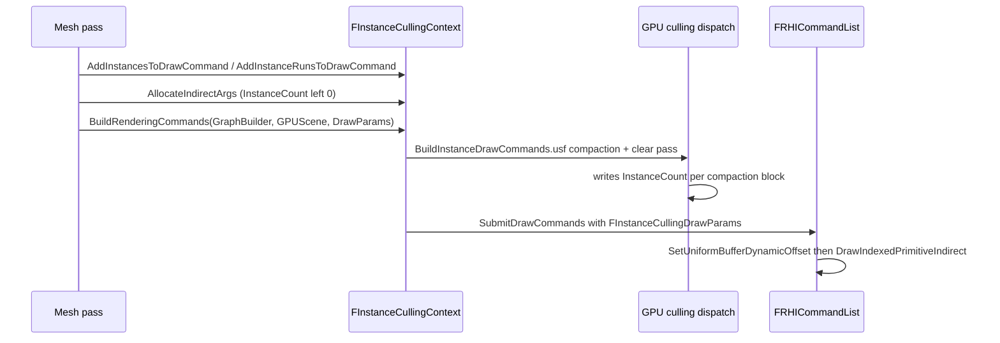

# Instance Culling and GPUScene — UE 5.8 RHI

## Scope

The GPU-side instance pipeline: instance data storage (GPUScene), GPU culling, indirect argument generation, and how a culled instance count reaches the draw call.

## The two data planes

| Plane | Storage | Accessed by |
|---|---|---|
| Instance scene data | GPUScene buffer, per-primitive + per-instance offsets | vertex shader through the `BatchedPrimitive` static UB slot or a vertex stream |
| Indirect args | `FRHIBuffer` with `EBufferUsageFlags::DrawIndirect` (`RHIDefinitions.h:910`) | `DrawIndexedPrimitiveIndirect` |

`FInstanceCullingContext` (`Renderer/Public/InstanceCulling/InstanceCullingContext.h:75`) owns both.

Key constants:

| Constant | Line | Value / meaning |
|---|---|---|
| `IndirectArgsNumWords` | 92 | 5 words — exactly `FRHIDrawIndexedIndirectParameters` |
| `CompactionBlockNumInstances` | 93 | 64 instances per compaction block |
| `UniformViewInstanceStride[2]` | 86-90 | `BATCHED_INSTANCE_DATA_STRIDE` (Generic) / `BATCHED_PRIMITIVE_DATA_STRIDE` (UnCulled) |
| `GetInstanceIdBufferStride` | 94 | shader-platform dependent |
| `GetStaticUniformBufferSlot` | 95 | static UB slot for `BatchedPrimitive` |

Static slot registration (`InstanceCullingContext.cpp`): `IMPLEMENT_STATIC_UNIFORM_BUFFER_SLOT(BatchedPrimitive)` L57 and `IMPLEMENT_STATIC_AND_SHADER_UNIFORM_BUFFER_STRUCT_EX(FBatchedPrimitiveParameters, "BatchedPrimitive", BatchedPrimitive, EUsageFlags::UniformView)` L58; slot lookup by name L118-119.

## Flow

## Indirect argument generation

`AllocateIndirectArgs` (`InstanceCullingContext.cpp:253-281`) writes `FRHIDrawIndexedIndirectParameters{NumVerticesOrIndices, 0, FirstIndex, BaseVertexIndex, 0}` (L278): `InstanceCount` is deliberately 0 at record time and is filled by the GPU culling pass. Culling payloads are packed at L324-330 and batched to `MaxBatchSize` L340-390.

`BuildRenderingCommandsInternal` (L818-830):
- `CreateIndirectDesc(IndirectArgsNumWords * IndirectArgs.Num())`
- `QueueBufferUpload`
- `AddClearIndirectArgInstanceCountPass` L825 (`FClearIndirectArgInstanceCountCs` L1363-1391, `BuildInstanceDrawCommands.usf`)
- `InstanceIdOffsetBuffer` created as a plain `Buffer<uint32>` — comment L827-829: "not structured buffer as we have to get at it as a vertex buffer"

Compaction: `FCalculateCompactBlockInstanceOffsetsCs` (L431-461) uses `COMPACTION_BLOCK_NUM_INSTANCES` and `INDIRECT_ARGS_NUM_WORDS`.

Per-command offsets are applied at L1771-1784 (`IndirectArgsByteOffset`, `PrimitiveIdOffset`), with a breadcrumb event `RHI_BREADCRUMB_EVENT_CONDITIONAL_F(..., "MaterialDrawEvent", "%s %s (%u instances)")` at L1787 before `SubmitDrawEnd` L1803.

## Modes and flags

| Enum | Line | Values |
|---|---|---|
| `EInstanceCullingMode` | 45 | `Normal`, `Stereo` |
| `EInstanceCullingFlags` | 51 | `NoInstanceOrderPreservation`, `DrawOnlySelected` |
| `EBatchProcessingMode` | 60 | `Generic` (full features), `UnCulled` (load-balanced runs/primitive ranges, culling disabled) |
| `EInstanceFlags` | 78 | `DynamicInstanceDataOffset`, `ForceInstanceCulling`, `PreserveInstanceOrder` |
| `EAsyncProcessingMode` | 255 | async setup behaviour |

Support predicates: `IsGPUCullingEnabled` L119, `IsOcclusionCullingEnabled` L120. Lifecycle: `BeginAsyncSetup` L164, `BuildRenderingCommands` L178/191, `CreateDeferredContext` L205, `SetDeferredContextCullingParams` L210, `AddClearIndirectArgInstanceCountPass` L215, `SetupDrawCommands` L217 (`bCompactIdenticalCommands`), `SubmitDrawCommands` L226.

HZB occlusion culling is fed by `InstanceCullingOcclusionQueryRenderer->Render` (`DeferredShadingRenderer.cpp:632`); scene culling feeds `FSceneCullingRenderer.CullInstances` (L1711, L1776).

## GPUScene

`FGPUScene` (`Renderer/Private/GPUScene.h:26`):

| API | Line | Role |
|---|---|---|
| `BeginRender` | 233 | frame start |
| `EndRender` | 235 | frame end |
| `AllocateInstanceSceneDataSlots` | 244 | instance data allocation |
| `AllocateInstancePayloadDataSlots` | 251 | payload data allocation |
| `FillSceneUniformBuffer` | 262 | `FSceneUniformParameters` |
| `ConsolidateInstanceDataAllocations` | 313 | defrag/consolidation |
| `ExecuteDeferredGPUWritePass` | 318 | async scatter upload |
| `CommitPrimitiveCollector` | 450 | deferred primitive writes |
| `bUseTiledInstanceDataLayout` | 372 | tiled layout selection |
| `DynamicPrimitivesOffset` | 461 | dynamic primitive region |
| `AddUpdatePrimitiveIdsPass` | 498 | primitive id update |
| `AddClearInstancesPass` | 500 | clear instances |
| `EPrimitiveDirtyState` | 275 | dirty tracking |

Per-primitive upload (`GPUScene.cpp:227-261`): `LocalInstanceSceneDataOffset = UploadData->TotalInstanceCount`, then `TotalInstanceCount += NumInstances` and `InstancePayloadDataFloat4Count += PayloadFloat4Stride * NumInstances`. Validation L361-410.

`FPrimitiveIdVertexBufferPool` (`MeshDrawCommands.h:31`) and `GPrimitiveIdVertexBufferPool` (L49) provide the vertex-buffer view of primitive ids used when the platform does not use a static UB slot (`PlatformGPUSceneUsesUniformBufferView`).

## Practical consequences

- Instance culling is a **GPU pass**, not a CPU filter: the CPU records a conservative indirect args buffer and the GPU writes the live `InstanceCount`.
- A draw command that cannot reach instance data (no stream, no static slot) is forced to a direct draw with `NumInstances = 1` (`MeshDrawCommands.cpp:930-936`).
- Compaction only merges commands with identical state bucket **and** identical culling payload (`InstanceCullingContext.cpp:1539-1543`), so per-instance LOD ranges split batches.
- `UnCulled` mode exists for batches that need load balancing without culling — the instance stride differs (`UniformViewInstanceStride[1]`), so shaders must match the mode.
