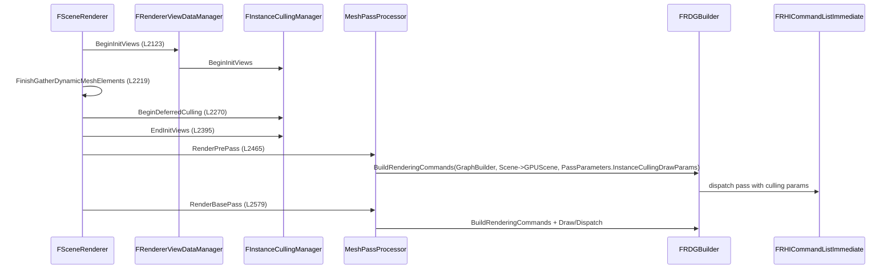

# Frame Flow and Mesh Passes — UE 5.8 RHI

## Scope

How a frame is assembled: visibility, mesh batches, draw commands, pass setup tasks, and submission — and where the RHI actually appears in that pipeline.

## Frame sequence



Anchors: `FRendererViewDataManager` (`Renderer/Private/DeferredShadingRenderer.cpp:2116`), `FInstanceCullingManager` (`L2117`), `RDG_EVENT_SCOPE_STAT(GraphBuilder, VisibilityCommands, ...)` + `BeginInitViews` (`L2123-2124`), `FinishGatherDynamicMeshElements` (`L2219`), `BeginDeferredCulling` (`L2270`), `EndInitViews` (`L2395`), `RenderPrePass` (`L2465`), `RenderBasePass` (`L2579`).

Occlusion-query culling runs through `InstanceCullingOcclusionQueryRenderer->Render` (`L632`); scene culling through `FSceneCullingRenderer.CullInstances` (`L1711`, `L1776`); Nanite through `NaniteRenderer->DrawGeometry` (`L1777`) — Nanite does not use `FMeshDrawCommand`, it uses its own indirect args (`Renderer/Public/BasePassRendering.h:162` `RDG_BUFFER_ACCESS(NaniteIndirectArgs, ERHIAccess::IndirectArgs)`).

## Mesh passes

`EMeshPass::Type` (`Renderer/Public/MeshPassProcessor.h:56-100`) — `DepthPass`, `SecondStageDepthPass`, `BasePass`, `AnisotropyPass`, `SkyPass`, `SingleLayerWaterPass`, `CSMShadowDepth`, `VSMShadowDepth`, `OnePassPointLightShadowDepth`, `Distortion`, `Velocity`, `TranslucencyStandard`, `TranslucencyAfterDOF`, `LightmapDensity`, `DebugViewMode`, `CustomDepth`, `MobileBasePassCSM`, `VirtualTexture`, `LumenCardCapture`, `LumenCardNanite`, `FrontLayerTranslucencyGBuffer`, `DitheredLODFadingOutMaskPass`, `NaniteMeshPass`, mesh-decal passes, water-info passes.

Each pass collects `FVisibleMeshDrawCommand`s, sorts them, then submits. The uniform pattern is:

```cpp
Pass->BuildRenderingCommands(GraphBuilder, Scene->GPUScene, PassParameters->InstanceCullingDrawParams);
Pass->Draw(RHICmdList, &PassParameters->InstanceCullingDrawParams);   // or Dispatch(...)
```

`SetDummyCullingParams` is used when a pass has no culling (`DeferredShadingRenderer.cpp`). Pass parameters embed the culling payload: `SHADER_PARAMETER_STRUCT_INCLUDE(FInstanceCullingDrawParams, InstanceCullingDrawParams)` (`BasePassRendering.h:163`).

## Pass setup and submission

`FParallelMeshDrawCommandPass` (`Renderer/Private/MeshDrawCommands.h:113`):

| Member | Line | Role |
|---|---|---|
| `DispatchPassSetup` | 128 | RDG dispatch-pass setup |
| `BuildRenderingCommands` | 150 | writes indirect args + instance offsets |
| `WaitForSetupTask` | 158 | joins the setup task |
| `Draw` | 163 | submits a range of commands |
| `Dispatch` | 164, 165 | RDG dispatch entry |
| `DispatchDraw` | 169 | deprecated |
| `HasAnyDraw` | 174 | empty-pass check |
| `MaxNumDraws` | 199 | task sizing |
| `DumpInstancingStats` | 201 | instancing effectiveness |

`FMeshDrawCommandPassSetupTaskContext` (`L54`) carries `bUseGPUScene`, `bDynamicInstancing`, `bReverseCulling`, `bRenderSceneTwoSided`, `InstanceFactor` (`L78`), `MinimalPipelineStatePassSet`, `InstanceCullingContext` (`L106`), stats (`L102-104`).

Submission (`MeshDrawCommands.cpp:1673-1723`): `FDrawVisibleMeshCommandsAnyThreadTask` per `ParallelCommandListSet`, `NumTasks = min(threads, ceil(MaxNumDraws / MinDrawsPerCommandList))`. `Draw()` (`L1766-1768`) calls `SubmitMeshDrawCommandsRange(..., TaskContext.bDynamicInstancing, 0, Num, InstanceFactor, RHICmdList)` — and that path asserts `!bDynamicInstancing` (`MeshPassProcessor.cpp:1660`), so dynamic instancing and this submission path are mutually exclusive.

`FPrimitiveIdVertexBufferPool` (`MeshDrawCommands.h:31`, global `GPrimitiveIdVertexBufferPool` `L49`) supplies the per-instance primitive-id stream; `SortAndMergeDynamicPassMeshDrawCommands` (`L209`) is the dynamic-instancing merge entry.

## Where the RHI appears

Per command (`MeshPassProcessor.cpp:1646-1677`): state cache applied, `INC_DWORD_STAT_BY(STAT_MeshDrawCalls, ...)` (`L1666`), `SCOPED_CONDITIONAL_DRAW_EVENTF(..., "Mesh Draw")` (`L1670`), `PrimitiveIdOffset` (`L1673`), then the actual `DrawIndexedPrimitive` / `DrawIndexedIndirect` on the command list. `FMeshDrawCommandStateCache` (`L1663`) is the mechanism that makes consecutive commands cheap.

## Practical consequences

- A frame's cost is dominated by the number of *state changes*, not draws. Sorting by `SortKey` then `StateBucketId` exists purely to make the state cache hit (`MeshPassProcessor.h:1836-1839`).
- Passes with no visible commands still cost a dispatch pass; `HasAnyDraw()` (`MeshDrawCommands.h:174`) is what lets RDG skip them.
- `r.RHICmdMinDrawsPerParallelCmdList` (default 64, `SceneRendering.cpp:512-515`) means small passes are never split across command lists — splitting a small pass costs more than it saves.
