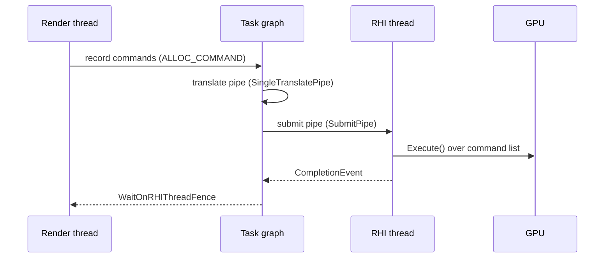

# Multi-GPU and Threading — UE 5.8 RHI

## Scope

How the RHI models "which GPU" and "which thread", and how those two interact through fences.

## GPU mask

`FRHIGPUMask` (`RHI/Public/MultiGPU.h:32`) is a bitmask of GPU indices. The design detail that matters: when `WITH_MGPU` is off, `GetMask()` is a compile-time constant `1` (`L42-45`), so every mask operation collapses to a no-op (`L150`, `L157`) and `HasSingleIndex()` is `true` (`L100`). Single-GPU builds pay nothing for the abstraction.

With `WITH_MGPU` (`L19`): `MAX_NUM_GPUS 8` (`L20`), `GNumExplicitGPUsForRendering` (`L21`), `GVirtualMGPU` (`L22`). Without it: `MAX_NUM_GPUS 1`, `GNumExplicitGPUsForRendering` is a macro constant `1` (`L25-27`).

`WITH_MGPU` is defined by the build: `RHI/RHI.Build.cs:23` — Windows **and** desktop platform group. So multi-GPU is a Windows-desktop-only feature in 5.8.

Key members: `GPU0()` (`L186`), `All()` (`L191`, `(1 << GNumExplicitGPUsForRendering) - 1`), `HasSingleIndex()` (`L75`), `ToIndex()` (`L69`, `checkSlow(HasSingleIndex())`), `Invert()` (`L203-214`, fails to `GPU0` when already `All()`), mask iterator with `FirstGPUIndexInMask` (`L220-236`, `L279-281`).

Buffers can be allocated per-GPU (`EBufferUsageFlags::MultiGPUAllocate`, `RHIDefinitions.h:942`) or excluded from cross-GPU transfer in RDG (`MultiGPUGraphIgnore`, `L949`). Cross-GPU movement is explicit: transfer commands (`RHICommandList.h:1487-1577`) plus RDG cross-GPU copy graph nodes. `Execute()` restores `CurrentGPUMask` (`RHI/Private/RHICommandList.cpp:517-548`) — a command list carries the GPU it belongs to (`FRHISubCommandList` constructor takes a `FRHIGPUMask`, `RHICommandList.h:5038`).

## Threads

Three distinct threads can be involved:

`ERHIThreadMode` (`RHICommandList.h:98`): `None`, `DedicatedThread`, task mode. `GPendingRHIThreadMode` (`L106`) handles `r.RHIThread.Enable`. Predicates: `IsRunningRHIInSeparateThread` (`L158`), `IsRunningRHIInDedicatedThread` (`L166`), `IsRunningRHIInTaskThread` (`L174`).

Idle accounting: `ERenderThreadIdleTypes` (`L108`), `GRenderThreadIdle` (`L120`), `FRenderThreadIdleScope` (`L123`, accumulates cycles at `L142`). This is how you tell whether the render thread is the bottleneck or is waiting on the RHI thread.

`AllowParallel()` (`L5087`) requires `FApp::ShouldUseThreadingForPerformance()`, no bypass, and `GSupportsParallelRenderingTasksWithSeparateRHIThread || !IsRunningRHIInSeparateThread()`.

## Ordering and fences

Ordering is guaranteed by pipes, not by locks (`RHICommandList.cpp:808-821`): FIFO within a pipe means a submit does not need an event to await its translate (`L981-984`).

- `LastMutate` (`L941`, `L946`) — blocks future translates until a lock fence signals; set from `LastLockFenceCommand->Fence` (`L945-946`).
- `LastClose` (`L959`, `L1084`) — gates close.
- `CompletionEvent` (`L1937`) — whether work is still in flight.
- `EnqueueSubmitTask` (`L1055`, `L1086`) — submission runs as a task.
- `RHIThreadFence(bool bSetLockFence)` (`RHICommandList.cpp:1753`) produces the event; `WaitOnRHIThreadFence` (`L1940`) waits on it.
- `GRHIGlobals.SupportsConcurrentTranslateAndSubmit` (checked at `RHICommandList.cpp:949`) decides whether translate and submit can overlap.
- `FScopedRHIThreadStaller` (`RHICommandList.inl:13`) stalls the RHI thread for a scope; `GRHIThreadStallRequestCount` (`RHICommandList.cpp:130`).

`FRHICommandListScopedFence` (`RHICommandList.h:421`) exists specifically to avoid issuing N fences for N resources — the comment at `L420` states this.

## RDG interaction

RDG dispatch passes create `FRHISubCommandList`s (`RenderGraphPass.h:764`) that are inserted into a render pass (`RHICommandList.h:4085`). Pass dependencies (`RenderGraphBuilder.h:249`) and dispatch hints (`L252`) determine which command lists can run concurrently and on which pipeline (`FRDGPass::Pipeline` `RenderGraphPass.h:392`).

## Practical consequences

- A resource lock on the render thread is only safe because of the lock fence (`LastMutate`); code that locks a buffer and then destroys it on the same frame relies on `FRHILockTracker` (`RHILockTracker.h:8`) deferring the release.
- With `r.RHICmdBypass=1`, `AllowParallel()` is false (`L5087`), so parallel command lists disappear — profiling with bypass on measures a different pipeline.
- On non-Windows-desktop builds, `FRHIGPUMask` is a constant; multi-GPU-specific code paths are compiled out (`L150`, `L157`), so cross-GPU transfer bugs cannot be reproduced on those builds.
