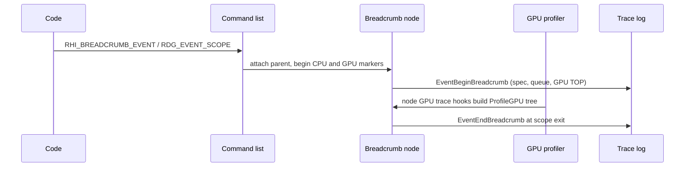

# Profiling, Debugging and Validation — UE 5.8 RHI

## Scope

The observability layer: stats, breadcrumbs, GPU timing, trace events, and the validating RHI that asserts the contracts the other chapters describe.

## Stats

| Group | Declared | Contents |
|---|---|---|
| `STATGROUP_RHI` | `Core/Public/Stats/GlobalStats.inl:61` | draws, dispatches, primitives, vertices; GPU memory rows (`RHI/Public/RHIStats.h:149-179`) |
| `STATGROUP_RDG` | `GlobalStats.inl:62` | RDG pass/memory |
| `STATGROUP_RenderThreadProcessing` | `GlobalStats.inl:63` | render thread time |
| `STATGROUP_RHICMDLIST` | `RHI/Public/RHICommandList.h:80` | execute time, memory, command counts, parallel translation, waits (`RHI/Private/RHICommandList.cpp:29-35`, `112-117`) |
| `STATGROUP_RHI_COMMANDS` | `RHICommandList.h:88` | per-method scope counters, only when `RHI_STATS` (`L85`) |
| `STATGROUP_SceneRendering` | `RenderCore/Public/RenderCore.h:37-41` | `STAT_MeshDrawCalls` (`L38`) |

Counters: `STAT_RHIDraws` `RHIStats.h:121`, `STAT_RHIDispatches` `L122`, `STAT_RHIPrimitives` `L123`, `STAT_RHIVertices` `L124`; incremented by `RHI_DRAW_CALL_STATS` with `max(1, Instances)` (`RHIStats.h:137-145`), defined in `RHIStats.cpp:15-18`. `RHISTAT(Method)` builds `STAT_RHI##Method` only under `RHI_STATS` (`RHICommandList.h:87-92`), used in `RHICommandListCommandExecutes.inl` (`L89`, e.g. `L194-198` for `NextSubpass`).

`STAT_MeshDrawCalls` counts *commands*, incremented per submission range (`MeshPassProcessor.cpp:1666`, `InstanceCullingContext.cpp:1762`) — instancing reduces it, per-instance draws do not.

## Breadcrumbs

Gate (`RHI/Public/RHIBreadcrumbs.h`): `WITH_RHI_BREADCRUMBS` = `UE_BUILD_DEBUG || UE_BUILD_DEVELOPMENT || WITH_PROFILEGPU || HAS_GPU_STATS` (`L26`); `_FULL` adds Insights markers (`L30`); `_MINIMAL` keeps only GPU-stat scopes (`L33`); CPU emission and source location require `_FULL` + `CPUPROFILERTRACE_ENABLED` (`L36`, `L39`).

`FRHIBreadcrumbNode` (`L136`) holds parent/list links, per-pipeline next pointers, allocator, optional `FGPUStat`, ID, and begin/end pipeline masks. Metadata carries a static name and a deterministic color from an FNV-1a hash of the name (`L84`) — the same scope always gets the same color in ProfileGPU and Insights. `FRHIBreadcrumbAllocator` (`L258`) is a `FMemStackBase` (`L265`) with parent chains (`L266`); inline allocation requires trivially destructible node types (`RHICommandList.inl:183-201`).

Command-list state carries the current breadcrumb per pipeline (`RHICommandList.cpp:1102`, `1106`, `1116`, `1132`, `1136`, `1141`, `1153`, `1157`, `1167`, `1171`), and close args snapshot it (`L1077`). Frame number is incremented at close (`L1449`).

Crash debugging: `WriteCrashData` serializes the breadcrumb ancestry into the crash context and logs it (`RHI/Private/RHIBreadcrumbs.cpp:142-188`); `DumpActiveBreadcrumbs` merges queue ranges. `r.GPUCrashDebugging.Breadcrumbs` defaults to `1` (`RHI/Private/RHI.cpp:2133-2143`). Platform RHIs are told whether to emit breadcrumb strings via `ShouldEmitBreadcrumbs()` (`RHI/Public/RHIContext.h:555-560`), consumed in `RHIBeginBreadcrumbGPU`/`RHIEndBreadcrumbGPU`.

RDG event macros (`RenderCore/Public/RenderGraphEvent.h`): `RDG_EVENT_NAME` `L477`, `RDG_EVENT_SCOPE` `L479`, `RDG_EVENT_SCOPE_STAT` `L480`, `RDG_EVENT_SCOPE_FINAL` `L484`, `RDG_EVENT_SCOPE_CONDITIONAL_NAME` `L486`; minimal-build fallbacks `L495-503`.

## GPU profiler

Queue types `FQueue::EType`: Graphics, Compute, Copy, SwapChain (`RHI/Public/GPUProfiler.h:24-32`), with GPU and queue index packed into the identity (`L34-44`). Timestamps use platform cycle units; TOP is before GPU work, BOP after (`L65-70`). Frame boundary records CPU timestamp, ended frame number, `bProfileNextFrame` (`L72-113`). `FBeginWork`/`FEndWork` (`L145-173`).

Per-node timing accumulates busy/idle/wait and exclusive vs inclusive stats (`RHI/Private/GPUProfiler.cpp:243-295`). `FQueueState` owns an event stream per queue (`L1151-1154`, `L1484-1487`), and the profiler keeps a `TMap<FQueue, FQueueState>` (`L1809`) so a fence wait on one queue can be resolved against the signal on another (`L1812-1817`). `FRHIGPUFrameTimeHistory` retains 16 timings (`GPUProfiler.h:579-614`), consumed via `PopFrameCycles` (`L599`, `L611`).

Defaults (`GPUProfiler.cpp:35-115`): `r.ProfileGPU.Sort=0`, `r.ProfileGPU.Root="*"`, `r.ProfileGPU.ThresholdPercent=0.0f`, table/unicode/leaf/header/empty-queues/stats/percent/inclusive/exclusive/UI all true; `r.GPUCsvStatsEnabled=0` (`L118-121`). Tree output sorts and filters by case-sensitive wildcard and threshold (`L1217-1244`, `1373-1384`), and reports draw/dispatch/vertex/primitive counts (`L2116-2121`).

## Render tracing

Enabled only with trace support, non-program, non-shipping (`RHI/Public/RenderTracing.h:19`). Channels (`L30-41`): `RDGPasses`, `RHICmdLists`, `RHITranslation`, `RHISubmission`, the `Submission` aggregate (`L38`), and `All`. `r.Trace.Channels` defaults to `Submission` (`RHI/Private/RenderTracing.cpp:62-68`), overridable with `-rendertracechannels=` (`L24-58`). Consumed by RenderTraceInsights (`RenderTracing.cpp:12-14`).

Event names (`RHI/Private/RHITracing.cpp:8-90`): `CommandListCreated`, `CommandListDetach`, `CommandListFinishRecording`, `CommandListDestroyed`, `SubmitCommandLists`, `TranslateJobCreated`, `SplitTranslateJob`, `DispatchCommandList`, `BeginTranslateCommandList`, `ActivatePipelines`, `SetTranslateContext`, `EndTranslateCommandList`, `FinalizeTranslateJob`, `SubmitTranslateJobs`. RDG side (`RenderCore/Private/RenderGraphTrace.cpp:516-540`): `BeginExecuteRDGPass`, `EndExecuteRDGPass`, `BeginExecuteDispatchPass`, `AddDispatchPassCommandList`, `EndExecuteDispatchPass`.

## Validation

`FValidationRHI` (`RHI/Public/RHIValidation.h:43`) derives from `FDynamicRHI` and wraps a real RHI, exposing the underlying non-validation RHI (`L89-125`). `FValidationContext` (`RHI/Public/RHIValidationContext.h:472`) wraps `IRHICommandContext`, forwards commands, tracks access and graphics/compute state (`L329-340`).

Asserted at API boundaries:

- draw without a graphics PSO (`RHI/Private/RHIValidation.cpp:1494-1500`); graphics PSO setup only inside an active render pass (`RHIValidationContext.h:801-824`);
- stream and index buffers must be in `ERHIAccess::VertexOrIndexBuffer`, indirect args in `IndirectArgs`, indexed draws require `EBufferUsageFlags::IndexBuffer` (`RHIValidationContext.h:768-773`, `934-968`);
- indirect dispatch requires vertex or byte-address usage, `DrawIndirect`, 4-byte alignment, in-bounds argument bytes (`RHIValidation.h:54-75`);
- shader parameters checked against required access (`RHIValidationContext.h:165-200`, `300-304`);
- staging copies assert `CopySrc` and `BUF_SourceCopy` when `GRHIValidateBufferSourceCopy` is true (`RHIValidation.cpp:25`, `1464-1479`).

Validation work is queued for deferred replay so the model matches execution order, not call order (`RHIValidationCommon.h:572-592` `EOpType`, `SetBreadcrumbRange` `L869-879`).

RDG debug: `RDG_ENABLE_DEBUG` = `!UE_BUILD_SHIPPING && !UE_BUILD_TEST` (`RenderGraphDefinitions.h:17`); user/barrier validation is compiled out otherwise (`RenderGraphBuilder.cpp:592-595`). `r.RDG.ClobberResources` off by default; clobber depth `0.123456789f`, stencil `123` (`RenderGraphPrivate.cpp:58-65`, `168-203`).

`FRHILockTracker` (`RHILockTracker.h:8`) — mismatched buffer lock/unlock is fatal (`Private/RHILockTracker.cpp`).

GPU dump: `r.DumpGPU.Root="*"`, `r.DumpGPU.Texture=2`, `r.DumpGPU.Buffer=2`, `r.DumpGPU.MaxStagingSize=64` MB, `r.DumpGPU.PassParameters=1`, `r.DumpGPU.RedumpInputs=0` (`RenderCore/Private/DumpGPU.cpp:61-97`).

`TextureProfiler.h` is `UE_DEPRECATED_HEADER(5.7, "TextureProfiler.h is no longer used.")` (`RHI/Public/TextureProfiler.h:7`) and defines `TEXTURE_PROFILER_ENABLED 0` (`L17`) — it is not an active profiler.

## Workflow

| Symptom | Tool | Why it works |
|---|---|---|
| Draw-call count high | `stat SceneRendering` (`STAT_MeshDrawCalls`) | counts commands, so instancing shows as a drop |
| Many state changes | `stat RHICmdList` | execute time vs command count |
| GPU hang / TDR | `r.GPUCrashDebugging.Breadcrumbs` | crash context contains the breadcrumb ancestry |
| Which pass is slow | ProfileGPU tree with `r.ProfileGPU.Root`/`ThresholdPercent` | breadcrumb names become tree nodes |
| Read-before-write | `r.RDG.ClobberResources` | clobbered values make undefined reads visible |
| Wrong access state | `FValidationContext` asserts | access is tracked per subresource |
| Command ordering confusion | `r.Trace.Channels` with RHICmdLists/RHITranslation/RHISubmission | translate vs submit are separate jobs |
