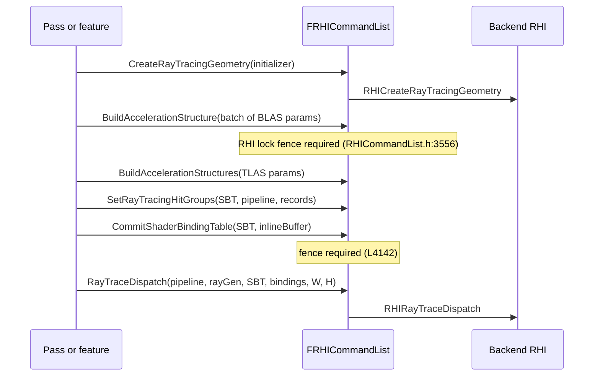

# 17. Ray Tracing, Work Graphs, Fixed-Function States, Presentation, Readback

Scope: the RHI elements the draw-path chapters do not cover — acceleration structures and the shader binding table, work graphs, sampler/rasterizer/depth-stencil/blend states and their static caches, viewports and presentation, GPU readback, and the thread-safety contract that `FDynamicRHI` declares per call. All citations are `file:line` in `UE_5.8`.

## Thread-safety contract (`FlushType` annotations)

`FDynamicRHI` documents each call with a `// FlushType:` comment. These are not style notes; they define which calls may run off the render thread and which force a flush.

| Category | Examples | Source |
|---|---|---|
| Thread safe | sampler `DynamicRHI.h:231-232`, rasterizer `L234-235`, depth-stencil `L237-238`, blend `L240-241`, shader library `L286-287`, staging buffer `L318-319`, bound shader state `L370` ("thread safe, but varies depending on the RHI"), graphics PSO `L394-395`, compute PSO `L397-398`, uniform buffer `L413-414`, calc texture size `L448-449`, buffer-SRV alignment `L456`, memory stats `L462-463`, async texture create `L497-498`, compute memory size `L533-534`, viewport present GPU index `L622-623`, back buffer `L629-630`, create viewport `L679-680`, resize viewport `L683-684`, tick `L692-693`, suspend/resume `L703-707`, resolutions `L720-721`, `L732-733`, `L743-744`, default context `L798-799` | `DynamicRHI.h` |
| Wait RHI thread | vertex declaration `L244`, pixel/vertex/geometry shader `L247`, `L250`, `L253`, mesh/amplification `L256`, `L262`, compute `L271`, work graph `L273-274`, render query `L610`, VT first mip in memory `L752-753`, first mip visible `L760-761` | `DynamicRHI.h` |
| Flush RHI thread | unlock buffer `L430-431`, native device `L766-767`, native physical device `L772-773`, native graphics/compute queue `L782-783`, `L791-792` | `DynamicRHI.h` |
| Flush immediate | texture visualize `L476-477`, `RHIReadSurfaceData` `L583-584`, map/unmap staging surface `L590-591`, `L594-595`, read float surface `L600-601`, `L603-604`, `L606-607`, `RHIIsRenderingSuspended` `L709-710`, `RHIBlockUntilGPUIdle` `L696-697` | `DynamicRHI.h` |

Two of these are annotated by Epic as suspect: the readback and staging-map calls carry `FlushType: Flush Immediate (seems wrong)` (`L583`, `L590`, `L594`, `L600`, `L603`, `L606`) — `[INFERENCE]` the annotation flags that a synchronous read forces a full flush of the immediate list, which is why readback stalls the pipeline. `RHIGetRenderQueryResult` is marked thread safe but the comment above it says it is only valid from the render thread (`L618-620`).

Consequence: any resource creation that goes through a "Wait RHI thread" call (shaders, vertex declarations, render queries) cannot be done inside a command list without a fence; doing it per-frame serialises the RHI thread.

## Ray tracing elements

Types (`RHI/Public/RHIResources.h`):

| Element | Anchor | Notes |
|---|---|---|
| `FRHIRayTracingShader` | `L1017` | derives from `FRHIShader`, frequencies `SF_RayGen`/`SF_RayMiss`/`SF_RayHitGroup`/`SF_RayCallable` (`RenderCore/Private/ShaderResource.cpp:706-708`) |
| `FRHIRayTracingAccelerationStructure` | `L3745` | base for geometry and scene; validation base under `ENABLE_RHI_VALIDATION` (`L3748`) |
| `FRHIRayTracingGeometry` (BLAS) | ctor `L3775`, initializer stored `L3812` | built at runtime or loaded from offline data |
| `FRHIRayTracingScene` (TLAS) | `L3816` | "contains instances of meshes" |
| `FRHIShaderBindingTable` | `L3936` | record storage for hit groups / callables / miss shaders |
| `FRayTracingPipelineState` | `L1145` | created through `RHICreateRayTracingPipelineState` (`DynamicRHI.h:964`, `L1154`) |
| `FRayTracingGeometrySegment` | `L3478` | per-segment vertex/index buffers |
| `FRayTracingGeometryInitializer` | `L3511` | `IndexBuffer` `L3514`, `Segments` `L3535` ("All ray tracing geometries must have at least one segment"), `OfflineData` `L3538`, `SourceGeometry` `L3542` |
| `FRayTracingShaderBindingTableInitializer` | `L3672` | `Lifetime` `L3675`, `ShaderBindingMode` `L3678`, `HitGroupIndexingMode` `L3681` |
| `FRayTracingSceneInitializer` | `L3706` | `MaxNumInstances` `L3708` — capacity, not the actual count |

Binding semantics: `ERayTracingShaderBindingTableLifetime` `Transient` = "SBT will be reallocated each frame", `Persistent` = only new or changed bindings are set (`L3650-3654`); `ERayTracingShaderBindingMode` `Disabled`/`Inline` (`L3657-3662`); `ERayTracingHitGroupIndexingMode` (`L3665`). Local binding data per record is classified `Persistent` or `Transient` (`RHICommandList.h:257-260`), and a record carries `Geometry`, `SegmentIndex`, `RecordIndex`, `ShaderIndexInPipeline` (`L265-271`).

Command-list surface (`RHICommandList.h`):

- Create: `CreateRayTracingGeometry` `L961-964`, `CreateRayTracingShaderBindingTable` `L966-969`.
- Build: `BuildAccelerationStructure` `L3492`, batch `L3493-3519` (params are copied into command-list memory because they are modified after copy, `L3504-3507`), TLAS `L3521-3538`; both take `RHIThreadFence(true)` because they mutate `FRHIRayTracingScene` members inside the backend (`L3554-3556`, `L3570-3572`).
- Bind memory: `BindAccelerationStructureMemory` `L3560-3572` (command `L2306-2314`).
- Cluster operations (NVIDIA): `ExecuteMultiIndirectClusterOperation` `L3479-3484`, command `L2359-2364`.
- Dispatch: `RayTraceDispatch` `L3441-3452` requires a non-null SBT (`check(SBT != nullptr)` `L3443`); indirect variant `L3460-3471`; the `FRHIBatchedShaderParameters` overloads `L3458`, `L3477` are compatibility adaptors over the legacy `FRayTracingShaderBindings` (`L246-251`, fixed 64-entry arrays) that are "planned for deprecation" (`L3455-3457`, `L5567-5569`).
- SBT binding: `SetBindingsOnShaderBindingTable` `L4153-4178` checks `GetRHIRayTracingPipelineStateMaxLocalBindingDataSize(Pipeline) <= SBT->GetInitializer().LocalBindingDataSize` (`L4165`, accessor `L2478`); `SetRayTracingHitGroups` `L4209`, `SetRayTracingCallableShaders` `L4217`, `SetRayTracingMissShaders` `L4225`; single-record `SetRayTracingHitGroup` `L4233-4268` (record index + geometry segment + loose parameters), `SetDefaultRayTracingHitGroup` `L4270-4278` with the default hit group always at record 0 (`L4275`); `CommitShaderBindingTable` `L4126-4144` — the single-argument form `checkf`s that the SBT is not in `Inline` mode (`L4128`), and the commit also needs the RHI lock fence (`L4142-4143`).
- Offline/inspection: `RHICalcRayTracingGeometrySize` `L5516-5519`, `RHICalcRayTracingSceneSize` `L1356-1359`, cluster-op size `L5521-5524`, offline metadata `L5526-5529`, `SerializeAccelerationStructure` only outside Shipping `L4716-4720` (`DynamicRHI.h:976-980` defaults to `checkNoEntry()`).

Capability gates (`RHIGlobals.h:420-500`): `Supported` `L426`, `SupportsShaders` `L432` (full pipeline; an RHI may support inline ray tracing only), `SupportsPSOAdditions` `L435`, `SupportsDispatchIndirect` `L438`, `SupportsAsyncBuildAccelerationStructure` `L441`, `SupportsBuildTopLevelAccelerationStructureIndirect` `L444`, `SupportsAsyncRayTraceDispatch` `L447`, `SupportsClusterOps` `L450`, `SupportsAMDHitToken` `L453`, `SupportsInlineRayTracing` `L456`, `RequiresInlineRayTracingSBT` `L459`, `SupportsInlinedCallbacks` `L462`, `SupportsPersistentSBTs` `L465`, `SupportsLooseParamsInShaderRecord` `L468`, `SupportsAccelerationStructureCompaction` `L471`, `SupportsSerializeAccelerationStructure` `L474`, `RequiresSeparateHitGroupContributionsBuffer` `L477`, `SupportsLinearSweptSpheres` `L480`, plus alignment/size fields `L483-498` exposed as `GRHIRayTracing*` macros (`L914-917`). Shader creation refuses to build RT shaders unless both `GRHISupportsRayTracing` and `GRHISupportsRayTracingShaders` are true (`ShaderResource.cpp:707-708`, `ShaderCodeArchive.cpp:1769-1770`).

Practical consequences: a `Transient` SBT is reallocated every frame (`RHIResources.h:3652`), so per-frame record churn is a per-frame allocation; `Persistent` SBTs only exist where `SupportsPersistentSBTs` (`RHIGlobals.h:465`). Loose parameters may or may not live in the shader record (`L468`), so code that assumes record-embedded data must check the flag. `IndexBufferStride` must be set on the initializer — the source warns it falls back to the live buffer stride and can race with index-buffer streaming (`RHIResources.h:3558-3561`), and validation asserts the captured stride still matches at build time (`L3804-3807`).

## Work graphs

`FRHIWorkGraphPipelineState` (`RHIResources.h:1139`) is keyed by `FWorkGraphPipelineStateSignature` — four hashes: program name, name table, shader table, graphics PSO table (`L4985-4999`), so changing a node name mapping or a graphics PSO inside the graph invalidates the cached pipeline. `FWorkGraphPipelineStateInitializer` (`L5013`) sets program name `L5018`, name table (`ExportName` → `NodeName`) `L5025-5047`, shader table with an optional root shader index `L5049-5056`, graphics PSO table `L5058-5062`. Cache access: `PipelineStateCache::GetAndOrCreateWorkGraphPipelineState` (`PipelineStateCache.cpp:4353`, `PipelineStateCache.h:187`), `FindWorkGraphPipelineState` (`L4905`, `PipelineStateCache.h:199`); the initializer must have a non-empty shader table (`PipelineStateCache.cpp:4325-4328`). The work graph frequencies changed the PSO cache key version (`PipelineCacheUtilities.cpp:74` `AddedWorkGraphFrequencies = 7`), which invalidates existing file caches.

Frequencies `SF_WorkGraphRoot` and `SF_WorkGraphComputeNode` (`ShaderCore.h:154-155`) are handled by the shader map (`ShaderResource.cpp:704-705`, `ShaderCodeArchive.cpp:1766-1767`), `FShader::GetWorkGraphShader` (`Shader.h:1124-1131`), and the vertex-factory parameter traits (`VertexFactory.h:253-254`, `274-275`, `305-306`); `ShaderParameterStruct.cpp:266-269` accepts only `SF_Compute` and `SF_WorkGraphComputeNode` for the compute binding technique. There is no `DispatchWorkGraph` entry point on `FRHICommandList` — dispatch reaches the RHI through the shader-bundle path (`RHICommandList.h:2860-2877`, command `L1854-1870`, `ERHIShaderBundleMethod::Emulation` default `L1864`) and the work-graph bundle shader `FDispatchShaderBundleWorkGraph` (`RenderCore/Public/ShaderBundles.h:40`, registered as `WorkGraphMainCS` at `SF_WorkGraphComputeNode` in `ShaderBundles.cpp:40`), gated by `RHISupportsWorkGraphs(Platform)` (`ShaderBundles.cpp:44`) and `GRHIGlobals.ShaderBundles.SupportsWorkGraphDispatch` / `SupportsWorkGraphGraphicsDispatch` (`RHIGlobals.h:664`, `667`), tiers `SupportsShaderWorkGraphsTier1` `L684` and `Tier1_1` `L687`. `DynamicRHI.h:400-403` defaults work-graph PSO creation to `checkNoEntry()` — it is a capability, not a universal.

## Fixed-function states and their static caches

Creation is thread safe for all four states (`DynamicRHI.h:231-241`), which is why the static-state cache can build them outside the render thread. `TStaticStateRHI` (`RenderCore/Public/RHIStaticStates.h:20-53`) wraps a `FRenderResource` whose `InitRHI` creates the state once (`L38-41`) and `GetRHI()` `checkSlow`s that it exists (`L28`); the resource is a `TGlobalResource` in `EInitPhase::Pre` (`L49`), so static states are created before any pass runs and released at shutdown (`L43-46`). `GetStaticRasterizerState` is a compile-time-keyed switch over fill/cull mode with `DepthClip` as the default depth-clip mode (`L99-102`).

Consequence: state objects obtained through the static cache are shared across every draw that requests the same key — changing a state per draw instead of using the static key creates a new RHI object per draw and defeats PSO reuse (see chapter 06). Vertex declarations are the exception: `RHICreateVertexDeclaration` is a "Wait RHI Thread" call (`DynamicRHI.h:244`), so a per-material vertex declaration is a serialising event.

## Viewport, presentation, and readback

- `FRHIViewport` is an `FRHIResource` (`RRT_Viewport`) (`RHIResources.h:2544`); `FRHIPresentArgs` carries `FrameCounter`, `bPresent`, `bLockToVsync` (`L2525-2530`).
- `RHICreateViewport` must be called from the main thread (`DynamicRHI.h:679-680`); `RHIResizeViewport` is thread safe (`L683-684`); `RHIEndDrawingViewport` enqueues presentation and advances the swapchain to the next back buffer (`L686-687`).
- Back buffer access is asynchronous from the render thread's point of view: `RHIGetViewportBackBuffer` (`L629-630`), per-layer variant `L631-632`, and `RHIGetViewportNextPresentGPUIndex` (`L622-623`) decide which GPU presents. `RHIHandleDisplayChange` (`L689`) is the display-change hook.
- Readback: `FRHIGPUMemoryReadback` (`RHIGPUReadback.h:20`) is the base; `IsReady()` polls the fence's pending write-command count (`L33-36`), the GPUMask variant polls per GPU (`L39-42`). `EnqueueCopy` for buffer `L67-70` and texture `L72-93`. The base `Lock`/`Unlock` are deprecated in 5.8 and return null / do nothing (`L100-112`) — callers must use `FRHIGPUBufferReadback` (`L132`, `EnqueueCopy` `L138`, `Lock` `L139`, `GetGPUSizeBytes` `L141`) or `FRHIGPUTextureReadback` (`L151`, `Lock(int32& OutRowPitchInPixels, ...)` `L160`, staging textures per GPU `L165`). Locking is only valid after `IsReady()`; polling is the non-blocking path (`L35`, `L41`).
- Buffer/texture lock modes: `EResourceLockMode` `RLM_ReadOnly`/`RLM_WriteOnly` (`RHIDefinitions.h:778-781`); `FRHILockTextureArgs::Lock2D` carries `bNeedsDefaultRHIFlush` (`DynamicRHI.h:128-136`, `L168`), and `RHIUnlockBuffer` is a "Flush RHI Thread" call (`L430-431`).

Consequence: readback is a synchronisation point. A readback that polls (`IsReady`) can be deferred to the next frame; a readback that locks without polling forces the flush flagged as suspect in the source (`DynamicRHI.h:583`, `L590`).

## Verification

Direct reads this session: `DynamicRHI.h` (FlushType annotations, `L128-136`, `L168`, `L231-241`, `L244-274`, `L286-287`, `L318-319`, `L370`, `L382`, `L394-403`, `L413-414`, `L430-431`, `L448-449`, `L456`, `L462-463`, `L476-477`, `L497-498`, `L533-534`, `L583-607`, `L610`, `L618-623`, `L629-632`, `L679-697`, `L703-710`, `L720-744`, `L752-761`, `L766-799`, `L922-980`, `L1070-1074`, `L1143-1147`, `L1154-1157`, `L1356-1370`, `L1401-1409`, `L1411`); `RHICommandList.h` (`L76-77`, `L246-282`, `L961-969`, `L1854-1870`, `L2306-2365`, `L2370-2456`, `L2475-2478`, `L2860-2897`, `L3441-3572`, `L4126-4144`, `L4153-4327`, `L4716-4720`, `L5511-5529`, `L5567-5569`); `RHICommandListCommandExecutes.inl:497-501`; `RHIContext.h:318-321`, `L851-854`; `RHIValidationContext.h:1216-1224`; `RHIGlobals.h:420-500`, `L658-675`, `L684-687`, `L906-966`; `RHIResources.h:1017`, `L1139`, `L1145`, `L2525-2544`, `L3407-3431`, `L3478`, `L3511-3569`, `L3650-3681`, `L3706`, `L3745-3812`, `L3816`, `L3936`, `L4980-5062`; `RHIDefinitions.h:778-781`; `RHIGPUReadback.h:20-165`; `RHIStaticStates.h:20-53`, `L99-102`; `RenderCore/Private/ShaderResource.cpp:703-708`, `ShaderCodeArchive.cpp:1765-1770`, `L3230-3235`, `ShaderBundles.h:8-48`, `ShaderBundles.cpp:40-63`, `ShaderParameterStruct.cpp:266-269`, `ShaderCore.h:153-158`, `Shader.h:1123-1134`, `VertexFactory.h:252-256`, `273-277`, `304-308`, `PipelineCacheUtilities.cpp:73-77`, `RenderUtils.cpp:1330-1335`; `PipelineStateCache.cpp:3398`, `L4325-4333`, `L4353-4356`, `L4905-4908`; `PipelineStateCache.h:187`, `L199`; `RHIFwd.h:91-94`.
