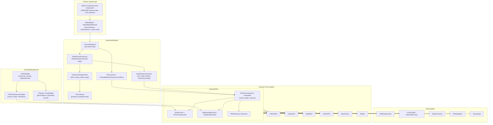
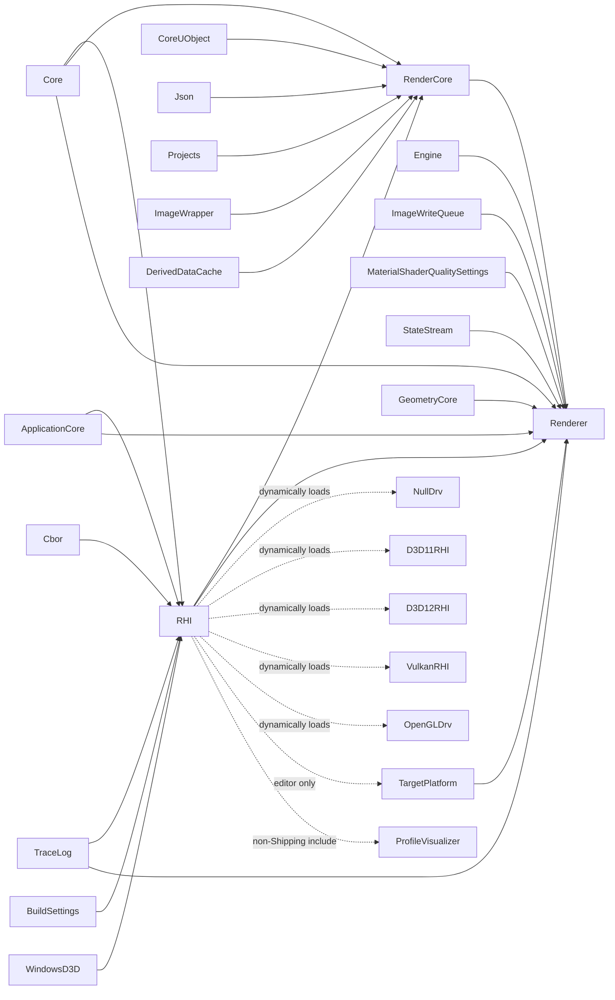

# Render Hardware Interface (RHI) — Architecture & Usage, UE 5.8

Full documentation set for every element of the Unreal Engine 5.8 Render Hardware Interface, grounded in the actual UE 5.8 source (`UE_5.8`). Each file covers **architecture** (types, responsibilities, key APIs, data flow) and **usage** (patterns, pitfalls, profiling). Every claim is cited as `file:line`; claims not directly observed in source are marked `[INFERENCE]`.

## Index

| File | Scope |
|---|---|
| [01_Overview_and_Architecture.md](01_Overview_and_Architecture.md) | layer model, `FDynamicRHI` vtable, `IRHICommandContext`, `GRHIGlobals`, capability gates |
| [02_Resources_and_Lifetime.md](02_Resources_and_Lifetime.md) | `FRHIResource` hierarchy, refcounting, `FRenderResource` init phases, usage flags, transient allocator, lock tracker, defrag |
| [03_Command_Lists_and_Execution.md](03_Command_Lists_and_Execution.md) | command classes, record vs execute, pipes, bypass, parallel command lists, deferred cleanup |
| [04_Access_States_and_Transitions.md](04_Access_States_and_Transitions.md) | `ERHIAccess`, `FRHISubresourceRange`, `FRHITransitionInfo`, predicates, descriptor ranges, validation |
| [05_Render_Passes_and_Subpasses.md](05_Render_Passes_and_Subpasses.md) | `FRHIRenderPassInfo`, load/store actions, subpasses, `ESubpassHint`, RDG pass merging, memoryless |
| [06_Pipeline_States_and_Shader_Binding.md](06_Pipeline_States_and_Shader_Binding.md) | `FGraphicsPipelineStateInitializer`, PSO cache, file cache, bound shader state fallback, binding layout, uniform buffers, root constants, shader bundles |
| [07_DrawCalls_and_Instancing.md](07_DrawCalls_and_Instancing.md) | `FMeshBatchElement` → `FMeshDrawCommand` → RHI draw, indirect args, state buckets, dynamic instancing, primitive-id streams |
| [08_Instance_Culling_and_GPUScene.md](08_Instance_Culling_and_GPUScene.md) | `InstanceCullingContext`, culling modes, compaction, indirect args buffers, GPUScene instance/payload slots |
| [09_Frame_Flow_and_Mesh_Passes.md](09_Frame_Flow_and_Mesh_Passes.md) | per-frame sequence, mesh pass list, `FParallelMeshDrawCommandPass`, RDG dispatch passes, pass catalog |
| [10_Feature_Levels_and_Shader_Platforms.md](10_Feature_Levels_and_Shader_Platforms.md) | `ERHIFeatureLevel`, `EShaderPlatform`, data-driven platform info, vertex factories, permutations |
| [11_Backends.md](11_Backends.md) | module selection, D3D11/D3D12/Vulkan/Metal/OpenGL/Null, submission models, descriptor models, PSO fallback |
| [12_MultiGPU_and_Threading.md](12_MultiGPU_and_Threading.md) | `FRHIGPUMask`, `WITH_MGPU`, render thread vs RHI thread, idle accounting, fences, pipes |
| [13_Profiling_Debugging_and_Validation.md](13_Profiling_Debugging_and_Validation.md) | stat groups, breadcrumbs, GPU profiler, render tracing, validating RHI, RDG debug, DumpGPU |
| [14_Tech_Artist_Guide.md](14_Tech_Artist_Guide.md) | cost model, instancing and LOD decisions, permutation guidance, bindless/virtual textures, CVar table, pitfalls |
| [15_File_Reference.md](15_File_Reference.md) | per-file inventory of RHI, backend modules, RenderCore RDG files, renderer draw path, engine instancing |
| [16_Testing.md](16_Testing.md) | `IRHITestModule`, `Rendering.RHI` automation spec, `-rhiunittest`, per-suite coverage |
| [17_Ray_Tracing_WorkGraph_States_and_Presentation.md](17_Ray_Tracing_WorkGraph_States_and_Presentation.md) | acceleration structures and SBT, work graphs, fixed-function states and static caches, viewport/presentation, GPU readback, `FlushType` thread-safety contract |

## Layered architecture

## Module dependency graph (from `.Build.cs`)

Notable: backends are **dynamically loaded modules**, not link-time dependencies (`RHI/RHI.Build.cs:27-53`) — the RHI module has no compile-time dependency on any backend, which is what makes `PlatformCreateDynamicRHI()` (`DynamicRHI.h:1483`) possible. Servers load only `NullDrv` (`RHI.Build.cs:29`). `WindowsD3D` is a Windows-only private dependency (`L18-21`), and `WITH_MGPU` is defined only for Windows desktop (`L23`).

## Build flags

| Flag | Condition | Source |
|---|---|---|
| `WITH_MGPU` | Windows **and** desktop platform group | `RHI.Build.cs:23` |
| `RHI_WANT_RESOURCE_INFO` | non-Shipping, or Test with `bTrackRHIResourceInfoForTest` | `RHI.Build.cs:32-35` |
| `RDG_ENABLE_DEBUG` | `!UE_BUILD_SHIPPING && !UE_BUILD_TEST` | `RenderCore/Public/RenderGraphDefinitions.h:17` (engine variant `L27`) |
| `WITH_RHI_BREADCRUMBS` | Debug/Development or `WITH_PROFILEGPU` or `HAS_GPU_STATS` | `RHI/Public/RHIBreadcrumbs.h:26` |
| `CAN_TOGGLE_COMMAND_LIST_BYPASS` | `!UE_BUILD_SHIPPING && !UE_BUILD_TEST` | `RHI/Public/RHICommandList.h:417` |
| `RHI_STATS` | hard-coded `0` in the RHI header; gates `RHISTAT` when flipped | `RHI/Public/RHICommandList.h:85`, `L87-90` |

## Source roots

- RHI core: `Engine/Source/Runtime/RHI/Public` (54 headers) and `Engine/Source/Runtime/RHI/Private` (33 files)
- RDG and shader layer: `Engine/Source/Runtime/RenderCore/Public`, `Engine/Source/Runtime/RenderCore/Private`
- Draw path: `Engine/Source/Runtime/Renderer/Public`, `Engine/Source/Runtime/Renderer/Private` (`MeshPassProcessor.*`, `MeshDrawCommands.*`, `InstanceCulling/`, `GPUScene.*`)
- Content instancing: `Engine/Source/Runtime/Engine/Public/MeshBatch.h`, `Engine/Source/Runtime/Engine/Private/InstancedStaticMesh.*`, `SceneManagement.*`
- Backends: `Engine/Source/Runtime/D3D12RHI`, `VulkanRHI`, `Apple/MetalRHI`, `Windows/D3D11RHI`, `OpenGLDrv`, `NullDrv`
- Tests: `Engine/Source/Runtime/RHI/Public/Tests`, `Engine/Plugins/Tests/RHITests/Source/RHITests/Private`, `Engine/Plugins/Tests/RHITests/Shaders/Private`

## Graph facts (from `graphify-out/graph.json`, scan root `UE_5.8`)

- Rendering corpus: **35,306 nodes** and **61,338 internal edges** across `Renderer`, `RenderCore`, `CoreRender`, `RHI`. Per-module node counts: Renderer 22,449 · RenderCore 7,571 · RHI 5,286.
- Highest-degree files: `ScenePrivate.h` (862), `RHIResources.h` (840), `SceneRendering.h` (548), `RHICommandList.h` (446), `LumenSceneData.h` (409), `Shader.h` (379), `NaniteShared.h` (356), `ShaderParameterMacros.h` (353), `PipelineStateCache.cpp` (318), `RendererScene.cpp` (317), `SceneVisibilityPrivate.h` (290), `MeshPassProcessor.h` (289), `RenderGraphResources.h` (273), `NaniteCullRaster.cpp` (248), `DeferredShadingRenderer.h` (226).
- Largest communities (hub, size): `RendererInterface.h` (2,702), `RenderGraphDefinitions.h` (2,111), `FStaticShaderPlatform` (1,882), `RenderGraphUtils.cpp` (1,571), `FRHICommandList` (950), `FSceneRenderer` (910), `FRHIResource` (858), `FMeshDrawCommand` (805), `FNaniteGlobalShader` (676), `FRHICommandListBase::Bypass` (397).
- Shape of the graph: the renderer and RDG are large hubs; the RHI itself is comparatively small (5,286 nodes) because it is a vtable plus resource types. Backends attach through `FDynamicRHI` and `IRHICommandContext`, not through the command-list hub — the dynamic-module boundary at `RHI.Build.cs:27-53` is a real graph boundary, not just a build detail.
