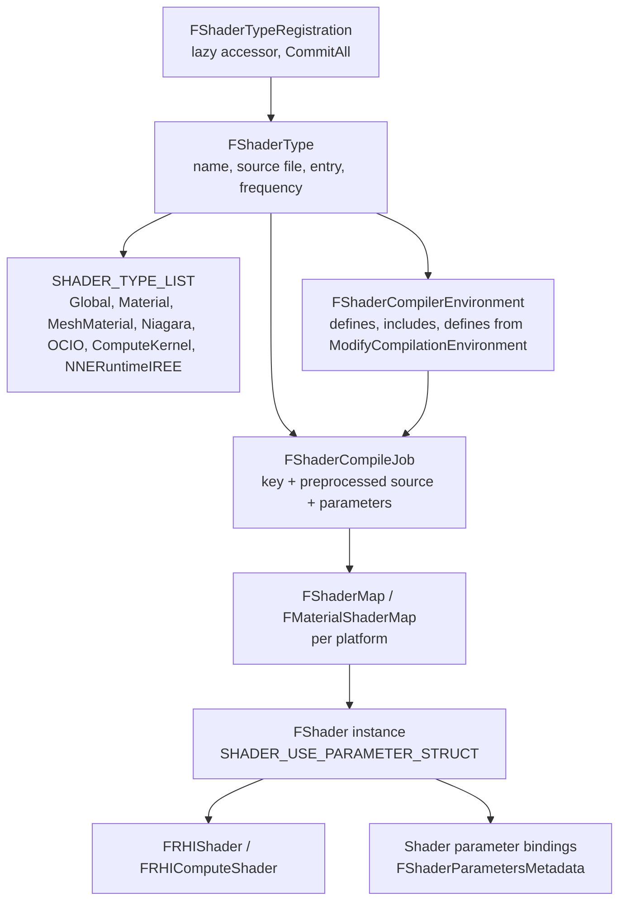

# 01 — Overview and Architecture

Four different objects get called "a shader" in engine code. Keeping them apart is what makes the rest of the system readable:

| Object | Where | What it is | Lifetime |
|---|---|---|---|
| `FShaderType` | `RenderCore/Public/Shader.h:1234` | A *family* of permutations: source file, entry point, shader frequency, permutation filter, compile-environment hook | Static, registered at module load |
| `FShaderCompileJob` | `RenderCore/Public/ShaderCompilerJobTypes.h:402` | One permutation to compile: key + preprocessed source + parameter metadata | Transient, DDC keyed |
| `FShader` | `RenderCore/Public/Shader.h:816` | A *compiled permutation instance* bound to a material or global context | Per shader map, per platform |
| `FRHIShader` / `FRHIComputeShader` | `Runtime/RHI/Public/RHI.h` | The driver object (DXC blob, Metal library, SPIR-V, VectorVM bytecode) | Per RHI device |

A **shader map** is the set of permutations that exist for one platform (`FShaderMap`, `FMaterialShaderMap`). A material's shader map is keyed by its `FShaderMapId`; a global shader map is keyed by the set of CVars that change general shader shapes (`Shader.cpp:1711` `ShaderMapAppendKey` appends every such CVar name and value, plus mobile CVars at `1723-1732`).

## Object model

## What a plugin can override

Every hook below is a public virtual or a macro a plugin owns; none require engine source edits.

| Hook | Signature | File |
|---|---|---|
| Permutation filter | `static bool ShouldCompilePermutation(const FGlobalShaderPermutationParameters&)` | `Shader.h:848` |
| Compile environment (defines/includes) | `static void ModifyCompilationEnvironment(const FGlobalShaderPermutationParameters&, FShaderCompilerEnvironment&)` | `Shader.h:842` |
| Precache policy | `static bool ShouldPrecachePermutation(...)` | `Shader.h:851` |
| Post-compile validation | `static void ValidateCompiledResult(...)` | `Shader.h:854` |
| Job priority | `static EShaderCompileJobPriority GetOverrideJobPriority(...)` | `Shader.h:858` |
| Binding layout | `static FShaderBindingLayoutHandle GetShaderBindingLayout(...)` | `Shader.h:845` |
| Shader type registration | `IMPLEMENT_SHADER_TYPE` / `IMPLEMENT_GLOBAL_SHADER` | `Shader.h:1744-1764`, `GlobalShader.h:433` |
| Shader source directory | `AddShaderSourceDirectoryMapping(TEXT("/Plugin/X"), dir)` | `ShaderCore.cpp:4218-4231` |
| Shader type instance list | `FShaderTypeRegistration::GetInstances()`, `CommitAll()` | `Shader.h:1600-1612`, `Shader.cpp:328-336` |
| Modular features | `IMeshDeformerProvider`, `IRenderCaptureProvider`, `IShaderAuditExtension` | `Public/Animation/MeshDeformerProvider.h:17`, `Public/IRenderCaptureProvider.h:10`, `Plugins/Developer/ShaderToolkit/Source/ShaderAuditCore/Public/IShaderAuditExtension.h:42` |

## Load-phase constraint

Shader types are registered by static `FShaderTypeRegistration` objects created by `IMPLEMENT_SHADER_TYPE`. The constructor asserts that the type list is not yet frozen:

> `checkf(!AreShaderTypesInitialized(), ... "use ELoadingPhase::PostConfigInit on your module")` — `Shader.cpp:315`

So a plugin that registers shader types must run `StartupModule()` at `ELoadingPhase::PostConfigInit` (Niagara does exactly this: `NiagaraShaderModule.cpp:13-21`). Registering later means the type is invisible to shader maps that were already built.

## Two compilation paths

1. **Editor / non-cooked**: source is preprocessed and compiled by `ShaderCompileWorker` processes (`r.Shaders.AllowCompilingThroughWorkers` default 1, `Shader.cpp:110`), results stored in the Derived Data Cache. `GRetryShaderCompilation = true` (`ShaderCompiler.cpp:321`).
2. **Cooked / shipped**: shaders are read from the shader code archive (`Engine/Plugins`-produced `.ushaderbytecode`, documented in `RenderCore/Internal/ShaderLibrary/EditorShaderCodeArchive.h:156-162`), loaded through `ShaderCodeLibrary` (`ShaderCodeArchive.cpp:45-76` CVars) and never compiled at runtime.

The consequence for a tech artist: a permutation that `ShouldCompilePermutation` rejects for a platform is *absent* in the cooked archive, and the material falls back or fails to bind — not a runtime warning.

See [03](03_Compilation_Pipeline_and_Caching.md) for the key/DDC mechanics and [05](05_Custom_Shaders_from_a_Plugin.md) for the plugin recipe.
