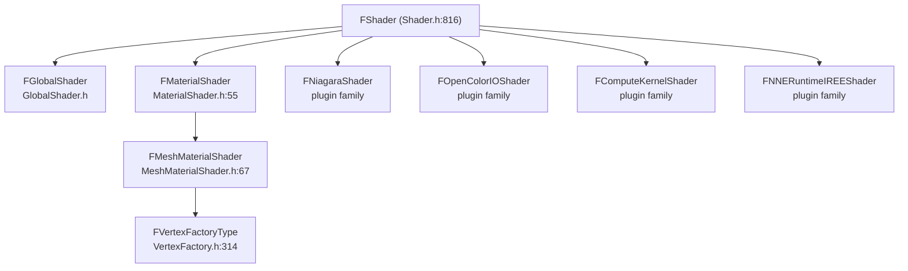

# 02 — Shader Type System and Families

## `FShader` — the instance

`RenderCore/Public/Shader.h:816`. The overridable surface a plugin uses:

| Virtual | Line | Purpose |
|---|---|---|
| `ModifyCompilationEnvironment` | 842 | Adds defines/includes for the permutation (per platform) |
| `GetShaderBindingLayout` | 845 | Root signature / binding layout handle |
| `ShouldCompilePermutation` | 848 | Permutation gate — the single most important hook |
| `ShouldPrecachePermutation` | 851 | PSO precache participation |
| `ValidateCompiledResult` | 854 | Post-compile check (e.g. instruction count, resource usage) |
| `GetOverrideJobPriority` | 858 | Compile queue priority |

`ShouldCompilePermutation` is called with `FGlobalShaderPermutationParameters` (platform, feature level, target API). Returning false means the permutation is never compiled, never archived, and never available at runtime.

## Type families

`SHADER_TYPE_LIST` (`Shader.h:1219-1226`) is a closed list of families:

| Family | Owner | Registration macro | Notes |
|---|---|---|---|
| Global | `RenderCore` | `IMPLEMENT_GLOBAL_SHADER` (`GlobalShader.h:433`) | Fixed source file + entry, no material |
| Material | `Engine` | `IMPLEMENT_MATERIAL_SHADER_TYPE` (`MaterialShaderType.h:13-20`) | Per-material permutation |
| MeshMaterial | `Engine` | same family, `FMeshMaterialShader` (`MeshMaterialShader.h:67`) | Material + vertex factory |
| Niagara | plugin | `IMPLEMENT_NIAGARA_SHADER_TYPE` (`NiagaraShaderType.h:16-21`) | Plugin-owned family |
| OCIO | plugin | `IMPLEMENT_OCIO_SHADER_TYPE` (`OpenColorIOShaderType.h:15-21`) | Plugin-owned family |
| ComputeKernel | plugin | `FComputeKernelShaderType` (`ComputeKernelShaderType.h:67`) | ComputeFramework |
| NNERuntimeIREE | plugin | `FNNERuntimeIREEShaderType` (`NNERuntimeIREEShaderType.h:71`) | Experimental |

`EShaderTypeForDynamicCast` (`Shader.h:1238-1242`) is the runtime discriminator used by `CastShaderType<T>()`; it enumerates the same families. A plugin cannot add a new family — it registers types *inside* an existing family.



## Registration mechanics

- `DECLARE_SHADER_TYPE` (`Shader.h:1706`) declares the type accessor inside the shader class.
- `IMPLEMENT_SHADER_TYPE` (`Shader.h:1744-1764`) emits a static `GetStaticType()` plus a static `FShaderTypeRegistration` instance — registration happens at static-init time, before `CommitAll()`.
- `IMPLEMENT_SHADER_TYPE_CONSTRUCTOR` (`Shader.h:1862`, family-specific variant at `1918`) binds a class to a family.
- `FShaderTypeRegistration` (`Shader.h:1600-1612`) holds the lazy instance list; `GetInstances()` collects, `CommitAll()` freezes. `CommitAll()` runs at `Shader.cpp:328-336`.
- `FShaderType`'s constructor registers the type into the family list, the name map and the sorted array (`Shader.cpp:290-295`).

Lookup APIs a tool can use: `GetTypeList()` (`Shader.h:1270`), `GetShaderTypeByName()` (`1272`), `GetShaderTypesByFilename()` (`1273`), `GetNameToTypeMap()` (`1277`), `GetSortedTypes()` (`1279`).

## Plugin-owned families in practice

Niagara is the reference implementation of a plugin extending the type system:

```cpp
// Engine/Plugins/FX/Niagara/Source/NiagaraShader/Private/NiagaraShaderModule.cpp:13-21
void FNiagaraShaderModule::StartupModule()
{
    AddShaderSourceDirectoryMapping(TEXT("/Plugin/FX/Niagara"), PluginShaderDir);
    AddShaderSourceSharedVirtualDirectory(TEXT("/Plugin/FX/Niagara/Shared/"));
}
```

plus `IMPLEMENT_SHADER_TYPE(, FNiagaraShader, TEXT("/Plugin/FX/Niagara/Private/NiagaraEmitterInstanceShader.usf"), TEXT("SimulateMain"), SF_Compute)` (`NiagaraShader.cpp:31`).

ComputeFramework, OCIO, NNERuntimeIREE, HairStrands, LensDistortion, WmfMedia, VirtualHeightfieldMesh, GLTFExporter, PFMExporter, RemoteSession and AppleARKit all register shader types from plugin modules with `IMPLEMENT_SHADER_TYPE` — 32 plugin files do this. None of them touch engine source.

## Vertex factories

A `FMeshMaterialShader` permutation is keyed by material *and* vertex factory type. `FVertexFactoryType` (`VertexFactory.h:314`) is registered by `IMPLEMENT_VERTEX_FACTORY_TYPE` (`572`); the parameter struct binding is `IMPLEMENT_VERTEX_FACTORY_PARAMETER_TYPE` (`217`). A plugin adding a vertex factory therefore adds a permutation axis: every material used with it gets a new permutation.

## What a tech artist can and cannot do

- Can: pick a material domain, set usage flags, add a Custom output node, choose a parent material, enable/disable features that gate permutations.
- Cannot: create a new shader family, add a new shader frequency (`SF_Vertex`/`SF_Pixel`/`SF_Geometry`/`SF_Compute` are fixed by the RHI), or register a type from Blueprint. Registration is C++ static-init.
