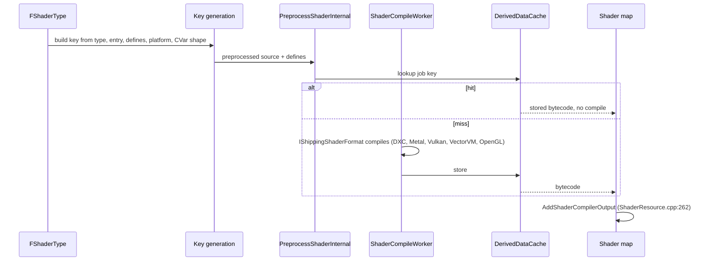

# 03 — Compilation Pipeline and Caching

## Job model

`FShaderCompileJob : FShaderCommonCompileJob` (`RenderCore/Public/ShaderCompilerJobTypes.h:402`) carries `Key` (`407`) and `ShaderParameters` (`413`, the reflected `FShaderParametersMetadata`). A job is the unit of caching: the key is a hash of everything that can change the emitted code.

## What enters the key

`ShaderMapAppendKey` (`RenderCore/Private/Shader.cpp:1711`) appends the name and value of every CVar that changes general shader shapes, then mobile CVars (`1723-1732`). Per-permutation tokens are appended separately (`Shader.cpp:2749-2778`):

| Token | Source | Condition |
|---|---|---|
| `MIN` | `r.Shaders.RemoveDeadCode` | 2749-2754 |
| `PJC` | `r.ShaderCompiler.PreprocessedJobCache` | 2757-2764 |
| `SHRC` | shader resource caching | 2766 |
| `SHBD` | shader binding layout | 2772 |
| `RTWM` | ray tracing wave mode | 2778 |

Practical consequence: changing a shape CVar invalidates the whole global shader map, not one shader. A plugin that adds a define in `ModifyCompilationEnvironment` changes only its own permutations.

## Caching layers

| Layer | What it caches | Control |
|---|---|---|
| Preprocessed job cache | preprocessed source per job | `r.ShaderCompiler.PreprocessedJobCache` (read at `Shader.cpp:2758`) |
| DDC, per shader | compiled permutation | `r.ShaderCompiler.PerShaderDDCCook` 1 (`ShaderCompilerJobCache.cpp:51-55`), `PerShaderDDCGlobal` 1 (`57-62`) |
| Shader code archive | cooked shader maps | `.ushaderbytecode`, `.assetinfo.json`, `.stinfo` (`Internal/ShaderLibrary/EditorShaderCodeArchive.h:156-162`) |
| Stable key metadata | stable key → hash mapping | `.shk`, `FShaderStableKeyDebugInfoReader` (`Public/ShaderStableKeyDebugInfoReader.h:17-26`) |
| Shader bundles | grouped shader data for bindful platforms | `r.ShaderBundle.MaxSize` 8192 (`ShaderBundles.cpp:8-12`), gate `RHISupportsShaderBundleDispatch` (`17-20`), `GetRequiresBindfulUtilityShaders` (`22-25`) |
| Pipeline cache / PSO precache | pipeline state objects | `r.ShaderPipelineCache.*` (`ShaderPipelineCache.cpp:55-126`), `Enabled` registered in `Runtime/RHI/Private/PipelineFileCache.cpp:112-116` with `PIPELINE_CACHE_DEFAULT_ENABLED` |
| On-demand creation | runtime permutation creation | `r.MeshDrawCommands.AllowOnDemandShaderCreation` 1 (`MeshDrawCommands.cpp:45-52`) |

`ShaderCodeLibrary` load behaviour: `DefaultAsyncIOPriority` `AIOP_Normal` (`ShaderCodeArchive.cpp:45-51`), `AsyncIOAllowDontCache` 0 (`53-59`), `VisualizeShaderUsage` 0 (`61-67`), `MaxShaderGroupSize` 1048576 (`69-76`); `SeparateLoadingCache` 0 and `PreloadShaderMaps` 1 (`ShaderCodeLibraryUtilities.cpp:50-64`).

## Pipeline cache CVars (`ShaderPipelineCache.cpp`)

| CVar | Default | Line |
|---|---|---|
| `r.ShaderPipelineCache.StartupMode` | 1 | 55-64 |
| `BackgroundBatchSize` | 1 | 66-71 |
| `BatchSize` | 50 | 72-77 |
| `PrecompileBatchSize` | 50 | 78-83 |
| `PSOPrecacheThreadPoolBatchSize` | 500 | 84-89 |
| `BackgroundBatchTime` | 0.0 | 90-95 |
| `BatchTime` | 16.0 | 96-101 |
| `PrecompileBatchTime` | 0.0 | 102-107 |
| `PSOPrecacheThreadPoolBatchTime` | 16.0 | 108-113 |
| `SaveAfterPSOsLogged` | 0 | 114-119 |
| `AutoSaveTime` | 30 | 121-126 |

Usage contract is documented in `RenderCore/Public/ShaderPipelineCache.h:34-38,54-58`.

## Shader formats

Compilation is delegated to `IShaderFormat` implementations (`Developer/TargetPlatform/Public/Interfaces/IShaderFormat.h:22`), resolved per platform by `LegacyShaderPlatformToShaderFormat()` plus `ITargetPlatformManagerModule::FindShaderFormat()` (`ShaderCompiler.cpp:3297`, `3819`, `4346`; `ShaderCompilerUtil.cpp:28` iterates `TPM.GetShaderFormats()`). Implementations live in `Developer/`: `ShaderFormatD3D`, `Apple/MetalShaderFormat`, `VulkanShaderFormat`, `ShaderFormatVectorVM` (VectorVM bytecode for Niagara/ComputeFramework), with `ShaderPreprocessor` and `ShaderCompilerCommon` as shared plumbing. Formats are supplied by target platform modules, so a plugin cannot add one — it can only feed source through the existing ones. `IShippingShaderFormat` is not a 5.8 type.

## Debug output

| CVar | Default | Line |
|---|---|---|
| `r.DumpShaderDebugInfo` | `OnError` (2) | `ShaderCompiler.cpp:323-334` |
| `r.DumpShaderDebugShortNames` | 0 | `ShaderCompiler.cpp:337-341` |
| `r.ShaderCompiler.DisableSourceStripping` | false | `ShaderCompiler.cpp:132-136` (kept false for RenderDoc file association) |
| `r.AreShaderErrorsFatal` | true | `ShaderCompiler.cpp:138-143` |
| `r.ShaderCompiler.DumpDebugInfoForCacheHits` | true | `ShaderCore.cpp:212-216` |
| `r.ShaderCompiler.BreakOnPreprocessJob` | "" | `ShaderCore.cpp:218-222` |
| `r.OverrideShaderDebugDir` | "" | `ShaderCore.cpp:224-229` |
| `r.DisambiguateShaderDebugDir` | false | `ShaderCore.cpp:231-236` |
| `r.Shaders.SkipCompression` | 0, `ReadOnly|Cheat`, non-shipping/test only | `Shader.cpp:103` |
| `r.Shaders.RemoveUnusedInterpolators` | 0, `ReadOnly` | `Shader.cpp:94` |
| `r.Shaders.AllowCompilingThroughWorkers` | 1 | `Shader.cpp:110` |
| `r.Shaders.ForceDXC` | 1 | `Shader.cpp:119` |
| `r.ShaderPipelines` | 1 | `Shader.cpp:89` |

`r.ShaderModel*`, `r.ShaderPreprocessing`, `r.ShaderOrphaning`, `r.ShaderCodeVerification` are **not registered CVars** in 5.8 (grep over `Engine/Source` finds no registration). Shader model targets come from DataDrivenPlatformInfo/TargetPlatform, not a console variable. `-EnableShaderDebugging` is likewise absent from 5.8 source; the current path is `r.DumpShaderDebugInfo` or `-directcompile`.

Editor-only stats: `r.ShaderCompiler.StatsPrintoutInterval` 180 and `r.ShaderCompiler.PrintIndividualProcessStats` false (`Editor/UnrealEd/Private/ShaderStatsCollector.cpp:9-20`). `r.LogShaderCompilerStats` does not exist.
