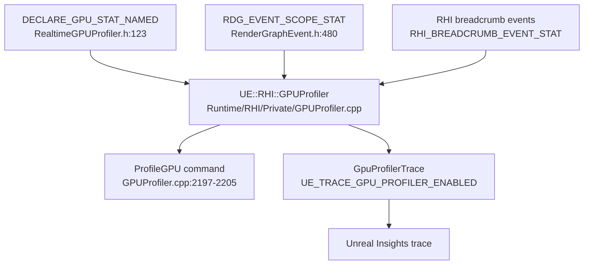

# 07 — Profiling

The legacy GPU profiler is gone in 5.8. `SCOPED_GPU_STAT`, `SCOPED_GPU_STAT_VERBOSE` and `GPU_STATS_BEGINFRAME` are deprecated no-ops (`RenderCore/Public/ProfilingDebugging/RealtimeGPUProfiler.h:153-156`). The declarations that still work — `DECLARE_GPU_STAT_NAMED` (`123`), `DECLARE_GPU_DRAWCALL_STAT_NAMED` (`125`), `DECLARE_GPU_STAT` (`128`) — route to `UE::RHI::GPUProfiler::TGPUStat`. `RHI_NEW_GPU_PROFILER` is deprecated and always 1 (`RHI/Public/RHIDefinitions.h:71`); `HAS_GPU_STATS` (`73-75`) is the compile gate.

## `ProfileGPU` CVars (`Runtime/RHI/Private/GPUProfiler.cpp`)

| CVar | Default | Line |
|---|---|---|
| `r.ProfileGPU.Sort` | 0 | 35-39 |
| `r.ProfileGPU.Root` | `*` | 45-49 |
| `r.ProfileGPU.ThresholdPercent` | 0.0 | 51-55 |
| `r.ProfileGPU.TableFormatting` | true | 57-61 |
| `r.ProfileGPU.UnicodeOutput` | true | 63-67 |
| `r.ProfileGPU.ShowLeafEvents` | true | 69-73 |
| `r.ProfileGPU.ShowHeader` | true | 75-79 |
| `r.ProfileGPU.ShowEmptyQueues` | true | 81-85 |
| `r.ProfileGPU.ShowStats` | true | 87-91 |
| `r.ProfileGPU.ShowPercentColumn` | true | 93-97 |
| `r.ProfileGPU.ShowInclusive` | true | 99-103 |
| `r.ProfileGPU.ShowExclusive` | true | 105-109 |
| `r.ProfileGPU.ShowUI` | true | 111-116 |

The `ProfileGPU` console command is registered under `#if WITH_PROFILEGPU` (`GPUProfiler.cpp:2197-2205`). `WITH_PROFILEGPU` is defined in `Runtime/Core/Public/Misc/Build.h:410-411`; `ALLOW_DUMPGPU_IN_TEST` (`413-415`) and `ALLOW_DUMPGPU_IN_SHIPPING` (`417-419`) control the dump path.

`stat GPU` is per-queue dynamic groups: the profiler builds the group name as `STATGROUP_<GPU><Type><Index>` (`GPUProfiler.cpp:827-831`, applied at `851`) and registers `FDynamicStat` instances (`870`), so `STATGROUP_GPU0_Graphics0` is the first graphics queue of GPU 0. `stat Unit` / `STAT_UnitGPU` is the per-unit view (`Runtime/Engine/Public/EngineStats.h:36`, defined `UnrealEngine.cpp:14015`, written `UnrealClient.cpp:438`). `r.GPUStats`, `r.RenderTimingEnabled`, `r.GPUTimingMaxQueries`, `r.ParallelGPUTiming` do not exist in 5.8.

## RDG scopes

`RenderCore/Public/RenderGraphEvent.h`: `RDG_EVENT_NAME` (`477`), `RDG_EVENT_SCOPE` (`479`), `RDG_EVENT_SCOPE_STAT` (`480`), `RDG_EVENT_SCOPE_CONDITIONAL` / `RDG_EVENT_SCOPE_CONDITIONAL_STAT` (`481-482`), `RDG_EVENT_SCOPE_FINAL` (`484`). `FRDGScope_RHI::BeginCPU` (`166-176`) is where the CPU-side window opens. A pass that has no RDG scope has no GPU timing entry — that is the most common "missing bar" in `ProfileGPU`.

## Shader-side counters

| Counter | Where | Lines |
|---|---|---|
| `STATGROUP_ShaderCompiling` (Niagara, OCIO, Material, Global compile time) | `RenderCore/Private/ShaderCore.cpp` | 102-109 |
| `STATGROUP_GPUSkinCache` | `Runtime/Engine/Private/GPUSkinCache.cpp` | 39-45 |
| `GRenderThreadTime`, `GRenderThreadWaitTime`, `GRHIThreadTime` | `RenderCore/Public/RenderTimer.h` | 8, 11, 14 |
| `FPixelRenderCounters`, `GPixelRenderCounters` | `RenderCore/Public/RenderCounters.h` | 7, 49 |
| Shader usage visualization | `r.ShaderCodeLibrary.VisualizeShaderUsage` 0 | `ShaderCodeArchive.cpp:61-67` |

Shader usage visualization can only write images on desktop Development/DebugGame non-program targets — `ImageWrapper` is added to `RenderCore` only in that configuration (`RenderCore.Build.cs:28-31`).

Compile-time stats printout is editor-only: `r.ShaderCompiler.StatsPrintoutInterval` 180, `r.ShaderCompiler.PrintIndividualProcessStats` false (`Editor/UnrealEd/Private/ShaderStatsCollector.cpp:9-20`).

## Trace gate

`UE_TRACE_GPU_PROFILER_ENABLED` = `UE_TRACE_ENABLED && !UE_BUILD_SHIPPING` (`RHI/Public/GpuProfilerTrace.h:12-14`). Shipping builds have no GPU profiler trace; `[INFERENCE]` — the only shipping-side timing is explicit RHI breadcrumb events captured by an external trace consumer.

## What to profile for shaders

1. Permutation cost: `STATGROUP_ShaderCompiling` during a material recompile, plus `r.ShaderCompiler.StatsPrintoutInterval`.
2. Per-pass GPU cost: `RDG_EVENT_SCOPE_STAT` on the pass, then `ProfileGPU` with `r.ProfileGPU.ShowInclusive`/`ShowExclusive`.
3. PSO precache pressure: `r.ShaderPipelineCache.*` batch sizes (`ShaderPipelineCache.cpp:55-126`) and `SaveAfterPSOsLogged` (`114-119`).
4. Runtime shader creation: `r.MeshDrawCommands.AllowOnDemandShaderCreation` (`MeshDrawCommands.cpp:45-52`) — hitches here mean a permutation was filtered out by `ShouldCompilePermutation`.
