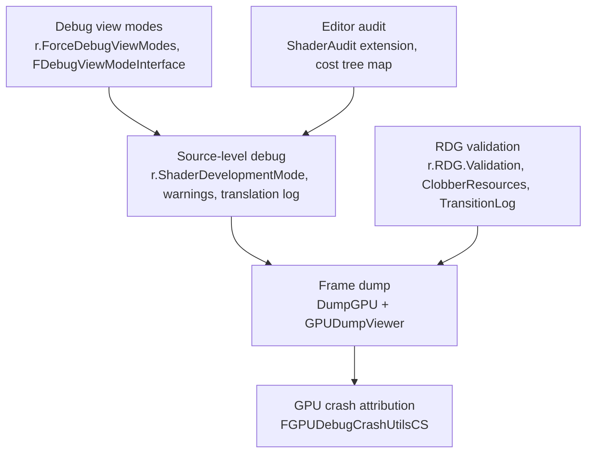

# 08 — Debugging Shaders

## Source-level

| CVar | Default | Line |
|---|---|---|
| `r.ShaderDevelopmentMode` | 0 | `RenderCore/Private/ShaderDiagnostics.cpp:8-12` |
| `r.ShaderCompilerWarningsFilter` | 2 | `ShaderDiagnostics.cpp:20-24` |
| `r.AreShaderErrorsFatal` | true | `Engine/Private/ShaderCompiler/ShaderCompiler.cpp:138-143` |
| `r.DumpShaderDebugInfo` | `OnError` (2) | `ShaderCompiler.cpp:323-334` |
| `r.ShaderCompiler.DisableSourceStripping` | false | `ShaderCompiler.cpp:132-136` — kept false so RenderDoc can associate a captured shader with its source file |
| `r.Material.EnableTranslationLogFile` | false | `Engine/Private/Materials/HLSLMaterialTranslator.cpp:90-94` |
| `r.ShaderCompiler.BreakOnPreprocessJob` | "" | `RenderCore/Private/ShaderCore.cpp:218-222` |
| `r.OverrideShaderDebugDir` / `r.DisambiguateShaderDebugDir` | "" / false | `ShaderCore.cpp:224-229`, `231-236` |

`-EnableShaderDebugging` does not appear anywhere in `Engine/Source` in 5.8; the current equivalents are `r.DumpShaderDebugInfo` and `-directcompile`.

## Frame dump

`DumpGPU` is a console command registered under `#if WITH_DUMPGPU` at `Runtime/Core/Private/HAL/ConsoleManager.cpp:3814` (guard at `3813`). `RenderCore/Private/DumpGPU.cpp`: `r.DumpGPU.Root` `*` (`61-65`), re-capture note (`95-97`), `r.DumpGPU.Delay` (`99`), streaming-mode note (`128-131`), `IsDumpingPass` wildcard match (`1979-1982`). The viewer source is staged as `RuntimeDependencies` when the configuration is not Shipping (`RenderCore.Build.cs:34-37`).

Programmatic side (`RenderCore/Public/DumpGPU.h`): `IDumpGPUUploadServiceProvider::GProvider` (`31`), `UploadDump` (`28`), `#if WITH_DUMPGPU` (`34`), namespace `UE::RenderCore::DumpGPU` (`36-63`) with `TickEndFrame` (`39`), `IsDumpingFrame` (`41`), `ShouldCameraCut` (`43`), `FDumpScope` (`45-61`). A plugin can supply its own upload provider through `GProvider`.

## GPU crash attribution

`r.RHICmdBypass` defaults to 0 (`Runtime/RHI/Private/RHICommandList.cpp:56-60`). The crash-time compute shader is registered in `RenderCore/Private/GPUDebugCrashUtils.cpp:36`:

> `IMPLEMENT_GLOBAL_SHADER(FGPUDebugCrashUtilsCS, "/Engine/Private/Tools/GPUDebugCrashUtils.usf", "MainCS", SF_Compute)`

and scheduled through `ScheduleGPUDebugCrash(FRDGBuilder&)` (`39-44`). This is why a GPU crash can name the pass: the pass scope plus a crash-time dispatch.

## Debug view modes

`r.ForceDebugViewModes` defaults to 0 (`ShaderCore.cpp:570-574`). The interface is `FDebugViewModeInterface` (`Runtime/Engine/Public/DebugViewModeInterface.h:27`) with `SetInterface` (`78`), `Singleton` (`86`), `GetInterface` (`72`) and `AllowFallbackToDefaultMaterial` (`81`). `DebugViewModeHelpers.cpp:89` reads the CVar through `FShaderPlatformCachedIniValue`, and `:345` calls `GetInterface(ShaderMode)`. A plugin supplies a debug view mode by implementing `FDebugViewModeInterface` and calling `SetInterface` — that is the extension point, not a CVar.

`r.VisualizeTexture.AllowBlinking` defaults to 1 (`RenderCore/Private/VisualizeTexture.cpp:602-605`).

## RDG debug CVars (`RenderCore/Private/RenderGraphPrivate.cpp`)

| CVar | Line |
|---|---|
| `r.RDG.ImmediateMode` | 18 |
| `r.RDG.Validation` | 25 |
| `r.RDG.Debug.FlushGPU` | 34 |
| `r.RDG.Debug.ExtendResourceLifetimes` | 43 |
| `r.RDG.Debug.DisableTransientResources` | 53 |
| `r.RDG.ClobberResources` | 60 |
| `r.RDG.OverlapUAVs` | 71 |
| `r.RDG.TransitionLog` | 77 |
| `r.RDG.Debug.GraphFilter` | 85 |
| `r.RDG.Debug.PassFilter` | 135 |
| `r.RDG.Debug.ResourceFilter` | 152 |
| `r.RDG.AsyncCompute` | 212-219 |
| `r.RDG.CullPasses` | 233 |
| `r.RDG.MergeRenderPasses` | 242 |
| `r.RDG.TransientAllocator` | 251 |
| `r.RDG.TransientExtractedResources` | 260 |
| `r.RDG.AsyncComputeTransientAliasing` | 269 |
| `r.RDG.Events` | 277 |
| `r.RDG.ParallelDestruction` | 291 |
| `r.RDG.ParallelSetup` | 299 |
| `r.RDG.ParallelExecute` | 329 |
| `r.RDG.ParallelExecute.PassMin` / `PassMax` / `PassTaskModeThreshold` | 353 / 359 / 365 |
| `r.RDG.ParallelExecuteStress` | 373 |
| `r.RDG.BarrierPass` (true) | `RenderGraphUtils.cpp:16` |

`r.RDG.Validation` + `r.RDG.ClobberResources` + `r.RDG.Debug.ExtendResourceLifetimes` is the combination that turns a silent wrong-pixel bug into an explicit error. See [../RDG/](../RDG/) for the pass model.

## Editor audit

`Engine/Plugins/Developer/ShaderToolkit/Source/ShaderAuditCore/Public/IShaderAuditExtension.h:42` defines `IShaderAuditExtension : IModularFeature` with `FeatureName = "ShaderAuditExtension"`, `GetExtensionId`, `GetDisplayName`, `GetContributions`, `OnSessionLoaded`, `OnSessionClosed` — an editor-only extension point a plugin can implement to contribute rows to the ShaderAudit session view. `ShaderStableKeyDebugInfoReader` (`RenderCore/Public/ShaderStableKeyDebugInfoReader.h:17-26`) maps `.shk` stable keys back to shader hashes, which is how an audit tool names a shader that only exists in an archive.

Shader source directory mappings are reset by `ResetAllShaderSourceDirectoryMappings` (`ShaderCore.cpp:4213`), so a plugin's mapping must be re-applied on module reload.
