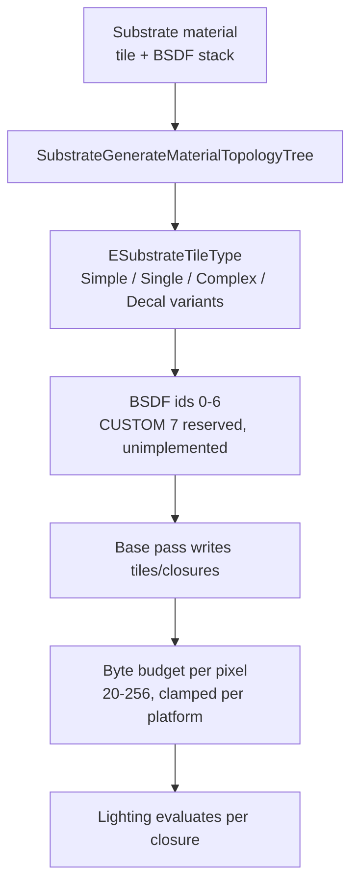

# 09 — Substrate

## The switch

Project setting `bEnableSubstrate` (`Runtime/Engine/Classes/Engine/RendererSettings.h:1254-1261`) is bound to console variable `r.Substrate` with `ConfigRestartRequired = true`. The CVar itself (`RenderCore/Private/RenderUtils.cpp:2068-2072`) defaults to **0** and is `ECVF_ReadOnly | ECVF_RenderThreadSafe` — it cannot be flipped at runtime, and the runtime query is `Substrate::IsSubstrateEnabled()` (`2221-2224`).

Storage format is a second, separate setting (`RendererSettings.h:1263-1265`) bound to `r.Substrate.ProjectGBufferFormat` (`RenderUtils.cpp:2084-2090`, default 1). The comment block at `2074-2083` states the migration policy: existing non-Substrate projects stay off, existing Substrate projects keep Adaptive GBuffer, new projects get Blendable; `GameProjectUtils.cpp` applies that at project creation.

## What changes when Substrate is off

| Aspect | On | Off |
|---|---|---|
| GBuffer layout | Substrate storage: Blendable or Adaptive per platform (`RenderUtils.cpp:2226-2233`) | Classic named GBuffer targets; the Substrate UAV path (`GBufferInfo.cpp:265-276`, `TargetGBufferA/B/C = -1`, `Info.NumTargets = 1` plus a velocity target) is not taken |
| Per-pixel material model | Multiple closures, tiles, BSDF stack | One shading model per pixel |
| Decals | Blendable format removes the DBuffer requirement (`RenderUtils.cpp:2088`); `r.Substrate.DBufferPass` 0 keeps DBuffer out of a separate pass (`2134-2138`) | DBuffer decals |
| Stochastic lighting | Available only with Adaptive GBuffer (`2235-2238`) | Not available |
| Byte budget | 20–256 bytes/pixel, clamped (`2240-2262`) | Fixed GBuffer size |
| Shading models | `ESubstrateShadingModel` (`EngineTypes.h:814-836`), code-only, not exposed in the UI | Legacy shading model list |
| Shader permutations | Compile-affecting settings are `ECVF_ReadOnly`; `r.Substrate.DBufferPass` explicitly requires recompiling all shaders (`2137`), as do `Glints` (`2162`) and `SpecularProfile` (`2186`). Runtime-writable exceptions: `Glints.LUT` `2169`, `Glints.LevelBias` `2175`, `Glints.LevelMin` `2181`, `SimpleTiledLightingPasses` `2205` | No Substrate permutations |

Practical consequence: turning Substrate on is a full shader recompile, and a material graph that emits Substrate data must go through `SubstrateGenerateMaterialTopologyTree` — otherwise `MaterialExpressions.cpp:2461` errors.

## Core types (5.8 reality)

| Type | File | Line |
|---|---|---|
| `ESubstrateStorageFormat` (BlendableGBuffer 0, AdaptiveBuffer 1) | `Runtime/Engine/Classes/Engine/EngineTypes.h` | 780-791 |
| `ESubstrateClosureConfig` | `EngineTypes.h` | 796-807 |
| `ESubstrateShadingModel` | `EngineTypes.h` | 814-836 |
| `ESubstrateTileType` (ESimple, ESingle, EComplex, EComplexSpecial, EOpaqueRoughRefraction, EOpaqueRoughRefractionSSSWithout, EDecalSimple, EDecalSingle, EDecalComplex, ECount) | `Runtime/Engine/Public/Rendering/SubstrateMaterialShared.h` | 68-81 |
| `ESubstrateBsdfFeature` | `SubstrateMaterialShared.h` | 61-65 |
| `FSubstrateSceneData`, `FSubstrateViewData`, `FSubstrateTileParameter`, `FSubstrateOperator`, `FSubstrateMaterialInfo` | `Runtime/Renderer/Private/Substrate/` | — |
| BSDF ids (SLAB 0 … TOON 6, `SUBSTRATE_BSDF_TYPE_CUSTOM 7` **reserved**), packing note, `SUBSTRATE_TILE_SIZE 8`, `SUBSTRATE_FULLY_SIMPLIFIED_NUM_UINTS (32/4)` | `Engine/Shaders/Shared/SubstrateDefinitions.h` | 33-40, 41, 44, 31 |

`FSubstrateGBufferTile`, `FSubstrateBuiltinTile`, `FSubstrateField`, `FSubstrateMaterial`, `FSubstrateGenerator`, `FSubstrateRenderer`, `FSubstrateSceneExtension` do **not** exist in 5.8.

## Can a tech artist extend Substrate?

**No, not from a plugin.** `ESubstrateShadingModel` and `SUBSTRATE_BSDF_TYPE_*` are closed enums/defines; `SUBSTRATE_BSDF_TYPE_CUSTOM` (7) is reserved but unimplemented (`SubstrateDefinitions.h:40`), and there is no registration API for a new BSDF or tile type. The Custom HLSL node is limited to `ECustomMaterialOutputType` (`Runtime/Engine/Public/Materials/MaterialExpressionCustom.h:16-24`) — it cannot emit Substrate data.

What a tech artist *can* do:
- Choose tile type and BSDF per layer through the Substrate material editor.
- Set per-quality-level closure counts via `r.Substrate.MaterialQualityLevelsClosuresPerPixel` (`RenderUtils.cpp:2110-2114`, empty by default, format `L1-M1-H1-E1`).
- Control the byte budget (`2092-2096`) and closure counts (`2098-2102`, `2104-2108`, `2116-2120`).
- Toggle runtime-legal features: `r.Substrate.RoughDiffuse` (`2153-2157`, `ECVF_RenderThreadSafe`), `r.Substrate.Glints.LUT` (`2165-2169`), `r.Substrate.Glints.LevelBias` (`2171-2175`), `r.Substrate.Glints.LevelMin` (`2177-2181`), `r.Substrate.SimpleTiledLightingPasses` (`2201-2205`). Everything else in the Substrate block is `ECVF_ReadOnly`.

## Substrate CVars (`RenderUtils.cpp`)

| CVar | Default | Lines | Flags |
|---|---|---|---|
| `r.Substrate` | 0 | 2068-2072 | ReadOnly, RenderThreadSafe |
| `r.Substrate.ProjectGBufferFormat` | 1 | 2084-2090 | ReadOnly, RenderThreadSafe, Preview |
| `r.Substrate.BytesPerPixel` | 80 | 2092-2096 | ReadOnly, RenderThreadSafe, Preview |
| `r.Substrate.ClosuresPerPixel` | 1 | 2098-2102 | ReadOnly, RenderThreadSafe, Preview |
| `r.Substrate.ProjectClosuresPerPixel` | 4 | 2104-2108 | ReadOnly, RenderThreadSafe, Preview |
| `r.Substrate.MaterialQualityLevelsClosuresPerPixel` | "" | 2110-2114 | ReadOnly, Preview |
| `r.Substrate.ProjectClosuresPerPixelOverride` | 0 | 2116-2120 | ReadOnly, RenderThreadSafe, Preview |
| `r.Substrate.OpaqueMaterialRoughRefraction` | 0 | 2122-2126 | ReadOnly, RenderThreadSafe |
| `r.Substrate.ShadingQuality` | 0 | 2128-2132 | ReadOnly, RenderThreadSafe, Preview |
| `r.Substrate.DBufferPass` | 0 | 2134-2138 | ReadOnly, RenderThreadSafe |
| `r.Substrate.EnableLayerSupport` | 0 | 2140-2144 | ReadOnly, RenderThreadSafe |
| `r.Material.RoughDiffuse` | 0 | 2147-2151 | ReadOnly, RenderThreadSafe, Preview |
| `r.Substrate.RoughDiffuse` | 0 | 2153-2157 | RenderThreadSafe |
| `r.Substrate.Glints` | 0 | 2159-2163 | ReadOnly, RenderThreadSafe, Preview |
| `r.Substrate.Glints.LUT` | 1 | 2165-2169 | RenderThreadSafe |
| `r.Substrate.Glints.LevelBias` | 0.0 | 2171-2175 | RenderThreadSafe |
| `r.Substrate.Glints.LevelMin` | 0.0 | 2177-2181 | RenderThreadSafe |
| `r.Substrate.SpecularProfile` | 1 | 2183-2187 | ReadOnly, RenderThreadSafe, Preview, MobileShaderChange |
| `r.Substrate.Debug.AdvancedVisualizationShaders` | 0 | 2189-2193 | ReadOnly, RenderThreadSafe |
| `r.Substrate.StochasticLighting` | 0 | 2195-2199 | ReadOnly, RenderThreadSafe |
| `r.Substrate.SimpleTiledLightingPasses` | 0 | 2201-2205 | RenderThreadSafe |
| `r.Substrate.Experimental.ToonReflectionQuantizationEnabled` | 0 | 2207-2211 | ReadOnly, RenderThreadSafe |
| `r.Substrate.Experimental.ToonUnifiedDiffuse` | 0 | 2213-2217 | ReadOnly, RenderThreadSafe |

`r.Substrate.AllocationMode` and `r.Substrate.AsyncClassification` are not registered in `RenderUtils.cpp` — they do not exist in 5.8.
