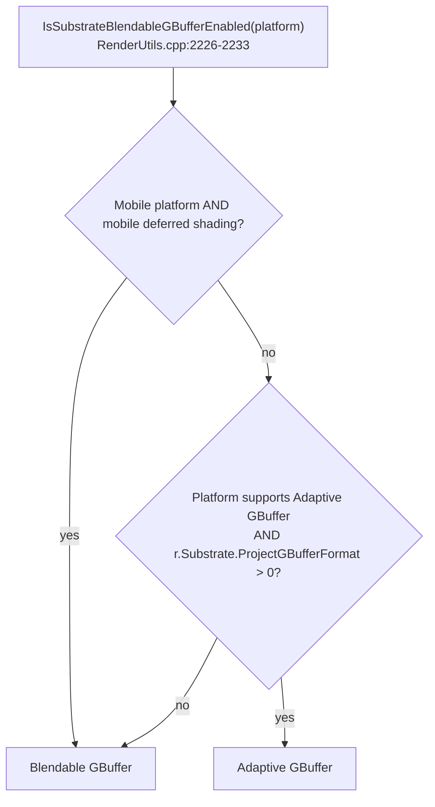

# 10 — GBuffer: Blendable vs Adaptive

Two storage formats, selected by `ESubstrateStorageFormat` (`Runtime/Engine/Classes/Engine/EngineTypes.h:780-791`): `BlendableGBuffer` (0) and `AdaptiveBuffer` (1). The project setting maps to `r.Substrate.ProjectGBufferFormat` (default 1 = Adaptive, `RenderUtils.cpp:2084-2090`).

| | Blendable GBuffer | Adaptive GBuffer |
|---|---|---|
| Storage | Fixed footprint, one closure per pixel | Bitstream buffer, multiple closures per pixel |
| Byte budget | 20 bytes/pixel, hard max (`RenderUtils.cpp:2256`) | 20–256 bytes/pixel, clamped (`2254-2262`) |
| Closures | Forced to 1 (`RenderUtils.cpp:2088`) | Up to `r.Substrate.ProjectClosuresPerPixel` 4 (`2104-2108`) |
| Decals | DBuffer no longer required (`2088`) | DBuffer path available (`r.Substrate.DBufferPass` 0, `2134-2138`) |
| Stochastic lighting | Not available (`2235-2238`) | Available |
| Cost | Lower | Higher |
| Platform support | Always | Only platforms where `FDataDrivenShaderPlatformInfo::GetSupportsAdaptiveGBuffer` is true (`2228`) |

## Selection logic

Mobile deferred shading is always blendable (`2232`). A non-mobile platform that does not support Adaptive falls back to blendable regardless of the project setting (`2089` states this explicitly).

## Closure count resolution

`r.Substrate.ProjectClosuresPerPixelOverride` 0 means "use the minimum of the platform's closure count and the project's" (`RenderUtils.cpp:2118`); setting it to force mode applies the project count on Adaptive-capable platforms. `r.Substrate.MaterialQualityLevelsClosuresPerPixel` (`2110-2114`) overrides per material quality level. Materials above the limit are simplified until they fit (`2107`) — the simplification target is the `SUBSTRATE_FULLY_SIMPLIFIED_NUM_UINTS (32/4)` footprint (`Engine/Shaders/Shared/SubstrateDefinitions.h:31`).

## GBuffer target mapping

When Substrate is active, the named GBuffer targets are replaced by a UAV path: `TargetGBufferA/B/C = -1`, `Info.NumTargets = 1`, plus the velocity target (`Runtime/RenderCore/Private/GBufferInfo.cpp:265-276`). A debug view or a custom pass that assumes named GBuffer targets must handle the Substrate case separately.

## What a tech artist should check

1. Platform support for Adaptive (`DataDrivenShaderPlatformInfo`, see [../RHI/](../RHI/)) — a project setting of 1 does not guarantee Adaptive.
2. Byte budget vs the material's actual tile count: exceeding the budget forces simplification, which changes appearance.
3. Whether a decal-heavy scene depends on DBuffer, which is unnecessary in the blendable format.
4. That `r.Substrate.*` is `ECVF_ReadOnly` — every change is a recompile, not a runtime toggle.
