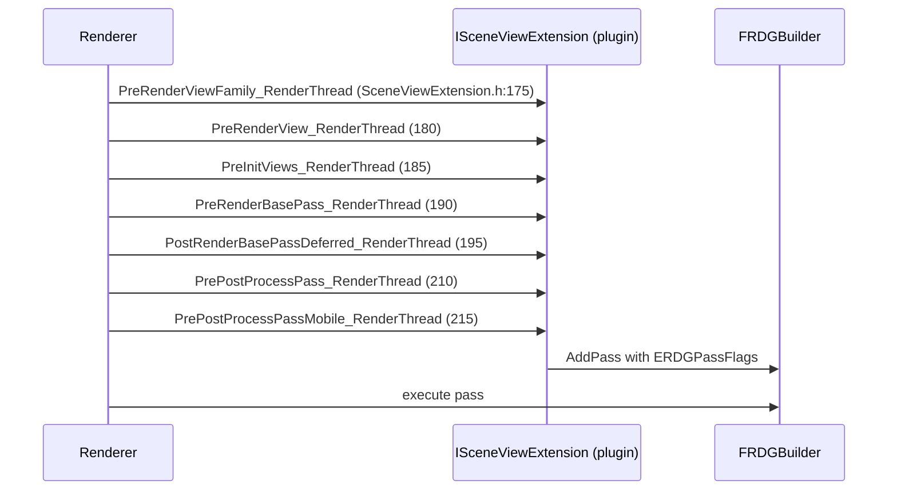

# 11 — SceneExtensions and Custom Render Passes

## Naming reality

In 5.8 the scene extension interfaces are `ISceneExtension`, `ISceneExtensionUpdater`, `ISceneExtensionRenderer` (`Runtime/Renderer/Private/SceneExtensions.h`). `FSceneExtension`, `FSceneExtensionDescriptor` and `FSceneExtensions::AddExtension` do **not** exist.

`SceneExtensions.h` is **Renderer Private** — a plugin cannot implement `ISceneExtension` directly. The plugin-accessible path is `ISceneViewExtension` (`Runtime/Engine/Public/SceneViewExtension.h:117`) or a custom render pass (`Runtime/Engine/Public/Rendering/CustomRenderPass.h`).

## The three interfaces

| Interface | File | Line | Hooks |
|---|---|---|---|
| `ISceneExtension` | `Renderer/Private/SceneExtensions.h` | 23-41 | `ShouldCreateExtension` (27), `InitExtension` (35, called after all extensions are created), `CreateUpdater` (36), `CreateRenderer` (37) |
| `ISceneExtensionUpdater` | same | 45-65 | `Begin` (49), `End` (50), `PostLightsUpdate` (55) |
| `ISceneExtensionRenderer` | same | 70-111 | `Begin` (74), `End` (75), `PreVisibilityTasks`, `PreInitViews` (88), `UpdateViewData` (94), `UpdateSceneUniformBuffer` (97), `PreRender` (102), `PostRender` (107) |
| `FSceneExtensionRegistry` | same | 132-140 | `Get()`, `Register(ISceneExtensionFactory&)` |
| `DECLARE_SCENE_EXTENSION` | same | 403-407 | — |
| `DECLARE_SCENE_EXTENSION_UPDATER` | same | 409-412 | — |

Registration is `FSceneExtensionRegistry::Get().Register(Factory)` (`132-140`) with `DECLARE_SCENE_EXTENSION` (`403-407`). Engine-side consumers (skin cache, Substrate, Nanite, Virtual Shadow Maps) are scene extensions inside the Renderer module.

## Plugin-accessible hooks

`FSceneViewExtensions::NewExtension<T>()` (`SceneViewExtension.h:328-334`) is the registration call; `SubscribeToPostProcessingPass` (`222`) is the post-process hook (see [12](12_Post_Process_Shaders_and_Control.md)).

## Custom render pass

`FCustomRenderPassBase : ICustomRenderPass` (`Runtime/Engine/Public/Rendering/CustomRenderPass.h:49`) with `OnBeginPass`, `OnPreRender`, `OnPostRender`, `OnEndPass` (`143-146`). The renderer receives it through `FCustomRenderPassRendererInput::CustomRenderPass` (`Runtime/Engine/Public/SceneInterface.h:809`) and `AddCustomRenderPass` (`812-813`). This is the game-thread-facing path: a plugin or a game module can add a pass without touching the Renderer module.

## Pass flags

`ERDGPassFlags` (`RenderCore/Public/RenderGraphDefinitions.h:129-160`): `None`, `Raster`, `Compute`, `AsyncCompute`, `Copy`, `NeverCull`, `SkipRenderPass`, `NeverMerge`, `NeverParallel`, `Readback` (= `Copy | NeverCull`). `GraphBuilder.AddPass` overloads are at `RenderGraphBuilder.h:221`, `225`, `233` (documented `210-218`); external resources enter through `RegisterExternalTexture` (`79-87`) and `CreateBuffer` (`110`).

There is no `AddAsyncComputePass`; async compute is `ERDGPassFlags::AsyncCompute` passed to `AddPass`, gated by `r.RDG.AsyncCompute` (`RenderGraphPrivate.cpp:211-229`, default `RDG_ASYNC_COMPUTE_ENABLED` = 1, with a sink at `221-229`). See [../RDG/](../RDG/).

## Choosing between the three

| Need | Use | Why |
|---|---|---|
| Persistent per-scene state + per-frame update inside the Renderer | `ISceneExtension` + `DECLARE_SCENE_EXTENSION` | Engine-internal; requires Renderer access |
| Plugin that injects passes into an existing frame | `ISceneViewExtension` + `FSceneViewExtensions::NewExtension<T>()` | Public header, no Renderer dependency |
| A pass owned by game code / a plugin module | `FCustomRenderPassBase` + `AddCustomRenderPass` | Public `Engine` header, game-thread API |
| A single dispatch in an existing pass | `FRDGBuilder::AddPass` | No extension needed |
