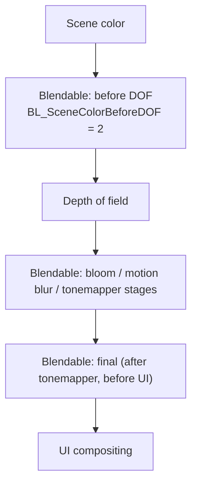

# 12 — Post Process Shaders and Control

## The shader side

`FPostProcessMaterialShader : FMaterialShader` (`Runtime/Renderer/Private/PostProcess/PostProcessMaterial.cpp:244-282`) uses `SHADER_USE_PARAMETER_STRUCT_WITH_LEGACY_BASE` (`248`) and has its own `ShouldCompilePermutation` (`250`). Registration is `IMPLEMENT_SHADER_TYPE` for the VS at `342` and the PS at `343`, entry points `MainVS` / `MainPS` in `/Engine/Private/PostProcessMaterialShaders.usf`; the vertex declaration is `FPostProcessMaterialVertexDeclaration` (`345-362`).

## Authoring surface

A Post Process Material is `MD_PostProcess` (`Runtime/Engine/Public/MaterialDomain.h:23`) plus a blendable location. `EBlendableLocation` (`Runtime/Engine/Classes/Engine/BlendableInterface.h:14-83`) — `BL_SceneColorBeforeDOF = 2` is documented at `16-23`. The interface is `IBlendableInterface::OverrideBlendableSettings(FSceneView&, float Weight)` (`95-101`). Settings reach the renderer through `FPostProcessSettings` + `WeightedBlendables` (`Runtime/Engine/Classes/Engine/Scene.h:2574-2575`) and `UPostProcessComponent` (`Runtime/Engine/Classes/Components/PostProcessComponent.h:23-53`).

Inputs available to a post process material are enumerated in `Runtime/Renderer/Public/PostProcess/PostProcessMaterialInputs.h:49-85`.

Insertion is driven by the blendable location chosen on the material asset; code insertion goes through `ISceneViewExtension::SubscribeToPostProcessingPass` (`Runtime/Engine/Public/SceneViewExtension.h:222`), called from `PostProcessing.cpp:830-851`. `FCustomPostProcessPass` does not exist — a custom pass is either a subscribed post-process pass or an RDG pass.

## Control surface

| CVar | Default | Line |
|---|---|---|
| `r.PostProcessAllowBlendModes` | 1 | `PostProcessMaterial.cpp:49-55` |
| `r.PostProcessing.DisableMaterials` | 0 | `PostProcessMaterial.cpp:57-61` |
| `r.PostProcessAllowStencilTest` | 1 | `PostProcessMaterial.cpp:41-45` |
| `r.PostProcessing.PreferCompute` | 0 | `PostProcessing.cpp:195-199` |
| `r.PostProcessing.PropagateAlpha` | false (bound to `GPostProcessingPropagateAlpha`) | `PostProcessing.cpp:189-193` |
| `r.BloomQuality` | 5 | `Runtime/Core/Private/HAL/ConsoleManager.cpp:4081-4085` |
| `r.FXAA.Quality` | 4 | `Renderer/Private/PostProcess/PostProcessAA.cpp:10-14` |
| `r.SSR.Quality` | 3 | `Renderer/Private/ScreenSpaceRayTracing.cpp:44-46` |
| `r.DefaultFeature.AutoExposure` | 1 | `Engine/Private/SceneView.cpp:182-186` |
| `r.DefaultFeature.AutoExposure.Method` | 0 (histogram, requires a compute shader) | `SceneView.cpp:189-193` |
| `r.DefaultFeature.AutoExposure.Bias` | 1.0 | `SceneView.cpp:196-199` |
| `r.DefaultFeature.AutoExposure.ExtendDefaultLuminanceRange` | 0 | `SceneView.cpp:201-205` |

`r.PostProcessAAQuality` and `r.LocalBloom` do not exist in 5.8.

## Tech artist vs code

| Action | Surface |
|---|---|
| Add a post effect | Post Process Material asset + blendable location + weight |
| Trigger it per camera/volume | `FPostProcessSettings`, `UPostProcessComponent` |
| Add a pass in code | `ISceneViewExtension::SubscribeToPostProcessingPass` or an RDG pass |
| Force compute implementation | `r.PostProcessing.PreferCompute` (only where an implementation exists) |
| Disable all post process materials | `r.PostProcessing.DisableMaterials` 1 |

## Frame order

Post-process stage order and the render pipeline context are in [../UnrealRenderPipeline/](../UnrealRenderPipeline/); the pass model and resource lifetime rules are in [../RDG/](../RDG/).
