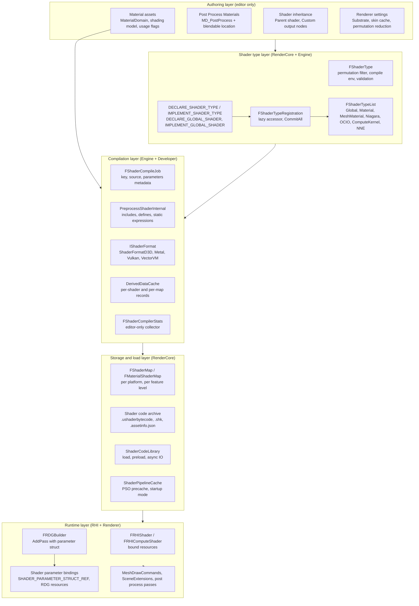
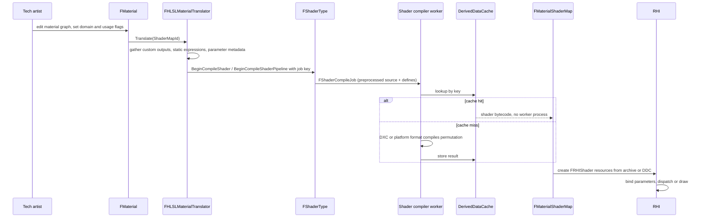
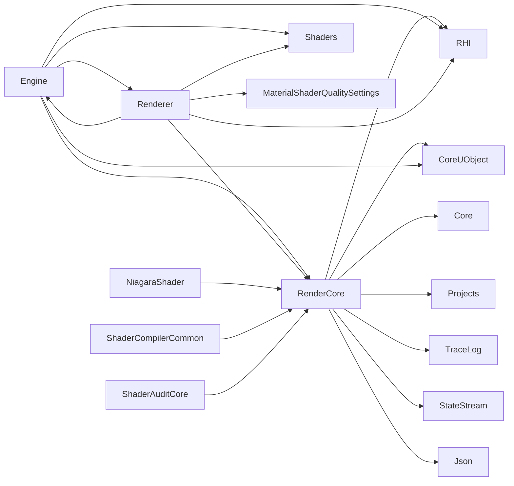

# Shaders — Architecture & Usage, UE 5.8

Documentation set for the UE 5.8 shader system: the type/registration model, the compilation and caching pipeline, material shader generation, how a plugin adds shaders without touching engine source, compute shaders for animation/simulation, profiling and debugging, Substrate (including what changes when it is off), Blendable vs Adaptive GBuffer, SceneExtensions for custom passes, and post-process shader control.

Citations are `file:line` against `G:/Epic/UE_5.8/Engine/Source/...` or `Engine/Shaders/...` unless another path is given. Every line number was read directly from source; scout-reported line numbers were treated as untrusted and re-verified. Claims not observed in source are marked `[INFERENCE]`. Graph facts come from `graphify-out/graph.json` (scan root `UE_5.8`, 2,688,593 nodes / 5,061,968 links, built at commit `bbf056d8568cdd48992ca50f5b36a2b6896930bd`).

Already-covered ground is cross-linked, not restated: the RHI abstraction in [../RHI/](../RHI/), Render Graph in [../RDG/](../RDG/), frame pipeline order in [../UnrealRenderPipeline/](../UnrealRenderPipeline/), Mass in [../MASS/](../MASS/), Niagara data flow in [../NDC/](../NDC/).

## Index

| File | Scope |
|---|---|
| [01_Overview_and_Architecture.md](01_Overview_and_Architecture.md) | What a shader is in UE (type, permutation, instance, map), the layers, where plugins hook |
| [02_Shader_Type_System_and_Families.md](02_Shader_Type_System_and_Families.md) | `FShader`, `FShaderType`, `SHADER_TYPE_LIST`, registration macros, virtual hooks |
| [03_Compilation_Pipeline_and_Caching.md](03_Compilation_Pipeline_and_Caching.md) | Jobs, DDC, key generation, shader maps, code archive, stable keys, bundles, PSO cache |
| [04_Material_Shader_Generation.md](04_Material_Shader_Generation.md) | Material domains, translator, custom outputs, usage flags, parameter structs, vertex factories |
| [05_Custom_Shaders_from_a_Plugin.md](05_Custom_Shaders_from_a_Plugin.md) | The plugin recipe: virtual shader dirs, module load phase, macros, worked example |
| [06_Compute_Shaders_for_Animation_and_Simulation.md](06_Compute_Shaders_for_Animation_and_Simulation.md) | `SF_Compute`, dispatch, indirect, Niagara, skin cache, deformer providers, VectorVM |
| [07_Profiling.md](07_Profiling.md) | GPU profiler reality, RDG scopes and stats, compile stats, counters, Insights |
| [08_Debugging_Shaders.md](08_Debugging_Shaders.md) | DumpGPU, debug info, warnings/errors, debug view modes, ShaderAudit |
| [09_Substrate.md](09_Substrate.md) | Substrate architecture, the on/off switch, what changes when off, extension reality |
| [10_GBuffer_Blendable_and_Adaptive.md](10_GBuffer_Blendable_and_Adaptive.md) | Blendable vs Adaptive GBuffer, byte budget, closure counts, platform gating |
| [11_SceneExtensions_and_Custom_Render_Passes.md](11_SceneExtensions_and_Custom_Render_Passes.md) | `ISceneExtension` trio, registry, view extensions, custom render passes |
| [12_Post_Process_Shaders_and_Control.md](12_Post_Process_Shaders_and_Control.md) | Post process material shaders, blendable locations, pass subscription, control surface |
| [13_File_Reference.md](13_File_Reference.md) | File inventory with responsibilities |
| [14_Testing.md](14_Testing.md) | Test coverage reality, verification surfaces, recipe for a plugin shader |

## Layered architecture

## Shader lifecycle (editor authoring to first draw)

## Module dependency graph (from `.Build.cs`)

`RenderCore.Build.cs:12` makes `RHI` and `CoreUObject` public and `Shaders`/`TargetPlatform` include-path-only (`:14`); `DerivedDataCache` is a real dependency only in editor builds (`:50-57`). `Renderer.Build.cs:15,17-22` keeps `Shaders` include-path-only and `RenderCore` private (`:42-53`). `Engine.Build.cs:18-31` exposes `Renderer`, `RHI` and `Shaders` as public include paths and `RenderCore` as a public dependency (`:79-97`). Plugin shader modules (`NiagaraShader`, `ShaderAuditCore`, `ShaderCompilerCommon`) reach `RenderCore` through the same public surface — that is the plugin extension path.

## Source roots

- Shader type and instance model: `Engine/Source/Runtime/RenderCore/Public/Shader.h`, `GlobalShader.h`, `ShaderParameterStruct.h`, `ShaderParameterMacros.h`, `ShaderSource.h`, `ShaderCore.h`; implementation `Private/Shader.cpp`, `Private/ShaderCore.cpp`, `Private/ShaderDiagnostics.cpp`
- Compiler and caching: `Engine/Source/Runtime/Engine/Public/ShaderCompiler.h`, `Private/ShaderCompiler/`, `Runtime/RenderCore/Private/ShaderLibrary/` (archive + library), `Developer/ShaderCompilerCommon/`, `Developer/ShaderPreprocessor/`, format implementations under `Developer/` resolved through `Developer/TargetPlatform/Public/Interfaces/IShaderFormat.h:22`
- Material generation: `Engine/Source/Runtime/Engine/Public/MaterialDomain.h`, `Public/MaterialShared.h`, `Public/MaterialShaderType.h`, `Public/Materials/MaterialExpressionCustomOutput.h`, `Private/Materials/` (`HLSLMaterialTranslator.cpp`, `MaterialShared.cpp`, `MaterialShader.cpp`)
- Vertex factories: `Runtime/RenderCore/Public/VertexFactory.h`, `Runtime/Engine/Private/LocalVertexFactory.cpp`
- Shader source: `Engine/Shaders/Private/` (502 entries), `Engine/Shaders/Shared/` (definition headers incl. `SubstrateDefinitions.h`)
- Compute and animation: `Runtime/RHI/Public/RHICommandList.h`, `Runtime/RenderCore/Public/RenderGraphUtils.h`, `Runtime/Engine/Private/GPUSkinCache.cpp`, `Runtime/RenderCore/Public/Animation/MeshDeformerProvider.h`, `Engine/Plugins/FX/Niagara/Source/Niagara/` + `NiagaraShader/`
- Profiling and debugging: `Runtime/RHI/Private/GPUProfiler.cpp`, `Runtime/RenderCore/Public/ProfilingDebugging/RealtimeGPUProfiler.h`, `Public/RenderGraphEvent.h`, `Public/DumpGPU.h`, `Private/GPUDebugCrashUtils.cpp`, `Private/VisualizeTexture.cpp`, `Engine/Plugins/Developer/ShaderToolkit/`
- Substrate and GBuffer: `Runtime/RenderCore/Private/RenderUtils.cpp`, `Private/GBufferInfo.cpp`, `Runtime/Engine/Public/Rendering/SubstrateMaterialShared.h`, `Engine/Shaders/Shared/SubstrateDefinitions.h`
- Scene extensions and passes: `Runtime/Renderer/Private/SceneExtensions.h`, `Runtime/Engine/Public/SceneViewExtension.h`, `Runtime/Engine/Public/Rendering/CustomRenderPass.h`, `Runtime/RenderCore/Public/RenderGraphDefinitions.h`
- Post process: `Runtime/Renderer/Private/PostProcess/`, `Runtime/Engine/Classes/Engine/BlendableInterface.h`, `Runtime/Renderer/Public/PostProcess/PostProcessMaterialInputs.h`

## Graph facts (from `graphify-out/graph.json`, scan root `UE_5.8`)

Corpus = graph nodes whose `source_file` matches `shader` (case-insensitive), `ThirdParty` excluded: **14,040 nodes**. Shader `.ush`/`.usf` files are not graphify nodes, so shader-source facts in these chapters come from direct reads only.

- Nodes per module: `Runtime` 7,485, `Developer` 2,383, `Plugin:Runtime` 829, `Plugin:Developer` 783, `Plugin:FX` 738, `Plugin:Experimental` 524, `Plugin:Interchange` 342, `Editor` 323, `Plugin:VirtualProduction` 183, `Plugin:Animation` 129, `Plugin:Compositing` 90, `Plugin:Media` 77, `Plugin:PCG` 57, `Plugin:NNE` 48, `Plugin:Tests` 37, `OtherSource` 12.
- Hub files by node count: `RenderCore/Public/Shader.h` 379, `Engine/Public/ShaderCompiler.h` 376, `RenderCore/Public/ShaderParameterMacros.h` 353, `Developer/ShaderCompilerCommon/Private/ISAParser/RDNA_Common.h` 241, `RenderCore/Public/ShaderCore.h` 207, `RHI/Public/DataDrivenShaderPlatformInfo.h` 189, `ShaderFormatVectorVM/Private/ir_vm_gen_bytecode_visitor.cpp` 188, `RenderCore/Private/ShaderCore.cpp` 185, `RenderCore/Public/ShaderMaterial.h` 175, `Engine/Private/Shader/ShaderValue.cpp` 174, `RenderCore/Private/ShaderLibrary/ShaderCodeLibrary.cpp` 170, `OpenGLDrv/Private/OpenGLShaders.cpp` 170, `NiagaraShader/Public/NiagaraShared.h` 156, `RenderCore/Public/ShaderCodeArchive.h` 149, `Engine/Private/Materials/MaterialShader.cpp` 137, `RenderCore/Public/ShaderCompilerCore.h` 134, `Engine/Private/ShaderCompiler/ShaderCompilerJobCache.cpp` 126, `Engine/Private/Shader/Preshader2.cpp` 116, `Engine/Public/Shader/ShaderTypes.h` 114, `ShaderCompilerCommon/Private/ShaderCompilerCommon.cpp` 114.
- Hub files by degree: `Shader.h` 809, `ShaderCore.cpp` 739, `ShaderCodeLibrary.cpp` 646, `ShaderCompiler.cpp` 626, `ShaderParameterMacros.h` 602, `MaterialShader.cpp` 574, `OpenGLShaders.cpp` 561, `ShaderValue.cpp` 540, `DataDrivenShaderPlatformInfo.h` 539, `ShaderCompiler.h` 504, `ir_vm_gen_bytecode_visitor.cpp` 467, `ShaderCompilerCommon.cpp` 457, `Preshader2.cpp` 456, `ShaderCodeArchive.cpp` 450, `ShaderCore.h` 429, `DisplayClusterMeshProjectionRenderer.cpp` 425, `ShaderCompilerJobCache.cpp` 407, `Shader.cpp` 382, `ShaderPipelineCache.cpp` 350, `MaterialXSurfaceShaderAbstract.cpp` 339.
- Relations inside the corpus: `references` 15,531, `contains` 6,348, `calls` 6,272, `defines` 5,123, `imports` 2,277, `method` 2,219, `inherits` 586, `rationale_for` 8, `implements` 2.
- Corpus edges by destination module: `Runtime` 16,689, unresolved 11,145, `Developer` 4,037, `Plugin:Runtime` 1,457, `Plugin:Developer` 1,119, `Plugin:FX` 898, `Plugin:Experimental` 611, `OtherSource` 550, `Plugin:Interchange` 542, `Editor` 511, `Plugin:Animation` 208, `Plugin:VirtualProduction` 208, `Plugin:Compositing` 130, `Plugin:Media` 89, `Plugin:PCG` 67.
- Plugin-side edges (shader nodes owned by plugins): `Plugin:Runtime` 2,249, `Plugin:Developer` 2,154, `Plugin:FX` 1,818, `Plugin:Experimental` 1,233, `Plugin:Interchange` 857, `Plugin:VirtualProduction` 512, `Plugin:Animation` 362, `Plugin:Compositing` 259, `Plugin:Media` 153, `Plugin:Tests` 132, `Plugin:PCG` 122, `Plugin:NNE` 94. Plugins are not a small consumer of the shader system — they contribute roughly a third of the corpus edges.
- Highest-degree symbols: `FShaderType::FShaderType()` (`Shader.cpp:224`) 18, then the plugin shader-type constructors `FOpenColorIOShaderType()` 15, `FNNERuntimeIREEShaderType()` 15, `FNiagaraShaderType()` 15, `FComputeKernelShaderType()` 15 — four of the top five hubs are plugin-owned shader types. Then `FMeshMaterialShaderType::BeginCompileShaderPipeline()` 14, `GetElementShaderBindings()` (`MeshMaterialShader.h:102`) 14, `FNiagaraShaderMap::CreateCompileJobs()` 13, `FMaterialShaderType::BeginCompileShader()` 12.
