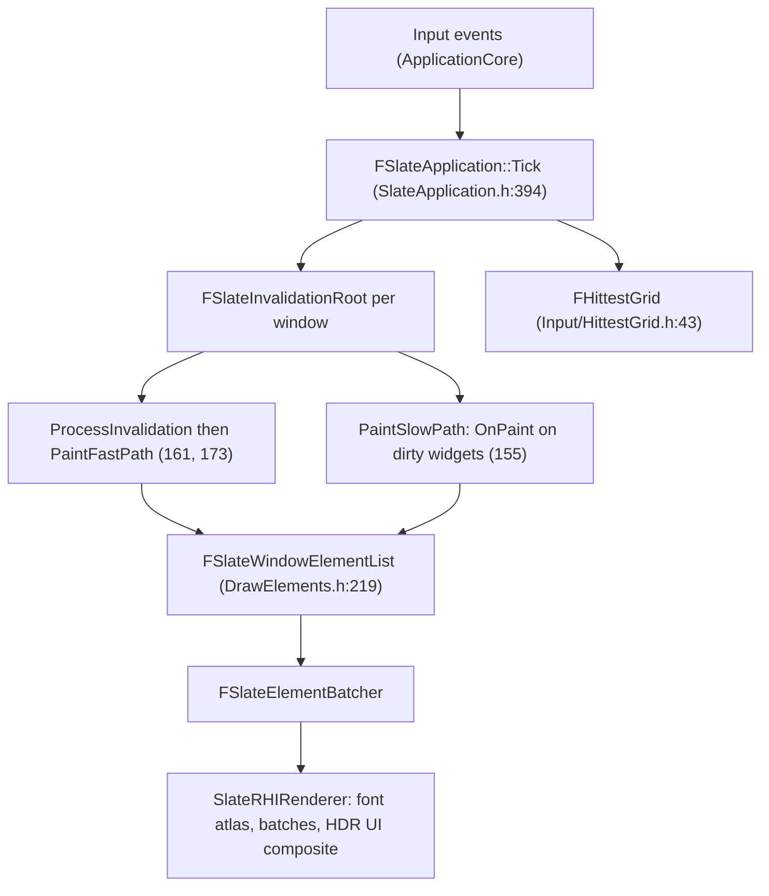

# 01 — Overview and Architecture

UE 5.8 UI is one retained-mode renderer with **two authoring surfaces** and **three consumers**: the game HUD, the editor, and standalone tool windows. Everything a plugin can hook into is either a Slate widget class, a style set, a ToolMenus entry, a tab spawner, a detail customization, or an asset definition.

## Layers

| Layer | Module | Responsibility | Anchor |
|---|---|---|---|
| Core widget model | `Runtime/SlateCore` | `SWidget` base, geometry, paint args, draw elements, styling, fonts, invalidation types | `Widgets/SWidget.h:163`, `Rendering/DrawElements.h:219` |
| Widget library + application | `Runtime/Slate` | Concrete `S*` widgets, `FSlateApplication`, hit test grid, docking/`FTabManager`, `FMenuBuilder`, text layout | `Framework/Application/SlateApplication.h:249`, `Framework/Docking/TabManager.h` |
| Renderer | `Runtime/SlateRHIRenderer` | Element batching, font atlas, RHI resources, HDR UI compositing | `Private/SlateRHIRenderer.cpp:82` |
| UObject wrapper | `Runtime/UMG` | `UWidget`/`UUserWidget`, `UWidgetBlueprintGeneratedClass`, animation, `WidgetComponent`, MVVM extension point | `Components/Widget.h:216`, `Blueprint/UserWidget.h:280` |
| Editor authoring | `Editor/UMGEditor`, `Editor/AssetDefinition` | Designer, widget palette, asset definitions | `Editor/AssetDefinition/Public/AssetDefinition.h:455` |
| Menu/tool bar content | `Developer/ToolMenus` | `UToolMenu`, `FToolMenuEntry`, sections, dynamic entries | `Public/ToolMenus.h:161`, `ToolMenuEntry.h:178` |
| Property UI | `Editor/PropertyEditor` | `SDetailsView`, `IDetailCustomization`, property type layouts | `Public/IDetailCustomization.h:11`, `PropertyEditorModule.h:284` |
| Data binding | `Plugins/Runtime/ModelViewViewModel` + `Runtime/FieldNotification` | Viewmodels, bindings, field change notification | `MVVMViewModelBase.h:42`, `FieldNotification/Public/INotifyFieldValueChanged.h:22` |

## The retained-mode contract

A widget is a long-lived object. It does not draw itself every frame unless it is marked volatile. The contract is:

1. `Construct` builds a child tree (`SLATE_BEGIN_ARGS` at `SlateCore/Public/Widgets/DeclarativeSyntaxSupport.h:63`).
2. Layout: `ComputeDesiredSize` (`SWidget.h:774`) is pure virtual — every widget must answer "how big do I want to be".
3. Paint: `OnPaint` (`SWidget.h:1771`) appends `FSlateDrawElement` records (`Rendering/DrawElementTypes.h:45`) into an `FSlateWindowElementList` (`DrawElements.h:219`).
4. Invalidation: state change marks a reason; the fast path replays cached draw elements, the slow path re-runs `OnPaint` (`FastUpdate/SlateInvalidationRoot.h:120`, `155`, `161`, `173`, `180`).
5. Batch + submit: the element batcher turns records into RHI batches; `SlateRHIRenderer` uploads them.

Consequence for design: **state that changes every frame forces the slow path**. Volatile widgets, active timers, and per-frame UMG `NativeTick` are the three ways projects accidentally pay for full repaints.

## Frame loop

## Three consumers, one renderer

| Consumer | Entry point | Notes |
|---|---|---|
| Game UI | `UGameViewportSubsystem` (`Blueprint/GameViewportSubsystem.h:52`), `UWidgetComponent`, `SGameLayerManager` | UMG widgets are wrapped as `SObjectWidget`; input routing depends on `EMouseCaptureMode` |
| Editor UI | `FLevelEditorModule` (`Editor/LevelEditor/Public/LevelEditor.h:70`), `FTabManager` spawners, ToolMenus, `ISettingsModule` (`Developer/Settings/Public/ISettingsModule.h:16`) | Editor-only modules; not available in a shipping game |
| Standalone tool | `FSlateApplication::InitializeAsStandaloneApplication` (`SlateApplication.h:297`), `AddWindow` (`1616`) | Cookless tool path; requires a Slate renderer (`InitializeRenderer`, `343`) |

## What is not here

- No immediate-mode UI. `ImGui` appears 0 times in `Engine/Source` and `Engine/Plugins` (direct grep). The closest surfaces are `SCanvas` (`Runtime/Slate/Public/Widgets/SCanvas.h`), `FCanvas`/`FDisplayDebugManager` (`Runtime/Engine/Classes/Engine/Canvas.h:53`), and the console. See [09](09_Debug_UI_and_Immediate_Mode.md).
- No Hydra UI framework in 5.8 (`Engine/Source/Runtime/HydraCore` does not exist; `usdHydra` is USD, unrelated).
- Rendering pipeline detail (RHI, RDG, shader compilation) is documented in [../RHI/](../RHI/), [../RDG/](../RDG/), [../Shaders/](../Shaders/), [../UnrealRenderPipeline/](../UnrealRenderPipeline/); this set does not restate it.

## Reading order

Programmer path: [02](02_Slate_Core_Architecture.md) → [10](10_Input_Focus_and_Event_Model.md) → [11](11_Painting_Layout_and_Performance.md) → [12](12_Slate_Rendering_and_Fonts.md).
Artist path: [04](04_UMG_Runtime_Model.md) → [03](03_Slate_Widget_Catalog_and_Theming.md) → [06](06_Artist_vs_Programmer_Boundary.md).
Tool author path: [07](07_Editor_UI_Extension.md) → [08](08_Custom_Tools_and_Widgets.md).
Debug and toggle UI: [09](09_Debug_UI_and_Immediate_Mode.md).
