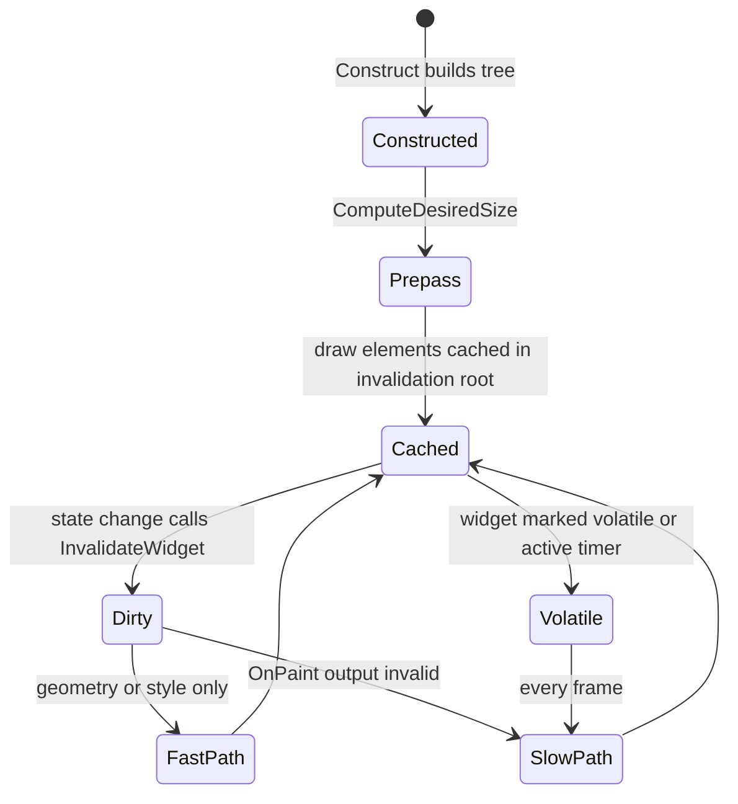

# 02 — Slate Core Architecture

Paths are relative to `Engine/Source/`. `SlateCore` owns the model; `Slate` owns implementations and the application.

## SWidget

`class SWidget` — `Runtime/SlateCore/Public/Widgets/SWidget.h:163`. The required and optional contract:

| Member | Line | Contract |
|---|---|---|
| `ComputeDesiredSize(float LayoutScaleMultiplier)` | `774` | **Pure virtual.** Must return intrinsic size; called during prepass |
| `OnPaint(...)` | `1771` | **Pure virtual.** Appends draw elements; called only when dirty or volatile |
| `Tick(const FGeometry&, double, float)` | `303` | Per-frame logic; only called for widgets that are ticked (volatile/active timer) |
| `OnKeyDown` / `OnKeyUp` | `357` | Key input while focused |
| `OnMouseButtonDown` | `388` | Bubbling pointer press; tunnel variant documented at `390-391` |
| `OnMouseEnter` / `OnMouseLeave` | `423` / `430` | Hover; `426` notes a custom bubble strategy |
| `OnMouseWheel` | `438` | Scroll |
| `OnMouseButtonDoubleClick` | `461` | Double click |
| `OnNavigation` | `641` | Gamepad/tab navigation reply |
| `SupportsKeyboardFocus` | `929` | Focus eligibility gate |
| `GetVisibility` / `SetVisibility` | `1065` / `1068` | `TAttribute<EVisibility>` — attribute, so it can be a delegate |
| `IsVolatile` / `IsVolatileIndirectly` | `1135` / `1141` | Volatility is inherited from ancestors |
| `ComputeFlowDirection` | `1356` | RTL layout; `EFlowDirectionPreference::Culture` resolves through `FLayoutLocalization` (`1361`) |
| `UpdateFlags` (`EWidgetUpdateFlags`) | `1970` | What this widget needs next frame |

`FActiveTimerHandle` is declared in `Private/Application/ActiveTimerHandle.h:11` — active timers are a private implementation detail of the application, not a public widget API.

## Declarative syntax

`SLATE_BEGIN_ARGS` at `Runtime/SlateCore/Public/Widgets/DeclarativeSyntaxSupport.h:63` generates `FArguments` with `SLATE_ARGUMENT` (value), `SLATE_EVENT` (delegate), `SLATE_SLOT_ARGUMENT` (slot), and `SLATE_OPTIONAL_ARGS` variants. `SCompoundWidget` (`Public/Widgets/SCompoundWidget.h:21`) is the base for any widget that composes children in `Construct` — the standard unit for a plugin's custom widget.

```cpp
class SMyPanel : public SCompoundWidget
{
    SLATE_BEGIN_ARGS(SMyPanel) {}
        SLATE_ARGUMENT(FText, Title)
        SLATE_EVENT(FOnClicked, OnClicked)
    SLATE_END_ARGS()
    void Construct(const FArguments& InArgs);            // build tree once
    int32 OnPaint(...) const override;                   // only when dirty
    FVector2D ComputeDesiredSize(float) const override;  // required
};
```

## Visibility semantics

`EVisibility` is a struct of static constants (`Public/Layout/Visibility.h:11`), not a plain enum — the values encode hit-test flags (`VISPRIVATE_Visible | VISPRIVATE_ChildrenHitTestVisible`, `103`):

| Value | Layout space | Paint | Hit test |
|---|---|---|---|
| `Visible` | yes | yes | self + children |
| `Hidden` | yes | no | no |
| `Collapsed` | no | no | no |
| `HitTestInvisible` | yes | yes | no, and blocks children |
| `SelfHitTestInvisible` | yes | yes | no for self, children still hit-test |

Layout containers default to `SelfHitTestInvisible` (`SBoxPanel.h:278`, `432`, `543`; `SOverlay.h:80`) so the container itself does not swallow clicks meant for its children.

## Paint and invalidation

`FSlateInvalidationRoot` (`Public/FastUpdate/SlateInvalidationRoot.h:76`) is per-window (or per `SInvalidationPanel`):

- `ProcessInvalidation()` (`161`) drains the dirty list.
- `PaintFastPath` (`173`) replays cached draw elements for widgets whose geometry/style changed but whose `OnPaint` output is cached.
- `PaintSlowPath` (`155`) re-runs `OnPaint` for widgets without cached element data.
- `InvalidateWidget(FWidgetProxy&, EInvalidateWidgetReason)` (`180`) is the entry point for any state change.
- `FSlateInvalidationWidgetList` (`Private/FastUpdate/SlateInvalidationWidgetList.h:19`) is the flat widget list the fast path walks.

Debug surface (`Private/FastUpdate/SlateInvalidationRoot.cpp`, `WITH_SLATE_DEBUGGING` only): `Slate.InvalidationRoot.DumpUpdateList` (`25`, default false), `DumpUpdateListOnce` (`33`), `DumpPreInvalidationList` (`45`), plus the deprecated `Slate.DumpUpdateList` command (`39-43`).

Practical rule: a widget that changes every frame must either be volatile (`SWidget.h:1135`) or invalidate itself; a volatile widget forces the slow path for its whole subtree under an invalidation panel.

## Application and event routing

`FSlateApplication` (`Runtime/Slate/Public/Framework/Application/SlateApplication.h:249`):

| API | Line | Role |
|---|---|---|
| `InitializeAsStandaloneApplication` | `297`, `299` | Cookless/tool path |
| `InitializeCoreStyle` | `301` | Style registration |
| `InitializeRenderer` | `343` | Attach `FSlateRenderer` (SlateRHIRenderer in practice) |
| `Tick` | `394` | Input, timers, invalidation |
| `DrawWindows` | `1250` | Draw all windows |
| `DrawPrepass` | `1260` | Layout-only pass |
| `DrawWindowAndChildren` | `1265` | Single-window draw |
| `GetInteractiveTopLevelWindows` | `1492` | Modal-aware window list |
| `AddWindow` / `AddWindowAsNativeChild` | `1616` / `446` | Window registration |
| `SetKeyboardFocus` | `724` (widget), `1681` (path) | Focus change; `1682-1684` per-user variants |
| `FindPathToWidget` | `1625` | Widget path construction for routing |

Routing is path-based: an event carries an `FWidgetPath` from the window root to the target; bubbling vs tunneling is decided by which virtual is called (`390-391`). Hit testing goes through `FHittestGrid` (`Public/Input/HittestGrid.h:43`); `FHittestGrid::FindFocusableWidget()` is the most-connected symbol in the corpus (`Private/Input/HittestGrid.cpp:366`, 12 edges).

## Draw element model

`FSlateWindowElementList` (`Public/Rendering/DrawElements.h:219`) collects `FSlateDrawElement` records (`Public/Rendering/DrawElementTypes.h:45`): box, line, polygon, text, font, IM, border, and rounded-box types. Memory stats for the CPU-side pools are declared in `Public/Rendering/DrawElementCoreTypes.h:28-29` (`STATGROUP_SlateMemory`).

The batcher (`Public/Rendering/ElementBatcher.h:245`) converts records into render batches; only the renderer module talks to RHI — see [12](12_Slate_Rendering_and_Fonts.md).

## Widget lifecycle


