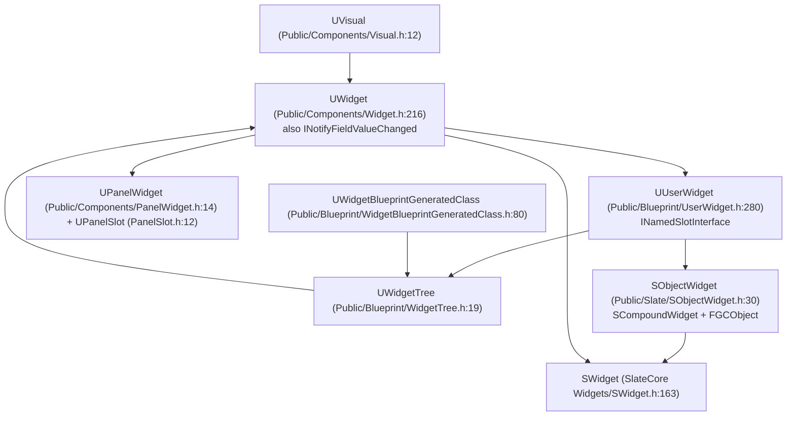

# 04 — UMG Runtime Model

UMG is a UObject wrapper layer over Slate. Every `UWidget` owns a Slate widget; the wrapper exists for reflection, Blueprint access, serialization, and editor tooling. Paths relative to `Engine/Source/Runtime/UMG/`.

## Object model

`UWidget` is `UCLASS(Abstract, BlueprintType, Blueprintable, CustomFieldNotify, MinimalAPI)` (`Widget.h:215`) and implements `INotifyFieldValueChanged` — that is what makes UMG widgets bindable targets for MVVM without any MVVM-specific code in UMG (`FieldNotification/Public/INotifyFieldValueChanged.h:22`).

## Lifecycle

| Stage | Anchor | Notes |
|---|---|---|
| `Initialize` | `UserWidget.h:297` | Builds the Slate tree; returns false if already initialized |
| `RebuildWidget` | `Widget.h:1148` | Per-widget Slate construction; `UButton` → `SNew(SButton)` at `Private/Components/Button.cpp:67` |
| `OnWidgetRebuilt` | `Widget.h:1151` | Post-construction hook |
| `SynchronizeProperties` | `Widget.h:938` | Pushes UObject property values into the Slate widget; called on every rebuild |
| `NativePreConstruct` / `NativeConstruct` | `UserWidget.h:1583` / `1584` | Blueprint `OnConstruct` runs through the native path |
| `NativeTick` | `UserWidget.h:1586` | Only runs when `TickFrequency` allows it (`117` `EWidgetTickFrequency`, `1725` property, `299` accessor) |
| `NativeDestruct` | `UserWidget.h:1585` | Teardown |
| `ReleaseSlateResources` | `UserWidget.h:322`, `Visual.h:17` | Drops the Slate pointer; must be called before the UObject is GC'd |
| `OnPaint` | `SObjectWidget::OnPaint` (`Private/Slate/SObjectWidget.cpp:132`) | Routed paint; calls the Blueprint event `OnPaint(FPaintContext&)` (`UserWidget.h:553`) from `Private/UserWidget.cpp:2388`. Individual `UWidget`s do not implement `OnPaint` — they delegate to their Slate widget. |

Two consequences:

1. **Rebuilding a widget destroys the Slate widget.** `RebuildWidget` re-creates the `SWidget`, so any state held in the Slate object (scroll position, text buffer) is lost. UMG state must live on the `UWidget`.
2. **Tick frequency is a performance contract.** `EWidgetTickFrequency::Never` (default for most widgets, `120`) means no per-frame `NativeTick`; `Auto` or `Manual` opts in. A widget that ticks every frame is also repainted through the slow path when it invalidates.

## Visibility mapping

UMG exposes `ESlateVisibility` (`Public/Components/SlateWrapperTypes.h:21`) through `UWidget::SetVisibility` (`Widget.h:590`, internal `593`), which maps onto `EVisibility` (`SlateCore/Public/Layout/Visibility.h:11`). `ESlateVisibility` includes `SelfHitTestInvisible` (`32`), so a UMG panel can be made click-through from the designer — the same behavior a C++ `SBoxPanel` has by default (`SBoxPanel.h:278`).

## Extensions

`UUserWidget::GetExtension(TSubclassOf<UUserWidgetExtension>)` (`UserWidget.h:1342`), templated version `1336-1338`, `GetExtensions` `1346`. Extensions are the plugin hook for adding per-widget data without subclassing — MVVM uses `UMVVMWidgetBlueprintExtension_View` (`Plugins/Runtime/ModelViewViewModel/Source/ModelViewViewModelBlueprint/Public/MVVMWidgetBlueprintExtension_View.h:53`). See [05](05_MVVM.md).

## Host surfaces

| Surface | Anchor | Behavior |
|---|---|---|
| Viewport UI | `Blueprint/GameViewportSubsystem.h:52` | Adds a `UUserWidget` to a player's viewport layer |
| 3D world UI | `Public/Components/WidgetComponent.h` (165 graph nodes) | Own `SObjectWidget`; hit testing comes from a `FHittestGrid` created by `FWidgetRenderer` (`Private/Slate/WidgetRenderer.cpp:121`), not by the component itself. Widget must be set before `BeginPlay`. |
| Interaction simulation | `Public/Components/WidgetInteractionComponent.h:56` | Synthetic pointer/key events into a widget |
| Layout helpers | `Public/Blueprint/WidgetLayoutLibrary.h:48` | Viewport slot add/remove, DPI scale, mouse position |
| Game viewport | `Runtime/Engine/Classes/Engine/GameViewportClient.h:71` | Slate window + `SGameLayerManager` layers |

There is no `UHUD` class in UE — `AHUD` (`Runtime/Engine/Classes/GameFramework/HUD.h:36`) is the only HUD type; it draws through `UCanvas`/`FCanvas`, not Slate.

## Animation

`UWidgetAnimation` (`Public/Animation/WidgetAnimation.h:25`) and `FWidgetAnimationBinding` (`Public/Animation/WidgetAnimationBinding.h:26`) describe per-widget tracks. Playback is driven by `UMGSequenceTickManager` (`Private/Animation/UMGSequenceTickManager.cpp`), capped by `Widget.MaxAnimationLatentActions` (default 100, `:22`). Post-buffer blur is limited by `umg.MaxPostBufferBlurStrength` (default -1 = unlimited, `Private/Components/PostBufferBlurUpdater.cpp:16`); window title bar buttons can be force-hidden with `WindowTitleBar.ForceWindowButtonsHidden` (default false, `Private/Components/WindowTitleBarArea.cpp:18`).

## Build dependencies

`UMG.Build.cs` — private deps `8-23`: `Core`, `TraceLog`, `CoreUObject`, `DeveloperSettings`, `Engine`, `InputCore`, `Slate`, `SlateCore`, `RenderCore`, `Renderer`, `RHI`, `ApplicationCore`, `SlateRHIRenderer`. Public deps `25-33`: `FieldNotification`, `HTTP`, `MovieScene`, `MovieSceneTracks`, `PropertyPath`, `TimeManagement`. `PropertyPath` + `FieldNotification` are what let MVVM bindings resolve field paths at runtime.
