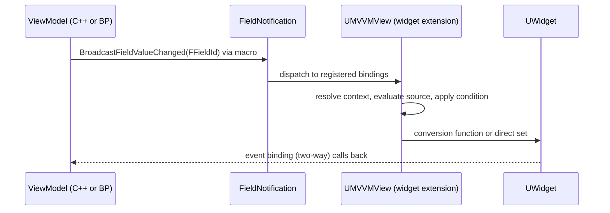

# 05 — MVVM (Model–View–ViewModel)

Plugin: `Engine/Plugins/Runtime/ModelViewViewModel` — **Runtime**, not Experimental. Modules (`ModelViewViewModel.uplugin:17-44`): `ModelViewViewModel` (Runtime), `ModelViewViewModelBlueprint` (UncookedOnly), `ModelViewViewModelEditor` (Editor), `ModelViewViewModelDebugger` (UncookedOnly), `ModelViewViewModelDebuggerEditor` (Editor). Depends on the `EnhancedInput` plugin (`46-50`).

## The three pieces

| Piece | Type | Anchor |
|---|---|---|
| ViewModel | `UMVVMViewModelBase : UObject, INotifyFieldValueChanged` | `Source/ModelViewViewModel/Public/MVVMViewModelBase.h:42` |
| Field notification | `UE::FieldNotification::FFieldId` | `Runtime/FieldNotification/Public/FieldNotificationId.h:15`; interface `INotifyFieldValueChanged.h:22` |
| View (runtime instance) | `UMVVMView : UUserWidgetExtension` | `Public/View/MVVMView.h:68`; per-widget source state `FMVVMView_Source` (`31`) |

The viewmodel's field identity is a generated class descriptor: `UMVVMViewModelBase::FFieldNotificationClassDescriptor : UE::FieldNotification::IClassDescriptor` (`MVVMViewModelBase.h:47`), enumerated by `ForEachField` (`49`). A field is observable **only if the code broadcasts it** — a plain member assignment does nothing.

## Macros

```cpp
// MVVMViewModelBase.h:16
#define UE_MVVM_BROADCAST_FIELD_VALUE_CHANGED(MemberName) \
    BroadcastFieldValueChanged(ThisClass::FFieldNotificationClassDescriptor::MemberName)

// :20 — set + notify only when the value actually changed
#define UE_MVVM_SET_PROPERTY_VALUE(MemberName, NewValue) \
    SetPropertyValue(MemberName, NewValue, ThisClass::FFieldNotificationClassDescriptor::MemberName)

// :24 — bitfield-safe variant, returns whether it changed
#define UE_MVVM_SET_PROPERTY_VALUE_INLINE(MemberName, NewValue) \
    [this, InNewValue = (NewValue)]() { if (MemberName == InNewValue) { return false; } \
        MemberName = InNewValue; BroadcastFieldValueChanged(...); return true; }()
```

`UWidget` also implements `INotifyFieldValueChanged` (`UMG/Public/Components/Widget.h:216`), so a binding target can be a widget property, not only a viewmodel field.

## Binding data model

Blueprint-side assets compile into per-generated-class data (`Public/View/MVVMViewClass.h`):

| Struct | Line | Role |
|---|---|---|
| `FMVVMViewClass_SourceBinding` | `30` | Binding record on the generated class |
| `FMVVMViewClass_SourceCondition` | `79` | Condition attached to a source |
| `FMVVMViewClass_Binding` | `114` | Runtime binding shape |
| `FMVVMViewClass_EvaluateSource` | `212` | Evaluate a source into a value |
| `FMVVMViewClass_Source` | `266` | Source (field path or function) |
| `FMVVMViewClass_Event` | `500` | Event binding (delegate → function) |
| `FMVVMViewClass_Condition` | `568` | Condition binding |

Authoring assets (`ModelViewViewModelBlueprint/Public/`): `UMVVMBlueprintView` (`MVVMBlueprintView.h:82`, `Within=MVVMWidgetBlueprintExtension_View`), `UMVVMBlueprintViewSettings` (`39`), `UMVVMBlueprintViewCondition` (`MVVMBlueprintViewCondition.h:27`), `UMVVMBlueprintViewEvent` (`MVVMBlueprintViewEvent.h:26`), `UMVVMBlueprintViewConversionFunction` (`MVVMBlueprintViewConversionFunction.h:27`), `UMVVMBlueprintViewModel` (`MVVMBlueprintViewModel.h:10`), `UMVVMViewModelBlueprint` (`ViewModel/MVVMViewModelBlueprint.h:20`). View extensions per widget family: `UMVVMBlueprintViewExtension` (`Extensions/MVVMBlueprintViewExtension.h:19`), `_ListViewBase` (`29`), `_PanelWidget` (`33`).

Context resolution: `FMVVMViewModelContext` (`Types/MVVMViewModelContext.h:16`), `FMVVMViewModelContextInstance` (`14`), `UMVVMViewModelContextResolver` (`20`), `UMVVMViewModelCollectionObject` (`Types/MVVMViewModelCollection.h:44`). A view resolves its viewmodels through a context — that is how the same view works for a player, an actor, or a global model.

## Runtime flow



Access rules observed in `Private/MVVMSubsystem.cpp`: the descriptor's fields are collected into a `TSet<FName> FieldDescriptors` (`182`, filled by `ForEachField` at `185-187`), then a binding is only offered when `FieldDescriptors.Contains(Function->GetFName())` is true (`205`, and `224` for the property-path branch); private/protected access depends on the accessor type (`195-196`). A field without `UE_MVVM_BROADCAST_FIELD_VALUE_CHANGED` never appears as a binding source.

## Subsystems

- `UMVVMSubsystem : UEngineSubsystem` (`Public/MVVMSubsystem.h:28`), `Initialize`/`Deinitialize` (`34-35`); Blueprint helpers e.g. `K2_CompareFloatValues` (`38`).
- `UMVVMGameSubsystem : UGameInstanceSubsystem` (`Public/MVVMGameSubsystem.h:16`), `Initialize`/`Deinitialize` (`22-23`).

## Editor surface

ToolMenus registration, not tab spawners: `UE::MVVM::SMVVMViewModelPanel::RegisterMenu()` and `UE::MVVM::SBindingsPanel::RegisterSettingsMenu()` called from module startup (`ModelViewViewModelEditor/Private/ModelViewViewModelEditorModule.cpp:320-321`); the settings menu is built with `UToolMenus::Get()->RegisterMenu("MVVM.ViewBindings.Toolbar")` (`Widgets/SMVVMViewBindingPanel.cpp:632-635`). Detail customization for contexts: `Private/Customizations/MVVMBlueprintViewModelContextCustomization.cpp` (reads the CVar at `449`).

## Console variables (all `ECVF_ReadOnly`)

| CVar | Default | Anchor |
|---|---|---|
| `MVVM.SupportUseAsInterfaceSetting` | false | `ModelViewViewModelBlueprint/Private/MVVMBlueprintViewModelContext.cpp:65` |
| `MVVM.AllowViewClass` | true | `.../MVVMWidgetBlueprintExtension_View.cpp:33` |
| `MVVM.AutogeneratedFunctionsAreTransient` | false | same file `41` |
| `MVVM.AutogeneratedFunctionsAreForceEditorTransient` | true | `ModelViewViewModelEditor/Private/ModelViewViewModelEditorModule.cpp:280` |
| `MVVM.ViewBinding.FilterMode.Enable` | false | `ModelViewViewModelEditor/Private/Widgets/SMVVMViewBindingPanel.cpp:51` |

`ECVF_ReadOnly` means these must be set in config before the module loads; changing them at runtime does not retro-affect already compiled views.

## Practical rules

1. Every observable field must be broadcast through the macro; otherwise the binding list is empty (`MVVMSubsystem.cpp:205`).
2. Bindings execute on the game thread; there is no render-thread path.
3. `UseAsInterface` on a viewmodel is gated by `MVVM.SupportUseAsInterfaceSetting` (`65`, `449`) — off by default.
4. Autogenerated binding functions are cooked unless the transient flags are set (`41`, `280`).
5. MVVM is a plugin dependency: `ModelViewViewModel.Build.cs` public deps `13-18` (`Core`, `CoreUObject`, `Engine`, `FieldNotification`), private `20-35` (`SlateCore`, `Slate`, `UMG`, `UnrealEd`). A game module that only uses viewmodels still needs `FieldNotification` publicly.

Graph facts: the MVVM plugin contributes 4,063 nodes to the UI corpus; `FieldNotification` 313. See [README](README.md).
