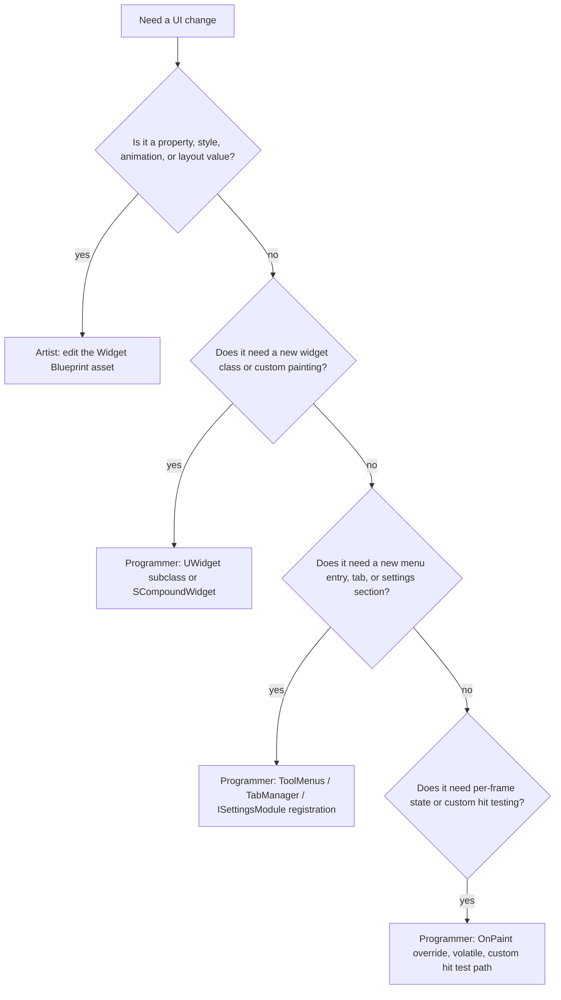

# 06 — Artist vs Programmer Boundary

The boundary is not "Blueprint vs C++" — it is **data vs code**. Anything that can be expressed as an asset property, a style entry, or a ToolMenus entry is artist-owned; anything that requires a new class, a delegate, or a registration call is programmer-owned.

## What each side owns

| Work | Owner | Mechanism | Anchor |
|---|---|---|---|
| Widget layout, slots, anchors | Artist | Designer view (`Private/Designer/SDesignerView.h:55`), Hierarchy (`Private/Hierarchy/SHierarchyView.h`) | `UWidgetTree` (`UMG/Public/Blueprint/WidgetTree.h:19`) |
| Widget properties, styles, colors, fonts | Artist | Details view (`Private/Details/SWidgetDetailsView.h:19`) on `UWidget` | `FSlateBrush` (`SlateCore/Public/Styling/SlateBrush.h:235`), `FSlateColor` (`SlateColor.h:41`), `FSlateFontInfo` (`Fonts/SlateFontInfo.h:146`) — all `BlueprintType` |
| Animations | Artist | Animation mode; keyable properties via `FUMGDetailKeyframeHandler` (`Private/Animation/UMGDetailKeyframeHandler.h:14`) | `UWidgetAnimation` (`UMG/Public/Animation/WidgetAnimation.h:25`) |
| Palette favorites and categories | Artist | `FWidgetTemplateBlueprintClass` from asset data (`Private/Palette/SPaletteViewModel.cpp:255`, `311`), category from `GetCategory()` (`375`), hidden categories from settings (`378-381`) | — |
| New widget **class** | Programmer | `UWidget` subclass implementing `RebuildWidget` | `Widget.h:1148`; palette entry built as `FWidgetTemplateClass` (`SPaletteViewModel.cpp:260`) |
| New style set | Programmer | `FSlateStyleRegistry::RegisterSlateStyle` (`Styling/SlateStyleRegistry.h:22`) | `ISlateStyle` (`ISlateStyle.h:17`) |
| Custom `OnPaint` behavior | Programmer | `SCompoundWidget` subclass (`SCompoundWidget.h:21`) | `SWidget.h:1771` |
| MVVM viewmodel | Both | `UMVVMViewModelBlueprint` asset (`ModelViewViewModelBlueprint/Public/ViewModel/MVVMViewModelBlueprint.h:20`) is artist-editable; C++ viewmodels need the broadcast macros (`MVVMViewModelBase.h:16-25`) | — |
| MVVM bindings | Artist | `UMVVMBlueprintView` (`MVVMBlueprintView.h:82`) inside the Widget Blueprint | — |
| Details panel layout for a class | Programmer | `IDetailCustomization` (`Editor/PropertyEditor/Public/IDetailCustomization.h:11`) + `RegisterCustomClassLayout` (`PropertyEditorModule.h:284`) | property type layouts `301` |
| Editor tabs / tool windows | Programmer | `FTabManager::RegisterTabSpawner` (`Runtime/Slate/Public/Framework/Docking/TabManager.h:1026`), `FWorkflowAllowedTabSet` (`Editor/UMGEditor/Public/BlueprintModes/WidgetBlueprintApplicationMode.h:43`) | — |
| Menus and tool bars | Programmer | `UToolMenus::RegisterMenu` (`Developer/ToolMenus/Public/ToolMenus.h:161`), `ExtendMenu` (`169`) | entry types `ToolMenuEntry.h:178-195` |
| Asset right-click behavior | Programmer | `UAssetDefinition` (`Editor/AssetDefinition/Public/AssetDefinition.h:454`); actions moved to ToolMenus (`365`, `404-407`) | — |
| Project settings sections | Programmer | `ISettingsModule::RegisterSettings` (`Developer/Settings/Public/ISettingsModule.h:49`, custom widget overload `64`) | — |

## Decision path

## Concrete asymmetries

- **Click-through containers.** C++ layout boxes default to `SelfHitTestInvisible` (`SBoxPanel.h:278`, `432`, `543`); UMG exposes the same value through `ESlateVisibility` (`Components/SlateWrapperTypes.h:32`), so an artist can make a panel click-through — but only for the widget itself, not for a container whose `OnPaint` swallows the hit test.
- **Per-frame updates.** An artist can turn on `TickFrequency` (`UserWidget.h:1725`, enum `117`), which forces per-frame `NativeTick` (`1586`) and slow-path repaints. The cost is invisible in the designer; the programmer owns the budget.
- **Style fallback.** A missing style entry warns and falls back to `WidgetStyleType::GetDefault()` (`ISlateStyle.h:58`); an artist can break a theme silently.
- **Rebuild resets state.** Any change that triggers `RebuildWidget` (`Widget.h:1148`) discards Slate-side state (scroll position, editable text buffer). `[INFERENCE]` Renaming or re-parenting in the designer can therefore reset runtime state; rename goes through `WidgetBlueprintEditorUtils.h:47`.
- **MVVM fields.** An artist can bind to a field only if C++ broadcasts it (`MVVMSubsystem.cpp:205`); the binding list looks empty from the editor when the macro is missing.

## Handoff conventions that hold up

1. Programmer ships a `UWidget` subclass with `BlueprintType` style properties; artist themes it. No artist touches `OnPaint`.
2. Style values live in a registered style set, not hardcoded in `OnPaint`, so themes remain artist-owned (`ISlateStyle.h:17`).
3. Data flows through a viewmodel; the view (Widget Blueprint) contains no logic beyond bindings (`MVVMBlueprintView.h:82`).
4. Editor tool windows are spawned through `RegisterTabSpawner` (`TabManager.h:1026`) so they participate in layout save/restore; hand-built `SWindow`s do not.
