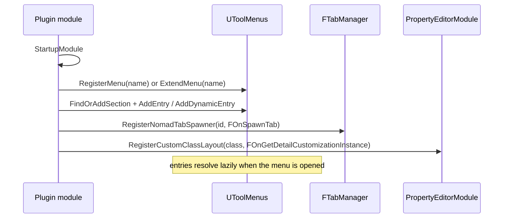

# 07 — Editor UI Extension

Extending the editor interface for an existing system means registering, not constructing: menus, tabs, detail panels, and settings sections are all registry-driven. Paths relative to `Engine/Source/`.

## Surfaces

| Surface | Entry point | Anchor |
|---|---|---|
| Menus / toolbars / status bars | `UToolMenus` (`Developer/ToolMenus/Public/ToolMenus.h:100`), `RegisterMenu` (`161`), `ExtendMenu` (`169`) | `ToolMenuOwner.h:16`, `ToolMenuSection.h:36`, `ToolMenuContext.h:34` |
| Dock tabs | `FTabManager::RegisterTabSpawner` (`Runtime/Slate/Public/Framework/Docking/TabManager.h:1026`), `RegisterNomadTabSpawner` (`1561`), `SpawnTab` (`1303`) | `FOnSpawnTab` (`177`), `FCanSpawnTab` (`178`), `FOnFindTabToReuse` (`183`) |
| Details panel | `PropertyEditorModule::RegisterCustomClassLayout` (`Editor/PropertyEditor/Public/PropertyEditorModule.h:284`), `RegisterCustomPropertyTypeLayout` (`301`) | `IDetailCustomization` (`Editor/PropertyEditor/Public/IDetailCustomization.h:11`) |
| Asset behavior | `UAssetDefinition` (`Editor/AssetDefinition/Public/AssetDefinition.h:454`) | actions replaced by ToolMenus (`365`, `404-407`) |
| Level editor menus/toolbars | `FLevelEditorModule` (`Editor/LevelEditor/Public/LevelEditor.h:70`), implements `IHasMenuExtensibility` + `IHasToolBarExtensibility` | `ILevelEditor` (`Editor/LevelEditor/Public/ILevelEditor.h:32`) |
| Project settings | `ISettingsModule` (`Developer/Settings/Public/ISettingsModule.h:16`), `RegisterSettings` object (`49`) and custom-widget (`64`) | `ISettingsViewer` (`10`) |
| Menu widget building (legacy) | `FMenuBuilder` (`Runtime/Slate/Public/Framework/MultiBox/MultiBoxBuilder.h:309`), `FToolBarBuilder` | `FToolBarBuilder::AddComboButton` is the most-called function in the corpus (12 call sites) |
| Console commands | `IConsoleCommandExecutor` (`Runtime/Core/Public/HAL/IConsoleManager.h:894`), `FConsoleCommandExecutor` (`Editor/UnrealEd/Public/Toolkits/FConsoleCommandExecutor.h:13`) | `IConsoleManager` struct (`970`) |

## Tool menu entry kinds

`FToolMenuEntry` init methods (`Developer/ToolMenus/Public/ToolMenuEntry.h`): `InitMenuEntry` overloads (`178-182`), `InitDynamicEntry` (`183`), `InitSubMenu` (`185-187`), `InitToolBarButton` (`189-190`), `InitComboButton` (`191`), `InitSeparator` (`193`), `InitWidget` (`195`); predicates `IsSubMenu` (`197`), `IsConstructLegacy` (`199`). Dynamic entries resolve through `FNewToolMenuSectionDelegate` at menu-open time, which is what lets a menu depend on the current selection (`ToolMenuContext.h:34`).

`RegisterMenu` takes an `EMultiBoxType` (default `Menu`, `161`) — the same registry drives menus, toolbars, and status bars, so a "menu" name is really a UI region name.

## Startup sequence

`ExtendMenu` is safe before the menu exists (`ToolMenus.h:164-166`), so plugin load order does not matter; ownership is tracked through `ToolMenuOwner` (`ToolMenuOwner.h:16`) for cleanup on module shutdown.

## Worked example: `UMGWidgetPreview` plugin

`Engine/Plugins/Editor/UMGWidgetPreview/Source/UMGWidgetPreview/`:

- `Private/UMGWidgetPreviewModule.cpp:37` `StartupModule`, `39` `FWidgetPreviewCommands::Register()`
- `95` `ExtendMenu("ContentBrowser.AssetContextMenu.WidgetBlueprint")`
- `96` `FindOrAddSection("GetAssetActions")`
- `97` `AddDynamicEntry("OpenWidgetPreviewEditor", FNewToolMenuSectionDelegate...)`
- Custom widget: `Private/Widgets/SWidgetPreview.h:23` `class SWidgetPreview : public SCompoundWidget`, `SLATE_BEGIN_ARGS` (`29`), `Construct` (`32`), `OnPaint` (`36`)
- Supporting files: `WidgetPreviewToolkit.cpp`, `WidgetPreviewFactory.cpp`, `WidgetPreviewStyle.cpp`, `AssetDefinition_WidgetPreview.cpp`, `SWidgetPreviewDetails.cpp`, `SWidgetPreviewStatus.cpp`, `SWidgetPreviewViewport.cpp`, `Customizations/WidgetPreviewCustomization.cpp`, `Public/IUMGWidgetPreviewModule.h`, `Public/IWidgetPreviewToolkit.h`

That is the complete shape of an editor tool: module + commands + menu extension + toolkit (tab spawner) + custom widgets + style set + asset definition + detail customization.

## Rules that prevent breakage

1. Register menus in `StartupModule`, not lazily inside a widget — `RegisterMenu` warns if a name is already registered (`161`, `bWarnIfAlreadyRegistered`).
2. Unregister on shutdown: `UnRegisterSlateStyle` (`SlateStyleRegistry.h:29`/`36`), `UnregisterNomadTabSpawner` (`TabManager.h:1563`), `UnregisterSettings`.
3. Detail customizations must be stateless per instance; the property grid recreates them (`PropertyEditorModule.h:284` returns an instance per call).
4. `UAssetDefinition` no longer provides `GetActions` (`AssetDefinition.h:365`, `404-407`) — put actions in a self-registering ToolMenus callback at the bottom of the asset definition's `.cpp`.
5. Tab spawners participate in layout persistence (`FOnPersistLayout`, `TabManager.h:448`); a hand-built `SWindow` does not.

Graph facts: `Developer/ToolMenus` 811 nodes, `Editor/PropertyEditor` 5,941, `Editor/AssetDefinition` 216; `PropertyHandleImpl.h` is the second-most-connected file in the corpus (303 nodes, degree 941). See [README](README.md).
