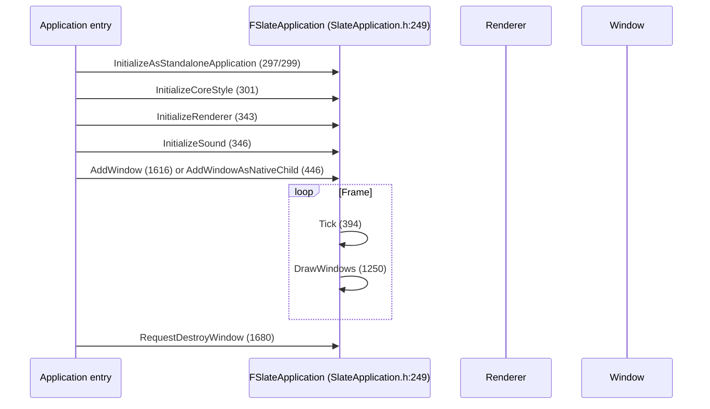

# 08 — Custom Tools and Widgets

Two distinct paths. A **tool window** is a dock tab owned by `FTabManager` and lives inside the editor layout. A **standalone widget app** is its own process-level Slate application. They share widget code but differ in who owns the window, the renderer, and the input routing.

## Compound widget recipe

```cpp
// SlateCore/Public/Widgets/SCompoundWidget.h:21
class SCompoundWidget : public SWidget { SLATE_DECLARE_WIDGET_API(SCompoundWidget, SWidget, SLATECORE_API) ... };

class SMyPanel : public SCompoundWidget
{
    SLATE_BEGIN_ARGS(SMyPanel) {}                       // DeclarativeSyntaxSupport.h:63
        SLATE_ARGUMENT(FText, Title)                    // :210
        SLATE_ARGUMENT_DEFAULT(bool, bCompact, false)   // :227
        SLATE_EVENT(FOnClicked, OnClicked)              // :460
        SLATE_DEFAULT_SLOT(FSlot::VBox, Content)        // :446
    SLATE_END_ARGS()

    void Construct(const FArguments& InArgs);           // build the child tree once
    int32 OnPaint(const FPaintArgs&, const FGeometry&, const FSlateRect&,
                  FSlateWindowElementList&, int32, const FWidgetStyle&, bool) const override; // SWidget.h:1771, pure virtual
};
```

`Construct` builds the tree; `OnPaint` is called per paint pass. Arguments are captured by value into `FArguments`, so a `TSharedRef` child slot is stored, not copied.

Key types: `FGeometry` (`SlateCore/Public/Layout/Geometry.h:39`, `BlueprintType`), `FReply` (`Input/Reply.h:23`, base `ReplyBase.h:14`), `FWidgetPath` (`Layout/WidgetPath.h:50`), `EVisibility` (`Layout/Visibility.h:11`).

## Tool window (editor layout)

| Piece | Anchor | Notes |
|---|---|---|
| `FTabManager` | `Runtime/Slate/Public/Framework/Docking/TabManager.h:438` | `RegisterTabSpawner` (`1026`), `RegisterNomadTabSpawner` (`1561`), `SpawnTab` (`1303`), `UnregisterNomadTabSpawner` (`1563`) |
| `FOnSpawnTab` | `177` | `DECLARE_DELEGATE_RetVal_OneParam(TSharedRef<SDockTab>, FOnSpawnTab, const FSpawnTabArgs&)` |
| `FCanSpawnTab` | `178` | Gate for whether a tab may open |
| `FOnFindTabToReuse` | `183` | Custom tab reuse; `FTabSpawnerEntry` fields at `245-250` (`MenuType`, `bAutoGenerateMenuEntry`) |
| `SDockTab` | `Widgets/Docking/SDockTab.h:67` | `public SBorder`; `ETabRole` (`27`); friends `FTabManager`, `STabSidebar` |
| Layout persistence | `TabManager.h:448` `FOnPersistLayout` | Only tab-spawned windows serialize |

A tool window is therefore: spawner → `SDockTab` → `SCompoundWidget` content. Style comes from a registered style set (`FSlateStyleRegistry::RegisterSlateStyle`, `Styling/SlateStyleRegistry.h:22`).

## Standalone application



Differences from the editor path: no `FTabManager`, no layout persistence, no `IHasMenuExtensibility`; input goes through `IInputProcessor` wrappers (`SlateApplication.h:2266-2269`); focus is set explicitly (`SetKeyboardFocus` `724`, `SetUserFocus` `1682-1684`).

## Widgets that change behavior, not just appearance

| Widget | Anchor | Why it matters |
|---|---|---|
| `SInvalidationPanel` | `Slate/Public/Widgets/SInvalidationPanel.h:28` | `SCompoundWidget` + `FSlateInvalidationRoot` (`SlateCore/Public/FastUpdate/SlateInvalidationRoot.h:76`) — subtree repaints only on invalidation |
| `SCanvas` | `Slate/Public/Widgets/SCanvas.h:21` | Retained `TPanelChildren<FSlot>` (`158`) with `TAttribute` position/size (`57-58`); `AddSlot` `126` / `RemoveSlot` `133` / `ClearChildren` `138` make per-frame redraw possible |
| `SViewport` | `Slate/Public/Widgets/SViewport.h:29` | `SCompoundWidget` + `ISlateViewport` render/I/O interface (`83`); custom hit test path (`142`), no grid of its own; invalidation-capable (`TWidgetTypeTraits` `24`) |
| `SToolTip` | `Slate/Public/Widgets/SToolTip.h:19` | `SCompoundWidget` + `IToolTip`; deferred variant `SDeferredToolTip.h:12` delegate |
| `SWindow` | `SlateCore/Public/Widgets/SWindow.h:240` | `SCompoundWidget` + `FSlateInvalidationRoot` — the root of every Slate window |
| `SPopup` / `SMenuOwner` | `Slate/Public/Widgets/Layout/SPopup.h`, `SMenuOwner.h` | Popup/menu ownership and dismissal |

## Rules

1. A widget that must repaint every frame needs `IsVolatile` (`SWidget.h:1135`, indirect `1141`); otherwise it is only repainted when invalidated (`InvalidateWidget` `180`).
2. `ComputeDesiredSize` is pure virtual (`774`) — a custom widget must define its own size or it collapses.
3. Keyboard focus requires `SupportsKeyboardFocus` (`929`); `FHittestGrid::FindFocusableWidget` (`SlateCore/Public/Input/HittestGrid.h:43` class) is what actually routes it.
4. Custom hit testing must respect `EVisibility` flags (`Visibility.h:103` encoding); `SelfHitTestInvisible` (`26`) is the container default.
5. Style lookups fall back to `WidgetStyleType::GetDefault()` (`ISlateStyle.h:58`); a custom widget that hardcodes colors is unthemeable.
