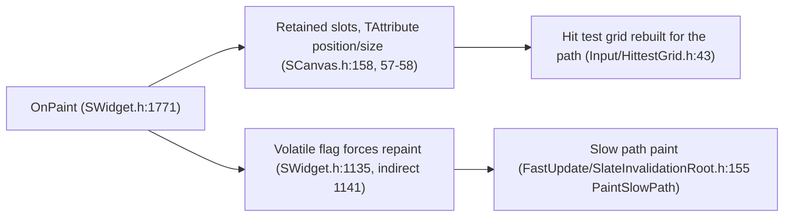

# 09 — Debug UI and Immediate Mode

**There is no ImGui in UE 5.8.** `grep ImGui|imgui` returns 0 matches in `Engine/Plugins` and 0 in `Engine/Source`. The Hydra UI framework is also absent (`Engine/Source/Runtime/HydraCore` does not exist; `usdHydra` hits are third-party USD). Slate is retained-mode: widgets persist, hit testing is a grid, and repaints are driven by invalidation. Nothing is genuinely immediate-mode; the closest pattern is a retained `SCanvas` whose slots are `TAttribute`-driven and repainted every frame when volatile.

## Actual debug surfaces

| Surface | Anchor | What it gives |
|---|---|---|
| Console | `Runtime/Core/Public/HAL/IConsoleManager.h:970` (`struct IConsoleManager`), `Get()` `1325` | Commands and variables; `IConsoleVariable` `577`, `IConsoleCommandExecutor` `894` |
| Auto-registration | `FAutoConsoleCommand` `2278` (no-`NO_CVARS` variant `2356`), `TAutoConsoleVariable` `1971`/`1991`, `FAutoConsoleVariableSink` `1460`/`1467` | Static-init registration, no module code |
| Console widget | `Runtime/Engine/Classes/Engine/Console.h:65` (`UConsole`) | In-game/editor console UI |
| Stats | `Runtime/Core/Public/Stats/Stats.h:209` `DECLARE_STATS_GROUP` (`212` SortByName, `215` Verbose, `218` MaybeCompiledOut) | `stat Slate`, `stat UMG`; no-op variants `486-496` under `UE_USE_LIGHTWEIGHT_STATS`, empty macros `673-676` |
| HUD debug text | `Runtime/Engine/Classes/GameFramework/HUD.h:36` (`AHUD`), `ShowDebug(FName)` `UFUNCTION(exec)` `121`, `ShowDebugToggleSubCategory` `127`, `ShowDebugForReticleTargetToggle` `131`, `PostRender` `500`, `DrawHUD` `503` | Per-category debug overlay |
| Debug text plumbing | `FDebugTextInfo` `USTRUCT` at `Runtime/Engine/Classes/GameFramework/DebugTextInfo.h:19`; `FOnShowDebugInfo` delegate `HUD.h:23`; `bShowDebugInfo` `54`; `ShowDebugInfo` `469`; `OnShowDebugInfo` `494`; `OnHUDPostRender` `497` | Category registration |
| Canvas drawing | `Runtime/Engine/Classes/Engine/Canvas.h:53` `struct FDisplayDebugManager`; members `DisplayDebugManager` `219`, `Canvas` `221`, `SceneView` `222`; `DrawString` `Private/UserInterface/Canvas.cpp:2327`, `GetTextScale` `2345`, `AddColumnIfNeeded` `2350` | Columnar debug text; column offset CVars `69-88` under `DisplayDebugManagerCvars` (`51-54`) |
| Exec interface | `Editor/UnrealEd/Public/DebugToolExec.h:15` `class FDebugToolExec : public FExec` | Console command routing for tools |
| Slate debug canvas | `Runtime/Engine/Private/Slate/SGameLayerManager.cpp:74-78` CVar `Slate.GameLayer.DebugCanvasVisible`, `ShowDebugCanvas` `815`, canvas visibility CVars `230-251` | Overlay canvas layer in the game viewport |
| Immediate-style widget | `Slate/Public/Widgets/SCanvas.h:21` (`SCanvas : SPanel`) | Retained `TPanelChildren<FSlot>` (`158`): `AddSlot` `126`, `RemoveSlot` `133`, `ClearChildren` `138`; slot `Position`/`Size` are `TAttribute` (`57-58`) resolved per paint |
| Navigation debugger | `Slate/Private/Framework/Navigation/SlateNavigationDebugger.cpp:16,22,28,34` — `Slate.NavigationDebugging.CandidateWidgets.*`, all false | Shows which widgets are navigation candidates |
| Paint/event hooks | `SlateCore/Public/Debugging/SlateDebugging.h:284` `class FSlateDebugging` | `BeginWindow` `288`, `EndWindow` `292`, `BeginWidgetPaint` `296`, `EndWidgetPaint` `300` |
| Render overlays | `SlateRHIRenderer/Private/SlateRHIRenderer.cpp`: `Slate.ShowOverdraw` `149`, `Slate.ShowBatching` `156`, `Slate.ShowWireFrame` `164` | Batch/overdraw/wireframe visualization |
| Invalidation dumps | `SlateCore/Private/FastUpdate/SlateInvalidationRoot.cpp`: `Slate.InvalidationRoot.DumpUpdateList` `25`, `DumpUpdateListOnce` `33`, deprecated `Slate.DumpUpdateList` `39-43`, `DumpPreInvalidationList` `45` | Update-list dumps for fast-path debugging |

## Immediate-mode pattern in a retained-mode system

Cost model: an immediate-style widget that repaints every frame opts out of the fast path (`SlateInvalidationRoot.h:76`, `PaintFastPath` `173`, `ProcessInvalidation` `161`), so its cost is per-frame element emission plus batching (`ElementBatcher.h:245`). ImGui-style UI in UE therefore means: `SCanvas` + `IsVolatile` true + `OnPaint` emitting `FSlateDrawElement` (`Rendering/DrawElementTypes.h:45`, `FSlateWindowElementList` `DrawElements.h:219`) — plus manual hit testing, because the grid only knows widgets that exist in the tree. The tree is still retained: "immediate mode" here means clearing and re-adding slots per frame (`ClearChildren` `138` + `AddSlot` `126`), not a treeless draw.

## Practical recipe

1. Register a `FAutoConsoleCommand` (`IConsoleManager.h:2278`) that toggles a static bool.
2. Draw through `AHUD::PostRender` (`HUD.h:500`) with `FDisplayDebugManager::DrawString` (`Canvas.cpp:2327`) — no Slate widget, no invalidation cost, no focus.
3. For interactive debug panels, build a `SCompoundWidget` inside a nomad tab (`TabManager.h:1561`) and gate it with `WITH_EDITOR` or `!UE_BUILD_SHIPPING`.
4. Use `FSlateDebugging::BeginWidgetPaint` (`296`) to observe paint order without changing behavior; it is a multicast delegate, so subscribers must remove themselves.
5. `FDebugDrawTracer` does not exist in 5.8; `FDebugToolExec` (`DebugToolExec.h:15`) is the exec interface.
